# IC Studio

A modern, cross-platform environment for full-custom integrated circuit design —
schematic capture, circuit simulation, layout and physical verification in one native,
GPU-accelerated app.

IC Studio is written in Rust and renders through `wgpu` (Metal, Vulkan, DX12), so it runs
on Windows, Linux and macOS. Unlike a standalone layout viewer, the schematic, the
simulator and the layout share one design database: layouts are generated from
schematics, checked against them (LVS) and their parasitics flow back into simulation.

**[User guide](https://geniuskey.github.io/ic-studio/)** · [Quick tour](https://geniuskey.github.io/ic-studio/quick-tour.html) · [Demo gallery and scripts](https://geniuskey.github.io/ic-studio/demos.html)

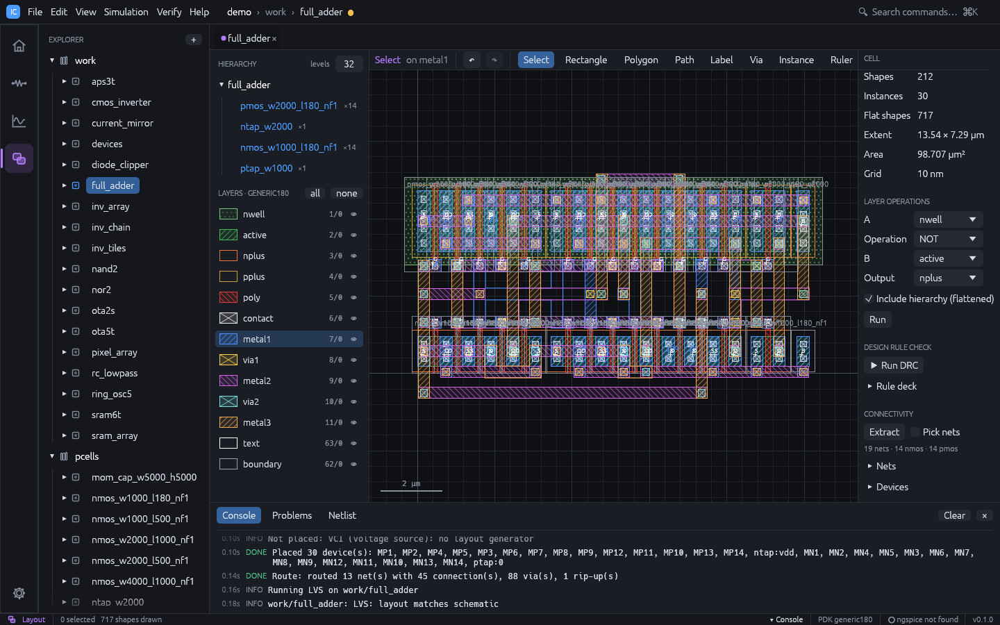

| Schematic with DC operating point back-annotation | Transient / DC sweep waveforms |
|---|---|
| 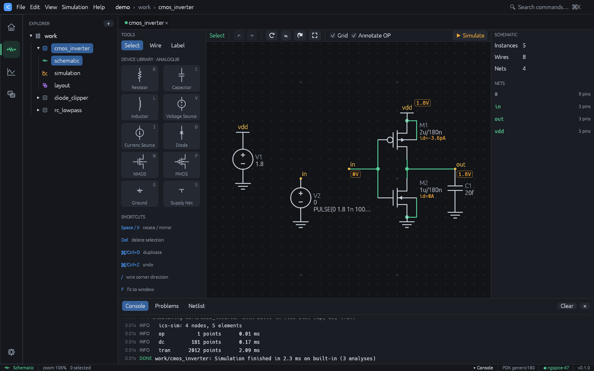 | 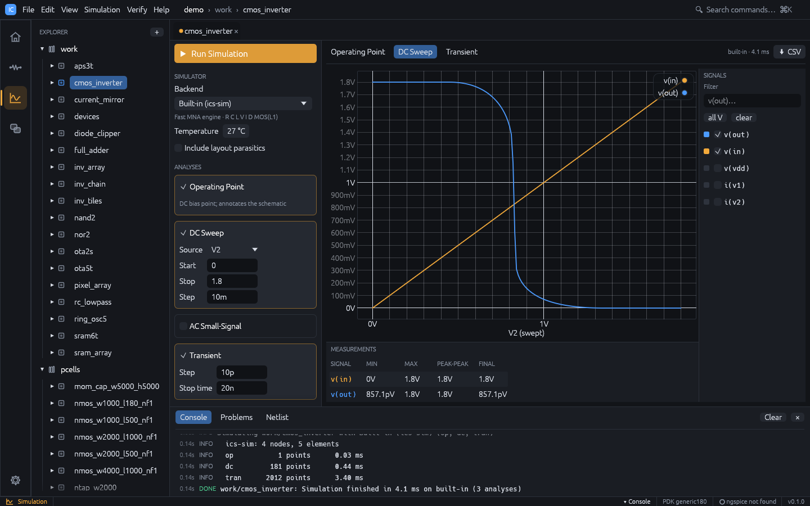 |
| **Hierarchical layout: 8192 inverters, level of detail** | **Parametric devices (PCells)** |
| 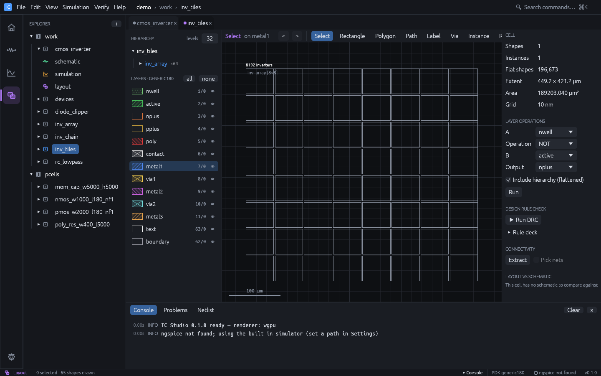 | 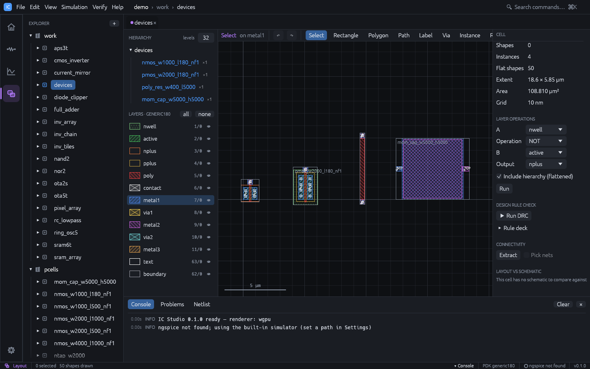 |
| **Common-centroid matched OTA, placed and routed automatically** | **8 × 8 SRAM array** |
| 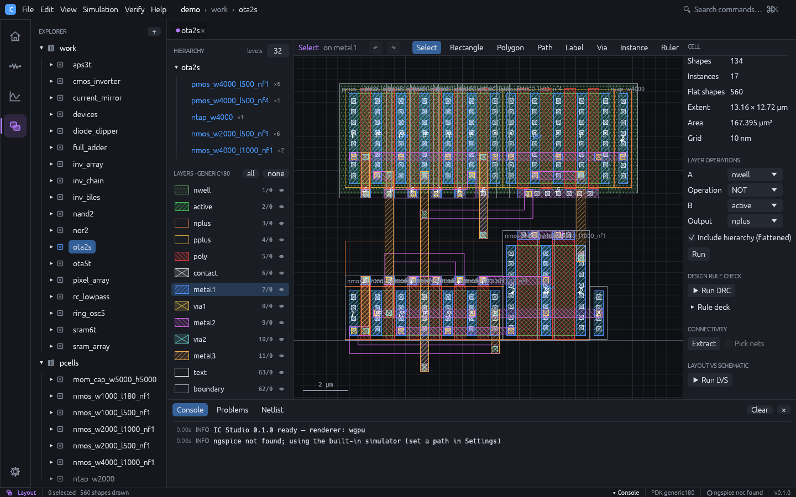 | 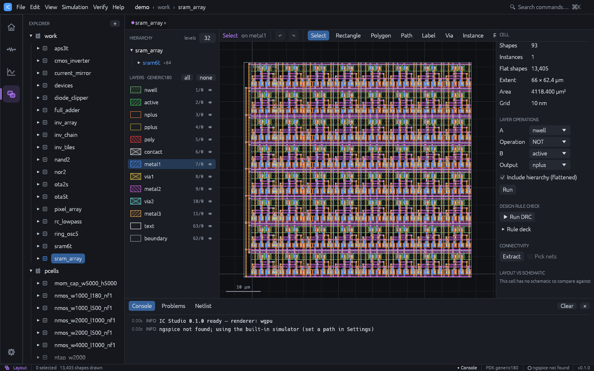 |
| **Layout generated from the schematic, with flylines** | **Rule-deck DRC on placed cells** |
| 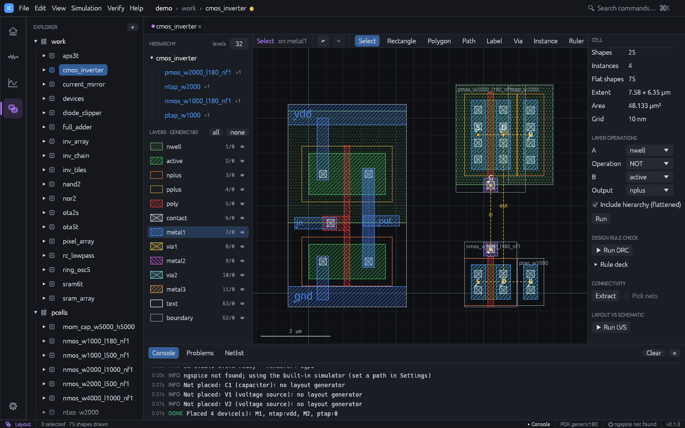 | 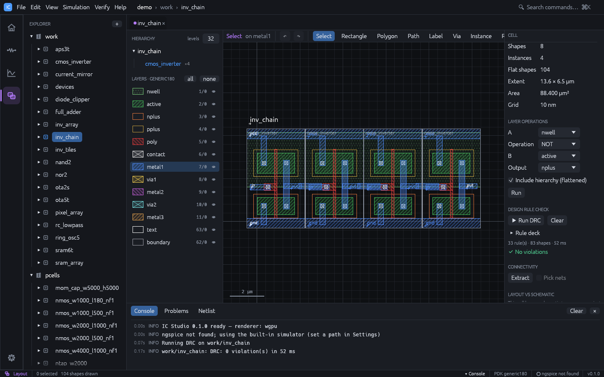 |
| **Monte Carlo with spec statistics, yield and histogram** | **Visual DRC rule designer with self-tested rules** |
| 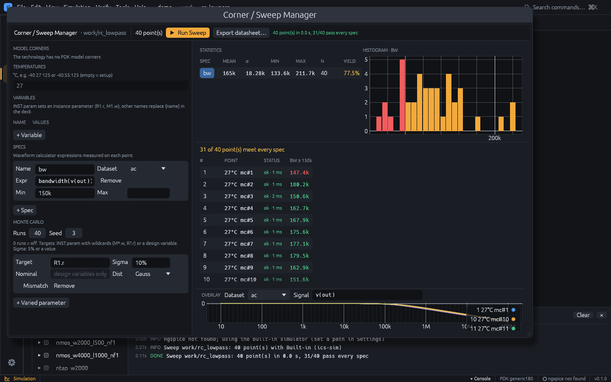 | 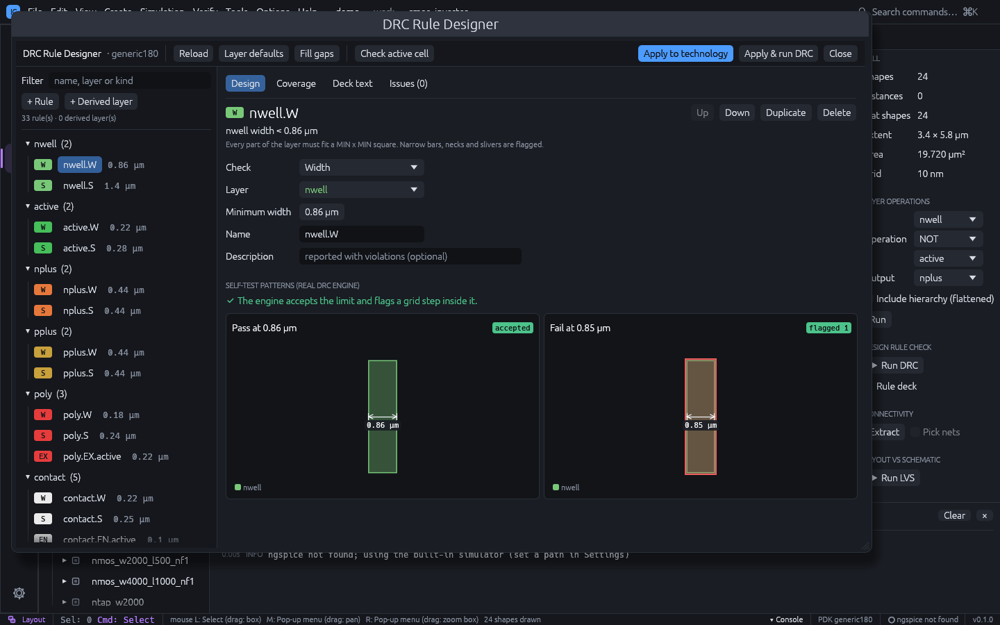 |

## Quick start

```sh
# Rust 1.95+ (https://rustup.rs)
cargo run --release                     # launch the desktop app
cargo run --release -- --demo           # ... with the bundled demo designs
cargo run --release -- --demo --cell inv_tiles --workspace layout
cargo run --release -- path/to/project  # ... opening a project folder
```

Optional: install [ngspice](https://ngspice.sourceforge.io/) (`brew install ngspice`,
`apt install ngspice`, or the Windows build) to use it as a simulation backend. Without
it, IC Studio uses its own built-in simulator.

Linux needs the usual windowing libraries:
`libxkbcommon-dev libwayland-dev libx11-dev libxcursor-dev libxrandr-dev libxi-dev`.

## Features

**Application**
- Project → library → cell → view model (schematic / simulation / layout), stored as
  human-readable JSON that works well with version control
- Workspaces for Home, Schematic, Simulation and Layout with shared cell tabs, project
  explorer, command palette (⌘K / Ctrl+K), console, problems and netlist panels, dark and
  light themes
- Every action is an `app::Command`: menus, shortcuts, the palette and automation share it
- Cadence Virtuoso conventions: default bindkeys and two-click commands in the layout
  editor, a Virtuoso or conventional mouse profile, and Cadence SKILL (`.il`) scripts with an
  interactive CIW prompt

**Schematic and simulation**
- analogLib-style primitives (R, C, L, V, I, diode, NMOS, PMOS, ground, supply), wiring,
  labels, live connectivity, property inspector, SPICE netlister
- Operating point, DC sweep, AC and transient analyses on the built-in Rust MNA engine or
  ngspice; waveform viewer with Bode plots and automatic measurements
- Optional post-layout simulation: wire capacitance to substrate, lateral and overlap
  coupling between nets, MOS drain / source junctions (`ad as pd ps`) and an RC network of
  wire, via and gate resistance extracted from the layout are added to the matching
  schematic nets and devices
- Schematic checker (Check and Save): missing ground, bad names, missing values, shorted
  devices, voltage-source loops, floating nets and dangling wires, live in the Problems tab

**Layout**
- Hierarchy: cell instances and arrays (GDS SREF / AREF) with 90° rotations and mirroring,
  hierarchy tree, drawn-level control, flatten and make-cell
- Scales to large designs: cached per-cell R-tree indices, view culling and level of
  detail (small cells collapse to boxes, tiny shapes to dots), bounded work per frame
- Editing: rectangles, Manhattan or any-angle polygons, paths, labels, rulers; vertex and
  edge handles that keep Manhattan outlines Manhattan; rotate / flip; µm-accurate inspector
- Manhattan Boolean engine: AND / OR / NOT / XOR, grow / shrink, merge, layer operations
- Via generator (single cut or area fill) and PCells: NMOS / PMOS (W, L, fingers),
  poly resistor, MOM capacitor and well / substrate taps, stored as ordinary cells of a
  `pcells` library
- GDSII and OASIS import and export with full hierarchy; unknown GDS layers are kept

**Design assistance**
- Live DRC: the rule deck re-runs around every edit on a worker thread (only the geometry
  within the deck's reach of the change is read), violations appear on the canvas as you draw
- Quick fixes (Ctrl+.): widen, grow, extend, move apart, shrink, fill a notch or add an
  enclosure, each candidate verified with DRC and ranked by the new violations it would cause;
  Fix All repairs the cell as one undoable edit (`ics drc --fix`, MCP `fix_drc`)
- Spacing magnet: drawn boxes, wire points and moved or pasted geometry snap to exactly the
  minimum spacing from (or abutting) same-layer neighbours, with the gap shown

**Verification**
- DRC with a text rule deck (`width`, `space`, `separation`, `enclosure`, `extension`,
  `area`, `antenna`, `density`) over technology layers and derived layers
  (`gate = poly and active`, `and` / `or` / `not` / `xor` / `size` / `wide` for wide-metal
  spacing) on the flattened hierarchy, Euclidean corner distances; results grouped by rule
  with zoom-to-marker
- Connectivity extraction with MOS recognition, top-level labels and net highlighting
- LVS against the schematic by iterative partition refinement, with parallel-device
  merging and W / L checks

**Schematic ↔ layout**
- Schematic-driven layout: place the schematic's transistors as named PCell instances in
  PMOS / NMOS rows, abutting devices that share a source / drain net (shared diffusion),
  with merged wells and implants and a bulk tap per row; differential pairs, current mirrors
  and devices sharing a `match` parameter are split into unit fingers in common-centroid
  order (ABBA, or two cross-coupled rows ABBA / BAAB for larger groups or `match_rows=2`),
  closed by off dummy fingers that LVS filters
- Flylines show schematic connections that are not yet routed; a maze router (A* on a
  terminal-aligned grid over metal1 and up) wires them DRC-clean around existing geometry,
  ripping up and rerouting nets that block each other
- Cross-probing: selecting a device in one view selects it in the other

**Tools** ([guide](https://geniuskey.github.io/ic-studio/tools.html))
- Waveform calculator: `bandwidth`, `ugf`, `phasemargin`, `risetime`, `cross`, `delay`,
  `rms`, `deriv`, ... on simulation results, with derived waveforms plotted
- Corner / sweep manager: model corners × temperatures × parameters and Monte Carlo
  (process and mismatch), run in parallel, specs with limits, statistics, yield,
  histograms, overlaid waveforms and an HTML datasheet
- Results browser: keep earlier runs and overlay them, e.g. pre- versus post-layout
- Layout generators: guard rings, via arrays, common-centroid / interdigitated matched
  placement with dummies; dummy metal fill to a density target
- Hierarchy and net browsers; a visual DRC rule designer that self-tests every rule; a
  stream layer map (Virtuoso layer map files) for GDSII / OASIS import and export

**Technology**
- `tech.json` with layers, GDS numbers, colours, fill patterns, width / spacing, vias,
  capacitance coefficients, sheet / via resistance and the DRC deck. A generic 180 nm-class demo technology is
  included.
- Import KLayout layer properties (`.lyp`, plus `.lyt` for the database unit) to use a
  real PDK's layer set, such as SKY130 or GF180
- PDK files (`pdks/sky130A.toml`, `pdks/ihp-sg13g2.toml`): layers, vias, device recognition,
  SPICE model library and corners in one TOML file; extraction, LVS, netlists and PCells
  follow the PDK
- Sign-off DRC / LVS with external tools: KLayout decks, Calibre SVRF rule files and
  netgen, with results as markers in the layout
- SVRF decks translated to the built-in DRC (layer maps, boolean / selection operations,
  INT / EXT / ENC / AREA / DENSITY checks), with notes for what is not translated

## Command line

```sh
ics new myproj --template demo
ics info myproj
ics netlist myproj cmos_inverter
ics sim myproj cmos_inverter --backend ngspice --json   # machine-readable results
ics sim myproj cmos_inverter --parasitics               # post-layout simulation
ics spice deck.cir                                      # simulate any SPICE deck
ics gds myproj inv_tiles -o tiles.gds                   # cell and everything it places
ics import-gds myproj chip.gds                           # new library, unknown layers kept
ics import-tech myproj sky130A.lyp --lyt sky130A.lyt
ics drc myproj cmos_inverter [--deck rules.drc]         # non-zero exit on violations
ics drc myproj cmos_inverter --fix                      # apply verified quick fixes, save
ics route myproj nand2 --place                          # place devices, route flylines, save
ics extract myproj inv_chain                            # extracted SPICE netlist
ics lvs myproj cmos_inverter                            # non-zero exit on differences
```

## Examples

`--demo` (or `ics new myproj --template demo`) opens a project with these cells in the
`work` library, all in the generic 180 nm technology:

| Cell | What it shows |
|---|---|
| `cmos_inverter` | Inverter with a hand-drawn layout; LVS reports its deliberate findings (PMOS W, load cap) |
| `rc_lowpass` | RC low-pass filter (fc ≈ 159 kHz): op, AC and transient |
| `diode_clipper` | Resistor and shunt diode clipper: transient and DC sweep |
| `nand2` | 2-input NAND: schematic plus routed PCell layout, DRC and LVS clean |
| `nor2` | 2-input NOR: schematic plus routed PCell layout, DRC and LVS clean |
| `ring_osc5` | 5-stage ring oscillator, fully routed (no flylines); about 8.8 GHz on the built-in simulator |
| `current_mirror` | NMOS current mirror with a 20 µA reference; DC sweep of the output voltage |
| `ota5t` | 5-transistor OTA (NMOS pair, PMOS mirror load); about 42 dB open-loop gain in AC |
| `sram6t` | 6T SRAM bit cell: routed PCell layout on an abutting pitch, DRC and LVS clean; transient write and hold |
| `sram_array` | 8 × 8 array (AREF) of `sram6t` with labelled word lines, bit lines and supply straps |
| `aps3t` | 3T image sensor pixel (reset, source follower, row select) over an n+ / p-sub photodiode, DRC and LVS clean; transient reset and integration |
| `pixel_array` | 8 × 8 pixel array (AREF) of `aps3t` with labelled reset / select rows and column lines |
| `full_adder` | 28T mirror full adder, placed and routed automatically from its netlist (no hand-drawn layout), DRC and LVS clean; transient over all eight input combinations |
| `ota2s` | Two-stage OTA, auto P&R: common-centroid input pair and mirror with dummies, every net maze-routed, DRC and LVS clean; about 80 dB open-loop gain in AC |
| `inv_chain` | Four placed `cmos_inverter` instances |
| `inv_array` | 16 × 8 array (AREF) of inverters |
| `inv_tiles` | 8 × 8 array of `inv_array`: 8192 inverters, two levels of hierarchy |
| `devices` | One instance of every PCell (NMOS, PMOS, poly resistor, MOM capacitor) |

The routed cells (`nand2`, `nor2`, `ring_osc5`, `current_mirror`, `ota5t`, `sram6t`, `aps3t`, `full_adder`, `ota2s`) run the whole
flow: simulate the schematic, open the layout, run DRC and LVS, and simulate again with
`--parasitics`.

Real open-source designs can be downloaded into `examples/` (git-ignored) as ready-to-open
projects:

```sh
./scripts/fetch-examples.sh             # macOS / Linux (curl, gunzip)
./scripts/fetch-examples.ps1            # Windows PowerShell
#   --caravel / -Caravel  also the full caravel chip (52 MB download, 278 MB unpacked)
#   --force   / -Force    rebuild the projects from the downloaded files
```

- `examples/sky130`: SKY130 layer set (open_pdks KLayout files) with the efabless caravel
  libraries `caravel_clocking`, `housekeeping` and `chip_io` (and `caravel`)
- `examples/gf180`: GF180MCU layer set with the `gf180mcu_fd_sc_mcu7t5v0` standard cells
  and the `gf180mcu_fd_ip_sram` 512 × 8 SRAM macro

The scripts skip files that are already downloaded and libraries already imported, and
use `target/release/ics` when it exists (otherwise `cargo run --release -p ics-cli`).

## MCP server (AI agents)

`ics-mcp` exposes an IC Studio project to AI agents over the Model Context Protocol
(stdio). Its 22 tools cover projects, netlisting and simulation, layout editing (rects,
paths, labels, instances, PCells, schematic-driven placement, flylines), DRC, extraction,
LVS, parasitics and GDS import / export. Coordinates are in µm; edits stay in memory until
`save_project`.

```sh
cargo build --release -p ics-mcp
claude mcp add ic-studio -- /path/to/ic-studio/target/release/ics-mcp
```

Then ask, for example: "create a demo project in ./demo and run LVS on cmos_inverter".

**Live mode.** While the desktop app (`ic-studio`) is running, `ics-mcp` forwards every
tool call to it (local TCP on 127.0.0.1 with a per-session token; discovery file
`live.json` in `%LOCALAPPDATA%\ic-studio` or `~/.local/state/ic-studio`). The agent then
works on the project open in the window: edits appear immediately and can be undone,
DRC / LVS / simulation results open in their panels, and the status bar shows
"MCP live". Without a running app, or with `ICS_MCP_STANDALONE=1`, the server works on its
own in-memory project.

Binaries: `ic-studio` (desktop app), `ics` (CLI), `ics-mcp` (MCP server).

## Architecture

```
crates/
  ics-core    UI-free design database
              geom · schematic · connectivity · netlist · layout · hier (indices, LOD)
              region (Booleans) · pcell · gds · oasis · stream_map · tech · tech_import
              drc · rule_design · extract · lvs · sdl (schematic-driven layout) · route
              matching · layout_gen · fill · pex · sch_check · sweep · skill
              project storage · examples
  ics-sim     SPICE parser, MNA engine, ngspice backend, waveform calculator, results
  ics-studio  desktop app (eframe/egui on wgpu)
              app (shell, commands) · schematic_view · sim_view · layout_view (edit, verify)
              tool windows: calc_view · sweep_view · rule_designer · stream_map_view
              fill_view · gen_view · net_view · hier_view · ciw
  ics-cli     `ics` command line
  ics-mcp     MCP server for AI agents
```

Design decisions:

- **The core is UI-free.** The GUI, the CLI and the MCP server are clients of the same
  `ics-core` / `ics-sim` API.
- **Commands are the single path for user actions**, which keeps the app scriptable.
- **One database for schematic and layout.** Instance names tie schematic devices to
  placed cells; LVS net matches carry parasitics back to simulation.
- **External engines where they add value.** ngspice is a first-class backend; the
  built-in engines make the tool work with no setup.
- **Plain-JSON project format** (`ic-studio.json`, `tech.json`, `<lib>/<cell>/*.json`).

## Testing

```sh
cargo test --workspace                                   # unit + headless UI tests
ICS_SHOT_DIR=shots cargo test -p ics-studio --test ui    # also write screenshots
cargo test --release -p ics-core bench_ -- --ignored --nocapture   # benchmarks
```

The UI tests drive the full application with a real `wgpu` renderer (egui_kittest): they
walk through every workspace, run simulations, DRC and LVS, draw a polygon with simulated
mouse input, and check accessibility labels and glyph coverage.

## Roadmap

- LEF / DEF and abstract generation
- Python API (PyO3)
- Resistor / capacitor recognition in LVS; incremental and hierarchical DRC
- Non-Manhattan Boolean operations
- Optimisation loops over the sweep manager; EM / IR-drop estimation

## License

Copyright (C) 2026 geniuskey

IC Studio is free software: you can redistribute it and/or modify it under the terms of the
GNU General Public License as published by the Free Software Foundation, either version 3 of
the License, or (at your option) any later version. See [LICENSE](LICENSE).

Contributions are accepted under the [Contributor License Agreement](CLA.md); a bot asks you
to sign it on your first pull request.
