# IC Studio

A modern, cross-platform environment for full-custom integrated circuit design —
schematic capture, circuit simulation, layout and physical verification in one native,
GPU-accelerated app.

IC Studio is written in Rust and renders through `wgpu` (Metal, Vulkan, DX12), so it runs
on Windows, Linux and macOS. Unlike a standalone layout viewer, the schematic, the
simulator and the layout share one design database: layouts are generated from
schematics, checked against them (LVS) and their parasitics flow back into simulation.

**[User guide](https://pages.euiyun.com/ic-studio/)** · [Learn IC design (beginner course)](https://pages.euiyun.com/ic-studio/learn/) · [Quick tour](https://pages.euiyun.com/ic-studio/quick-tour.html) · [Demo gallery and scripts](https://pages.euiyun.com/ic-studio/demos.html) · [한국어 가이드](https://pages.euiyun.com/ic-studio/ko/)

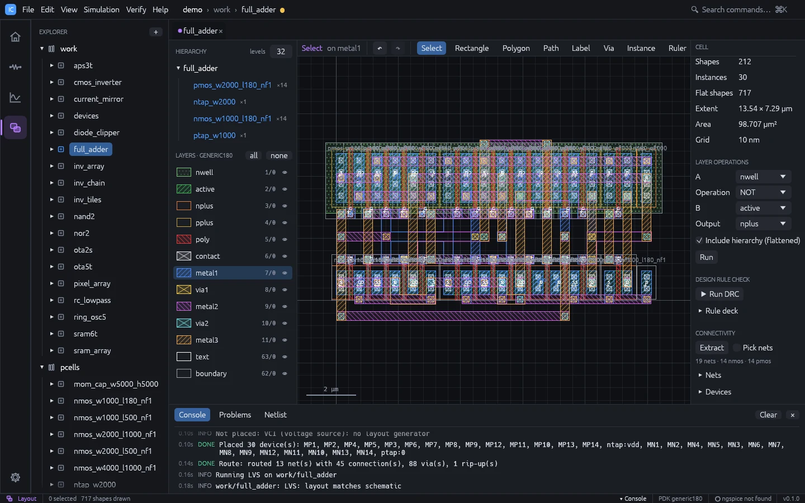

| Schematic with DC operating point back-annotation | Transient / DC sweep waveforms |
|---|---|
| 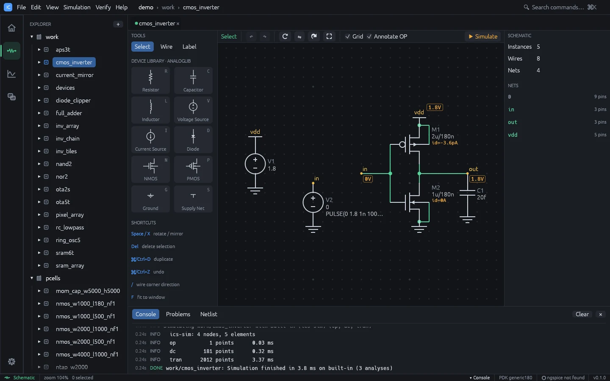 | 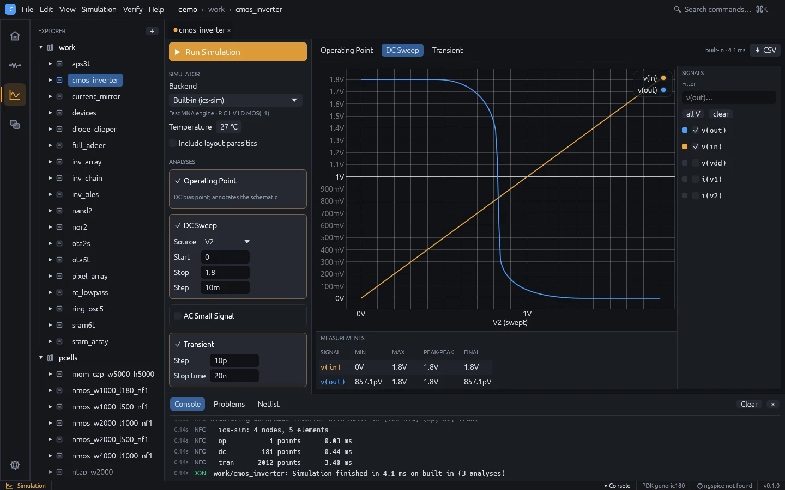 |
| **Hierarchical layout: 8192 inverters, level of detail** | **Parametric devices (PCells)** |
| 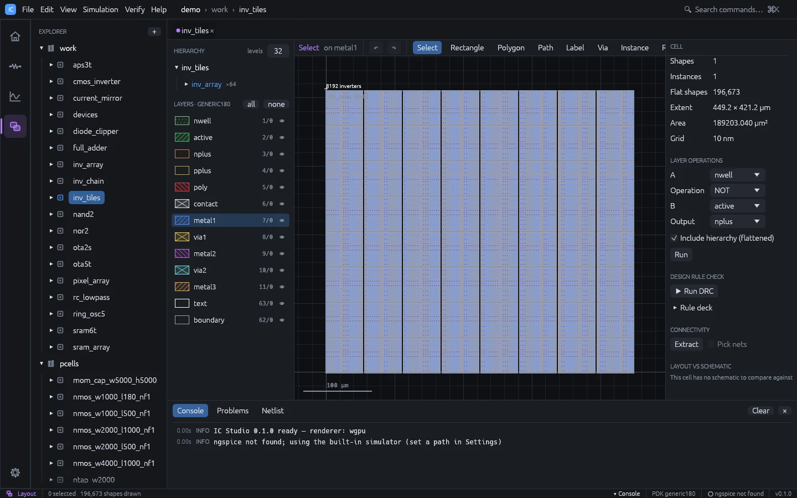 | 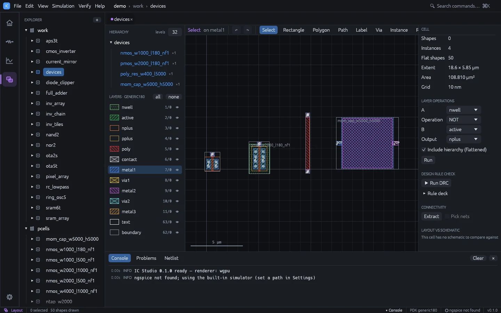 |
| **Common-centroid matched OTA, placed and routed automatically** | **8 × 8 SRAM array** |
| 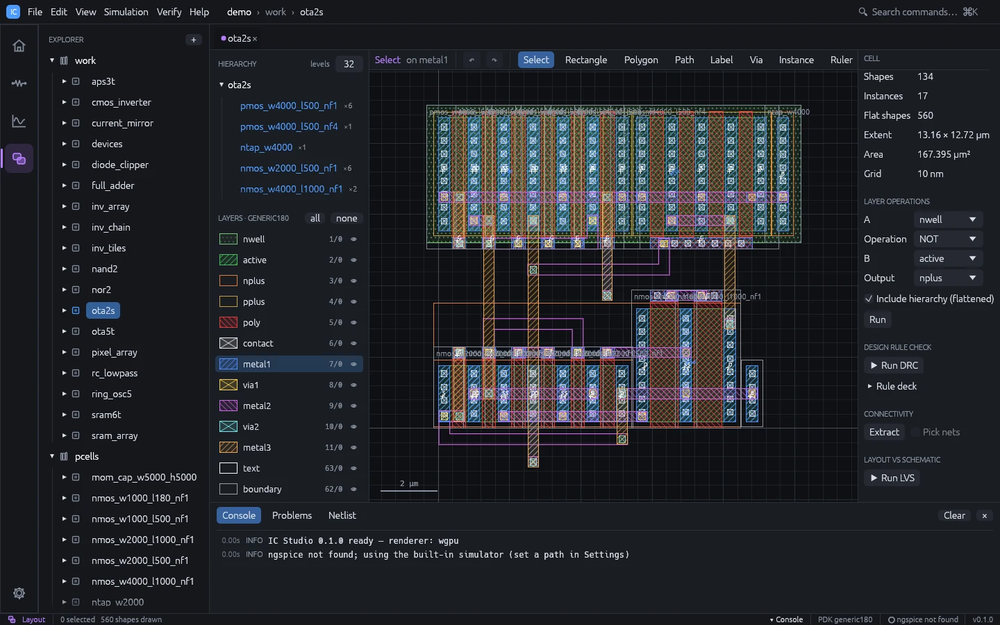 | 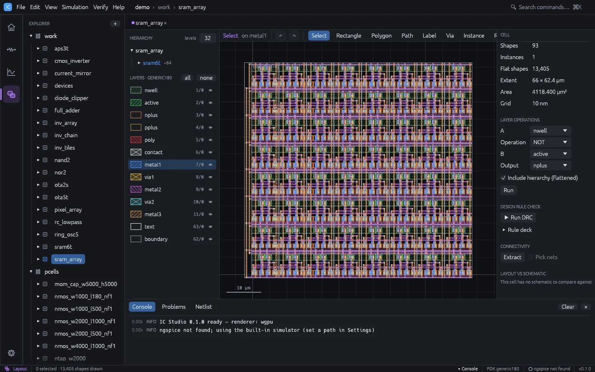 |
| **Layout generated from the schematic, with flylines** | **Rule-deck DRC on placed cells** |
| 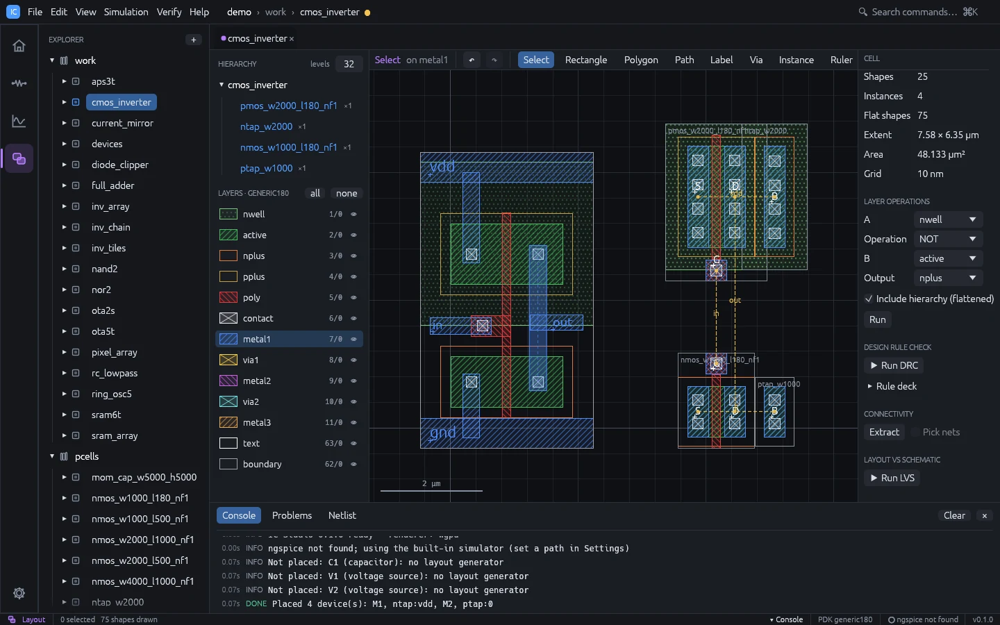 | 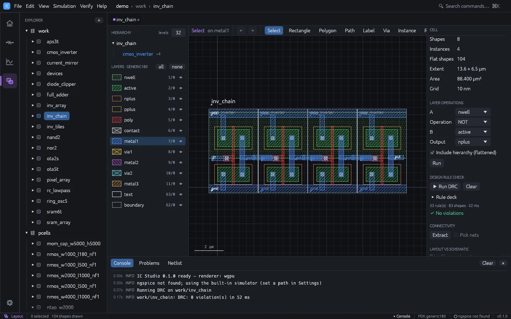 |
| **Monte Carlo with spec statistics, yield and histogram** | **Visual DRC rule designer with self-tested rules** |
| 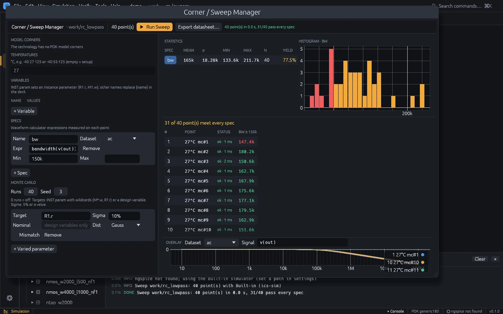 | 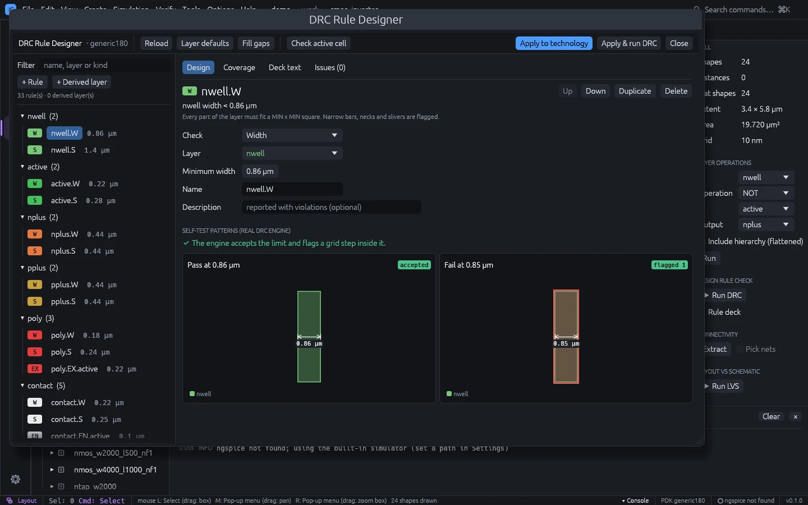 |

## Install

```powershell
# Windows (PowerShell)
irm https://github.com/geniuskey/ic-studio/releases/latest/download/install.ps1 | iex
```

```sh
# macOS (Apple silicon) and Linux (x86_64)
curl -fsSL https://github.com/geniuskey/ic-studio/releases/latest/download/install.sh | sh
```

The installer puts the app `ic-studio` and the command line tool `ics` (CLI and MCP
server) in one folder on the `PATH`, adds a launcher (Start Menu on Windows, desktop entry
on Linux) and registers the MCP server with Claude Code if `claude` is installed. Options,
uninstall and manual downloads: [Installation](https://pages.euiyun.com/ic-studio/install.html).

## Build from source

```sh
# Rust 1.95+ (https://rustup.rs)
cargo run --release                     # launch the desktop app
cargo run --release -- --demo           # ... with the bundled demo designs
cargo run --release -- --demo --cell inv_tiles --workspace layout
cargo run --release -- path/to/project  # ... opening a project folder
cargo build --release --workspace       # both programs into target/release/
```

Optional: install [ngspice](https://ngspice.sourceforge.io/) (`brew install ngspice`,
`apt install ngspice`, or the Windows build) to use it as a simulation backend. Without
it, IC Studio uses its own built-in simulator.

Linux needs the usual windowing libraries:
`libxkbcommon-dev libwayland-dev libx11-dev libxcursor-dev libxrandr-dev libxi-dev`.

## Features

**Application**
- Project → library → cell → view model (schematic / simulation / layout), stored as
  human-readable JSON that works well with version control
- Workspaces for Home, Schematic, Simulation and Layout with shared cell tabs, project
  explorer, command palette (⌘K / Ctrl+K), console, problems and netlist panels, dark and
  light themes
- Every action is an `app::Command`: menus, shortcuts, the palette and automation share it
- Virtuoso schematics: import hierarchical CDL netlists (auCdl, `ics import-cdl`) and export
  schematics as SKILL scripts that recreate them with analogLib or PDK symbols
  (`ics export-skill`)
- Virtuoso libraries: a SKILL dump script (`ics dump-skill`) writes schematics and layouts
  from inside Virtuoso, and `ics import-virtuoso` reads them, with placement, CDF parameters,
  hierarchy, layout masters and PCell variants
- Cadence Virtuoso conventions: default bindkeys and two-click commands in the layout
  editor, a Virtuoso or conventional mouse profile, and Cadence SKILL (`.il`) scripts with an
  interactive CIW prompt

**Schematic and simulation**
- analogLib-style primitives (R, C, L, V, I, diode, NMOS, PMOS, NPN, PNP, controlled sources
  E / F / G / H, ground, supply), wiring,
  labels, live connectivity, property inspector, SPICE netlister
- Operating point, DC sweep, AC and transient analyses on the built-in Rust MNA engine or
  ngspice; waveform viewer with Bode plots and automatic measurements
- PDK decks on the built-in engine: `.include` / `.lib` sections, `.param` expressions,
  subcircuits and model binning, and BSIM4 currents and charges (match ngspice in DC, AC
  and transient)
- Optional post-layout simulation: wire capacitance to substrate, lateral and overlap
  coupling between nets, MOS drain / source junctions (`ad as pd ps`) and an RC network of
  wire, via and gate resistance extracted from the layout are added to the matching
  schematic nets and devices
- Hierarchical schematics: cells placed as pin-box symbols, descend / return, simulated,
  swept and compared (LVS) as the flattened circuit
- Schematic pins (input / output / inout) as the cell's ports, kept through CDL, SKILL and
  Virtuoso import / export, and placed as boundary pins in the generated layout
- Schematic checker (Check and Save): missing ground, bad names, missing values, shorted
  devices, voltage-source loops, floating nets and dangling wires, live in the Problems tab

**Layout**
- Hierarchy: cell instances and arrays (GDS SREF / AREF) with 90° rotations and mirroring,
  hierarchy tree, drawn-level control, flatten and make-cell
- Scales to large designs: cached per-cell R-tree indices, view culling and level of
  detail (small cells collapse to boxes, tiny shapes to dots), bounded work per frame
- Editing: rectangles, Manhattan or any-angle polygons, paths, labels, rulers; vertex and
  edge handles that keep Manhattan outlines Manhattan; rotate / flip; µm-accurate inspector;
  buses of parallel wires that follow metal changes with a via per wire; routing tracks and
  width spacing patterns that wires snap to, with a conformance check; live R, C and EM
  limit while drawing a wire, with EM-driven sizing; copy as a
  rows × columns array, move / copy by a typed offset; search by kind, layer,
  name and size with select, zoom, change layer or delete
- Boolean engines: AND / OR / NOT / XOR, grow / shrink, merge, layer operations; a fast
  Manhattan region engine and an exact any-angle polygon engine (45° sizing, holes) used
  for non-Manhattan input by layer operations, SKILL `dbLayer*` and layout compare
- Via generator (single cut or area fill) and PCells: NMOS / PMOS (W, L, fingers),
  poly resistor, MOM capacitor and well / substrate taps, stored as ordinary cells of a
  `pcells` library
- GDSII and OASIS import and export with full hierarchy; unknown GDS layers are kept

**Design assistance**
- Start from an earlier design ([guide](https://pages.euiyun.com/ic-studio/derive.html)): the
  Derive New Design wizard copies a finished cell with new targets, sizes the parameters it
  suggests from the circuit (matched devices kept equal) with the optimizer, lays the copy out
  like the original and checks it (`ics derive`, MCP `derive_design`); demo cells carry design
  notes and specs shown beside the schematic, failing specs come with advice in plain words,
  beginner mode keeps the menus to the everyday flow, and the interface is also in Korean
- Live DRC: the rule deck re-runs around every edit on a worker thread (only the geometry
  within the deck's reach of the change is read), violations appear on the canvas as you draw
- Quick fixes (Ctrl+.): widen, grow, extend, move apart, shrink, fill a notch or add an
  enclosure, each candidate verified with DRC and ranked by the new violations it would cause;
  Fix All repairs the cell as one undoable edit (`ics drc --fix`, MCP `fix_drc`)
- Spacing magnet: drawn boxes, wire points and moved or pasted geometry snap to exactly the
  minimum spacing from (or abutting) same-layer neighbours, with the gap shown
- Placement constraints stored with the layout: symmetry about an axis, shared edges or
  centre lines and fixed items; moving one member moves its partners, and symmetry is
  inferred from the schematic's differential pairs, current mirrors and `match` groups
- Compaction: top-level items slide toward a side until the rules stop them, connected
  geometry and constrained groups move together, and moves that would add DRC violations
  are undone (`ics compact`, MCP `compact`)
- Layout compare: the cell XOR-ed per layer against its saved version or any git revision,
  added and removed geometry drawn on the canvas (`ics diff --rev HEAD~1`, MCP `diff_layout`)
- Optimizer: a pattern search sizes device parameters until the specs pass, optionally
  placing, routing and extracting every candidate so they pass after layout
  (`ics optimize --post-layout --apply`, MCP `optimize`)
- Layout by example (Layout Generators > By Example): a cell with the same circuit as a
  finished one is matched device for device by topology and placed like it, sized from its
  own schematic, then routed (`ics place-like`, MCP `place_like`)
- Design copilot (Tools > Design Copilot): an AI chat that works on the open project through
  the MCP tools, every edit visible and undoable in the window. Models are set in
  **Tools > AI Models...**: Google Gemini (default, `gemini-flash-latest`), OpenAI, Anthropic
  Claude or an OpenAI-compatible server; API keys come from there, a `.env` in the project or
  working folder, or the environment (e.g. `GEMINI_API_KEY`). It
  works as an agent: keeps a task list, asks when a request is unclear, and in plan mode
  investigates read-only and presents a plan for approval before editing; Stop cancels a run

**Verification**
- DRC with a text rule deck (`width`, `space`, `separation`, `enclosure`, `extension`,
  `area`, `antenna`, `density`) over technology layers and derived layers
  (`gate = poly and active`, `and` / `or` / `not` / `xor` / `size` / `wide` for wide-metal
  spacing) on the flattened hierarchy, Euclidean corner distances; results grouped by rule
  with zoom-to-marker
- Connectivity extraction with MOS recognition, top-level labels and net highlighting
- LVS against the schematic by iterative partition refinement, with parallel-device
  merging and W / L checks

**Schematic ↔ layout**
- Schematic-driven layout: place the schematic's transistors as named PCell instances in
  PMOS / NMOS rows, abutting devices that share a source / drain net (shared diffusion),
  with merged wells and implants and a bulk tap per row; differential pairs, current mirrors
  and devices sharing a `match` parameter are split into unit fingers in common-centroid
  order (ABBA, or two cross-coupled rows ABBA / BAAB for larger groups or `match_rows=2`),
  closed by off dummy fingers that LVS filters
- Flylines show schematic connections that are not yet routed; a maze router (A* on a
  terminal-aligned grid over metal1 and up) wires them DRC-clean around existing geometry,
  ripping up and rerouting nets that block each other
- Check against source and update (Layout XL ECO): missing, extra and resized devices,
  missing pins, shorts and opens against the schematic, optionally live after every edit; new devices are
  placed and changed ones resized in place (`ics eco --update`, MCP `update_from_source`)
- Abutment: selected MOS devices slide together onto a shared source / drain column of the
  same net, flipped when needed, also automatically when a device is dropped next to one
  (MCP `abut`)
- Cross-probing: selecting a device in one view selects it in the other

**Image sensor pixels** ([guide](https://pages.euiyun.com/ic-studio/pixel-optics.html))
- Pixel optics: microlens, colour filters, metal grid and anti-reflection films over the
  silicon photodiode give the QE of each Bayer colour, optical crosstalk at a chief ray angle
  and the light budget; the photocurrent for an illuminance goes into the pixel circuit
  (`ics pixel`, **Pixel Optics** window); a fast ray model and an RCWA solver that includes
  diffraction for small pitches. Material data from refractiveindex.info
- Carrier diffusion in the silicon: collection probability, electrical crosstalk, deep
  trench isolation
- Pixel stacks from the PDK cross section and the pixel cell's layout (`ics pixel --cell`,
  **From PDK**)

**Tools** ([guide](https://pages.euiyun.com/ic-studio/tools.html))
- Waveform calculator: `bandwidth`, `ugf`, `phasemargin`, `risetime`, `cross`, `delay`,
  `rms`, `deriv`, ... on simulation results, with derived waveforms plotted
- Corner / sweep manager: model corners × temperatures × parameters and Monte Carlo
  (process and mismatch), run in parallel, specs with limits, statistics, yield,
  histograms, overlaid waveforms and an HTML datasheet
- Verification (ADE Assembler style): every testbench of the project run together, each
  spec summarised by its worst corner and margin, runs kept as history and compared for
  regressions; `ics verify` exits non-zero on a failure and writes JUnit XML for CI
- Yield prediction: a response-surface model of every spec over the Monte Carlo inputs,
  sampled 10⁵ times per condition, gives the predicted yield, Cpk and each varied
  parameter's share of the spread (`ics yield`, MCP `predict_yield`)
- Silicon correlation: measured curves (CSV) against the simulation, with a
  Levenberg-Marquardt fit of model card, instance or design parameters with standard errors,
  and the fitted `.model` cards (`ics correlate`, MCP `correlate_silicon`)
- Results browser: keep earlier runs and overlay them, e.g. pre- versus post-layout
- Layout generators: guard rings, via arrays, common-centroid / interdigitated matched
  placement with dummies; dummy metal fill to a density target
- Model-based OPC: a Gaussian-blur / threshold litho model, edge fragmentation and
  iterative correction of the edge placement error, with a preview of the mask and what
  prints with and without correction
- PCell designer: turn a drawn layout into a parametric cell with stretch lines, repeats,
  conditional regions and re-arraying contact fills driven by parameter expressions;
  suggestions read a drawn MOS (contacts, fingers, W, L), a corner check runs DRC at the
  parameter extremes, and the saved master is placed and stretched like a built-in PCell;
  export to Cadence Virtuoso as a SKILL `pcDefinePCell` generating the same layout
  (`ics pcell-skill`); the Design Copilot and MCP agents build them too, from a drawn layout
  or from nothing (`pcell_design_*` tools)
- Hierarchy and net browsers; a visual DRC rule designer that self-tests every rule; a
  stream layer map (Virtuoso layer map files) for GDSII / OASIS import and export

**Process** ([guide](https://pages.euiyun.com/ic-studio/process.html))
- Process emulation: the cross-section of a layout along a cut line after a process flow
  (deposit, conformal deposit, anisotropic / isotropic etch, implant, anneal, thermal
  oxidation, CMP, strip) with a generic 180 nm flow; Gaussian implant profiles, 2-D dopant
  diffusion and Deal-Grove oxidation give net doping, junction depths and sheet resistance;
  step through the flow, probe material stacks and dopant profiles, export SVG and CSV
  (`ics xsection`, MCP `process_cross_section`)
- Process data: WAT / PCM results against the process spec with Cp / Cpk, control charts
  of the wafer means (Western Electric rules) and a check that the model corners cover the
  measured spread (`ics process-data`, MCP `process_data`)
- Corner models from silicon: fit tt and ff / ss / fs / sf model cards to WAT data through
  simulated test structures, with correlated parameters following by regression, and write a
  corner library (`ics corners`, MCP `extract_corners`); the process variation of the model
  parameters by backward propagation of variance, for Monte Carlo, yield prediction and the
  library's `mc` section
- Mismatch from silicon: Pelgrom Avt / Abeta fitted to matched-pair data with standard errors,
  drawn by Monte Carlo (`ics mismatch`, MCP `extract_mismatch`)

**Technology**
- `tech.json` with layers, GDS numbers, colours, fill patterns, width / spacing, vias,
  capacitance coefficients, sheet / via resistance and the DRC deck. A generic 180 nm-class demo technology is
  included.
- Import KLayout layer properties (`.lyp`, plus `.lyt` for the database unit) or a Cadence
  Virtuoso technology file (`.tf` with `display.drf` and the layer map) to use a real PDK's
  layer set, such as SKY130 or GF180
- PDK files (`pdks/sky130A.toml`, `pdks/ihp-sg13g2.toml`): layers, vias, device recognition,
  SPICE model library and corners in one TOML file; extraction, LVS, netlists and PCells
  follow the PDK
- Sign-off DRC / LVS with external tools: KLayout decks, Calibre SVRF rule files and
  netgen, with results as markers in the layout
- SVRF decks translated to the built-in DRC (layer maps, boolean / selection operations,
  INT / EXT / ENC / AREA / DENSITY checks), with notes for what is not translated

## Command line

```sh
ics new myproj --template demo
ics examples ~/ics-examples                             # example projects, one per topic
ics info myproj
ics netlist myproj cmos_inverter
ics sim myproj cmos_inverter --backend ngspice --json   # machine-readable results
ics sim myproj cmos_inverter --parasitics               # post-layout simulation
ics spice deck.cir                                      # simulate any SPICE deck
ics gds myproj inv_tiles -o tiles.gds                   # cell and everything it places (.oas: OASIS)
ics import-gds myproj chip.gds                          # new library, unknown layers kept
ics import-tech myproj sky130A.lyp --lyt sky130A.lyt
ics drc myproj cmos_inverter [--deck rules.drc]         # non-zero exit on violations
ics drc myproj cmos_inverter --fix                      # apply verified quick fixes, save
ics compact myproj full_adder --dir left,down           # compact, keep constraints, save
ics diff myproj cmos_inverter --rev HEAD~1              # XOR against a git revision
ics optimize myproj ota2s --post-layout --apply         # size devices to meet the specs
ics place-like myproj nand2_b --from nand2 --route      # reuse a finished placement
ics route myproj nand2 --place                          # place devices, route flylines, save
ics eco myproj nand2 --update                           # update the layout from the schematic
ics extract myproj inv_chain                            # extracted SPICE netlist
ics lvs myproj cmos_inverter                            # non-zero exit on differences
ics emir myproj ring_osc5 --net vdd                     # IR drop / EM; non-zero exit on EM violations
ics opc myproj cmos_inverter --layer poly --apply       # optical proximity correction, save
ics mcp                                                 # MCP server for AI agents (stdio)
```

All commands and options: [Command line](https://pages.euiyun.com/ic-studio/cli.html).

## Examples

`--demo` (or `ics new myproj --template demo`) opens a project with these cells in the
`work` library, all in the generic 180 nm technology. The same cells also come as smaller
example projects by topic (getting started, analog, digital, memory and pixels, hierarchy):
the **Examples** cards on the welcome page, `ics examples <DIR>`, and the installer, which
writes them to `Documents/IC Studio/Examples`.

| Cell | What it shows |
|---|---|
| `cmos_inverter` | Inverter with a hand-drawn layout; LVS reports its deliberate findings (PMOS W, load cap) |
| `rc_lowpass` | RC low-pass filter (fc ≈ 159 kHz): op, AC and transient |
| `nmos_curves` | One NMOS on a test bench: its output curves, one per gate voltage (DC sweep and sweep manager) |
| `diode_clipper` | Resistor and shunt diode clipper: transient and DC sweep |
| `nand2` | 2-input NAND: schematic plus routed PCell layout, DRC and LVS clean |
| `nor2` | 2-input NOR: schematic plus routed PCell layout, DRC and LVS clean |
| `ring_osc5` | 5-stage ring oscillator, fully routed (no flylines); about 8.8 GHz on the built-in simulator |
| `current_mirror` | NMOS current mirror with a 20 µA reference; DC sweep of the output voltage |
| `ota5t` | 5-transistor OTA (NMOS pair, PMOS mirror load); about 42 dB open-loop gain in AC |
| `sram6t` | 6T SRAM thin cell (4.62 × 1.84 µm, point-symmetric, straight poly on two tracks), DRC and LVS clean; transient write and hold |
| `sram_array` | 8 × 8 array of `sram6t`, mirrored in x and y so neighbours share edge contacts, with labelled word lines and bit lines |
| `dram1t1c` | Planar 1T1C DRAM cell (1.28 × 2.0 µm) with a ≈ 10 fF MOS storage capacitor, DRC and LVS clean; write, VDD / 2 precharge and charge-sharing read of a 1 and a 0 |
| `dram_array` | 8 × 8 array of `dram1t1c`, rows mirrored so cell pairs share the bit-line contact and the plate |
| `nand_string` | NAND flash string: 8 floating-gate cells (poly floating gate, poly2 word line) with select gates, DRC and LVS clean; page read of a programmed and an erased cell |
| `nand_array` | 8 bit lines × 4 strings of `nand_string`, mirrored so strings share contacts |
| `aps4t` | 5.6 µm 4T image sensor pixel (transfer gate, floating diffusion, reset, source follower, row select) over an n+ / p-sub photodiode with 41 % fill factor, DRC and LVS clean; transient reset, integration and transfer |
| `pixel_array` | 8 × 8 pixel array (AREF) of `aps4t` with labelled transfer / reset / select rows and column lines |
| `full_adder` | 28T mirror full adder, placed and routed automatically from its netlist (no hand-drawn layout), DRC and LVS clean; transient over all eight input combinations |
| `ota2s` | Two-stage OTA, auto P&R: common-centroid input pair and mirror with dummies, every net maze-routed, DRC and LVS clean; about 83 dB open-loop gain in AC |
| `inv_chain` | Four placed `cmos_inverter` instances |
| `inv_array` | 16 × 8 array (AREF) of inverters |
| `inv_tiles` | 8 × 8 array of `inv_array`: 8192 inverters, two levels of hierarchy |
| `devices` | One instance of every PCell (NMOS, PMOS, poly resistor, MOM capacitor) |

The routed cells (`nand2`, `nor2`, `ring_osc5`, `current_mirror`, `ota5t`, `sram6t`, `dram1t1c`, `nand_string`, `aps4t`, `full_adder`, `ota2s`) run the whole
flow: simulate the schematic, open the layout, run DRC and LVS, and simulate again with
`--parasitics`.

Real open-source designs can be downloaded into `examples/` (git-ignored) as ready-to-open
projects:

```sh
./scripts/fetch-examples.sh             # macOS / Linux (curl, gunzip)
./scripts/fetch-examples.ps1            # Windows PowerShell
#   --caravel / -Caravel  also the full caravel chip (52 MB download, 278 MB unpacked)
#   --force   / -Force    rebuild the projects from the downloaded files
```

- `examples/sky130`: SKY130 layer set (open_pdks KLayout files) with the efabless caravel
  libraries `caravel_clocking`, `housekeeping` and `chip_io` (and `caravel`)
- `examples/gf180`: GF180MCU layer set with the `gf180mcu_fd_sc_mcu7t5v0` standard cells
  and the `gf180mcu_fd_ip_sram` 512 × 8 SRAM macro

The scripts skip files that are already downloaded and libraries already imported, and
use `target/release/ics` when it exists (otherwise `cargo run --release -p ics-cli`).

## MCP server (AI agents)

`ics mcp` exposes an IC Studio project to AI agents over the Model Context Protocol
(stdio). Its 59 tools cover projects and PDKs, schematics from SPICE netlists, Virtuoso
CDL and library dumps, netlisting and simulation, verification and yield, layout editing (rects, paths, labels, instances, PCells, schematic-driven
placement, flylines, routing), PCell Designer parametric cells from a drawn layout or from
nothing, DRC with quick fixes, compaction, layout compare, the
optimizer, layout by example, extraction, LVS, sign-off runsets, parasitics, GDSII / OASIS
import and export, SKILL scripts, and search of the user manual. Coordinates are in µm; edits stay in memory until
`save_project`. Tool list: [MCP server](https://pages.euiyun.com/ic-studio/mcp.html).

The release installer registers it with Claude Code, as does **Add to Claude Code** in
**File > Settings... > AI agents (MCP)**; **Copy MCP config** there copies the JSON for
other clients. By hand:

```sh
claude mcp add --scope user ic-studio -- /path/to/ics mcp
# from source: cargo build --release -p ics-cli, then
claude mcp add --scope user ic-studio -- /path/to/ic-studio/target/release/ics mcp
```

Then ask, for example: "create a demo project in ./demo and run LVS on cmos_inverter".

**Live mode.** While the desktop app (`ic-studio`) is running, the MCP server forwards every
tool call to it (local TCP on 127.0.0.1 with a per-session token; discovery file
`live.json` in `%LOCALAPPDATA%\ic-studio`, `$XDG_RUNTIME_DIR/ic-studio` or
`~/.local/state/ic-studio`). The agent then works on the project open in the window: edits
appear immediately and can be undone, DRC / LVS / simulation results open in their panels,
and the status bar shows "MCP live". Without a running app, or with `ICS_MCP_STANDALONE=1`, the server works on its
own in-memory project.

## Python API

`pip install ./python` builds the `icstudio` package (PyO3, needs Rust). It runs the same
tools in-process, and `simulate` returns full waveforms as NumPy arrays:

```python
import icstudio
p = icstudio.Project.open("myproj")
r = p.simulate("rc_lowpass")                 # {"ac": {"vectors": {"v(out)": complex array, ...}}}
print(p.drc("cmos_inverter")["violations"], p.verify()["status"])
p.call("route", cell="cmos_inverter")        # any MCP tool by name
```

See [Python API](https://pages.euiyun.com/ic-studio/python.html). Tools of installed
[extensions](#extensions) are called the same way.

## Extensions

Third parties can add tools, menu commands, SKILL scripts and PDKs as **extensions**: a folder
with an `extension.toml`, kept in its author's git repository. A tool is served by the
extension's own program in any language (a Python helper is built in) over newline-delimited
JSON-RPC on stdio, a subset of MCP, and can call every built-in tool back on the open project.
Extension tools appear as `<id>__<tool>` in the **Extensions** menu, the command palette, the
Design Copilot, `ics mcp`, the CLI and the Python API.

```sh
ics ext search                          # the community index (extensions/index.json)
ics ext install design-report           # by id, or a folder, or any git URL (--rev, --path)
ics ext new my-tool                     # start one (Python or --template skill)
ics ext call myproj design-report__report '{"cell": "nand2"}'
```

In the app: **Extensions > Manage Extensions…**. Examples are in [`extensions/`](extensions);
see [Extensions](https://pages.euiyun.com/ic-studio/extensions.html) for the manifest and the
protocol, and [`extensions/README.md`](extensions/README.md) to list yours in the index.

## Architecture

```
crates/
  ics-core    UI-free design database
              geom · schematic · connectivity · netlist · layout · hier (indices, LOD)
              region / polybool (Booleans) · pcell · gds · oasis · stream_map · tech · tech_import
              drc · rule_design · extract · lvs · sdl (schematic-driven layout) · route
              matching · layout_gen · fill · opc · pex · sch_check · sweep · verify · skill
              cadence (CDL, SKILL out) · virtuoso (tech files) · virtuoso_dump (library import)
              project storage · examples
  ics-sim     SPICE parser, MNA engine, ngspice backend, waveform calculator, results
  ics-studio  desktop app (eframe/egui on wgpu)
              app (shell, commands) · schematic_view · sim_view · layout_view (edit, verify)
              tool windows: calc_view · sweep_view · verify_view · rule_designer · stream_map_view
              fill_view · opc_view · gen_view · net_view · hier_view · ciw · ext_view
  ics-cli     `ics` command line and `ics mcp`
  ics-mcp     MCP tools, stdio server, live-mode bridge and the extension host (ext)
  ics-i18n    English/Korean message tables and lookup, shared by the app and the CLI
  python/     `icstudio` Python package (PyO3, built by maturin; outside the workspace)
```

Design decisions:

- **The core is UI-free.** The GUI, the CLI, the MCP server and Python are clients of the same
  `ics-core` / `ics-sim` API.
- **Commands are the single path for user actions**, which keeps the app scriptable.
- **Extensions are separate programs** speaking a small, MCP-shaped protocol, so they can be
  written in any language, licensed by their authors and cannot crash the app.
- **One database for schematic and layout.** Instance names tie schematic devices to
  placed cells; LVS net matches carry parasitics back to simulation.
- **External engines where they add value.** ngspice is a first-class backend; the
  built-in engines make the tool work with no setup.
- **Plain-JSON project format** (`ic-studio.json`, `tech.json`, `<lib>/<cell>/*.json`).

## Testing

```sh
cargo test --workspace                                   # unit + headless UI tests
ICS_SHOT_DIR=shots cargo test -p ics-studio --test ui    # also write screenshots
cargo test --release -p ics-core bench_ -- --ignored --nocapture   # benchmarks
```

The UI tests drive the full application with a real `wgpu` renderer (egui_kittest): they
walk through every workspace, run simulations, DRC and LVS, draw a polygon with simulated
mouse input, and check accessibility labels and glyph coverage.

## Roadmap

The goal is one environment for design, analysis, simulation, prediction and process,
fit for production use, including the optics of image sensors.

1. **Trust**: PDK-grade simulation. Done: a SPICE front-end for libraries, parameters,
   subcircuits and model binning; BSIM4 currents, charges, junctions, noise and leakage;
   Spectre decks and model libraries; Spectre and CDL netlist output.
2. **Fit into existing flows**: Done: Virtuoso technology files (`.tf`, `display.drf`, layer
   map), sign-off results from runs made elsewhere (Calibre, KLayout, netgen), DSPF
   post-layout netlists, Spectre / CDL netlists; Virtuoso schematics in as hierarchical CDL
   (auCdl) and out as SKILL scripts that rebuild them; whole libraries (schematics and layouts)
   through a SKILL dump run inside Virtuoso. Next: run both scripts in a Virtuoso session.
3. **Image sensor pixels**: Done: a pixel stack (microlens, colour filter, dielectrics, metal
   grid, anti-reflection films, silicon) with ray and thin-film optics giving QE, crosstalk
   at a chief ray angle and the photocurrent of the pixel circuit (`ics pixel`, **Pixel
   Optics**); an RCWA solver for small pitches; metal patterns, photodiode and pitch read from
   the pixel's layout; carrier diffusion with electrical crosstalk and deep trench isolation; stacks generated
   from the PDK's back-end cross section and the layout.
4. **Prediction and process**: Done: yield prediction from Monte Carlo with surrogate models
   and sensitivities; silicon-to-simulation correlation with model fitting; process
   emulation (cross-sections from layout and process steps, with implant profiles, diffusion
   and oxidation); process data (WAT / PCM, SPC, corner coverage); corner models, process
   variation and mismatch extracted from silicon and drawn by Monte Carlo and yield
   prediction.

Also: non-Manhattan DRC and extraction, resistor / capacitor definitions
in the bundled PDKs.

## Acknowledgements

The built-in BSIM4 model follows BSIM4 by the BSIM Research Group of the University of
California, Berkeley.

## License

Copyright (C) 2026 geniuskey

IC Studio is free software: you can redistribute it and/or modify it under the terms of the
GNU General Public License as published by the Free Software Foundation, either version 3 of
the License, or (at your option) any later version. See [LICENSE](LICENSE).

Contributions are accepted under the [Contributor License Agreement](CLA.md); a bot asks you
to sign it on your first pull request.
