<!-- seo title="Command Line Interface (ics)" description="Script IC Studio from the terminal with the ics CLI: create projects, netlist, simulate, run DRC and LVS and export GDS in batch or CI, with JSON output." -->

# Command line (`ics`)

`ics` works on the same project folders as the desktop app. Use it for scripting, batch
runs and CI; `ics mcp` also runs the [MCP server](mcp.md) for AI agents. The
[release installer](install.md#install-a-release) puts it on the `PATH`. From source, build
it with `cargo build --release -p ics-cli` (binary `target/release/ics`) or run it with
`cargo run -p ics-cli -- <args>`.



- `<CELL>` is `lib/cell` or just the cell name (the first cell with that name is used).
- Exit code 0 means success. Errors print `error: <message>` to stderr and exit with 1.
- `ics --help` and `ics <command> --help` describe every option.

## Commands

| Command | Purpose |
|---|---|
| `ics mcp` | Run the MCP server for AI agents on stdio (see [MCP server](mcp.md)) |
| `ics new <DIR> [--template empty\|demo]` | Create a project (default template `demo`) |
| `ics examples [DIR] [--force]` | Write the example projects, one per topic, to `DIR/<topic>` (existing ones are kept unless `--force`); without `DIR`, list the topics |
| `ics info <PROJECT>` | List libraries, cells and views |
| `ics netlist <PROJECT> <CELL> [--format spice\|spectre\|cdl]` | Print the cell's netlist: SPICE deck (default), the same deck in Spectre, or CDL for LVS (`.SUBCKT` with `*.PININFO`, no sources) |
| `ics schematic <PROJECT> <CELL> <NETLIST> [--overwrite]` | Create or replace a cell's schematic from a SPICE netlist file and save |
| `ics sim <PROJECT> <CELL> [--backend builtin\|ngspice\|auto] [--json] [--parasitics] [--compare [--tol T]]` | Simulate with the cell's saved setup; `--compare` correlates the built-in engine against ngspice |
| `ics spice <FILE> [--backend builtin\|ngspice\|auto] [--json] [--compare [--tol T]]` | Simulate a SPICE or Spectre file (`.scs`, or `simulator lang=spectre`) with its own analyses |
| `ics mc <PROJECT> <CELL> --measure ANALYSIS:EXPR... [--runs N] [--seed S] [--avt V] [--abeta V] [--vto-sigma V] [--kp-sigma V] [--parasitics] [--json]` | Monte Carlo on the built-in engine with process variation and Pelgrom mismatch |
| `ics gds <PROJECT> <CELL> -o <FILE>` | Export the cell and every cell it places to GDSII, or to OASIS when `FILE` ends in `.oas` / `.oasis` |
| `ics gds-info <FILE>` | Print hierarchy statistics and timings of a GDSII or OASIS file |
| `ics import-gds <PROJECT> <FILE> [--lib NAME] [--skip-unknown-layers] [--json]` | Import a GDSII or OASIS file as a new library |
| `ics lef export <PROJECT> <CELL>... [-o FILE] [--obs detailed\|block\|none] [--class CLASS]` | Write LEF abstracts of cells with a technology header (stdout without `-o`) |
| `ics lef import <PROJECT> <FILE> [--lib NAME]` | Import LEF macros as layout cells of a new library and save |
| `ics def export <PROJECT> <CELL> [-o FILE] [--lef FILE]` | Write a top cell as DEF; `--lef` also writes the placed cells' abstracts |
| `ics def import <PROJECT> <FILE> [--lib NAME]` | Import a DEF as a new top cell placing the project's cells and save |
| `ics lib-storage <PROJECT> <LIB> gds\|json` | Change how a library is stored on disk |
| `ics import-tech <PROJECT> <FILE> [--lyt FILE] [--drf FILE] [--layermap FILE]` | Replace the technology from a KLayout `.lyp` or a Virtuoso `.tf` (with its `display.drf` and layer map) |
| `ics load-pdk <PROJECT> <PDK>` | Replace the technology with a PDK file (see Technology) |
| `ics drc <PROJECT> <CELL> [--deck FILE] [--fix]` | Run DRC (the deck may be SVRF); exit 1 on violations |
| `ics extract <PROJECT> <CELL>` | Print the extracted netlist as SPICE |
| `ics lvs <PROJECT> <CELL>` | Compare layout and schematic; exit 1 on differences |
| `ics results <PROJECT> <CELL> <FILE>` | Show sign-off results made elsewhere (Calibre, KLayout, netgen); exit 1 on violations or a mismatch |
| `ics emir <PROJECT> <CELL> --net NET [--currents FILE] [--json]` | IR drop and electromigration of a net from its labelled pins; currents per layout device (JSON) or from the schematic's operating point; exit 1 on EM violations |
| `ics opc <PROJECT> <CELL> --layer LAYER [--apply] [--sigma UM] [--threshold T] [--fragment UM] [--max-out UM] [--max-in UM] [--iterations N] [--gain G] [--json]` | Optical proximity correction of a layer: EPE without and with correction; `--apply` writes the mask to `<LAYER>_opc` (replacing the previous mask; the drawn layer is never changed) and saves |
| `ics signoff <PROJECT> <CELL> [RUNSET]` | Run an external KLayout / Calibre / netgen runset (list them without RUNSET); exit 1 on violations or a mismatch |
| `ics route <PROJECT> <CELL> [--place]` | Route flylines and save; exit 1 if nets stay unrouted |
| `ics compact <PROJECT> <CELL> [--dir left,down] [--no-infer]` | Compact the layout toward the given directions and save |
| `ics diff <PROJECT> <CELL> [--rev REV \| --against DIR]` | Compare the layout with a git revision (default `HEAD`) or another project; exit 1 if they differ |
| `ics optimize <PROJECT> <CELL> [--post-layout] [--apply] [--json]` | Size devices to meet the cell's specs; exit 1 if no point meets every spec |
| `ics place-like <PROJECT> <CELL> --from <CELL> [--route]` | Place the cell like a finished cell with the same circuit and save |
| `ics skill <PROJECT> <FILE.il> [--no-save] [--json]` | Run a Cadence SKILL script on the project and save; exit 1 on a SKILL error |

## Details

### Schematic from a netlist

`ics schematic` reads a flat SPICE netlist (R, C, L, V, I, D and M lines, and X lines for
PDK MOS subcircuits) and draws it as the cell's schematic: every pin gets a net label
(node `0` or `gnd` gets a ground symbol) and devices are laid out in rows (PMOS, NMOS,
passives, sources). Analysis lines (`.op`, `.dc`, `.ac dec`, `.tran`) and `.temp` set the
cell's simulation setup; other dot lines (`.model`, `.include`, `.param`, `.ic`, `.meas`)
become its extra lines. Lengths are SPICE metres (`w=2u`); a bare `w=2` is read as µm with
a warning. The cell is created in library `work` unless `lib/cell` is given. It prints the
generated deck and saves the project.

```sh
ics schematic myproj ota ota.cir && ics route myproj ota --place && ics lvs myproj ota
```

### Simulation

`ics sim` uses the analyses, temperature, extra lines and backend saved for the cell in the
app. `--backend` overrides the backend (`auto` picks ngspice only when the built-in engine
would not evaluate the deck as written, see [Backends](simulation.md#auto));
`--parasitics` adds layout parasitics (also enabled when the saved setup has them on).
Without `--json`, it prints each dataset's title and point count, operating-point values
and device regions, and the vector names of sweeps. The backend and any warnings about what
the built-in engine approximates go to stderr.

With `--json`, the full results go to stdout:

```json
{
  "backend": "built-in",
  "elapsed_ms": 3.1,
  "warnings": [],
  "datasets": [
    { "analysis": "tran", "title": "...", "vectors": { "time": [0, 1e-11], "v(out)": [0, 0.01] } }
  ]
}
```

AC vectors are `{ "re": [...], "im": [...] }`.

`ics spice deck.cir` simulates any SPICE file with the analyses in the file
(default backend built-in).

`--compare` runs the deck on ngspice (the reference) and on the built-in engine and prints
the worst disagreement of every vector; it exits with 1 when the largest relative error is
above `--tol` (default `0.05`). See
[Built-in engine versus ngspice](simulation.md#built-in-engine-versus-ngspice).

`ics mc` runs the cell's analyses `--runs` times (default 100, reproducible with `--seed`)
with a global threshold and transconductance shift per polarity (`--vto-sigma` default
`20m` V, `--kp-sigma` default `0.03`) and per-device mismatch σ(ΔVth) = `avt` / √(W L),
σ(Δβ/β) = `abeta` / √(W L) (`--avt` default `5n` = 5 mV·µm, `--abeta` default `10n` =
1 %·µm). Each `--measure` is an analysis and a
[calculator](tools.md#waveform-calculator) expression with a scalar result; the command
prints mean, sigma, min and max of each. The same runs from the app's
[Monte Carlo window](simulation.md#monte-carlo-window).

```sh
ics mc demo ota5t --runs 200 --measure "op:v(out)" --measure "ac:bandwidth(v(out))"
```

### GDS

- `ics import-gds` adds layers the technology lacks, unless `--skip-unknown-layers` is
  given. The library name defaults to the file name. By default the library is stored as
  one GDS file in the project; `--json` stores one JSON folder per cell instead (editable,
  diff-friendly, larger). `ics lib-storage` converts an existing library between the two.
- `ics gds` and `ics import-gds` apply the technology's
  [stream layer map](tools.md#stream-layer-map) when it has one.
- `ics gds-info` reads a GDS file without writing anything and prints the top cells with
  their sizes and the read / parse / index times.

### Verification and routing

- `ics drc` prints each rule with its violation count and up to 50 marker boxes in µm.
  `--deck FILE` uses a deck file instead of the technology's deck. `--fix` first applies
  verified quick fixes to the cell's top-level geometry and saves the project, then
  reports what is left.
- `ics lvs` prints the device and net pairs and the differences.
- `ics route --place` first places the schematic devices missing from the layout
  (schematic-driven layout), then routes, then saves the project.

### Layout editing

- `ics compact` slides the cell's top-level items toward each `--dir` in turn (`left`,
  `right`, `down`, `up`; default `left,down`) until the rules stop them, and saves. Fixed
  items stay, constraints hold and moves that would add DRC violations are undone.
  Symmetry constraints are first inferred from the schematic's matched devices unless
  `--no-infer` is given.
- `ics diff` XORs the cell's flattened layout per layer against the version at a git
  revision of the project (`--rev`, default `HEAD`) or against the same cell in another
  project directory (`--against DIR`), and prints the differences.
- `ics place-like` matches the cell's devices by circuit topology to a finished reference
  cell (`--from`) and places them like it, sized from the cell's own schematic; `--route`
  then routes it.

### Optimizer

`ics optimize` uses the cell's specs (`sim.sweep.specs`) and optimizer variables
(`sim.optimize`), as set up in the app (**Tools > Optimizer...**). It prints each evaluation on stderr and
the best values and spec results on stdout (`--json`: one object with `passed`,
`evaluations`, `vars` and `specs`). `--post-layout` places, routes and extracts every
candidate first; `--apply` writes the best values into the schematic and saves.

### SKILL scripts

`ics skill` runs a Cadence SKILL (`.il`) file against the project (layout calls such as
`dbOpenCellViewByType`, `dbCreateRect` and `dbCreateInst`, coordinates in µm). It prints
what the script printed, lists the modified cells on stderr, and saves the project unless
`--no-save` is given. With `--json`, stdout is one object:

```json
{ "output": "...", "value": "t", "modified": ["work/inv_layout"] }
```

On a SKILL error it prints the script output, then `error: <file>:<line>: <message>`, exits
with 1 and does not save.

## Examples

```sh
ics new demo --template demo
ics info demo
ics netlist demo cmos_inverter
ics sim demo rc_lowpass --json > rc.json
ics sim demo nand2 --backend ngspice
ics sim demo cmos_inverter --compare
ics sim demo ring_osc5 --parasitics
ics drc demo nand2 && ics lvs demo nand2
ics extract demo inv_chain
ics gds demo inv_tiles -o tiles.gds
ics def export demo inv_chain -o chain.def --lef chain.lef
ics import-gds demo chip.gds --lib chip
ics import-tech demo sky130A.lyp --lyt sky130A.lyt
ics skill demo make_pads.il --json
ics drc demo cmos_inverter --fix
ics diff demo nand2 --rev HEAD~1
```

A CI check of a cell:

```sh
ics drc myproj work/opamp && ics lvs myproj work/opamp
```
