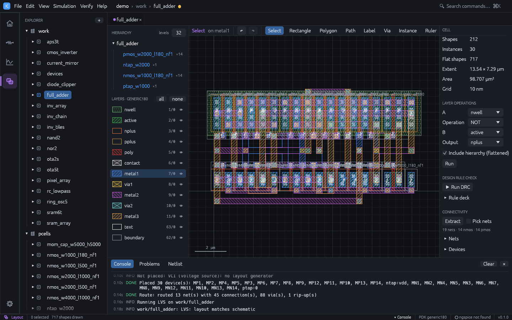
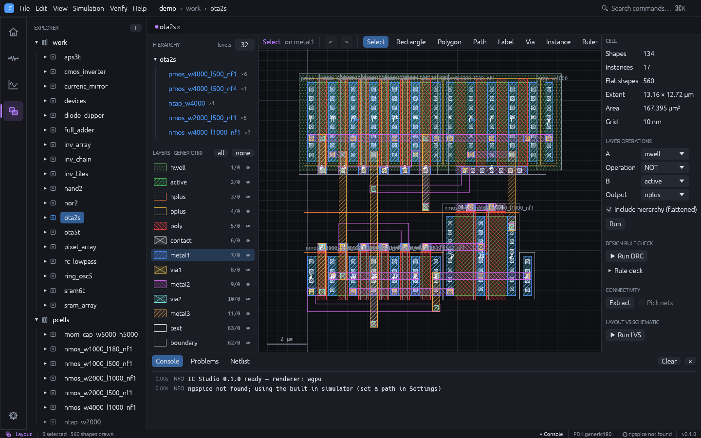
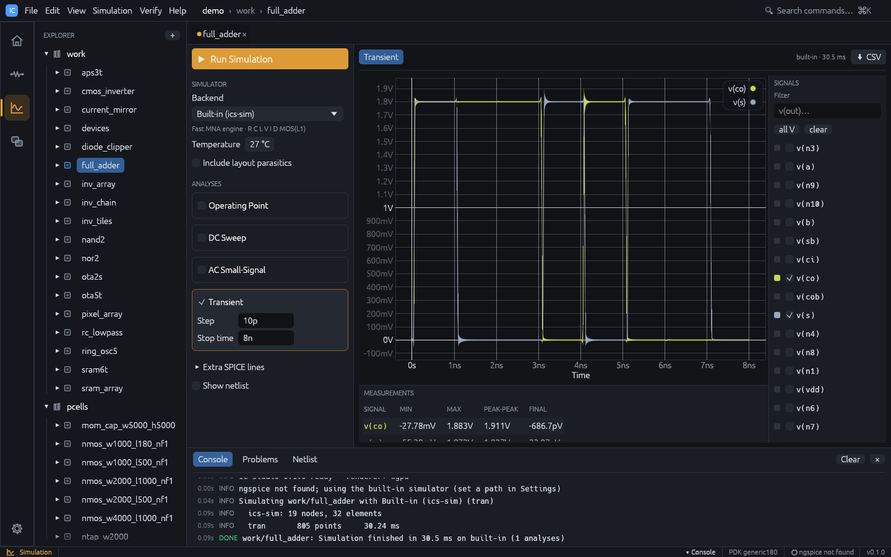
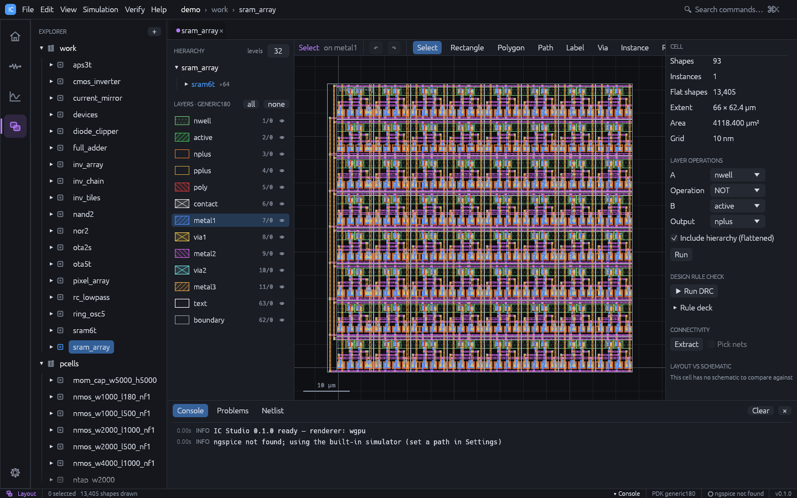
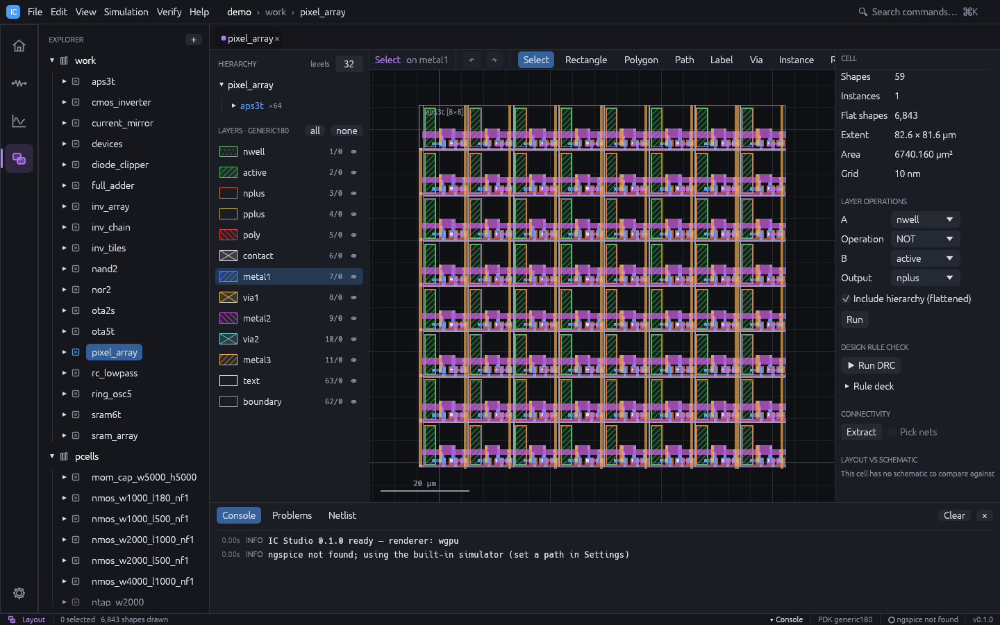
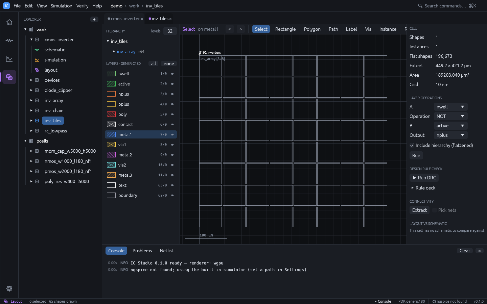
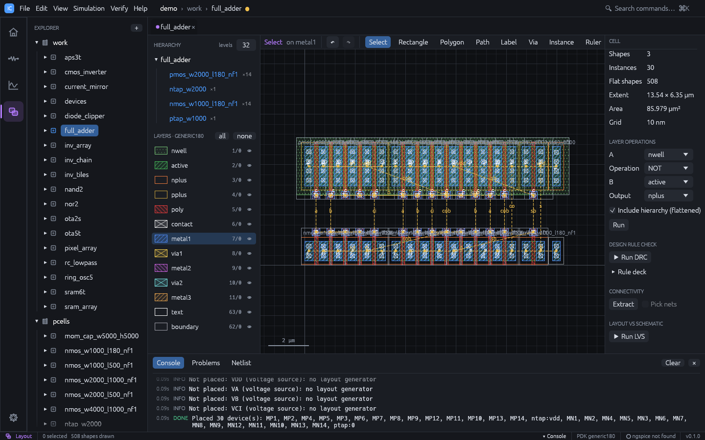
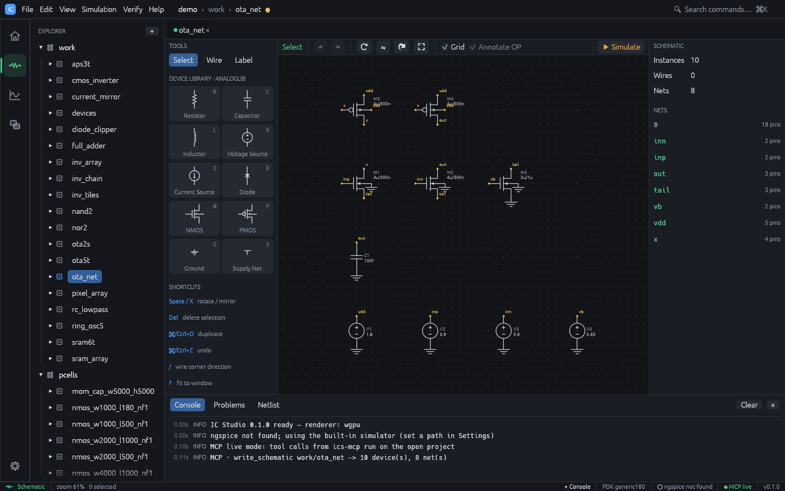

# Demo gallery

Every example below ships with IC Studio. Open them all with:

```sh
cargo run --release -- --demo
```

or choose **Open demo project** on the welcome page. The demo uses the generic 180 nm
technology and lives in memory until you save it with `Ctrl+S`. To jump straight to a cell,
add `--cell <name> --workspace <schematic|simulation|layout>`.

The second half of this page has [step-by-step demo scripts](#demo-scripts) for showing
IC Studio to an audience.

## Highlights

<div class="ics-gallery">

<div class="ics-card">



### `full_adder` <span class="ics-tag">auto P&amp;R</span>

A 28-transistor mirror full adder whose layout was never drawn: devices placed from the
schematic with shared diffusion, every net maze-routed on metal1 to metal3. DRC and LVS
clean.

</div>

<div class="ics-card">



### `ota2s` <span class="ics-tag">auto P&amp;R</span> <span class="ics-tag">analog</span>

A two-stage OTA. The input pair and the current mirror are recognised, split into unit
fingers, placed in common-centroid order with dummies, then routed. About 80 dB
open-loop gain.

</div>

<div class="ics-card">



### `full_adder` simulation

The adder's transient run cycles through all eight input combinations; the sum and carry
waveforms are the truth table.

</div>

<div class="ics-card">



### `sram_array`

An 8 × 8 array of the 6T bit cell `sram6t`, with word lines, bit lines and supply
straps. The bit cell itself is DRC and LVS clean and simulates a write and hold.

</div>

<div class="ics-card">



### `pixel_array`

An 8 × 8 array of 3T image sensor pixels (`aps3t`: reset, source follower, row select
over an n+ / p-substrate photodiode) with labelled rows and columns.

</div>

<div class="ics-card">



### `inv_tiles`

8,192 inverters in two levels of arrays, about 250k flattened shapes. Level-of-detail
rendering keeps pan and zoom smooth.

</div>

</div>

## All demo cells

| Cell | What it shows |
|---|---|
| `full_adder` | 28T mirror full adder, placed and routed automatically; transient over all input combinations |
| `ota2s` | Two-stage OTA, auto P&R with common-centroid matching; about 80 dB open-loop gain in AC |
| `cmos_inverter` | Inverter with a hand-drawn layout; LVS reports deliberate findings (PMOS W, load cap) |
| `rc_lowpass` | RC low-pass filter (fc about 159 kHz): OP, AC and transient |
| `diode_clipper` | Resistor and shunt diode clipper: transient and DC sweep |
| `nand2` | 2-input NAND: schematic plus routed PCell layout, DRC and LVS clean |
| `nor2` | 2-input NOR: schematic plus routed PCell layout, DRC and LVS clean |
| `ring_osc5` | 5-stage ring oscillator, fully routed; slows down visibly with layout parasitics |
| `current_mirror` | NMOS current mirror with a 20 µA reference: DC sweep of the output |
| `ota5t` | 5-transistor OTA: about 42 dB open-loop gain in AC |
| `sram6t` | 6T SRAM bit cell, DRC and LVS clean: transient write and hold |
| `sram_array` | 8 × 8 array of `sram6t` |
| `aps3t` | 3T image sensor pixel, DRC and LVS clean: transient reset and integration |
| `pixel_array` | 8 × 8 array of `aps3t` |
| `inv_chain` | Four placed `cmos_inverter` instances |
| `inv_array` | 16 × 8 array of inverters |
| `inv_tiles` | 8 × 8 array of `inv_array`: 8,192 inverters, two levels of hierarchy |
| `devices` | One instance of every PCell |

Every cell with both a schematic and a layout (`full_adder`, `ota2s`, `nand2`, `nor2`,
`ring_osc5`, `current_mirror`, `ota5t`, `sram6t`, `aps3t`) runs the whole flow:
simulate, open the layout, run DRC and LVS, and simulate again with parasitics.

## Demo scripts

Each script is a sequence you can run in front of an audience, with the result to expect
at every step. The blue boxes suggest what to say.

### 1. Five-minute tour

The whole loop on one circuit: schematic, simulation, automatic layout, verification and
post-layout simulation.

1. Start the app on the adder's schematic:

   ```sh
   cargo run --release -- --demo --cell full_adder --workspace schematic
   ```

2. Press `F5`. The Simulation workspace opens with the transient run: `a`, `b` and `ci`
   step through all eight combinations, and `s` and `co` follow the truth table.
3. Press `Ctrl+4` for the layout. Select everything with `Ctrl+A` and press `Delete`.
   The layout is empty.
4. Choose **Verify > Generate Layout from Schematic**. The 28 transistors appear as PCells
   in a PMOS row over an NMOS row, with well taps, and dashed flylines show every
   connection still to make.
5. Choose **Verify > Route Flylines**. The flylines are replaced by metal1 to metal3 wires
   and vias; the console reports the nets routed.
6. In the right panel press **Run DRC** (no violations), then **Run LVS** (the layout
   matches the schematic).
7. Press `Ctrl+3`, tick **Include layout parasitics** and press `F5`. The console
   summarises the extracted capacitance and resistance, and the waveforms now include the
   wiring delay.

<div class="callout say">

**Say:** "Nothing here was drawn by hand. The layout comes from the schematic, the router
makes it DRC clean, LVS proves it is the same circuit, and the parasitics go straight back
into the simulation, all on one database."

</div>

### 2. Auto place and route, step by step

Slower, for an audience that cares about layout. Use the adder or the OTA.

| Step | Do | Expect |
|---|---|---|
| 1 | Open `full_adder` in the Layout workspace | The finished, routed layout |
| 2 | `Ctrl+A`, `Delete` | An empty layout |
| 3 | **Verify > Generate Layout from Schematic** | Devices placed; source / drain columns shared where nets allow; flylines on |
| 4 | Move a device with the mouse | Its flylines follow it: the link to the schematic is the instance name |
| 5 | `Ctrl+Z` | The device goes back |
| 6 | **Verify > Route Flylines** | All nets routed; the console lists nets, connections, vias and rip-ups |
| 7 | Click a device in the layout, then `Ctrl+2` | The same device is selected in the schematic (cross-probing) |
| 8 | **Run DRC**, **Run LVS** | No violations; layout matches schematic |



<div class="callout say">

**Say:** "The router is a maze router with rip-up and reroute. Its grid is aligned to the
device terminals, so what it draws is DRC clean by construction, and it labels the named
nets so LVS can anchor them."

</div>

### 3. Analog matching

Shows that the generator understands analog structure, not only connectivity.

1. Open `ota2s` in the Layout workspace, `Ctrl+A`, `Delete`.
2. **Verify > Generate Layout from Schematic**. The console reports the matched groups,
   for example the differential pair and the mirror placed as `ABBA` with dummy fingers
   at both ends.
3. **Verify > Route Flylines**, then **Run LVS**. LVS merges the unit fingers back into
   the seven schematic devices and ignores the dummies.
4. Press `Ctrl+3` and `F5`. The AC plot shows about 80 dB of open-loop gain.

<div class="callout say">

**Say:** "Differential pairs and current mirrors are detected from the schematic. They are
split into unit fingers and placed in common-centroid order, the way an analog layout
engineer would, and LVS still sees seven transistors."

</div>

### 4. Post-layout effects

1. Open `ring_osc5` in the Simulation workspace and press `F5`. Note the oscillation
   period.
2. Tick **Include layout parasitics** and press `F5` again. The period gets longer: the
   wire capacitance and resistance extracted from the layout slow the ring down.

### 5. Scale

1. Open `inv_tiles` in the Layout workspace: 8,192 inverters.
2. Zoom with `Ctrl`+wheel, pan with the wheel or the middle mouse button, `F` to fit.
3. Press `1`, `2` and `9` to change how many hierarchy levels are drawn, and double-click
   an instance to descend into it.

### 6. Command line and CI

The same flow without a window, from a SPICE netlist to a verified GDS. Save this as
`ota.cir`:

```spice
* two-stage OTA
M1 x inp tail 0 nmos w=4u l=500n
M2 o1 inn tail 0 nmos w=4u l=500n
M3 x x vdd vdd pmos w=8u l=500n
M4 o1 x vdd vdd pmos w=8u l=500n
M5 tail vb 0 0 nmos w=4u l=1u
M6 out o1 vdd vdd pmos w=16u l=500n
M7 out vb 0 0 nmos w=4u l=1u
VDD vdd 0 dc 1.8
VINP inp 0 dc 0.9 ac 1
VINN inn 0 dc 0.9
VB vb 0 dc 0.65
.ac dec 20 1k 10g
```

Then:

```sh
ics new demo                         # project with the demo cells
ics schematic demo my_ota ota.cir    # netlist -> schematic and simulation setup
ics route demo my_ota --place        # place, route, save
ics drc demo my_ota                  # 0 violations
ics lvs demo my_ota                  # layout matches schematic
ics sim demo my_ota --parasitics     # post-layout AC
ics gds demo my_ota -o my_ota.gds    # stream out
```

Every command exits non-zero on failure, so the sequence drops into a CI job as is. See
[Command line](cli.md).

### 7. An AI agent designs while you watch

With the [MCP server](mcp.md) registered in an agent such as Claude Code, start the app
(`cargo run --release -- --demo`) and ask the agent:

> In the open IC Studio project, create a cell `my_ota` from this netlist (paste
> `ota.cir`), generate its layout, route it, run DRC and LVS, then simulate AC and tell me
> the open-loop gain.

The status bar shows **MCP live**. The schematic appears in the window, then the placed
devices, the routed wires, the DRC and LVS results and the AC plot, each logged in the
console as `MCP · <tool> ...`. Every layout step can be undone with `Ctrl+Z`.



<div class="callout say">

**Say:** "The agent uses the same commands as the menus. It is not generating a file for
you to import; it is working in your session, and you can take over at any point."

</div>
