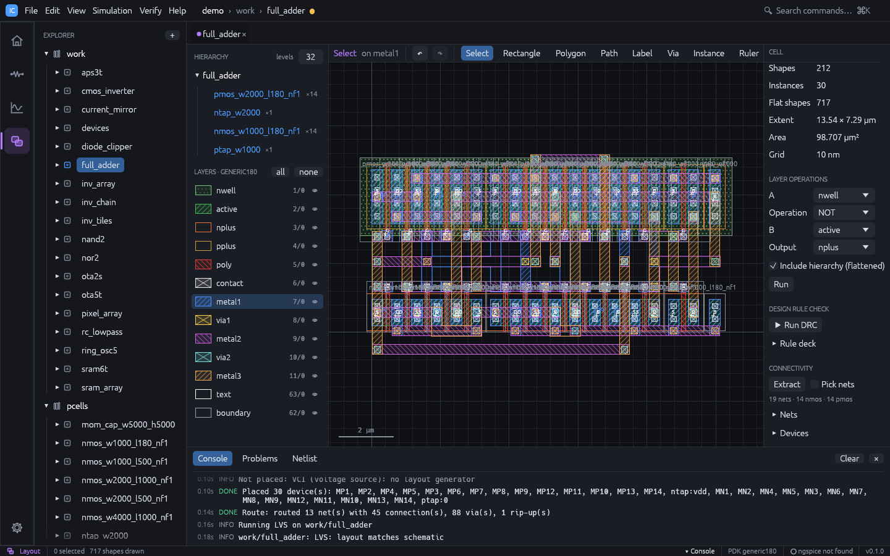

<div class="ics-hero">
<span class="ics-eyebrow">Open-source · full-custom IC design</span>
<p class="ics-title">From schematic to sign-off,<br>in one native app.</p>
<p class="ics-lede">IC Studio puts schematic capture, SPICE simulation, layout, automatic place and route,
DRC, LVS and parasitic extraction on one design database. Draw a circuit, generate its
layout, verify it and simulate it again with the parasitics, without leaving the window
or converting a single file.</p>
<div class="ics-actions">
<a class="ics-button primary" href="quick-tour.html">Take the quick tour</a>
<a class="ics-button" href="demos.html">See the demos</a>
<a class="ics-button" href="install.html">Install</a>
<a class="ics-button" href="https://github.com/geniuskey/ic-studio">GitHub</a>
</div>
</div>



<div class="ics-stats">
<div class="ics-stat"><b>28T</b><span>full adder placed and routed automatically, DRC and LVS clean</span></div>
<div class="ics-stat"><b>8,192</b><span>inverters (about 250k shapes) browsed interactively</span></div>
<div class="ics-stat"><b>3</b><span>front ends on one core: desktop app, CLI, MCP for AI agents</span></div>
<div class="ics-stat"><b>3 OS</b><span>Windows, Linux and macOS, GPU rendered with wgpu</span></div>
</div>

## One database, the whole loop

Most open-source flows chain separate tools through netlists and GDS files. In IC Studio
the schematic, the simulator and the layout share one design database, so every step
knows about the others:

<div class="ics-flow">
<span>Schematic</span><i>→</i>
<span>Simulate</span><i>→</i>
<span>Generate layout</span><i>→</i>
<span>Route</span><i>→</i>
<span>DRC · LVS</span><i>→</i>
<span>Extract parasitics</span><i>→</i>
<span class="loop">Simulate again ↺</span>
</div>

- Layouts are **generated from schematics** and **routed automatically**.
- Layouts are **checked against schematics** (LVS) with clickable differences.
- **Parasitics extracted from the layout** flow straight back into simulation.

## What you get

<div class="ics-grid">
<div class="ics-card">
<span class="ics-icon">SCH</span>
<h3>Schematic and simulation</h3>
<p>Live connectivity, operating-point annotation, DC / AC / transient analyses on a
built-in simulator or ngspice, Bode plots and automatic measurements.</p>
</div>
<div class="ics-card">
<span class="ics-icon">P&amp;R</span>
<h3>Automatic place and route</h3>
<p>Transistors placed as PCells with shared diffusion, common-centroid matching and
dummies; a rip-up-and-reroute maze router wires every net DRC-clean.</p>
</div>
<div class="ics-card">
<span class="ics-icon">LAY</span>
<h3>Hierarchical layout</h3>
<p>Instances and arrays, level-of-detail rendering for large designs, Boolean layer
operations, vias, PCells, GDSII and OASIS in and out.</p>
</div>
<div class="ics-card">
<span class="ics-icon">DRC</span>
<h3>Verification</h3>
<p>Rule-deck DRC with derived layers, connectivity extraction, LVS with device merging,
and sign-off runs through KLayout, Calibre or netgen.</p>
</div>
<div class="ics-card">
<span class="ics-icon">ADE</span>
<h3>Analysis tools</h3>
<p>A waveform calculator, corner, parametric and Monte Carlo sweeps with specs, yield
and datasheets, and run-to-run comparison of results.</p>
</div>
<div class="ics-card">
<span class="ics-icon">GEN</span>
<h3>Layout generators</h3>
<p>Guard rings, via arrays, common-centroid matched placement and density fill, plus a
visual DRC rule designer and Virtuoso-compatible SKILL.</p>
</div>
<div class="ics-card">
<span class="ics-icon">PDK</span>
<h3>Real PDKs</h3>
<p>Start on the generic 180 nm technology, then switch to SKY130 or IHP SG13G2: layers,
device recognition, models and corners from one PDK file.</p>
</div>
<div class="ics-card">
<span class="ics-icon">AI</span>
<h3>Scriptable and agent-ready</h3>
<p>Every action is a command. The <code>ics</code> CLI runs in CI, and the MCP server
lets an AI agent design in the window you are watching.</p>
</div>
</div>

## Try it in one minute

```sh
git clone https://github.com/geniuskey/ic-studio
cd ic-studio
cargo run --release -- --demo --cell full_adder --workspace layout
```

The demo project opens on an automatically placed and routed full adder. The
[demo gallery](demos.md) walks through every example and has ready-made scripts for
presenting IC Studio live.

## What is in the box

| Binary | Purpose |
|---|---|
| `ic-studio` | The desktop application |
| `ics` | Command-line interface for scripting and CI |
| `ics-mcp` | Model Context Protocol server for AI agents |

All three use the same core library, so a project edited in the app can be simulated,
checked or exported from the command line, or driven by an agent.

## Main concepts

- **Project**: a folder holding `ic-studio.json`, the technology (`tech.json`) and one
  folder per library. Everything is human-readable JSON that diffs well in git.
- **Library**: a named group of cells (the demo project has `work` and `pcells`).
- **Cell**: a design unit with up to three views: **schematic**, **simulation** (the
  analyses set up for the schematic) and **layout**.
- **Workspace**: the app has four workspaces, Home, Schematic, Simulation and Layout.
  The open cells appear as tabs shared by all workspaces; switching workspace shows the
  same cell in a different view.
- **Technology (PDK)**: layers, GDS numbers, display styles, design rules and electrical
  coefficients. New projects start with a generic 180 nm-class technology.

## How to read this guide

- New users: [Installation](install.md), then the [Quick tour](quick-tour.md).
- Showing IC Studio to others: the [Demo gallery](demos.md).
- Designing a circuit: [Schematic](schematic.md) and [Simulation](simulation.md).
- Drawing and checking layout: [Layout](layout.md), [Verification](verification.md) and
  [Schematic-driven layout](schematic-driven-layout.md).
- Measurements, corners, Monte Carlo and layout generators: [Tools](tools.md).
- Using a real PDK: [Technology](technology.md).
- Automation: [Command line](cli.md) and [MCP server](mcp.md).

Keyboard shortcuts are written for Windows and Linux (`Ctrl`). On macOS use `Cmd` instead.
Press `F1` in the app for the full shortcut list, or see [Keyboard shortcuts](shortcuts.md).
