# 명령줄 (`ics`)

`ics`는 데스크톱 앱과 같은 프로젝트 폴더를 다룹니다. 스크립트, 일괄 실행, CI에 사용하며,
`ics mcp`는 AI 에이전트용 [MCP 서버](mcp.md)도 실행합니다.
[릴리스 설치 프로그램](install.md#릴리스-설치)이 `PATH`에 등록해 줍니다. 소스에서는
`cargo build --release -p ics-cli`로 빌드하거나(바이너리 `target/release/ics`)
`cargo run -p ics-cli -- <args>`로 실행합니다.



- `<CELL>`은 `lib/cell` 또는 셀 이름만 씁니다(그 이름의 첫 번째 셀이 사용됩니다).
- 종료 코드 0은 성공입니다. 오류가 나면 stderr에 `error: <message>`를 출력하고 1로 종료합니다.
- `ics --help`와 `ics <command> --help`에서 모든 옵션을 설명합니다.

## 명령

| 명령 | 용도 |
|---|---|
| `ics mcp` | AI 에이전트용 MCP 서버를 stdio로 실행([MCP 서버](mcp.md) 참고) |
| `ics new <DIR> [--template empty\|demo]` | 프로젝트 생성(기본 템플릿 `demo`) |
| `ics examples [DIR] [--force]` | 주제별 예제 프로젝트를 `DIR/<topic>`에 씀(`--force`가 없으면 기존 것은 유지). `DIR`이 없으면 주제 목록 출력 |
| `ics info <PROJECT>` | 라이브러리, 셀, 뷰 목록 |
| `ics netlist <PROJECT> <CELL>` | 셀의 SPICE 덱 출력 |
| `ics schematic <PROJECT> <CELL> <NETLIST> [--overwrite]` | SPICE 넷리스트 파일로 셀의 회로도를 만들거나 교체하고 저장 |
| `ics sim <PROJECT> <CELL> [--backend builtin\|ngspice\|auto] [--json] [--parasitics] [--compare [--tol T]]` | 셀에 저장된 설정으로 시뮬레이션. `--compare`는 내장 엔진을 ngspice와 대조 |
| `ics spice <FILE> [--backend builtin\|ngspice\|auto] [--json] [--compare [--tol T]]` | SPICE 파일을 파일 자체의 해석으로 시뮬레이션 |
| `ics mc <PROJECT> <CELL> --measure ANALYSIS:EXPR... [--runs N] [--seed S] [--avt V] [--abeta V] [--vto-sigma V] [--kp-sigma V] [--parasitics] [--json]` | 공정 변동과 Pelgrom 미스매치를 적용한 내장 엔진 몬테카를로 |
| `ics gds <PROJECT> <CELL> -o <FILE>` | 셀과 그 셀이 배치하는 모든 셀을 GDSII로 내보냄. `FILE`이 `.oas` / `.oasis`로 끝나면 OASIS |
| `ics gds-info <FILE>` | GDSII 또는 OASIS 파일의 계층 통계와 소요 시간 출력 |
| `ics import-gds <PROJECT> <FILE> [--lib NAME] [--skip-unknown-layers] [--json]` | GDSII 또는 OASIS 파일을 새 라이브러리로 가져옴 |
| `ics lef export <PROJECT> <CELL>... [-o FILE] [--obs detailed\|block\|none] [--class CLASS]` | 테크놀로지 헤더와 함께 셀의 LEF 추상을 씀(`-o`가 없으면 stdout) |
| `ics lef import <PROJECT> <FILE> [--lib NAME]` | LEF 매크로를 새 라이브러리의 레이아웃 셀로 가져오고 저장 |
| `ics def export <PROJECT> <CELL> [-o FILE] [--lef FILE]` | 최상위 셀을 DEF로 씀. `--lef`는 배치된 셀의 추상도 씀 |
| `ics def import <PROJECT> <FILE> [--lib NAME]` | DEF를 프로젝트 셀을 배치하는 새 최상위 셀로 가져오고 저장 |
| `ics lib-storage <PROJECT> <LIB> gds\|json` | 라이브러리의 디스크 저장 방식 변경 |
| `ics import-tech <PROJECT> <LYP> [--lyt FILE]` | KLayout `.lyp`로 테크놀로지 레이어 교체 |
| `ics load-pdk <PROJECT> <PDK>` | 테크놀로지를 PDK 파일로 교체(테크놀로지 참고) |
| `ics drc <PROJECT> <CELL> [--deck FILE] [--fix]` | DRC 실행(덱은 SVRF도 가능). 위반이 있으면 1로 종료 |
| `ics extract <PROJECT> <CELL>` | 추출된 넷리스트를 SPICE로 출력 |
| `ics lvs <PROJECT> <CELL>` | 레이아웃과 회로도 비교. 차이가 있으면 1로 종료 |
| `ics emir <PROJECT> <CELL> --net NET [--currents FILE] [--json]` | 라벨이 붙은 핀 기준으로 넷의 IR 드롭과 일렉트로마이그레이션 분석. 전류는 레이아웃 소자별(JSON) 또는 회로도의 동작점에서 가져옴. EM 위반이 있으면 1로 종료 |
| `ics opc <PROJECT> <CELL> --layer LAYER [--apply] [--sigma UM] [--threshold T] [--fragment UM] [--max-out UM] [--max-in UM] [--iterations N] [--gain G] [--json]` | 레이어의 광근접 보정. 보정 전후 EPE 출력. `--apply`는 마스크를 `<LAYER>_opc`에 쓰고(이전 마스크 교체, 그린 레이어는 바뀌지 않음) 저장 |
| `ics signoff <PROJECT> <CELL> [RUNSET]` | 외부 KLayout / Calibre / netgen 런셋 실행(RUNSET이 없으면 목록 출력). 위반이나 불일치가 있으면 1로 종료 |
| `ics route <PROJECT> <CELL> [--place]` | 플라이라인을 배선하고 저장. 배선되지 않은 넷이 남으면 1로 종료 |
| `ics compact <PROJECT> <CELL> [--dir left,down] [--no-infer]` | 지정한 방향으로 레이아웃을 압축하고 저장 |
| `ics diff <PROJECT> <CELL> [--rev REV \| --against DIR]` | 레이아웃을 git 리비전(기본 `HEAD`) 또는 다른 프로젝트와 비교. 다르면 1로 종료 |
| `ics optimize <PROJECT> <CELL> [--post-layout] [--apply] [--json]` | 셀의 스펙을 만족하도록 소자 사이징. 모든 스펙을 만족하는 포인트가 없으면 1로 종료 |
| `ics place-like <PROJECT> <CELL> --from <CELL> [--route]` | 같은 회로를 가진 완성된 셀처럼 배치하고 저장 |
| `ics skill <PROJECT> <FILE.il> [--no-save] [--json]` | 프로젝트에 Cadence SKILL 스크립트를 실행하고 저장. SKILL 오류가 나면 1로 종료 |

## 세부 사항

### 넷리스트로 회로도 만들기

`ics schematic`은 평탄한 SPICE 넷리스트(R, C, L, V, I, D, M 줄과 PDK MOS 서브서킷용 X 줄)를 읽어
셀의 회로도로 그립니다. 모든 핀에 넷 라벨이 붙고(노드 `0` 또는 `gnd`는 접지 심볼), 소자는 행 단위로
배치됩니다(PMOS, NMOS, 수동 소자, 소스). 해석 줄(`.op`, `.dc`, `.ac dec`, `.tran`)과 `.temp`는 셀의
시뮬레이션 설정이 되고, 그 밖의 점 명령(`.model`, `.include`, `.param`, `.ic`, `.meas`)은 추가
줄(extra lines)이 됩니다. 길이는 SPICE 단위인 미터입니다(`w=2u`). 단위 없는 `w=2`는 경고와 함께
µm로 읽습니다. `lib/cell`을 주지 않으면 셀은 `work` 라이브러리에 만들어집니다. 생성된 덱을 출력하고
프로젝트를 저장합니다.

```sh
ics schematic myproj ota ota.cir && ics route myproj ota --place && ics lvs myproj ota
```

### 시뮬레이션

`ics sim`은 앱에서 셀에 저장한 해석, 온도, 추가 줄, 백엔드를 사용합니다. `--backend`는 백엔드를
덮어씁니다(`auto`는 내장 엔진이 덱을 그대로 계산할 수 없을 때만 ngspice를 고릅니다.
[백엔드](simulation.md#auto) 참고). `--parasitics`는 레이아웃 기생 성분을 추가합니다(저장된 설정에서
켜져 있어도 적용됩니다). `--json`이 없으면 각 데이터셋의 제목과 포인트 수, 동작점 값과 소자 영역,
스윕의 벡터 이름을 출력합니다. 백엔드와, 내장 엔진이 근사하는 부분에 대한 경고는 stderr로 나갑니다.

`--json`을 주면 전체 결과가 stdout으로 나갑니다.

```json
{
  "backend": "built-in",
  "elapsed_ms": 3.1,
  "warnings": [],
  "datasets": [
    { "analysis": "tran", "title": "...", "vectors": { "time": [0, 1e-11], "v(out)": [0, 0.01] } }
  ]
}
```

AC 벡터는 `{ "re": [...], "im": [...] }` 형태입니다.

`ics spice deck.cir`은 임의의 SPICE 파일을 파일 안의 해석으로 시뮬레이션합니다(기본 백엔드는
built-in).

`--compare`는 덱을 ngspice(기준)와 내장 엔진에서 모두 실행하고 각 벡터의 최대 불일치를 출력합니다.
가장 큰 상대 오차가 `--tol`(기본 `0.05`)을 넘으면 1로 종료합니다.
[내장 엔진과 ngspice 비교](simulation.md#내장-엔진과-ngspice-비교)를 참고하십시오.

`ics mc`는 셀의 해석을 `--runs`번(기본 100, `--seed`로 재현 가능) 실행합니다. 극성별 전역 문턱 전압
및 트랜스컨덕턴스 변동(`--vto-sigma` 기본 `20m` V, `--kp-sigma` 기본 `0.03`)과, 소자별 미스매치
σ(ΔVth) = `avt` / √(W L), σ(Δβ/β) = `abeta` / √(W L)(`--avt` 기본 `5n` = 5 mV·µm, `--abeta` 기본
`10n` = 1 %·µm)을 적용합니다. 각 `--measure`는 해석과 스칼라 결과를 내는
[계산기](tools.md#waveform-calculator) 수식으로 이루어지며, 명령은 각각의 평균, 시그마, 최솟값,
최댓값을 출력합니다. 앱의 [Monte Carlo 창](simulation.md#monte-carlo-창)에서도 같은 실행을 할 수
있습니다.

```sh
ics mc demo ota5t --runs 200 --measure "op:v(out)" --measure "ac:bandwidth(v(out))"
```

### GDS

- `ics import-gds`는 `--skip-unknown-layers`를 주지 않으면 테크놀로지에 없는 레이어를 추가합니다.
  라이브러리 이름은 기본적으로 파일 이름입니다. 기본적으로 라이브러리는 프로젝트 안에 GDS 파일
  하나로 저장되며, `--json`을 주면 셀마다 JSON 폴더 하나로 저장합니다(편집 가능, diff에 유리, 크기가
  더 큼). `ics lib-storage`는 기존 라이브러리를 두 방식 사이에서 변환합니다.
- `ics gds`와 `ics import-gds`는 테크놀로지에 [스트림 레이어 맵](tools.md#stream-layer-map)이 있으면
  적용합니다.
- `ics gds-info`는 아무것도 쓰지 않고 GDS 파일을 읽어, 최상위 셀과 그 크기, 읽기 / 파싱 / 인덱싱
  시간을 출력합니다.

### 검증과 배선

- `ics drc`는 각 룰과 위반 수, 그리고 최대 50개의 마커 상자를 µm 단위로 출력합니다. `--deck FILE`은
  테크놀로지 덱 대신 덱 파일을 사용합니다. `--fix`는 먼저 셀의 최상위 지오메트리에 검증된 빠른 수정을
  적용하고 프로젝트를 저장한 뒤, 남은 위반을 보고합니다.
- `ics lvs`는 소자와 넷의 대응 쌍, 그리고 차이를 출력합니다.
- `ics route --place`는 먼저 레이아웃에 없는 회로도 소자를 배치하고(회로도 기반 레이아웃), 배선한
  다음 프로젝트를 저장합니다.

### 레이아웃 편집

- `ics compact`는 셀의 최상위 항목을 각 `--dir`(`left`, `right`, `down`, `up`. 기본 `left,down`)
  방향으로 차례로 룰에 막힐 때까지 밀고 저장합니다. 고정된 항목은 그대로 두고, 제약 조건은 유지되며,
  DRC 위반을 늘리는 이동은 취소됩니다. `--no-infer`를 주지 않으면 먼저 회로도의 매칭 소자에서 대칭
  제약을 추론합니다.
- `ics diff`는 셀의 평탄화된 레이아웃을 레이어별로 프로젝트의 git 리비전(`--rev`, 기본 `HEAD`)
  버전이나 다른 프로젝트 디렉터리의 같은 셀(`--against DIR`)과 XOR하여 차이를 출력합니다.
- `ics place-like`는 셀의 소자를 회로 토폴로지로 완성된 기준 셀(`--from`)과 매칭하고, 셀 자체의
  회로도 값으로 사이징하여 기준 셀처럼 배치합니다. `--route`를 주면 이어서 배선합니다.

### Optimizer

`ics optimize`는 앱(**Tools > Optimizer...**)에서 설정한 셀의 스펙(`sim.sweep.specs`)과 옵티마이저
변수(`sim.optimize`)를 사용합니다. 각 평가는 stderr에, 최적 값과 스펙 결과는 stdout에 출력합니다
(`--json`: `passed`, `evaluations`, `vars`, `specs`를 가진 객체 하나). `--post-layout`은 모든 후보를
먼저 배치, 배선, 추출합니다. `--apply`는 최적 값을 회로도에 쓰고 저장합니다.

### SKILL 스크립트

`ics skill`은 Cadence SKILL(`.il`) 파일을 프로젝트에 대해 실행합니다(`dbOpenCellViewByType`,
`dbCreateRect`, `dbCreateInst` 같은 레이아웃 호출, 좌표는 µm). 스크립트가 출력한 내용을 출력하고,
수정된 셀을 stderr에 나열하며, `--no-save`를 주지 않으면 프로젝트를 저장합니다. `--json`을 주면
stdout은 객체 하나입니다.

```json
{ "output": "...", "value": "t", "modified": ["work/inv_layout"] }
```

SKILL 오류가 나면 스크립트 출력을 출력한 뒤 `error: <file>:<line>: <message>`를 출력하고, 1로
종료하며 저장하지 않습니다.

## 예제

```sh
ics new demo --template demo
ics info demo
ics netlist demo cmos_inverter
ics sim demo rc_lowpass --json > rc.json
ics sim demo nand2 --backend ngspice
ics sim demo cmos_inverter --compare
ics sim demo ring_osc5 --parasitics
ics drc demo nand2 && ics lvs demo nand2
ics extract demo inv_chain
ics gds demo inv_tiles -o tiles.gds
ics def export demo inv_chain -o chain.def --lef chain.lef
ics import-gds demo chip.gds --lib chip
ics import-tech demo sky130A.lyp --lyt sky130A.lyt
ics skill demo make_pads.il --json
ics drc demo cmos_inverter --fix
ics diff demo nand2 --rev HEAD~1
```

셀의 CI 검사 예:

```sh
ics drc myproj work/opamp && ics lvs myproj work/opamp
```
