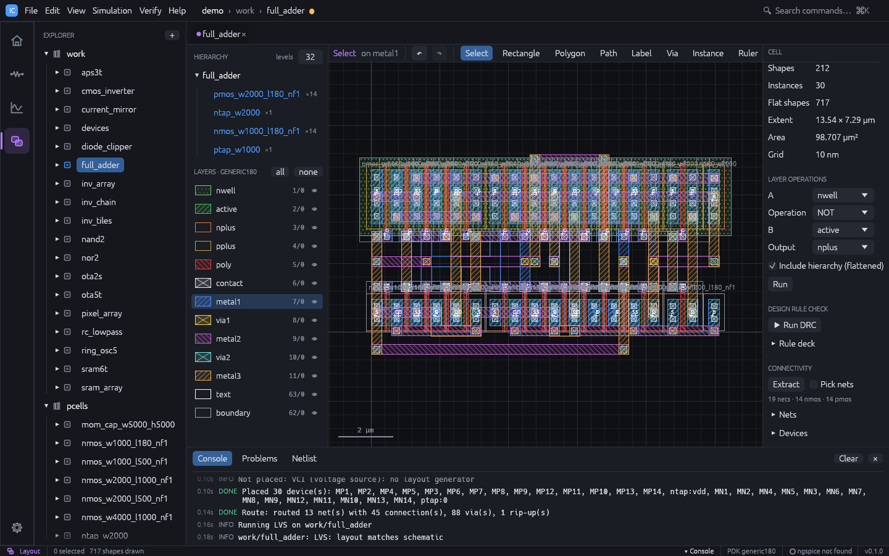
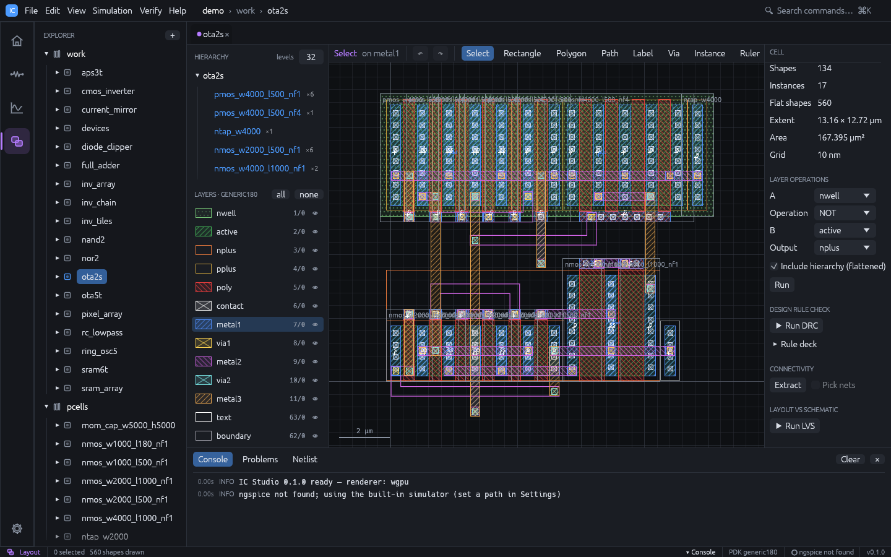
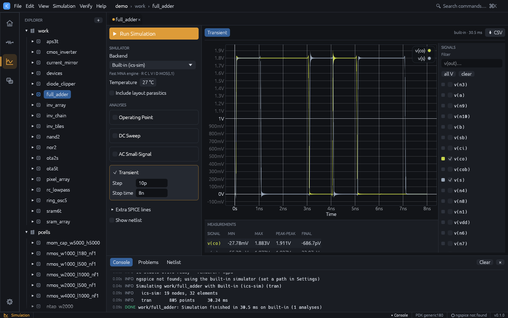
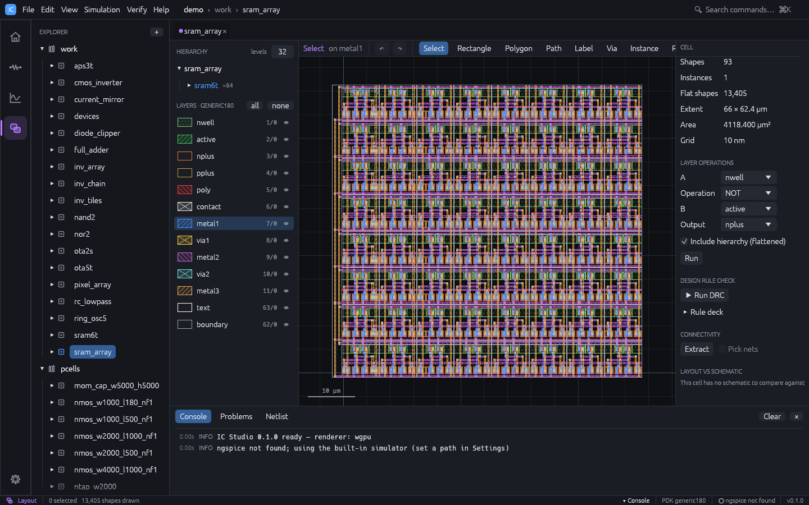
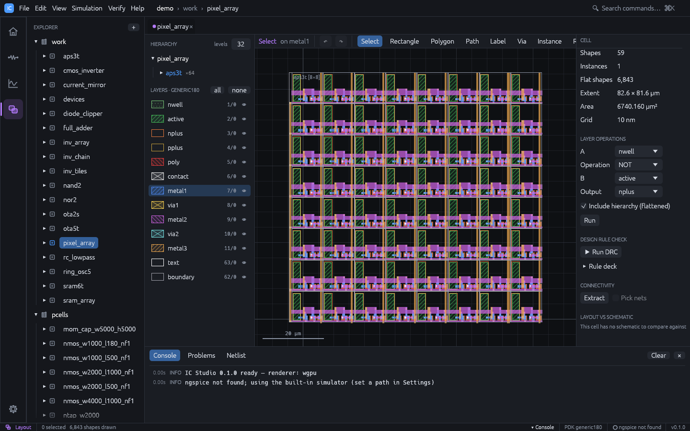
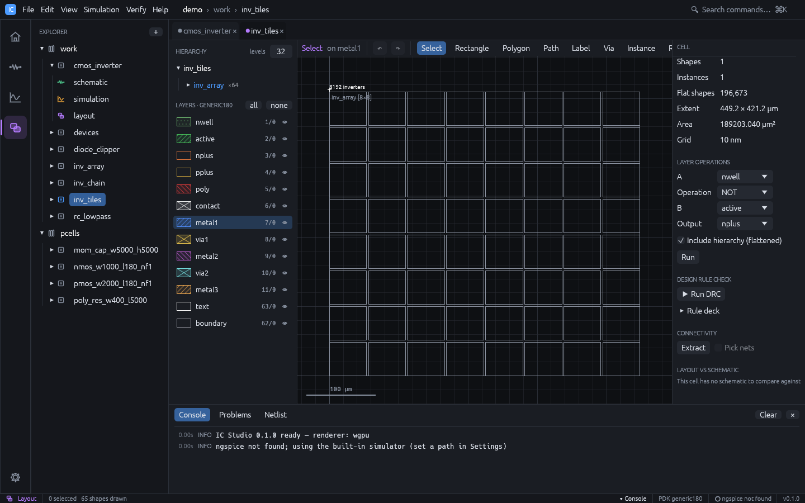
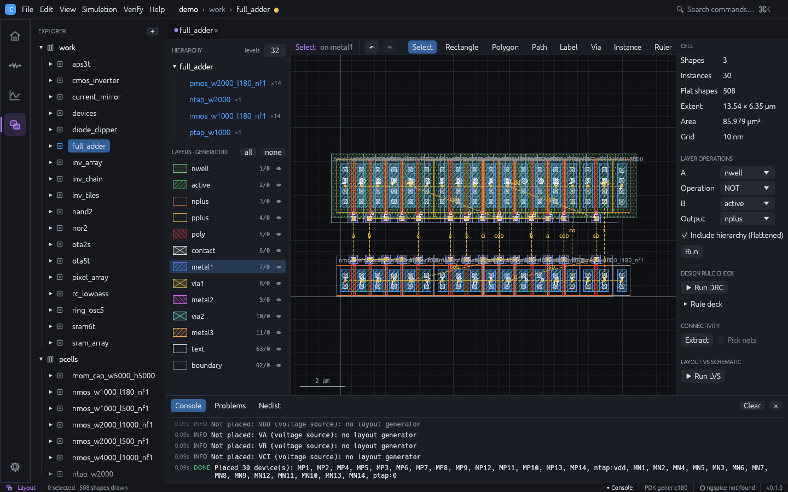
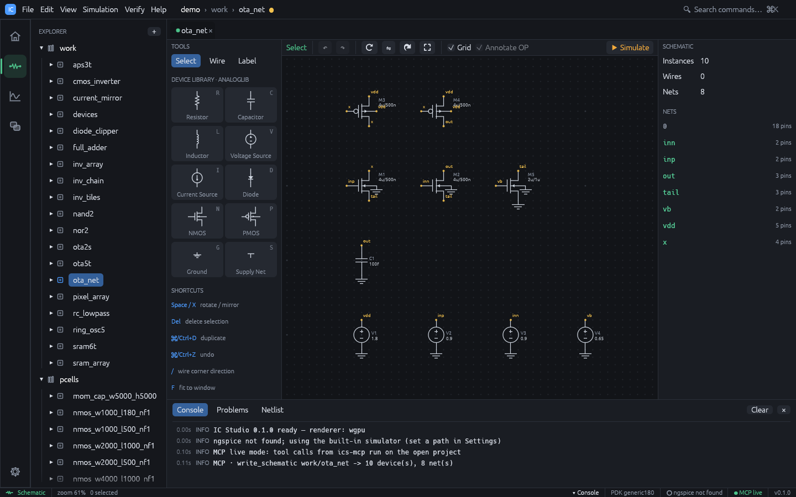

# 데모 갤러리

아래의 모든 예제는 IC Studio에 기본으로 포함되어 있습니다. 다음 명령으로 한꺼번에 엽니다.

```sh
cargo run --release -- --demo
```

또는 시작 페이지에서 **Open demo project**를 선택합니다. 데모는 범용 180 nm 테크놀로지를 사용하며
`Ctrl+S`로 저장하기 전까지 메모리에만 존재합니다. 특정 셀로 바로 이동하려면
`--cell <name> --workspace <schematic|simulation|layout>`을 덧붙입니다.

## 예제 프로젝트

같은 설계가 주제별로 나뉜 작은 프로젝트로도 제공됩니다. 시작 페이지의 **Examples** 카드나
**File > Open Example**로 엽니다(데모처럼 메모리에서 열림). 프로젝트 폴더로는
`Documents/IC Studio/Examples`에 있습니다. 설치 프로그램이 이 폴더에 쓰며, 설치나 업데이트 후 앱을
처음 시작할 때도 앱이 씁니다. 이미 있는 예제는 그대로 두므로 수정한 내용은 업데이트 후에도
유지됩니다. **File > Save Examples to Folder…**로 다른 위치에 쓸 수 있고, 명령줄에서는
`ics examples <DIR>`로 씁니다(`--force`가 없으면 기존 예제는 유지). `ics examples`는 목록을 표시합니다.

| 주제 | 셀 |
|---|---|
| `getting_started` | `cmos_inverter`, `rc_lowpass`, `diode_clipper`, `devices` |
| `analog` | `current_mirror`, `ota5t`, `ota2s` |
| `digital` | `nand2`, `nor2`, `ring_osc5`, `full_adder` |
| `memory_and_pixels` | `sram6t`, `sram_array`, `aps3t`, `pixel_array` |
| `hierarchy` | `inv_chain`, `inv_array`, `inv_tiles` |

각 주제에는 레이아웃이 배치하는 셀도 들어 있습니다. 예를 들어 `hierarchy`에는 `cmos_inverter`가,
`pcells`에는 PCell이 있습니다.

이 페이지의 후반부에는 청중 앞에서 IC Studio를 시연하기 위한
[단계별 데모 스크립트](#데모-스크립트)가 있습니다.

## 하이라이트

<div class="ics-gallery">

<div class="ics-card">



### `full_adder` <span class="ics-tag">자동 P&amp;R</span>

레이아웃을 한 번도 그리지 않은 28 트랜지스터 미러 전가산기입니다. 회로도에서 확산을 공유하도록
소자를 배치하고, 모든 넷을 metal1~metal3에 미로 배선했습니다. DRC와 LVS를 통과합니다.

</div>

<div class="ics-card">



### `ota2s` <span class="ics-tag">자동 P&amp;R</span> <span class="ics-tag">아날로그</span>

2단 OTA입니다. 입력 차동쌍과 전류 미러를 인식해 단위 핑거로 나누고, 더미와 함께
common-centroid 순서로 배치한 뒤 배선합니다. 개루프 이득은 약 80 dB입니다.

</div>

<div class="ics-card">



### `full_adder` 시뮬레이션

전가산기의 과도 해석은 여덟 가지 입력 조합을 모두 순회합니다. sum과 carry 파형이 곧 진리표입니다.

</div>

<div class="ics-card">



### `sram_array`

6T 비트 셀 `sram6t`의 8 × 8 어레이로, 워드 라인, 비트 라인, 전원 스트랩을 포함합니다. 비트 셀
자체는 DRC와 LVS를 통과하며 쓰기와 유지 동작을 시뮬레이션합니다.

</div>

<div class="ics-card">



### `pixel_array`

3T 이미지 센서 픽셀(`aps3t`: n+ / p-substrate 포토다이오드 위의 리셋, 소스 팔로워, 행 선택)의
8 × 8 어레이로, 행과 열에 레이블이 붙어 있습니다.

</div>

<div class="ics-card">



### `inv_tiles`

2단계 어레이로 구성한 인버터 8,192개, 평탄화하면 약 25만 개 도형입니다. LOD 렌더링 덕분에 이동과
확대·축소가 부드럽습니다.

</div>

</div>

## 전체 데모 셀

| 셀 | 보여 주는 내용 |
|---|---|
| `full_adder` | 자동 배치 배선된 28T 미러 전가산기, 모든 입력 조합에 대한 과도 해석 |
| `ota2s` | common-centroid 매칭을 적용해 자동 P&R한 2단 OTA, AC 개루프 이득 약 80 dB |
| `cmos_inverter` | 손으로 그린 레이아웃의 인버터, LVS가 의도적인 차이(PMOS W, 부하 커패시터)를 보고 |
| `rc_lowpass` | RC 저역 통과 필터(fc 약 159 kHz): OP, AC, 과도 해석 |
| `diode_clipper` | 저항과 션트 다이오드 클리퍼: 과도 해석과 DC 스윕 |
| `nand2` | 2입력 NAND: 회로도와 배선된 PCell 레이아웃, DRC와 LVS 통과 |
| `nor2` | 2입력 NOR: 회로도와 배선된 PCell 레이아웃, DRC와 LVS 통과 |
| `ring_osc5` | 완전히 배선된 5단 링 발진기, 레이아웃 기생 성분을 넣으면 눈에 띄게 느려짐 |
| `current_mirror` | 20 µA 기준 전류의 NMOS 전류 미러: 출력의 DC 스윕 |
| `ota5t` | 5 트랜지스터 OTA: AC 개루프 이득 약 42 dB |
| `sram6t` | DRC와 LVS를 통과한 6T SRAM 비트 셀: 과도 해석으로 쓰기와 유지 |
| `sram_array` | `sram6t`의 8 × 8 어레이 |
| `aps3t` | DRC와 LVS를 통과한 3T 이미지 센서 픽셀: 과도 해석으로 리셋과 적분 |
| `pixel_array` | `aps3t`의 8 × 8 어레이 |
| `inv_chain` | 배치된 `cmos_inverter` 인스턴스 4개 |
| `inv_array` | 인버터 16 × 8 어레이 |
| `inv_tiles` | `inv_array`의 8 × 8 어레이: 인버터 8,192개, 2단계 계층 |
| `devices` | 모든 PCell의 인스턴스 각 1개 |

회로도와 레이아웃이 모두 있는 셀(`full_adder`, `ota2s`, `nand2`, `nor2`, `ring_osc5`,
`current_mirror`, `ota5t`, `sram6t`, `aps3t`)은 전체 플로를 실행할 수 있습니다. 시뮬레이션, 레이아웃
열기, DRC와 LVS 실행, 기생 성분을 포함한 재시뮬레이션입니다.

## 데모 스크립트

각 스크립트는 청중 앞에서 그대로 진행할 수 있는 순서이며, 단계마다 예상되는 결과를 적어 두었습니다.
파란 상자는 말할 내용을 제안합니다.

### 1. 5분 둘러보기

회로 하나로 전체 루프를 보여 줍니다. 회로도, 시뮬레이션, 자동 레이아웃, 검증, 포스트 레이아웃
시뮬레이션입니다.

1. 전가산기 회로도로 앱을 시작합니다.

   ```sh
   cargo run --release -- --demo --cell full_adder --workspace schematic
   ```

2. `F5`를 누릅니다. Simulation 워크스페이스가 열리고 과도 해석 결과가 표시됩니다. `a`, `b`, `ci`가
   여덟 가지 조합을 모두 거치고, `s`와 `co`가 진리표대로 따라갑니다.
3. `Ctrl+4`를 눌러 레이아웃을 엽니다. `Ctrl+A`로 모두 선택하고 `Delete`를 누릅니다. 레이아웃이
   비워집니다.
4. **Verify > Generate Layout from Schematic**을 선택합니다. 28개 트랜지스터가 웰 탭과 함께 NMOS 행
   위의 PMOS 행에 PCell로 나타나고, 아직 연결해야 할 모든 곳이 점선 플라이라인으로 표시됩니다.
5. **Verify > Route Flylines**를 선택합니다. 플라이라인이 metal1~metal3 와이어와 비아로 바뀌고,
   콘솔에 배선된 넷이 보고됩니다.
6. 오른쪽 패널에서 **Run DRC**(위반 없음), 이어서 **Run LVS**(레이아웃이 회로도와 일치)를 누릅니다.
7. `Ctrl+3`을 누르고 **Include layout parasitics**를 체크한 뒤 `F5`를 누릅니다. 콘솔에 추출된
   커패시턴스와 저항이 요약되고, 파형에 배선 지연이 반영됩니다.

<div class="callout say">

**멘트:** "여기 있는 것 중 손으로 그린 것은 하나도 없습니다. 레이아웃은 회로도에서 만들어지고,
라우터가 DRC를 통과하도록 배선하며, LVS가 같은 회로임을 증명하고, 기생 성분은 곧바로 시뮬레이션으로
돌아갑니다. 모두 하나의 데이터베이스 위에서요."

</div>

### 2. 자동 배치 배선 단계별 시연

레이아웃에 관심이 많은 청중을 위해 천천히 진행합니다. 전가산기나 OTA를 사용합니다.

| 단계 | 할 일 | 예상 결과 |
|---|---|---|
| 1 | Layout 워크스페이스에서 `full_adder` 열기 | 완성되어 배선된 레이아웃 |
| 2 | `Ctrl+A`, `Delete` | 빈 레이아웃 |
| 3 | **Verify > Generate Layout from Schematic** | 소자 배치, 넷이 허용하는 곳에서 소스 / 드레인 열 공유, 플라이라인 표시 |
| 4 | 마우스로 소자 이동 | 플라이라인이 따라옴: 회로도와의 연결 고리는 인스턴스 이름 |
| 5 | `Ctrl+Z` | 소자가 원래 위치로 돌아감 |
| 6 | **Verify > Route Flylines** | 모든 넷 배선, 콘솔에 넷, 연결, 비아, rip-up 수 표시 |
| 7 | 레이아웃에서 소자 클릭 후 `Ctrl+2` | 회로도에서 같은 소자가 선택됨(크로스 프로빙) |
| 8 | **Run DRC**, **Run LVS** | 위반 없음, 레이아웃이 회로도와 일치 |



<div class="callout say">

**멘트:** "라우터는 rip-up and reroute 방식의 미로 라우터입니다. 그리드가 소자 단자에 정렬되어 있어서
그리는 결과가 구조적으로 DRC를 통과하고, LVS가 기준으로 삼을 수 있도록 이름 있는 넷에 레이블을
붙입니다."

</div>

### 3. 아날로그 매칭

생성기가 연결성뿐 아니라 아날로그 구조도 이해한다는 것을 보여 줍니다.

1. Layout 워크스페이스에서 `ota2s`를 열고 `Ctrl+A`, `Delete`.
2. **Verify > Generate Layout from Schematic**. 콘솔에 매칭 그룹이 보고됩니다. 예를 들어 차동쌍과
   미러가 양 끝에 더미 핑거를 두고 `ABBA`로 배치됩니다.
3. **Verify > Route Flylines** 후 **Run LVS**. LVS는 단위 핑거를 다시 회로도의 일곱 소자로 병합하고
   더미는 무시합니다.
4. `Ctrl+3`과 `F5`를 누릅니다. AC 플롯에 약 80 dB의 개루프 이득이 표시됩니다.

<div class="callout say">

**멘트:** "차동쌍과 전류 미러는 회로도에서 자동으로 감지됩니다. 아날로그 레이아웃 엔지니어가 하듯이
단위 핑거로 나뉘어 common-centroid 순서로 배치되고, LVS는 여전히 트랜지스터 일곱 개로 인식합니다."

</div>

### 4. 포스트 레이아웃 효과

1. Simulation 워크스페이스에서 `ring_osc5`를 열고 `F5`를 누릅니다. 발진 주기를 확인합니다.
2. **Include layout parasitics**를 체크하고 `F5`를 다시 누릅니다. 주기가 길어집니다. 레이아웃에서
   추출한 배선 커패시턴스와 저항이 링 발진기를 느리게 합니다.

### 5. 규모

1. Layout 워크스페이스에서 `inv_tiles`를 엽니다. 인버터 8,192개입니다.
2. `Ctrl`+휠로 확대·축소하고, 휠이나 마우스 가운데 버튼으로 이동하며, `F`로 화면에 맞춥니다.
3. `1`, `2`, `9`를 눌러 표시할 계층 깊이를 바꾸고, 인스턴스를 더블클릭해 안으로 들어갑니다.

### 6. 명령줄과 CI

창 없이 SPICE 넷리스트에서 검증된 GDS까지 같은 플로를 진행합니다. 다음을 `ota.cir`로 저장합니다.

```spice
* two-stage OTA
M1 x inp tail 0 nmos w=4u l=500n
M2 o1 inn tail 0 nmos w=4u l=500n
M3 x x vdd vdd pmos w=8u l=500n
M4 o1 x vdd vdd pmos w=8u l=500n
M5 tail vb 0 0 nmos w=4u l=1u
M6 out o1 vdd vdd pmos w=16u l=500n
M7 out vb 0 0 nmos w=4u l=1u
VDD vdd 0 dc 1.8
VINP inp 0 dc 0.9 ac 1
VINN inn 0 dc 0.9
VB vb 0 dc 0.65
.ac dec 20 1k 10g
```

그다음:

```sh
ics new demo                         # 데모 셀이 들어 있는 프로젝트
ics schematic demo my_ota ota.cir    # 넷리스트 -> 회로도와 시뮬레이션 설정
ics route demo my_ota --place        # 배치, 배선, 저장
ics drc demo my_ota                  # 위반 0개
ics lvs demo my_ota                  # 레이아웃이 회로도와 일치
ics sim demo my_ota --parasitics     # 포스트 레이아웃 AC
ics gds demo my_ota -o my_ota.gds    # 스트림 아웃
```

모든 명령은 실패하면 0이 아닌 코드로 종료하므로 이 순서를 그대로 CI 작업에 넣을 수 있습니다.
[명령줄](cli.md)을 참고하세요.

### 7. 지켜보는 동안 AI 에이전트가 설계하기

Claude Code 같은 에이전트에 [MCP 서버](mcp.md)를 등록한 상태에서 앱을 시작하고
(`cargo run --release -- --demo`) 에이전트에게 다음과 같이 요청합니다.

> 열려 있는 IC Studio 프로젝트에서 이 넷리스트(`ota.cir` 붙여넣기)로 셀 `my_ota`를 만들고,
> 레이아웃을 생성해 배선한 뒤 DRC와 LVS를 실행하고, AC 시뮬레이션을 해서 개루프 이득을 알려 줘.

상태 표시줄에 **MCP live**가 표시됩니다. 창에 회로도가 나타나고, 이어서 배치된 소자, 배선된
와이어, DRC와 LVS 결과, AC 플롯이 차례로 나타나며, 각 단계는 콘솔에 `MCP · <tool> ...`로 기록됩니다.
모든 레이아웃 단계는 `Ctrl+Z`로 되돌릴 수 있습니다.



<div class="callout say">

**멘트:** "에이전트는 메뉴와 똑같은 명령을 사용합니다. 가져올 파일을 생성하는 것이 아니라 여러분의
세션 안에서 직접 작업하며, 언제든지 이어받을 수 있습니다."

</div>
