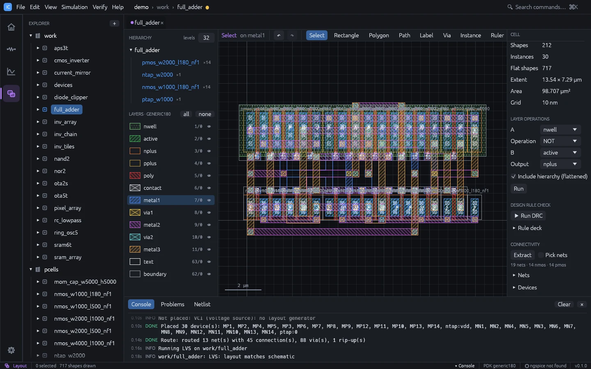

<!-- seo title="IC Studio: 오픈소스 풀커스텀 IC 설계 소프트웨어" description="회로도 입력, SPICE 시뮬레이션, 레이아웃, 자동 배치 배선, DRC, LVS, 기생 성분 추출을 하나의 네이티브 앱에서 다루는 오픈소스 IC 설계 환경." -->

<div class="ics-hero">
<span class="ics-eyebrow">오픈 소스 · 풀 커스텀 IC 설계</span>
<h1 class="ics-title">회로도부터 사인오프까지,<br>하나의 네이티브 앱에서.</h1>
<p class="ics-lede">IC Studio는 회로도 입력, SPICE 시뮬레이션, 레이아웃, 자동 배치 배선, DRC, LVS,
기생 성분 추출을 하나의 설계 데이터베이스 위에서 제공합니다. 회로를 그리고, 레이아웃을
생성하고, 검증한 뒤 기생 성분을 포함해 다시 시뮬레이션하기까지 창을 벗어나거나 파일을
하나도 변환할 필요가 없습니다.</p>
<div class="ics-actions">
<a class="ics-button primary" href="quick-tour.html">빠른 둘러보기</a>
<a class="ics-button" href="demos.html">데모 보기</a>
<a class="ics-button" href="install.html">설치</a>
<a class="ics-button" href="https://github.com/geniuskey/ic-studio">GitHub</a>
</div>
</div>



<div class="ics-stats">
<div class="ics-stat"><b>28T</b><span>전가산기를 자동으로 배치 배선, DRC와 LVS 통과</span></div>
<div class="ics-stat"><b>8,192</b><span>개 인버터(약 25만 개 도형)를 끊김 없이 탐색</span></div>
<div class="ics-stat"><b>3</b><span>가지 프런트엔드, 하나의 코어: 데스크톱 앱, CLI, AI 에이전트용 MCP</span></div>
<div class="ics-stat"><b>3 OS</b><span>Windows, Linux, macOS 지원, wgpu로 GPU 렌더링</span></div>
</div>

## 하나의 데이터베이스, 전체 설계 루프

대부분의 오픈 소스 플로는 넷리스트와 GDS 파일로 별개의 도구를 이어 붙입니다. IC Studio에서는
회로도, 시뮬레이터, 레이아웃이 하나의 설계 데이터베이스를 공유하므로 각 단계가 서로의 정보를
알고 있습니다.

<div class="ics-flow">
<span>회로도</span><i>→</i>
<span>시뮬레이션</span><i>→</i>
<span>레이아웃 생성</span><i>→</i>
<span>배선</span><i>→</i>
<span>DRC · LVS</span><i>→</i>
<span>기생 성분 추출</span><i>→</i>
<span class="loop">다시 시뮬레이션 ↺</span>
</div>



- 레이아웃은 **회로도에서 생성**되고 **자동으로 배선**됩니다.
- 레이아웃은 **회로도와 대조 검사**(LVS)되며, 차이 항목을 클릭해 바로 찾아갈 수 있습니다.
- **레이아웃에서 추출한 기생 성분**이 곧바로 시뮬레이션에 반영됩니다.

## 주요 기능

<div class="ics-grid">
<div class="ics-card">
<span class="ics-icon">SCH</span>
<h3>회로도와 시뮬레이션</h3>
<p>실시간 연결성, 동작점 주석 표시, ngspice와 결과를 맞춘 내장 시뮬레이터(필요하면
ngspice를 자동 선택)로 DC / AC / 과도 / 잡음 해석, Bode 플롯과 자동 측정을 제공합니다.</p>
</div>
<div class="ics-card">
<span class="ics-icon">P&amp;R</span>
<h3>자동 배치 배선</h3>
<p>트랜지스터를 확산 공유, common-centroid 매칭, 더미를 적용한 PCell로 배치하고,
rip-up-and-reroute 미로 라우터가 모든 넷을 DRC 위반 없이 배선합니다.</p>
</div>
<div class="ics-card">
<span class="ics-icon">LAY</span>
<h3>계층형 레이아웃</h3>
<p>인스턴스와 어레이, 대형 설계를 위한 LOD 렌더링, 임의 각도에서도 정확한 레이어 불리언
연산, 비아, PCell, GDSII, OASIS, LEF, DEF 입출력을 지원합니다.</p>
</div>
<div class="ics-card">
<span class="ics-icon">DRC</span>
<h3>검증</h3>
<p>증분 실시간 검사를 지원하는 룰 덱 기반 DRC, 트랜지스터·저항·커패시터 추출과 LVS,
IR 드롭과 일렉트로마이그레이션, KLayout·Calibre·netgen을 통한 사인오프 실행을 제공합니다.</p>
</div>
<div class="ics-card">
<span class="ics-icon">ADE</span>
<h3>분석 도구</h3>
<p>파형 계산기, 코너 및 파라메트릭 스윕, 공정 편차와 Pelgrom 미스매치를 반영한 몬테카를로,
스펙·수율·데이터시트, 실행 간 결과 비교를 제공합니다.</p>
</div>
<div class="ics-card">
<span class="ics-icon">GEN</span>
<h3>레이아웃 생성기</h3>
<p>가드 링, 비아 어레이, common-centroid 매칭 배치, 밀도 필, 모델 기반 OPC에 더해
시각적 DRC 룰 디자이너와 Virtuoso 호환 SKILL을 제공합니다.</p>
</div>
<div class="ics-card">
<span class="ics-icon">PDK</span>
<h3>실제 PDK</h3>
<p>범용 180 nm 테크놀로지로 시작해 SKY130이나 IHP SG13G2로 전환할 수 있습니다. 레이어,
소자 인식, 모델, 코너를 PDK 파일 하나로 설정합니다.</p>
</div>
<div class="ics-card">
<span class="ics-icon">AI</span>
<h3>스크립트와 AI 에이전트 지원</h3>
<p>모든 동작은 명령입니다. <code>ics</code> CLI는 CI에서 실행되고, MCP 서버를 통해 AI
에이전트가 여러분이 보고 있는 창에서 직접 설계합니다.</p>
</div>
</div>

## 1분 만에 실행해 보기

```sh
git clone https://github.com/geniuskey/ic-studio
cd ic-studio
cargo run --release -- --demo --cell full_adder --workspace layout
```

[릴리스를 설치](install.md#릴리스-설치)했다면 대신
`ic-studio --demo --cell full_adder --workspace layout`을 실행합니다. 데모 프로젝트가 자동으로
배치 배선된 전가산기를 연 상태로 시작합니다. [데모 갤러리](demos.md)에서 모든 예제를 살펴볼 수
있으며, IC Studio를 실시간으로 시연하기 위한 스크립트도 준비되어 있습니다.

## 구성

두 프로그램이 함께 설치됩니다.

| 프로그램 | 용도 |
|---|---|
| `ic-studio` | 데스크톱 애플리케이션 |
| `ics` | 스크립트와 CI용 명령줄 인터페이스 |
| `ics mcp` | 같은 `ics` 프로그램을 AI 에이전트용 Model Context Protocol 서버로 실행 |

세 프런트엔드는 모두 같은 코어 라이브러리를 사용합니다. 따라서 앱에서 편집한 프로젝트를
명령줄에서 시뮬레이션·검사·내보내기 하거나 에이전트로 조작할 수 있습니다.

## 주요 개념

- **프로젝트**: `ic-studio.json`, 테크놀로지(`tech.json`), 라이브러리별 폴더를 담은 폴더입니다.
  모든 내용이 사람이 읽을 수 있는 JSON이라 git에서 diff가 잘 됩니다.
- **라이브러리**: 이름이 붙은 셀 묶음입니다(데모 프로젝트에는 `work`와 `pcells`가 있습니다).
- **셀**: 최대 세 개의 뷰를 갖는 설계 단위입니다. **schematic**(회로도), **simulation**(회로도에
  설정된 해석), **layout**(레이아웃) 뷰가 있습니다.
- **워크스페이스**: 앱에는 Home, Schematic, Simulation, Layout의 네 워크스페이스가 있습니다.
  열린 셀은 모든 워크스페이스가 공유하는 탭으로 표시되며, 워크스페이스를 전환하면 같은 셀을
  다른 뷰로 보여 줍니다.
- **테크놀로지(PDK)**: 레이어, GDS 번호, 표시 스타일, 디자인 룰, 전기적 계수입니다. 새 프로젝트는
  범용 180 nm급 테크놀로지로 시작합니다.

## 이 가이드 읽는 법

- 처음 사용하는 경우: [설치](install.md) 후 [빠른 둘러보기](quick-tour.md), 또는 앱에서
  **Help > Interactive Tutorial**.
- IC Studio를 다른 사람에게 시연하는 경우: [데모 갤러리](demos.md).
- 회로 설계: [회로도](schematic.md)와 [시뮬레이션](simulation.md).
- 레이아웃 작성과 검사: [레이아웃](layout.md), [검증](verification.md),
  [회로도 기반 레이아웃](schematic-driven-layout.md).
- 측정, 코너, 몬테카를로, 레이아웃 생성기: [도구](tools.md).
- 실제 PDK 사용: [테크놀로지](technology.md).
- 자동화: [명령줄](cli.md)과 [MCP 서버](mcp.md).

단축키는 Windows와 Linux 기준(`Ctrl`)으로 표기합니다. macOS에서는 `Cmd`를 사용합니다.
앱에서 `F1`을 누르면 전체 단축키 목록이 표시되며, [단축키](shortcuts.md) 페이지에서도 볼 수 있습니다.
