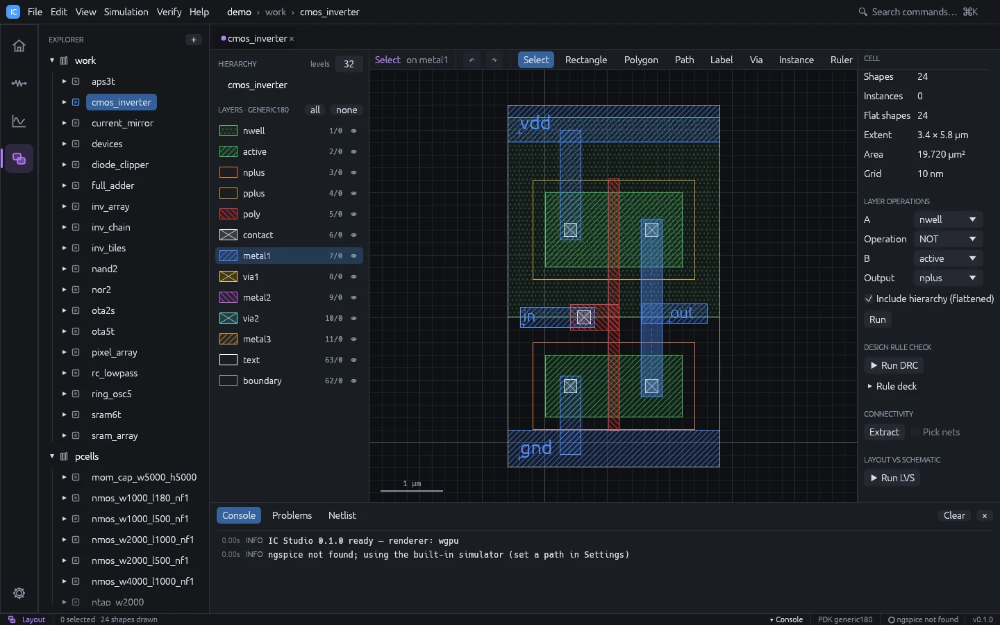
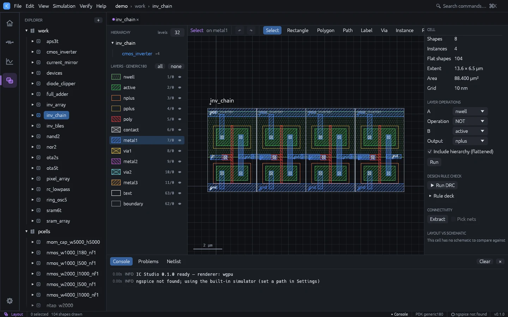
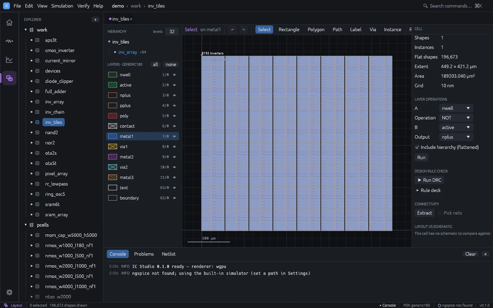

<!-- seo title="IC 레이아웃 편집기: 레이어, 계층, GDSII" description="IC Studio 레이아웃 편집: 레이어별 도형 그리기, 편집과 정렬, 계층 구성, SKILL 스크립트, GDSII, LEF, DEF 파일 교환." -->

# 레이아웃 편집기

셀의 레이아웃 뷰를 엽니다(셀이 열려 있으면 `Ctrl+4`). 레이아웃 좌표는 데이터베이스 단위(dbu)이며,
generic 테크놀로지에서 1 dbu = 1 nm이고 y축은 위쪽을 향합니다. 인스펙터에는 µm로 표시됩니다. 모든
점은 스냅 그리드(툴바의 **Snap** 필드, 테크놀로지 그리드의 배수)에 맞춰집니다. 편집기는 Virtuoso
관례를 따릅니다. 캔버스 왼쪽 위에 프롬프트가 표시되는 두 번 클릭 방식의 명령, 바인드키(`S` 늘이기,
`M` 이동, `C` 복사, `Shift+C` 잘라내기(chop), `O` 비아, `T` 레이어 탭, `u` 실행 취소, `Z` 확대 박스,
`W` 이전 뷰, `q` 속성, `F3` 명령 옵션, `F4` 부분 선택 등. [단축키](shortcuts.md) 참고), 떠 있는
옵션 폼, 가운데 클릭 팝업 메뉴, 그래비티 스냅, 디자인 룰 기반 피드백을 제공합니다. Layout
워크스페이스에서는 메뉴 바에 **Create**와 **Options** 메뉴가 추가되고 **Edit**, **View**,
**Verify** 메뉴에 레이아웃 명령이 들어갑니다. 모든 항목에 바인드키가 표시되며, 명령 팔레트에는
"Layout <menu>: <item>" 형식으로 나열됩니다.



- **왼쪽 패널**: **Hierarchy**(표시 레벨과 배치된 셀의 트리), **Layers**, 현재 도구의 옵션.
- **툴바**: 실행 취소 / 다시 실행, 도구(**Select**, **Stretch**, **Move**, **Copy**,
  **Rectangle**, **Polygon**, **Path**, **Label**, **Via**, **Instance**, **Chop**, **Split**, **Ruler**),
  맞춤(fit), **Zoom box**, **Prev view**, **Grid**, **Snap**, **Gravity**, **DRD**,
  **Constraints**, **Magnet**, **Live DRC**, **Flylines**, 그리고 셀을 내보내는 **GDS**.
- **상태 표시줄**: 커서의 `X` / `Y`, 명령 진행 중에는 기준점으로부터의 `dX`, `dY`, `Dist`,
  `Sel: n`(부분 선택이면 `Sel(P): n`), 현재 도구를 나타내는 `Cmd:`, 그리고 각 마우스 버튼이
  지금 하는 일을 알려 주는 `mouse L: … M: … R: …` 줄.
- **오른쪽 패널**: 셀 통계 또는 인스펙터, **Edit** 작업, **Layer operations**, 검증 섹션
  ([검증](verification.md) 참고).

## 레이어

- 레이어 행을 클릭하면 **활성 레이어**가 됩니다. 새 도형은 이 레이어에 그려집니다.
- 눈 아이콘을 클릭하면 레이어를 보이거나 숨깁니다. 눈 왼쪽의 작은 상자를 클릭하면 레이어의
  **선택 가능** 여부를 바꿉니다. 선택할 수 없는(또는 숨긴) 레이어의 도형은 그려지지만 선택되지
  않습니다(Virtuoso의 LSW와 같습니다). **AV** / **NV**는 모든 레이어를 보이기 / 숨기기,
  **AS** / **NS**는 모든 레이어를 선택 가능 / 불가능하게 합니다.
- **Filter**는 이름으로 목록을 좁히고, **Instances selectable**은 배치된 셀을 선택할 수 있는지
  정합니다.
- 각 행에는 채우기 패턴, 이름, GDS `layer/datatype`이 표시됩니다. 행 위에 마우스를 올리면 최소
  폭과 간격이 보입니다.
- 레이어는 Virtuoso 디스플레이 패킷처럼 그려집니다. 채움 색의 스티플이 창 기준으로 고정되고,
  외곽선은 외곽선 색과 선 스타일로 그립니다([테크놀로지](technology.md) 참고). 행을 더블클릭하거나
  우클릭 후 **Edit display...**를 고르면 **Layer Display** 편집기가 열립니다(**Tools > Layer
  Display...**로도 열 수 있습니다). Virtuoso의 Display Resource Editor에 해당하며, 레이어마다 채움
  색과 외곽선 색, 채움 스타일, 비트 단위로 그릴 수 있는 스티플 비트맵(최대 32 × 32), 선 스타일을
  미리보기와 함께 편집합니다. **Apply**를 누르면 테크놀로지에 저장됩니다.

## 그리기



키는 마우스가 캔버스 위에 있을 때만 캔버스에 적용됩니다.

| 도구 | 키 | 사용법 |
|---|---|---|
| Select | `Esc` | 클릭, `Shift`/`Ctrl`+클릭, 또는 박스 드래그 |
| Stretch | `S` | 도형의 변이나 꼭짓점을 클릭한 뒤 목적지를 클릭(또는 드래그). 또는 변에서 떨어진 곳에서 박스를 드래그하면 안쪽 꼭짓점이 부분 선택이 되고, 이어서 기준점과 목적지를 클릭 |
| Rectangle | `R` | 모서리에서 모서리로 드래그하거나 두 모서리를 클릭. 크기가 표시됨 |
| Polygon | `Shift+P` | 꼭짓점마다 클릭. `Enter`, 더블 클릭 또는 오른쪽 클릭으로 닫음 |
| Path | `P` | 점을 클릭. `Enter`, 더블 클릭 또는 오른쪽 클릭으로 끝냄 |
| Label | `L` | 왼쪽 패널에 **Text**를 입력하고 클릭해 배치 |
| Via | `O` | 왼쪽 패널에서 비아를 고르고 클릭하면 컷 하나, 드래그하면 영역을 채움 |
| Instance | `I` | 왼쪽 패널에서 셀이나 PCell을 고르고 클릭해 배치 |
| Chop | `Shift+C` | 박스를 드래그하거나 클릭. 선택한 도형(또는 박스에 닿는 모든 선택 가능한 도형)에서 그 영역을 잘라냄 |
| Split | `Shift+S` | 선의 두 점을 클릭. 선택한 도형(또는 선이 지나는 모든 선택 가능한 도형)을 그 선을 따라 둘로 자름 |
| Ruler | `K` | 두 점을 드래그하거나 클릭. 눈금자는 (Virtuoso cellview처럼) 셀과 함께 저장되고, 실행 취소할 수 있으며, `Shift+K`까지 남아 있음 |

폴리곤이나 패스를 그리는 동안 `Backspace`는 마지막 점을 지우고 `Esc`는 취소합니다.

- **Gravity**(기본으로 켜짐, `G`로 전환)는 커서를 주변 도형과 인스턴스 박스의 꼭짓점(마름모
  표시)과 변(원 표시)에 스냅하여 새 도형이 정확히 맞닿게 합니다.
- **DRD**(디자인 룰 기반 편집, 기본으로 켜짐)는 그리는 중인 사각형의 최소 간격 후광을 보여 주고,
  같은 레이어 도형과의 간격이 최소 간격보다 좁은 곳과 최소 폭보다 좁은 도형을 빨간색으로
  표시합니다. 사각형과 패스를 그릴 때, 이동, 복사, 붙여넣기 중에 동작합니다. 배치된 셀 안의 이웃
  도형(깊이와 무관)과 제자리 편집 중인 셀 주변 도형도 포함하며, 이동하거나 붙여넣는 인스턴스는
  외곽선을 따라 있는 도형으로 검사합니다.
- **Magnet**(기본으로 켜짐)은 그리거나 옮기는 도형이 이웃에 가까워지면 정확히 최소 간격 위치로
  끌어당깁니다.
- **Live DRC**(기본으로 켜짐)는 편집할 때마다 주변을 룰 덱으로 검사합니다.
  [Live DRC](verification.md#live-drc) 참고.
- **레이어 탭**: `T`는 커서 아래 도형의 레이어를 활성 레이어로 만듭니다.
- **배선 중 메탈 변경**: Path 도구에서 `+`(또는 `=` / `PageUp`)를 누르면 커서 위치에서 패스를
  끝내고, 위쪽 배선 레이어로 가는 비아를 놓은 뒤 그 레이어에서 이어 그립니다. `-`(또는
  `PageDown`)는 아래로 내려갑니다.

- **폴리곤**은 기본적으로 맨해튼입니다. 각 점은 이전 점과 수평 또는 수직으로 정렬됩니다. 클릭할
  때 `Shift`(또는 `Ctrl`)를 누르면 임의 각도가 됩니다. 닫는 변에는 모서리가 하나 추가되어 맨해튼
  외곽선이 유지됩니다.
- **패스**는 항상 맨해튼입니다. 왼쪽 패널의 **Width (nm)**가 폭을 정하며, `0`이면 레이어의 최소
  폭을 씁니다. 패스 끝은 폭의 절반만큼 연장됩니다.
- 배선 레이어 위의 **라벨**은 그 아래 넷의 이름이 됩니다(추출과 LVS에서 사용).
- **비아**는 테크놀로지에서 정의됩니다(아래 레이어, 컷, 위 레이어). 영역을 드래그하면 들어갈
  수 있는 만큼 컷을 채웁니다.

### 사각형 그리기 단계별 안내

1. **Layers**에서 `metal1` 행을 클릭합니다.
2. `R`을 누르고 캔버스에서 드래그합니다.
3. `Esc`를 눌러 Select로 돌아간 뒤 사각형을 클릭하고 인스펙터에 정확한 좌표(**x0**, **y0**,
   **x1**, **y1**, 단위 µm)를 입력합니다.

## 선택과 편집

| 작업 | 방법 |
|---|---|
| 선택 | 클릭. 커서 아래 가장 작은 도형이 선택됨. 같은 위치를 다시 클릭하면 그 아래 항목을 차례로 순환 |
| 추가 / 제거 | `Shift`+클릭 또는 `Ctrl`+클릭 |
| 박스 선택 | 빈 곳에서 드래그. 왼쪽에서 오른쪽은 완전히 안에 든 항목, 오른쪽에서 왼쪽(점선 박스)은 닿는 모든 항목을 선택. `Shift`는 추가 |
| 모두 선택 | `Ctrl+A` |
| 이동 | 선택한 항목을 드래그, 또는 `M` 후 기준점과 목적지를 클릭, 또는 `Shift`+방향키로 미세 이동(스냅 10칸). 이동 중 오른쪽 클릭은 90° 회전, `Shift`+오른쪽 클릭은 좌우 반전 |
| 복사 | `C` 후 기준점을 클릭하고 목적지를 클릭(클릭할 때마다 복사본 추가, `Esc`로 종료). 회전 / 반전은 이동과 같음 |
| 늘이기 | `S` 후 변이나 꼭짓점, 목적지를 클릭. 부분 선택이 있으면 기준점, 목적지 순으로 클릭. 또는 여러 변 위로 박스를 드래그(아래 참고) |
| Yank / 붙여넣기 | `y` 또는 `Ctrl+C`로 선택 항목을 복사(`Ctrl+X`는 잘라내기). `Shift+Y` 또는 `Ctrl+V`로 커서에 붙이고 클릭해 배치. 클립보드는 셀 사이에서도 동작 |
| 병합 / 잘라내기 / 나누기 | `Shift+M` / `Shift+C` / `Shift+S` |
| 형태 변경 | 도형 하나를 선택한 상태에서 꼭짓점 핸들(사각형)이나 변 핸들(원)을 드래그. 맨해튼 도형은 맨해튼으로 유지 |
| 90° 회전 / 반전 | `Shift+O`, 또는 **Rotate 90°**, **Flip X**, **Flip Y** |
| 모두 선택 해제 | `Ctrl+D` |
| 삭제 | `Del` 또는 `Backspace` |
| 실행 취소 / 다시 실행 | `u` / `Shift+U`, 또는 `Ctrl+Z` / `Ctrl+Shift+Z` 또는 `Ctrl+Y` |
| 하위 진입 | 인스턴스 위에서(또는 하나를 선택한 상태에서) `Shift+X`는 그 셀을 단독으로 엶. `Shift+B`로 복귀. `Shift+T`는 계층 트리 표시 |
| 반전 | `Ctrl+J`는 선택 항목 또는 이동 / 복사 중인 항목을 좌우 반전 |
| 제자리 편집 | 인스턴스 위에서(또는 하나를 선택한 상태에서) `x`는 그 셀, 또는 커서 아래 배열 요소를 부모 안에서 편집. 주변은 부모의 방향 그대로 흐리게 보이고 DRD도 주변을 대상으로 검사. `Shift+B` 또는 툴바의 **Return**으로 복귀 |
| 배치된 셀 열기 | 인스턴스를 더블 클릭하거나 인스펙터의 **Open** |
| 팝업 메뉴 | 가운데 클릭, 또는 대기 중인 명령 점이 없을 때 오른쪽 클릭: Move, Copy, Stretch, Delete, Properties, Rotate 90°, Merge, Yank, Paste, Descend Edit, Return, Fit All, Previous View, Edit In Place. 선택한 것이 없으면 커서 아래 항목을 먼저 선택 |

### 부분 선택

`F4`(또는 **Edit > Toggle Partial Select**)로 부분 선택을 켜고 끕니다. Select에서 변 근처를
클릭하면 그 변(양 끝 꼭짓점) 또는 꼭짓점이 선택되고, `Shift`+클릭은 추가 / 제거하며, 드래그
박스는 안쪽 꼭짓점을 선택합니다(완전히 안에 든 항목은 통째로 선택). 선택된 변과 꼭짓점은
강조되고 상태 표시줄에 `Sel(P): n`이 표시됩니다.

`S`를 누르고 기준점, 목적지를 차례로 클릭하면 선택된 모든 꼭짓점이 이동하며, 맨해튼 도형은
맨해튼으로 유지됩니다(인접한 변이 따라 미끄러짐). Select에서 부분 선택된 도형을 드래그해도
늘어납니다. `Esc`는 부분 선택을 지웁니다.

### 폼

각 키는 떠 있는 폼을 열고, 다시 누르면 닫습니다.

| 키 | 폼 |
|---|---|
| `q` | **Edit Object Properties**: 선택 항목의 인스펙터 |
| `F3` | 현재 명령의 옵션(패스 폭, 라벨 텍스트, 비아, 인스턴스 배치. 옵션이 없는 명령은 스냅과 그래비티) |
| `e` | **Display Options**: 그리드, 표시 레벨 **From** 0 **To** N, 플라이라인, 눈금자 지우기 |
| `Shift+E` | **Layout Editor Options**: 스냅 간격, 그래비티, DRD, 인스턴스 선택 가능 여부, 부분 선택, 기본 패스 폭 |

오른쪽 패널의 **Edit** 섹션(무언가 선택했을 때 표시)에는 다음 기능도 있습니다.

- **Flatten**: 선택한 인스턴스를 그 내용으로 바꿉니다(한 단계).
- **Make cell**: 선택 항목을 새 셀로 옮기고 그 셀의 인스턴스를 배치합니다.
- **Merge**: 선택한 도형을 레이어별로 합칩니다.
- **Size**와 **Apply**: 선택한 도형을 키우거나(양수 µm) 줄입니다(음수).
- **Chamfer**와 **Apply**(**Edit > Chamfer Corners**): 선택한 사각형과 폴리곤의 볼록한 모서리를 45°로 깎습니다.
  두 변을 따라 주어진 길이만큼(최대 변 길이의 절반) 깎으며, 안쪽 모서리는 그대로 둡니다.
- **To polygon**(**Edit > Convert to Polygon**): 선택한 패스와 사각형을 폴리곤으로 바꿉니다. 예를 들어 패스의 외곽을
  꼭짓점 단위로 고칠 때 씁니다.
- **Align**(두 개 이상): 왼쪽, 가운데, 오른쪽 변 또는 아래, 가운데, 위 변을 정렬합니다.
  **Space X** / **Space Y**는 세 개 이상의 항목을 같은 간격으로 벌립니다.

## 화면 이동

| 작업 | 방법 |
|---|---|
| 확대 / 축소 | `Ctrl`+휠 또는 핀치, 커서 위치에서 `[` 확대 / `]` 축소, `Shift+Z` 축소(Conventional 프로필: 휠) |
| 확대 박스 | 오른쪽 드래그, 또는 `Z`(또는 **Zoom box**) 후 드래그하거나 두 모서리를 클릭 |
| 이전 / 다음 뷰 | `W` / `Shift+W`(또는 **Prev view**) |
| 맞춤 | `F` |
| 이동(팬) | 휠(위 / 아래), `Shift`+휠(좌우), 가운데 드래그, 또는 방향키 |
| 팝업 메뉴 | 가운데 클릭(또는 대기 중인 명령 점이 없을 때 오른쪽 클릭) |

위는 기본값인 **Virtuoso** 상호작용 프로필입니다. **Conventional**(**Settings** >
**Interaction**)에서는 휠이 확대 / 축소하고 오른쪽 드래그가 화면을 이동합니다.

바인드키는 마우스가 캔버스 위에 있을 때 캔버스로 전달되며, 캔버스의 폼(`q`, `F3`, `e`,
`Shift+E`)이 위에 열려 있는 동안에도 창의 다른 곳을 클릭할 때까지 유지됩니다. 입력 중인 텍스트
필드나 마우스 아래 폼의 포커스된 컨트롤이 키를 먼저 받습니다.

## 레이어 연산

선택한 것이 없을 때 **Layer operations**는 불리언 결과를 계산합니다.

1. 레이어 **A**, **Operation**(AND, OR, NOT, XOR, SIZE), 레이어 **B**(SIZE는 거리 **By**,
   µm)를 고릅니다.
2. **Output** 레이어를 고릅니다.
3. 배치된 셀까지 포함하려면 **Include hierarchy (flattened)**를 체크한 채로 둡니다.
4. **Run**을 누릅니다. 결과 도형이 출력 레이어에 추가되고 선택됩니다.

불리언 연산, **Merge**, **Size**, **Chop**은 임의 각도 도형(45° 및 임의의 변, GDS / OASIS 또는
폴리곤 도구에서 온 도형)을 정확히 처리합니다. 그리드 점 사이에 떨어지는 교차점은 가장 가까운
데이터베이스 단위로 스냅됩니다. 크기를 조정할 때 수평, 수직, 45° 변은 주어진 거리만큼 움직이고
90° 이상인 모서리는 뾰족하게 유지됩니다. 구멍이 있는 결과는 구멍 없는 폴리곤으로 나뉩니다.

## 제약 조건, 컴팩션, 비교

이 명령들은 메뉴나 바인드키가 없습니다. 명령 팔레트에서 "Layout Assist: <item>"으로 실행합니다.

- **Symmetric About Vertical / Horizontal Axis**, **Keep Left / Bottom Edges Aligned**,
  **Keep Centres Aligned Vertically / Horizontally**, **Fix In Place**는 선택한 항목에 제약
  조건을 추가합니다. 구성원 하나를 옮기면 제약이 유지되도록 나머지도 따라 움직입니다.
  **Infer Constraints From Schematic**은 회로도의 매칭 소자에 대칭 제약을 추가하고, **Remove
  Constraints**는 제약을 지웁니다. 툴바의 **Constraints** 체크박스는 제약을 화면에 그리며,
  오른쪽 패널의 **Constraints** 섹션은 제약을 나열하고 더 이상 만족하지 않는 제약에 **Snap**을
  제공합니다.
- **Compact (Left, Then Down)**와 **Compact Left / Right / Down / Up**은 셀의 최상위 항목을
  간격 룰이 허용하는 한 한쪽으로 밀어 붙입니다. 연결된 도형과 제약 조건의 구성원은 함께
  움직입니다.
- **Compare With Saved**와 **Compare With Git HEAD**는 마지막 저장 또는 마지막 커밋 이후 추가되고
  삭제된 도형을 그립니다. **Next Difference**로 차이를 하나씩 이동합니다.

## 계층



### 셀 또는 배열 배치

1. `I`를 누릅니다. 왼쪽 패널에 **PCell** 변형과 **Place cell**(순환을 만들지 않는 레이아웃을
   가진 다른 모든 셀)이 나열됩니다.
2. 셀을 고르고 **Rotation**, **Mirror about x**, **Columns**, **Rows**를 설정합니다. 배열
   요소는 셀 범위에서 맞닿습니다.
3. 클릭해 배치합니다.

인스턴스를 선택하면 인스펙터에서 위치, 회전, 미러링을 편집할 수 있습니다. **Array**를 체크하면
**Columns**, **Rows**, **Column pitch**, **Row pitch**를 가진 배열(GDS AREF)이 됩니다.

### 표시 깊이

**Hierarchy**의 **levels** 필드(키 `0`~`8`, 모든 레벨은 `9`)는 배치된 셀을 몇 단계까지 내용과
함께 그릴지 정합니다(`Shift+F` 모든 레벨, `Ctrl+F` 최상위만). 더 깊은 인스턴스는 이름이 붙은
박스로 그려집니다. 없는 셀은 빨간색으로 그려집니다.

큰 설계도 빠르게 유지됩니다. 화면에서 작은 셀은 박스로, 아주 작은 도형은 점으로 축약됩니다.



계층 트리(**Edit > Hierarchy Tree**, `Shift+T`)는 현재 셀에 배치된 셀을 개수와 함께 나열하며,
클릭하면 그 셀을 엽니다. **Tools > Hierarchy Browser**는 프로젝트 전체의 레이아웃 계층과 사용처
목록을 보여 줍니다([도구](tools.md#hierarchy-browser) 참고).

## 생성기와 필

**Tools** 메뉴는 활성 레이아웃에 도형을 추가하는 기능도 제공하며, 각각 한 번에 실행 취소할 수
있는 단계로 처리됩니다.

- **Layout Generators > Guard Ring**: 영역 또는 선택 항목 둘레에 콘택과 metal1 스트랩을 갖춘
  p+ 기판 링 또는 n+ nwell 링;
- **Layout Generators > Via Array**: 두 레이어가 겹치는 모든 곳, 또는 지정 영역을 채우는 비아
  배열;
- **Layout Generators > Matched Placement**: 매칭 트랜지스터를 더미와 함께 common-centroid,
  interdigitated 또는 2-D common-centroid로 배치;
- **Layout Generators > By Example**: 같은 회로를 가진 완성 셀(토폴로지로 매칭)처럼 소자를
  배치하고 웰, 임플란트, 탭을 복사하며 선택적으로 배선;
- **Dummy Fill**: 밀도 룰을 맞추도록 사각형 필을 채움.

옵션은 [도구](tools.md#layout-generators)를 참고하세요.

## PCell

파라미터 셀(`nmos`, `pmos`, `poly_res`, `mom_cap`, 탭 `ntap` / `ptap`)은 테크놀로지로부터
생성되어 `pcells` 라이브러리에 일반 셀로 저장됩니다(예: `nmos_w1000_l180_nf2`). 배치하려면 `I`를
누르고 왼쪽 패널에서 PCell을 고른 뒤 파라미터를 설정하고 클릭합니다. 배치된 PCell을 바꾸려면
선택한 뒤 인스펙터의 **PCell** 섹션에서 파라미터를 편집하고 **Apply**를 누릅니다.

[PCell과 커스텀 소자](pcells.md)에서 파라미터, 변형 저장 방식, PDK가 제공해야 하는 것, 추출이
이해하는 소자 형태(L자형, U자형 액티브 포함), SKILL로 직접 소자 생성기를 작성하는 방법을
다룹니다.

## SKILL 스크립트

**Tools > Load SKILL (.il)**은 프로젝트에 Cadence SKILL 파일을 실행합니다. `ics skill`과 MCP
도구 `run_skill`은 명령줄과 에이전트에서 같은 일을 합니다. 출력은 로그로 가고, 변경된 모든
레이아웃은 실행 취소할 수 있으며, `geGetEditCellView()`는 편집기에 열린 셀을 반환합니다.

하단 패널의 **CIW** 탭(**Tools > SKILL CIW**, 또는 명령 팔레트의 "CIW")은 Virtuoso의 Command
Interpreter Window와 같은 대화형 SKILL 프롬프트입니다. 변수, 프로시저, 열린 셀뷰는 명령 사이에
유지되며 Tools > Load SKILL로 불러온 파일에서 정의한 모든 것을 포함합니다. 다른 프로젝트를 열면
새 세션이 시작됩니다. Enter는 줄을 실행하고, 괄호나 문자열이 닫히지 않은 줄은 다음 줄로
이어지며(프롬프트에 `...` 표시), Up / Down으로 이전 명령을 불러옵니다.

```lisp
cv = dbOpenCellViewByType("work" "pad" "layout" "maskLayout" "w")
for(i 0 3
  dbCreateRect(cv list("metal1" "drawing") list(i*2:0 i*2+1:1)))
dbCreateInstByMasterName(cv "work" "via_cell" "layout" "I0" 0:5 "R90")
printf("%d shapes\n" length(cv~>shapes))
```

지원 범위:

- 문법: C 스타일 `f(a b)`와 Lisp `(f a b)` 호출, 중위 연산자, `x:y` 점, `obj~>prop`,
  `tbl[key]`, `'quote`, `?key` 인자, `;`와 `/* */` 주석, `1.5u` 같은 스케일 접미사;
- 제어: `if` / `then` / `else`, `when`, `unless`, `cond`, `case`, `while`, `for`, `foreach`
  (`mapcar`와 테이블도), `let`, `prog` / `return`, `setof`, `exists`, `errset`, `error`;
- `@optional`, `@key`, `@rest`를 쓰는 `procedure` / `defun`, `lambda`, `funcall`, `apply`,
  `mapcar`, `load`; 리스트, 문자열, 수학, `printf` / `sprintf` 내장 함수, `makeTable` 테이블,
  disembodied property list;
- 레이아웃: `dbOpenCellViewByType`(`"r"`, `"w"`는 레이아웃을 비움, `"a"`는 추가. 라이브러리와
  셀은 필요할 때 생성), `dbCreateRect`, `dbCreatePolygon`, `dbCreatePath`, `dbCreateLabel`,
  `dbCreateInst`, `dbCreateInstByMasterName`, `dbCreateSimpleMosaic`, `dbDeleteObject`,
  `dbMoveFig`, `dbCopyFig`, `dbFindAnyInstByName`, `dbGetOverlaps`, `dbTransformPoint` /
  `dbTransformBBox`; 레이어 불리언 연산 `dbLayerAnd`, `dbLayerOr`, `dbLayerXor`,
  `dbLayerAndNot`(`cv layer shapes1 shapes2`)과 `dbLayerSize`(`cv layer shapes size`)는 결과를
  `layer`에 추가하고 새 도형을 반환(임의 각도 도형 포함); `dbSave`와 `dbClose`는 아무 일도 하지
  않음(프로젝트를 저장하세요). 도형, 인스턴스, 셀뷰의 속성(`bBox`, `points`, `layerName`, `xy`,
  `orient`, `shapes`, `instances` 등)은 읽을 수 있고, 기하 속성은 설정할 수도 있음.

좌표 단위는 µm입니다. 레이어는 이름, `list(name purpose)` 또는 레이어 인덱스로 지정합니다.
`drawing` 이외의 purpose는 먼저 `name.purpose` 또는 `name_purpose`라는 이름의 레이어를 찾습니다.
변수는 `.il` 파일처럼 동적 스코프를 가집니다. 지원하지 않는 것: 회로도 뷰, PCell 정의
(`pcDefinePCell`. [직접 만드는 소자 생성기](pcells.md#사용자-소자-생성기) 참고), 대화형
`hi*` / `le*` 폼, SKILL++(`.ils`)의 렉시컬 스코프.

## GDSII

- **File > Import > GDSII / OASIS...**는 GDS 또는 OASIS 파일을 전체 계층과 함께 새 라이브러리로
  읽습니다.
- 툴바의 **GDS** 또는 **File > Export > Cell GDSII...**는 셀과 그 셀이 배치하는 모든 셀을
  씁니다. **Export > Library GDSII...**는 프로젝트의 모든 레이아웃을 씁니다. **Cell OASIS...**와
  **Library OASIS...**는 OASIS로 씁니다.

레이어는 GDS layer / datatype으로 매핑됩니다. 테크놀로지에 없는 레이어는 가져올 때 테크놀로지에
추가되므로 잃어버리는 것이 없습니다. [스트림 레이어 맵](tools.md#stream-layer-map)(**Tools >
Stream Layer Map**, 또는 Virtuoso 레이어 맵 파일)은 내보낼 때 레이어 번호를 바꾸고, 가져올 때
다른 번호를 테크놀로지 레이어에 매핑하거나 버립니다.

## LEF와 DEF

LEF 추상(abstract)과 DEF 배치로 OpenROAD 같은 배치 배선 도구와 블록을 주고받습니다.

| 작업 | 메뉴 | 명령줄 |
|---|---|---|
| 활성 셀의 추상 쓰기 | **File > Export > Cell LEF abstract...** | `ics lef export <project> <cells>... [-o FILE] [--obs detailed\|block\|none] [--class BLOCK]` |
| LEF 매크로를 새 라이브러리의 레이아웃 셀로 읽기 | **File > Import > LEF abstracts...** | `ics lef import <project> <FILE> [--lib NAME]` |
| 활성 셀을 DEF로 쓰기 | **File > Export > Cell DEF...** | `ics def export <project> <cell> [-o FILE] [--lef FILE]` |
| DEF를 새 최상위 셀로 읽기 | **File > Import > DEF placement...** | `ics def import <project> <FILE> [--lib NAME]` |

- **추상**: LEF는 테크놀로지 헤더(단위, 그리드, 배선 및 컷 레이어, 기본 비아)로 시작합니다. 각
  매크로에는 `CLASS`, `ORIGIN`, `SIZE`(boundary 레이어의 범위, 없으면 셀 전체 범위), 라벨이 붙은
  넷마다 배선 레이어 위 도형을 `PORT`로 가진 `PIN`(`DIRECTION`은 그 핀이 구동하거나 구동받는
  소자에서 결정, 전원 이름은 `USE POWER` / `GROUND`), 그리고 나머지 메탈과 배선 레이어 사이 컷을
  위한 `OBS`가 들어갑니다. 장애물(obstruction)은 병합된 도형(`detailed`, 기본값), 핀 주변의
  레이어별 블록 하나(`block`), 또는 없음 중에서 고릅니다. 폴리와 확산은 제외됩니다.
- **LEF 가져오기**는 매크로마다 레이아웃 셀 하나를 만듭니다. boundary 레이어의 박스, 핀 이름
  라벨이 붙은 핀 포트, 장애물이 들어갑니다. LEF 레이어 이름은 이름 또는 정규화된 형태로
  테크놀로지 레이어에 매칭됩니다(`M1`, `met1`, `metal1`은 같은 레이어).
- **DEF 내보내기**는 다이 영역, 컴포넌트(배치된 셀. 배열 요소는 `name_i_j`가 됨), 핀(최상위
  라벨), 배치된 셀의 핀 사이 넷을 씁니다. `--lef`는 배치된 셀의 추상도 함께 씁니다.
- **DEF 가져오기**는 컴포넌트의 매크로 이름에 해당하는 프로젝트 셀(`--lib`의 셀 우선, 기본값
  `work`)을 배치하는 최상위 셀을 만들고, 핀 도형과 라벨, boundary 레이어의 다이 영역을 넣습니다.
  셀이 없는 매크로는 보고됩니다.

MCP에서는 `export_lef`, `import_lef`, `export_def`, `import_def`가 같은 일을 합니다.
