<!-- seo title="아날로그 IC 설계 기초: gm, 이득, 전류 미러" description="아날로그 IC 설계 입문: 바이어스, 소신호 트랜스컨덕턴스 gm과 출력 저항 ro, 공통 소스 증폭기, 이득과 대역폭, 전류 미러, 차동 쌍과 OTA." -->

# 아날로그 빌딩 블록

디지털 회로는 트랜지스터를 스위치로 씁니다. **아날로그** 회로는 트랜지스터를 *증폭기*로 씁니다.
게이트의 작은 변화가 그에 비례하는 드레인 전류 변화를 만듭니다. 센서, 무선, 오디오, 전원 관리,
그리고 모든 데이터 변환기의 핵심은 아날로그입니다. 이 장에서는 범용 180 nm 테크놀로지의 수치로
모든 아날로그 회로의 바탕이 되는 개념을 소개합니다.

## 먼저 바이어스, 그다음 신호

아날로그 회로는 두 단계로 해석합니다.

1. **바이어스(bias)**(DC 동작점): 모든 트랜지스터를 <strong>포화 영역(saturation)</strong>에 두는 고정 전압과
   전류입니다. 포화 영역에서 트랜지스터는 V<sub>GS</sub>로 제어되는 전류원처럼 동작합니다
   ([MOSFET](mosfet.md#세-가지-동작-영역) 참고).
2. **소신호(small signal)**: 그 동작점 주변의 작은 변화입니다. 충분히 작으면 회로는 *선형*이고,
   간단한 식으로 이득을 예측할 수 있습니다.

SPICE에서 1단계는 **동작점(operating point)** 해석이고, 2단계는 모든 소자를 동작점 주변에서
선형화하는 **AC** 해석입니다.

## 트랜스컨덕턴스 g<sub>m</sub>과 출력 저항 r<sub>o</sub>

포화 영역의 트랜지스터는 소신호 수치 두 개로 설명됩니다.

- **트랜스컨덕턴스(transconductance) g<sub>m</sub>**: 게이트 전압 1 V당 드레인 전류가 얼마나
  변하는지입니다. 제곱 법칙에서 다음이 나옵니다.

  ```text
  g_m = ∂I_D/∂V_GS = 2·I_D / V_ov = √(2·k'·(W/L)·I_D)
  ```

  전류가 많거나 오버드라이브가 작을수록 마이크로암페어당 g<sub>m</sub>이 커집니다.

- **출력 저항 r<sub>o</sub>**: 포화 영역의 평평한 곡선은 완전히 평평하지 않습니다. 그 기울기가 출력
  컨덕턴스 g<sub>ds</sub> = 1/r<sub>o</sub> ≈ λ·I<sub>D</sub>입니다. 긴 트랜지스터일수록 λ가 작고
  r<sub>o</sub>가 큽니다.

동작점 시뮬레이션 후 IC Studio는 **Operating Point** 탭에 모든 트랜지스터의 `gm`과 `gds`를
나열합니다. 이 값을 읽는 것이 아날로그 설계의 절반입니다.

## 공통 소스 증폭기



가장 기본적인 증폭기(common-source amplifier)입니다. 소스가 접지에 연결된 NMOS, 게이트에 입력,
드레인에서 V<sub>DD</sub>로 가는 부하 저항 R<sub>D</sub>로 이루어집니다.

- 게이트 전압이 v<sub>in</sub>만큼 조금 올라가면 드레인 전류가 g<sub>m</sub>·v<sub>in</sub>만큼
  늘어납니다.
- 늘어난 전류가 R<sub>D</sub>를 흐르면서 드레인 전압을 g<sub>m</sub>·v<sub>in</sub>·R<sub>D</sub>만큼
  *낮춥니다*.

따라서 <strong>전압 이득(voltage gain)</strong>은 다음과 같습니다.

```text
A_v = v_out / v_in = −g_m · (R_D ∥ r_o)
```

마이너스 부호는 출력이 반전된다는 뜻입니다. W/L = 2 µm / 1 µm를 V<sub>GS</sub> = 0.7 V로
바이어스하고 R<sub>D</sub> = 50 kΩ로 하면, 시뮬레이터는 g<sub>m</sub> = 150 µS, r<sub>o</sub> =
714 kΩ를 구하므로 A<sub>v</sub> = −150 µS × 46.7 kΩ ≈ **−7.0**(17 dB)입니다. 바로 이 회로를
[다음 튜토리얼](tutorial-amplifier.md)에서 만들어 봅니다.

### 바이어스 고르기

출력은 M1이 포화 영역(V<sub>DS</sub> > V<sub>ov</sub>)에 머무는 동안 위아래로 흔들릴 수 있는 곳에
있어야 합니다. I<sub>D</sub> = 18.7 µA이면 R<sub>D</sub>에서 0.94 V가 떨어지고 V<sub>out</sub> ≈
0.86 V가 남습니다. V<sub>ov</sub> = 0.25 V와 1.8 V 사이의 넉넉한 위치입니다. R<sub>D</sub>를 키우면
이득은 커지지만 V<sub>out</sub>이 내려가다가 결국 M1이 트라이오드 영역으로 떨어지고 이득이
무너집니다. 이득, 출력 스윙, 전력은 언제나 서로 맞바꾸는 관계입니다.

## 대역폭

모든 노드에는 커패시턴스가 있습니다. 증폭기의 출력 노드에서는 R<sub>D</sub> ∥ r<sub>o</sub>가 부하
커패시턴스 C<sub>L</sub>과 병렬로 보이며, 앞에서 본 것과 같은 [RC 저역 통과 필터](circuits.md#주파수-응답-데시벨-보드-플롯)가
됩니다.

```text
f_-3dB = 1 / (2π · (R_D ∥ r_o) · C_L)
```

부하가 100 fF이면 f<sub>-3dB</sub> ≈ 34 MHz입니다(시뮬레이션: 35 MHz). 그 위에서는 이득이 디케이드당
20 dB씩 떨어지다가 <strong>단위 이득 주파수(unity-gain frequency)</strong>에서 1(0 dB)이 됩니다.

```text
f_u ≈ |A_v| · f_-3dB ≈ g_m / (2π · C_L)       ≈ 240 MHz
```

**이득-대역폭 곱(gain-bandwidth product)** g<sub>m</sub>/C<sub>L</sub>은 쓰는 전류와 구동하는
커패시턴스로 정해집니다. 이득을 더 얻으면 대역폭이 줄어듭니다.

## 전류 미러

아날로그 회로에는 정확한 바이어스 전류가 필요합니다. <strong>전류 미러(current mirror)</strong>는 하나의 기준
전류를 여러 곳으로 복사합니다.

```text
      I_ref ↓                 ↓ I_out
            │                 │
       d ┌──┤                 ├── d
         │  M1 ─ g ───── g ─ M2
         └──┘ (gate = drain)  │
            │ s             s │
           GND               GND
```

M1은 **다이오드 연결(diode-connected)**(게이트를 드레인에 연결)되어 있어, 기준 전류가 M1의
V<sub>GS</sub>를 정합니다. M2는 같은 V<sub>GS</sub>를 가지므로 포화 영역에서 같은 전류, 또는
(W<sub>2</sub>/L<sub>2</sub>)/(W<sub>1</sub>/L<sub>1</sub>)배의 전류를 흘립니다.

시뮬레이션(둘 다 2 µm / 1 µm, I<sub>ref</sub> = 20 µA)에서 출력 전류는 0.9 V에서 20.3 µA이고,
출력 전압에 따라 (r<sub>o</sub> 때문에) 천천히 늘어 0.5 V에서 19.7 µA, 1.8 V에서 21.7 µA가 됩니다.
약 0.26 V(V<sub>ov</sub>) 아래로 내려가면 M2가 포화 영역을 벗어나 전류가 무너집니다.

## 차동 쌍과 OTA

<strong>차동 쌍(differential pair)</strong>은 꼬리(tail) 전류원을 공유하는 매칭된 트랜지스터 두 개입니다. 두
입력의 *차이*를 증폭하고, 둘에 공통인 것(예: 공유 전원의 잡음)은 제거합니다. 여기에 전류 미러를
부하로 달면 대부분의 연산 증폭기의 핵심인 **5-트랜지스터 OTA**(operational transconductance
amplifier)가 됩니다.

```text
A_v = g_m1 · (r_o2 ∥ r_o4)
```

데모 `ota5t`(입력 쌍 2 µm / 0.5 µm, 미러 4 µm / 0.5 µm, 꼬리 전류 11.5 µA)의 이득은 약 **121**
(42 dB)입니다. g<sub>m</sub> = 117 µS, g<sub>ds2</sub> + g<sub>ds4</sub> = 0.97 µS입니다. 두 번째
이득단을 더하면 약 80 dB의 `ota2s`가 됩니다.

## 매칭과 변동

"똑같은" 트랜지스터 두 개도 완전히 같지는 않습니다. 도펀트의 무작위 요동이 문턱 전압을 조금씩
바꿉니다. 무작위 성분은 게이트 면적이 클수록 줄어듭니다(**Pelgrom의 법칙**).

```text
σ(V_th) = A_Vt / √(W·L)        per device; a pair differs by √2 times as much
```

(소자당 값이며, 쌍의 차이는 그 √2배입니다.) 180 nm 공정에서 A<sub>Vt</sub> ≈ 5 mV·µm입니다.
2 µm × 1 µm 트랜지스터는 σ ≈ 3.5 mV, 0.5 µm × 0.18 µm 트랜지스터는 약 17 mV입니다. 그래서
아날로그 트랜지스터는 디지털보다 크게 만들고, 매칭 기법으로 레이아웃합니다
([회로에서 실리콘으로](layout-basics.md#자주-보게-될-레이아웃-기법) 참고). IC Studio의 **Monte
Carlo**가 이 변동을 시뮬레이션합니다.

## 한 바퀴로 보는 아날로그 설계

1. 전력 예산에서 바이어스 전류를 정합니다.
2. V<sub>ov</sub>(흔히 0.15~0.3 V)를 고르고 제곱 법칙으로 W/L을 계산합니다.
3. 손으로 이득과 대역폭을 계산합니다.
4. 동작점을 시뮬레이션합니다. 모든 트랜지스터가 포화 영역인가요? 그다음 AC 응답을 봅니다.
5. 조정한 뒤 코너, 온도, Monte Carlo를 확인합니다.

<div class="callout say">

**해 보기:** 데모를 엽니다.

```sh
ic-studio --demo --cell current_mirror --workspace simulation
```

`F5`를 누르고 **DC Sweep** 탭에서 출력 전압에 따른 출력 전류를 봅니다. 그다음 `ota5t`를 열어 `F5`를
누르고 AC 측정값에서 **GAIN @ fstart**와 **UNITY GAIN f**를 읽습니다. 회로도(`Ctrl+2`)로 가면 각
트랜지스터의 동작점을 볼 수 있습니다.

</div>

다음: [실습: 증폭기](tutorial-amplifier.md).
