<!-- seo title="IC 설계를 위한 회로 기초: 전압, 전류, RC" description="칩 설계 전에 알아야 할 전자공학: 전압, 전류, 옴의 법칙, 키르히호프 법칙, 커패시터, RC 시상수, 주파수 응답, 데시벨, SPICE 넷리스트." -->

# 10분 만에 보는 회로

칩 설계는 기초 전자공학의 몇 가지 개념 위에 서 있습니다. 이 장에서는 딱 그것들만 다루고, 마지막에
직접 시뮬레이션해 볼 수 있는 예제를 소개합니다.

## 전압, 전류, 저항

- **전압**(V, 볼트)은 두 지점 사이의 전기적 "압력"입니다. 항상 두 노드 사이에서 측정하며, 노드를
  하나만 말할 때는 다른 쪽이 **접지**(ground, 0 V)입니다.
- **전류**(I, 암페어)는 와이어나 소자를 통과하는 전하의 흐름입니다. 칩에서는 밀리암페어(mA,
  10⁻³ A), 마이크로암페어(µA, 10⁻⁶ A) 또는 그보다 작은 전류를 다룹니다.
- **저항**(R, 옴 Ω)은 소자가 전류를 얼마나 방해하는지를 나타냅니다.

셋은 **옴의 법칙**(Ohm's law)으로 묶여 있습니다.

```text
V = I · R          1 V across 1 kΩ drives 1 mA
```

저항은 전기 에너지를 열로 바꿉니다. 저항이 소모하는 **전력**은 `P = V · I`입니다. 칩이 뜨거워지는
이유도, 설계자가 마이크로암페어 하나까지 신경 쓰는 이유도 전력 때문입니다.

## 키르히호프 법칙: 회로를 푸는 방법

어떤 회로든 두 가지 규칙만으로 풀 수 있으며, SPICE 시뮬레이터가 하는 일이 바로 이것입니다.

1. **전류 법칙(KCL)**: 한 노드로 들어오는 전류의 합은 0입니다. 들어온 만큼 나갑니다.
2. **전압 법칙(KVL)**: 닫힌 루프를 한 바퀴 돌며 더한 전압의 합은 0입니다.

시뮬레이터는 노드마다 KCL 방정식을 하나씩 세우고(각 소자의 전류는 노드 전압의 함수), 전체를 한
번에 풉니다. 이를 **수정 절점 해석**(modified nodal analysis)이라고 하며, IC Studio의 내장 엔진이
바로 이 방식으로 동작합니다.

## 노드, 넷, 접지

회로도에서 서로 연결된 와이어 묶음 하나가 **넷**(net, 또는 **노드**)입니다. 넷에는 이름(`in`,
`out`, `vdd`)이나 자동 이름(`net1`)이 붙습니다. SPICE에서 접지 넷의 이름은 `0`입니다. 모든 회로에는
접지가 필요합니다. 모든 전압을 재는 기준이기 때문입니다.

**전원**(supply, `vdd`)은 회로에 전력을 공급하는 넷입니다. 범용 테크놀로지에서는 **1.8 V**입니다.

## 커패시터와 RC 시상수

**커패시터**(C, 패럿 F)는 전하를 저장합니다: `Q = C · V`. 절연체를 사이에 둔 두 도체로 이루어져
있습니다. 칩에는 원하든 원하지 않든 커패시터가 어디에나 있습니다. 트랜지스터의 게이트 하나하나가
작은 커패시터이고, 모든 배선은 기판 및 이웃 배선과의 사이에 커패시턴스를 가집니다. 값은 아주
작아서 펨토패럿(fF, 10⁻¹⁵ F)에서 피코패럿(pF, 10⁻¹² F) 수준입니다.

커패시터의 전압은 순간적으로 바뀔 수 없고, 저항을 통해 충전되는 데 시간이 걸립니다. R을 통해 C를
충전하면 전압은 **시상수**(time constant)를 가진 지수 곡선을 따릅니다.

```text
τ = R · C          1 kΩ · 1 nF = 1 µs
```

τ가 한 번 지나면 커패시터는 최종 전압의 63 %, 3τ 후에는 95 %, 5τ 후에는 99 %에 도달합니다.



<div class="callout">

**칩에서 이것이 중요한 이유:** 다음 게이트를 구동하는 논리 게이트는, 저항(켜져 있는 트랜지스터)이
커패시터(다음 게이트와 배선)를 충전하는 것과 같습니다. RC 곱이 칩의 동작 속도를 결정합니다. 디지털
설계의 속도 문제는 거의 모두 "R은 얼마나 크고, C는 얼마나 큰가?"로 돌아옵니다.

</div>

## 주파수 응답, 데시벨, 보드 플롯

같은 RC 회로라도 느린 신호와 빠른 신호에 대해 다르게 동작합니다. 느린 사인파는 그대로 통과하지만,
빠른 사인파는 커패시터가 충전되기도 전에 접지로 빠져나갑니다. 이것이 **코너(−3 dB) 주파수**를 가진
**저역 통과 필터**(low-pass filter)입니다.

```text
f(-3 dB) = 1 / (2π · R · C)          1 kΩ, 1 nF → 159 kHz
```

출력 진폭과 입력 진폭의 비가 **이득**(gain)이며, 보통 **데시벨**(dB)로 나타냅니다.

| 이득(비율) | 이득(dB) = 20 · log₁₀(비율) |
|---|---|
| 100 | 40 dB |
| 10 | 20 dB |
| 2 | 6 dB |
| 1 | 0 dB |
| 0.707 | −3 dB ("코너": 전력이 절반) |
| 0.1 | −20 dB |

**보드 플롯**(Bode plot)은 로그 주파수 축에 대해 이득(dB)과 위상(도)을 그린 그래프입니다. 코너
위에서 RC 필터는 디케이드(주파수 10배)마다 20 dB씩 감소합니다. 시뮬레이터의 **AC 해석**이 바로 이
그래프를 계산합니다.

## 주요 해석

| 해석 | 답하는 질문 | 예 |
|---|---|---|
| **동작점**(Operating point, OP) | 입력을 고정했을 때 DC 전압과 전류는? | 모든 트랜지스터가 제대로 바이어스되었나? |
| **DC 스윕**(DC sweep) | 소스 하나를 스윕할 때 DC 출력은 어떻게 변하나? | 인버터의 전달 곡선 |
| **AC**(소신호) | 작은 사인파가 주파수별로 어떻게 통과하나? | 증폭기의 이득과 대역폭 |
| **과도 해석**(Transient) | 실제 파형으로 시간에 따라 무슨 일이 일어나나? | 게이트 지연, 발진기의 주기 |

## SPICE 넷리스트 읽기

모든 회로도 밑에는 **넷리스트**(netlist)가 있습니다. 소자마다 한 줄씩, 연결된 노드와 값을
적습니다. IC Studio는 아래 패널의 **Netlist** 탭에 이를 보여 줍니다. RC 필터는 다음과 같습니다.

```spice
* RC low-pass
V1 in 0 DC 0 AC 1 PULSE(0 1 0.5u 1n 1n 10u 20u)   ; source between in and ground
R1 in out 1k                                      ; 1 kΩ from in to out
C1 out 0 1n                                       ; 1 nF from out to ground
.ac dec 20 1 10meg                                ; AC: 20 points per decade
.tran 10n 5u                                      ; transient: 5 µs
.end
```

- 첫 글자는 소자 종류입니다: `R` 저항, `C` 커패시터, `V` 전압원, `M` MOSFET, `D` 다이오드.
- 그다음은 연결된 노드, 그다음은 값입니다.
- 값에는 **SPICE 접미사**를 씁니다: `f` 10⁻¹⁵, `p` 10⁻¹², `n` 10⁻⁹, `u` 10⁻⁶, `m` 10⁻³,
  `k` 10³, `meg` 10⁶, `g` 10⁹. 주의하세요. `m`은 밀리이므로 메가옴은 `1meg`입니다.
- `.`로 시작하는 줄은 명령입니다: 모델, 해석, 옵션.

<div class="callout say">

**직접 해 보기:** 데모의 `rc_lowpass`를 엽니다.

```sh
ic-studio --demo --cell rc_lowpass --workspace simulation
```

`F5`를 누릅니다. **AC** 탭의 **f -3 dB** 열에 약 159 kHz가 표시됩니다. **Transient** 탭에서는
지수적으로 충전되는 모습을 볼 수 있습니다. 이제 회로도(`Ctrl+2`)로 가서 인스펙터에서 `R1`을 `2k`로
바꾸고 다시 `F5`를 누릅니다. 보기 전에 먼저 예측해 보세요. 코너 주파수는 얼마가 될까요?<sup>1</sup>

</div>

<sup>1</sup> R을 두 배로 하면 τ가 두 배가 되고 코너는 절반이 됩니다: 약 80 kHz.

다음: 이 강좌 나머지 전체의 기반이 되는 소자, [MOSFET](mosfet.md).
