<!-- seo title="CMOS 논리 게이트: 인버터, NAND, NOR 설명" description="CMOS 로직의 동작 원리: 스위치로서의 트랜지스터, CMOS 인버터와 전달 곡선, NAND와 NOR 게이트, 전파 지연, 전력, 트랜지스터 크기 정하기." -->

# CMOS 로직

디지털 칩은 **CMOS**(complementary MOS, 상보형 MOS) 로직으로 만들어집니다. 모든 게이트는 출력을
아래로 끌어내리는 NMOS 트랜지스터와 위로 끌어올리는 PMOS 트랜지스터를 짝지어 구성합니다. 이
장에서는 인버터를 만들고, 이어서 NAND와 NOR를 만들고, 게이트를 빠르거나 느리게 만드는 요인을
설명합니다.

## 스위치로서의 트랜지스터

로직에서 MOSFET은 게이트로 제어되는 스위치입니다.

| | 게이트 = 0 (0 V) | 게이트 = 1 (V<sub>DD</sub>) |
|---|---|---|
| **NMOS** | 꺼짐 | 켜짐 |
| **PMOS** | 켜짐 | 꺼짐 |

NMOS는 0을 잘 전달하고(접지에 잘 연결됨), PMOS는 1을 잘 전달합니다(V<sub>DD</sub>에 잘 연결됨).
CMOS는 각자 잘하는 일을 맡깁니다. **NMOS는 접지로 가는 풀다운 네트워크에, PMOS는
V<sub>DD</sub>로 가는 풀업 네트워크에 둡니다.**

## 인버터



가장 단순한 게이트입니다. V<sub>DD</sub>에서 출력으로 PMOS 하나, 출력에서 접지로 NMOS 하나가
있고, 두 게이트는 입력에 묶여 있습니다.

- **in = 0**: PMOS가 켜지고 NMOS가 꺼집니다. 출력이 V<sub>DD</sub>에 연결되어 **out = 1**입니다.
- **in = 1**: NMOS가 켜지고 PMOS가 꺼집니다. 출력이 접지에 연결되어 **out = 0**입니다.

어느 정상 상태에서든 두 트랜지스터 중 하나는 꺼져 있으므로 **V<sub>DD</sub>에서 접지로 전류가 흐르지
않습니다**. 스위칭하지 않는 CMOS 게이트는 전력을 (거의) 쓰지 않습니다. CMOS가 승리한 이유가 바로
이 한 가지 성질입니다.

### 전압 전달 곡선

입력을 0에서 1.8 V까지 천천히 스윕하며 출력을 그리면 **전압 전달 곡선**(voltage transfer curve,
VTC)이 됩니다. 그림 오른쪽이 그것입니다(IC Studio에서 범용 테크놀로지로 시뮬레이션, NMOS 1 µm,
PMOS 2 µm, 길이는 둘 다 180 nm).

- 입력이 낮으면 출력은 1.8 V, 입력이 높으면 0 V를 유지합니다. 논리 레벨이 **복원**되므로 게이트를
  여러 개 거쳐도 잡음이 쌓이지 않습니다.
- 가운데에서 곡선은 매우 가파릅니다(이득 약 −22). 문턱 근처의 작은 입력 변화가 큰 출력 변화를
  만듭니다.
- <strong>스위칭 문턱 V<sub>M</sub></strong>은 out = in이 되는 점입니다. 여기서는 약 **0.83 V**로, NMOS가
  PMOS보다 강하기 때문에 중간(0.9 V)보다 조금 낮습니다.
- **잡음 여유**(noise margin): V<sub>IL</sub> ≈ 0.65 V보다 낮은 입력은 0으로, V<sub>IH</sub> ≈
  0.96 V보다 높은 입력은 1로 읽힙니다(기울기가 −1인 점).

입력이 가운데 영역을 지나는 동안에만 두 트랜지스터가 함께 일부 켜지고, V<sub>DD</sub>에서 접지로
단락 전류(short-circuit current)가 흐릅니다(이 인버터에서는 최대 약 135 µA).

<!-- quiz
? 이 인버터는 V<sub>IH</sub> ≈ 0.96 V보다 높은 입력을 1로 읽고, 출력 하이는 1.8 V입니다. 하이 노이즈 마진 NM<sub>H</sub> = V<sub>OH</sub> − V<sub>IH</sub>는 몇 V일까요?
= 0.84 ±0.02 V
> NM<sub>H</sub> = 1.8 − 0.96 = 0.84 V입니다. 앞단 게이트가 보낸 1은 0.84 V의 노이즈까지 견딥니다. 로우 마진은 V<sub>IL</sub> − 0 ≈ 0.65 V입니다.
-->

## NAND와 NOR



모든 정적 CMOS 게이트는 한 가지 공식을 따릅니다.

1. 출력이 0이어야 할 때 도통하는 NMOS **풀다운 네트워크**를 만듭니다. NMOS **직렬** = AND, NMOS
   **병렬** = OR입니다.
2. PMOS **풀업 네트워크**는 그 **쌍대**(dual)로 만듭니다. 직렬은 병렬로, 병렬은 직렬로 바뀝니다.

| 게이트 | 출력 | 풀다운(NMOS) | 풀업(PMOS) |
|---|---|---|---|
| 인버터 | NOT A | 하나 | 하나 |
| NAND2 | NOT (A AND B) | 두 개 **직렬** | 두 개 **병렬** |
| NOR2 | NOT (A OR B) | 두 개 **병렬** | 두 개 **직렬** |

출력은 항상 반전됩니다. CMOS 한 단으로는 **반전** 함수만 만들 수 있습니다. AND는 NAND 뒤에
인버터를 붙인 것입니다. NAND와 NOR는 각각 **범용**(universal) 게이트입니다. 어느 하나만으로도 모든
논리 함수를 만들 수 있습니다.

<div class="callout">

**설계자가 NOR보다 NAND를 선호하는 이유:** 직렬 트랜지스터는 느립니다(저항이 더해지므로). NOR는
원래 약한 소자인 *PMOS*를 직렬로 두기 때문에 빠르게 하려면 PMOS를 아주 넓게 만들어야 합니다.
NAND는 NMOS를 직렬로 두므로 비용이 덜 듭니다.

</div>

<!-- quiz
? 2입력 NOR의 풀업 네트워크는 무엇일까요?
- 병렬 PMOS 두 개
+ 직렬 PMOS 두 개
- 병렬 NMOS 두 개
- PMOS 한 개
> NOR의 풀다운은 병렬 NMOS 두 개(OR)이고, 풀업은 그 쌍대인 직렬 PMOS 두 개입니다. 약한 PMOS가 직렬이 되므로 NAND를 더 선호합니다.
-->

## 지연: 게이트에 시간이 걸리는 이유

게이트의 출력은 **부하 커패시턴스**(load capacitance) C<sub>L</sub>을 구동합니다. 다음 단의 게이트,
배선, 그리고 자신의 드레인 접합입니다. 출력을 바꾼다는 것은 켜진 트랜지스터를 통해
C<sub>L</sub>을 충전하거나 방전한다는 뜻이고, 켜진 트랜지스터는 저항 R<sub>on</sub>처럼 동작합니다.
[RC 회로](circuits.md#커패시터와-rc-시상수)에서처럼 여기에는 시간이 걸립니다.

```text
t_p ≈ 0.69 · R_on · C_L
```

(0.69는 ln 2입니다. RC 회로가 최종 전압의 절반, 즉 지연을 재는 50 % 지점에 이르는 데 0.69·RC가
걸립니다.)

**전파 지연**(propagation delay) t<sub>p</sub>는 입력이 스윙의 50 %를 지나는 시점부터 출력이
50 %를 지나는 시점까지로 잽니다. 두 가지가 있습니다. **t<sub>pHL</sub>**(출력 하강, NMOS를 통해)과
**t<sub>pLH</sub>**(출력 상승, PMOS를 통해)입니다.

위 인버터에 20 fF 부하를 달면 IC Studio 시뮬레이션 결과 **t<sub>pHL</sub> ≈ 33 ps**,
**t<sub>pLH</sub> ≈ 47 ps**입니다. PMOS가 약하기 때문에 상승이 더 느립니다.

게이트를 빠르게 하려면 R<sub>on</sub>을 줄이거나(트랜지스터를 넓게) C<sub>L</sub>을 줄입니다(구동할
게이트를 적게 또는 작게, 배선을 짧게). 하지만 넓은 트랜지스터는 게이트도 커서 *앞* 단의 부하가
됩니다. 크기 정하기는 균형의 문제입니다.

<!-- quiz
? R<sub>on</sub> = 5 kΩ인 게이트가 C<sub>L</sub> = 20 fF를 구동합니다. t<sub>p</sub>를 어림하면 몇 ps일까요?
= 69 ±3 ps
> t<sub>p</sub> ≈ 0.69 · 5 kΩ · 20 fF = 0.69 · 100 ps = 69 ps입니다.
-->

## 전력

CMOS 칩은 세 가지 방식으로 전력을 소모합니다.

| 종류 | 원인 | 식 |
|---|---|---|
| **동적 전력**(스위칭) | 부하 커패시턴스의 충전과 방전 | P = α · C<sub>L</sub> · V<sub>DD</sub>² · f |
| **단락 전력** | 입력 전환 중 두 트랜지스터가 잠깐 함께 켜짐 | 입력 에지가 가파르면 작음 |
| **누설 전력**(정적) | "꺼진" 트랜지스터도 조금씩 새어 나감 | 첨단 공정에서 중요 |

α는 해당 노드가 스위칭하는 클럭 사이클의 비율입니다. 전력이 V<sub>DD</sub>²에 비례하므로 공급
전압을 낮추는 것이 전력을 아끼는 가장 효과적인 방법입니다. 그래서 수십 년에 걸쳐 공급 전압이
5 V에서 1 V 아래로 내려왔습니다.

<!-- quiz
? C<sub>L</sub> = 20 fF인 노드가 V<sub>DD</sub> = 1.8 V, 1 GHz 클록의 10 % 사이클에서 스위칭합니다. 동적 전력은 몇 µW일까요?
= 6.48 ±0.2 µW
> P = α · C<sub>L</sub> · V<sub>DD</sub>² · f = 0.1 · 20 fF · 3.24 V² · 1 GHz = 6.48 µW입니다. 0.9 V라면 그 4분의 1입니다.
-->

## 트랜지스터 크기 정하기

범용 테크놀로지의 PMOS는 k' = 70 µA/V²로, NMOS의 280 µA/V²에 비해 같은 W/L에서 네 배 약합니다.
흔히 쓰는 두 가지 선택이 있습니다.

| PMOS 폭 | V<sub>M</sub> | t<sub>pHL</sub> / t<sub>pLH</sub> | 설명 |
|---|---|---|---|
| W<sub>p</sub> = 2·W<sub>n</sub> (2 µm) | 0.83 V | 33 / 47 ps | 흔한 절충안: 작지만 약간 불균형 |
| W<sub>p</sub> = 4·W<sub>n</sub> (4 µm) | 0.90 V | 35 / 33 ps | 균형: 대칭적인 문턱과 지연 |

(20 fF 부하로 시뮬레이션. 균형형은 상승과 하강 지연이 같지만 PMOS가 커서 자신을 구동하는 앞 단에도
부하가 되므로, 게이트 체인 안에서는 2:1 비율이 더 나은 경우가 많습니다.)

제곱 법칙으로 스위칭 점에서 NMOS와 PMOS 전류를 같다고 놓으면 다음 식을 얻습니다.

```text
V_M = (V_th,n + r · (V_DD − |V_th,p|)) / (1 + r),   r = √(k'_p·W_p/L_p / (k'_n·W_n/L_n))
```

W<sub>p</sub> = 4·W<sub>n</sub>이면 r = 1이 되고 V<sub>M</sub>은 정확히 V<sub>DD</sub>/2입니다.

<!-- explore: inverter -->

<!-- quiz
? NMOS가 1 µm일 때 V<sub>M</sub>을 V<sub>DD</sub>/2에 두는 PMOS 폭은 얼마일까요?
- 1 µm
- 2 µm
+ 4 µm
- 8 µm
> k'<sub>p</sub>가 k'<sub>n</sub>의 4분의 1이므로 W<sub>p</sub> = 4·W<sub>n</sub>이면 r = 1이 되어 V<sub>M</sub> = 0.9 V입니다. 흔히 쓰는 2 µm에서는 0.83 V입니다.
-->

<div class="callout say">

**직접 해 보기:** 데모에는 완성된 인버터, NAND, NOR와 링 발진기가 들어 있습니다.

```sh
ic-studio --demo --cell cmos_inverter --workspace simulation
```

`F5`를 누르고 **DC Sweep**과 **Transient** 탭을 살펴보세요. 그다음 `nand2`와 `nor2`(Explorer에서,
또는 `Ctrl+K`), 그리고 `ring_osc5`를 엽니다. `ring_osc5`는 인버터 다섯 개를 고리로 연결한 것으로,
각 단의 지연 때문에 루프가 결코 안정되지 못해 발진합니다. 주기는 2 × 5 × t<sub>p</sub>입니다.

</div>

<!-- try: cmos_inverter 시뮬레이션 | simulate cmos_inverter -->

<!-- try: nand2 회로도 열기 | open nand2 schematic -->

<!-- try: nor2 회로도 열기 | open nor2 schematic -->

<!-- try: ring_osc5 시뮬레이션 | simulate ring_osc5 -->

<!-- quiz
? 5단 링 오실레이터의 단마다 t<sub>p</sub> = 14 ps입니다. 주기는 몇 ps일까요?
= 140 ±5 ps
> 주기 = 2 × 5 × t<sub>p</sub> = 140 ps입니다. 한 주기에 에지가 루프를 두 번(한 번은 상승, 한 번은 하강) 돕니다.
-->

이제 직접 만들어 봅시다: [실습: 인버터 설계](tutorial-inverter.md).
