<!-- seo title="IC 설계 배우기: 입문 과정" description="트랜지스터부터 시작해 칩이 설계되는 과정을 배웁니다: 회로, MOSFET, CMOS 로직, 레이아웃, 아날로그 증폭기까지, IC Studio 실습 튜토리얼과 함께." -->

# IC 설계 배우기: 여기서 시작하세요

이 파트는 집적회로(IC, integrated circuit)가 어떻게 설계되는지 다루는 짧은 강좌입니다. 반도체에
대한 사전 지식은 필요 없습니다. 전압이 저항을 통해 전류를 흐르게 한다는 것만 기억하고 있다면
시작하기에 충분합니다. 강좌를 마치면 CMOS 인버터와 작은 증폭기를 설계하고, 레이아웃을 그리고,
검증하고, 실제 배선의 기생 성분까지 반영해 시뮬레이션하게 됩니다. 모두 IC Studio 안에서요.

## 칩이란 정확히 무엇일까요?

칩은 **수백만에서 수십억 개의 트랜지스터**가 올라간 작은 실리콘 조각이며, 트랜지스터들은 여러 층의
메탈로 서로 연결되어 있습니다. 각 트랜지스터는 아주 작은 **전압으로 제어되는 스위치**입니다.
스위치를 모으면 논리 게이트가 되고, 게이트를 모으면 가산기, 메모리, 프로세서가 됩니다. 트랜지스터
몇 개를 신중하게 조합하면 증폭기, 필터, 데이터 변환기 같은 아날로그 회로가 되는데, 이들이 칩을
현실 세계와 이어 줍니다.

위 그림은 네 단계로 확대해 들어갑니다.

| 단계 | 크기 | 그 단계에서 설계하는 것 |
|---|---|---|
| 웨이퍼(wafer) | 300 mm | 없음: 공장(팹, fab)이 그 위에 여러분의 칩을 수백 개 찍어 냅니다 |
| 칩(다이, die) | 수 mm | 플로어플랜: 블록을 어디에 둘지, 전원과 신호를 어떻게 전달할지 |
| 셀(cell) | 수 µm | 게이트, 메모리 비트, 증폭기: 트랜지스터 몇 개와 그 배선 |
| 트랜지스터 | ~100 nm | 폭 W와 길이 L, 회로 설계자가 고르는 두 숫자 |

IC Studio가 겨냥하는 <strong>풀커스텀 설계(full-custom design)</strong>는 셀과 트랜지스터 수준에서 이루어집니다.
트랜지스터 하나하나를 직접 고르고, 모든 도형을 직접 그리거나 생성합니다.

## 칩은 어떻게 설계되나요?

1. **사양(specification)**: 회로가 해야 할 일입니다. "1.8 V 신호를 50 ps 안에 반전한다",
   "30 MHz까지 10배로 증폭한다" 같은 것들입니다.
2. **회로도(schematic)**: 심볼과 와이어로 그린 회로입니다. 어떤 트랜지스터를, 얼마나 크게,
   어떻게 연결할지 정합니다.
3. **시뮬레이션**: SPICE 시뮬레이터가 회로 방정식을 풀어, 아무것도 만들기 전에 전압과 전류를
   보여 줍니다.
4. **레이아웃(layout)**: 공장이 마스크로 바꾸는 색색의 다각형으로 그린 회로입니다. 제조 공정의
   층마다 마스크가 하나씩 있습니다.
5. **검증**: **DRC**는 그림이 공장의 설계 규칙을 지키는지, **LVS**는 그림이 회로도와 같은
   회로인지 확인합니다.
6. **기생 성분 추출(parasitic extraction)**: 실제 배선은 저항과 커패시턴스를 더합니다. 이를
   레이아웃에서 추출해 시뮬레이션에 다시 넣고 영향을 확인합니다.
7. **테이프아웃(tape-out)**: 검증이 끝난 레이아웃을 GDSII 파일로 팹에 보냅니다. 몇 주 뒤 칩이
   돌아옵니다.

2~6단계는 사양을 만족할 때까지 반복됩니다. IC Studio는 이 모든 단계를 하나의 설계 데이터베이스에
담고 있어서, 루프를 한 바퀴 도는 데 키 몇 번이면 충분합니다.

## 강좌 구성

1
<h3><a href="circuits.html">10분 만에 보는 회로</a></h3>

전압, 전류, 저항, 커패시터, RC 시상수, 주파수 응답과 데시벨. SPICE 넷리스트 읽기.

2
<h3><a href="mosfet.html">MOSFET</a></h3>

트랜지스터의 동작 원리: 실리콘, 도핑, 채널, 문턱 전압, 트라이오드와 포화 영역, 제곱 법칙.

3
<h3><a href="cmos-logic.html">CMOS 로직</a></h3>

스위치로서의 트랜지스터: 인버터, NAND와 NOR, 전달 곡선, 지연과 전력, 트랜지스터 크기 정하기.

4
<h3><a href="tutorial-inverter.html">실습: 인버터 설계</a></h3>

회로도를 그리고 시뮬레이션해 스위칭 전압과 지연을 측정하고, PMOS 크기를 조정해 균형을 맞춥니다.

5
<h3><a href="layout-basics.html">회로에서 실리콘으로</a></h3>

칩이 층층이 만들어지는 과정, 레이아웃 레이어의 의미, 설계 규칙, 기생 성분이 생기는 이유.

6
<h3><a href="tutorial-layout.html">실습: 인버터 레이아웃</a></h3>

레이아웃을 생성·배선하고, DRC와 LVS를 실행하고, 기생 성분을 넣어 시뮬레이션한 뒤 GDSII로 내보냅니다.

7
<h3><a href="analog-basics.html">아날로그 기본 블록</a></h3>

소신호 관점: gm과 ro, 공통 소스 증폭기, 이득과 대역폭, 전류 미러와 차동 쌍.

8
<h3><a href="tutorial-amplifier.html">실습: 증폭기</a></h3>

공통 소스 증폭기를 바이어스하고 시뮬레이션해 보드 플롯에서 이득과 대역폭을 읽고, OTA 데모를 살펴봅니다.

[용어집](glossary.md)에서 강좌에 나오는 모든 용어의 설명과 더 읽을거리를 볼 수 있습니다.

## 강좌 활용법

- 이 분야가 처음이라면 **순서대로 읽으세요**. 각 장은 15~30분 정도 걸립니다. 실습 장도 앱에서
  비슷한 시간이 걸립니다.
- 본문 옆에 **IC Studio를 열어 두세요**([설치](../install.md)). 이론 장마다 끝에 데모 셀을 여는
  "직접 해 보기" 상자가 있어서, 배운 내용을 바로 시뮬레이션으로 확인할 수 있습니다.
- **연습 문제를 풀어 보세요.** 숫자 하나를 바꾸고 `F5`를 누르기 전에 결과를 예측해 보는 것이
  직관을 기르는 가장 빠른 방법입니다.
- 모든 내용은 새 프로젝트의 기본값인 **범용 180 nm 테크놀로지**를 사용합니다. 실제 파운드리 공정이
  아닌 예시용이지만 수치는 현실적입니다. 공급 전압 1.8 V, 최소 게이트 길이 180 nm, 문턱 전압
  0.45 V입니다.

**이 강좌의 숫자는 실제 값입니다.** 인용한 모든 값(스위칭 전압, 지연, 이득)은 범용 테크놀로지에서
IC Studio 내장 엔진으로 시뮬레이션한 결과이므로, 여러분의 화면에서도 마지막 자릿수 정도의
차이를 빼면 같은 숫자가 나와야 합니다.

준비되셨나요? [10분 만에 보는 회로](circuits.md)부터 시작하거나, 옴의 법칙을 이미 알고 있다면
[MOSFET](mosfet.md)으로 바로 넘어가세요.
