<!-- seo title="IC 레이아웃 기초: 레이어, 마스크, 디자인 룰" description="회로도가 실리콘이 되는 과정: 칩이 레이어별로 제조되는 방식, 레이아웃 레이어의 의미, 레이아웃 속 트랜지스터의 모습, 디자인 룰, DRC, LVS, 기생 성분." -->

# 회로에서 실리콘으로

회로도는 *무엇이* 연결되어 있는지를 말해 줍니다. <strong>레이아웃(layout)</strong>은 *모든 것이 물리적으로
어디에 있는지*, 즉 공장이 웨이퍼에 찍어 낼 정확한 도형을 말해 줍니다. 이 장에서는 칩이 어떻게
제조되는지, 레이아웃을 어떻게 읽는지, 그리고 레이아웃이 왜 디자인 룰을 지켜야 하는지 설명합니다.

## 칩은 어떻게 만들어지나

칩은 실리콘 웨이퍼 위에서 수백 개의 공정 단계를 거쳐 만들어집니다. 산화, 증착, 이온 주입, 식각,
연마 같은 단계입니다. 패턴을 만드는 단계에는 <strong>포토리소그래피(photolithography)</strong>를 씁니다.
웨이퍼에 빛에 반응하는 감광막(resist)을 바르고, 패턴의 스텐실인 <strong>마스크(mask)</strong>를 통해 빛을
쬔 뒤 현상하고, 감광막이 열린 곳에만 식각하거나 이온을 주입합니다.

**마스크 하나가 레이아웃의 레이어 하나입니다.** `poly` 레이어에 사각형을 그리면, 폴리 마스크의
일부를 그리고 있는 것입니다.

애니메이션은 [CMOS 로직](cmos-logic.md) 장의 인버터를 마스크 하나씩 쌓아 만듭니다.

| # | 레이어 | 팹(fab)이 하는 일 | 용도 |
|---|---|---|---|
| 1 | substrate | (시작 웨이퍼, p형) | 모든 NMOS의 바디 |
| 2 | `nwell` | 기판 깊숙이 n형 도펀트를 주입 | PMOS의 바디 |
| 3 | `active` | 실리콘이 드러나 있을 곳을 정의하고, 나머지에는 두꺼운 절연 산화막을 성장 | 트랜지스터와 기판 콘택 |
| 4 | `poly` | 얇은 게이트 산화막 위에 폴리실리콘을 패터닝 | 게이트(와 짧은 배선) |
| 5 | `nplus` / `pplus` | 폴리로 덮이지 않은 액티브에 n+ 또는 p+ 도펀트를 주입 | 소스와 드레인, 탭 |
| 6 | `contact` | 액티브나 폴리 위 산화막에 구멍을 뚫고 금속으로 채움 | metal1을 실리콘에 연결 |
| 7 | `metal1` | 첫 번째 메탈 레이어를 패터닝 | 국소 배선 |
| 8 | `via1` | metal1과 metal2 사이의 구멍 | 메탈 레이어 연결 |
| 9 | `metal2`, `metal3` … | 더 많은 메탈 레이어 | 더 길고 넓은 배선과 전원 |

**자기 정렬 게이트(self-aligned gate).** 폴리는 소스/드레인 주입 *전에* 패터닝되므로, 게이트
자체가 주입을 막습니다. 그래서 소스와 드레인은 정확히 게이트 가장자리에서 끝납니다. 이 때문에
레이아웃에서 **트랜지스터는 그저 폴리가 액티브를 가로지르는 곳**입니다. 채널 길이 L은 폴리 선의
폭이고, 채널 폭 W는 그 아래 액티브의 폭입니다.

IC Studio의 **Tools > Process Emulation**은 여러분의 레이아웃에 공정 흐름을 실행해, 원하는 절단선을
따라 만들어진 단면을 그려 줍니다. [공정 에뮬레이션](../process.md)을 참고하세요.

<!-- quiz
? 레이아웃에서 트랜지스터의 채널 길이 L은 무엇이 정할까요?
+ 액티브를 가로지르는 poly 선의 폭
- poly 아래 액티브의 폭
- 콘택의 크기
- metal1 배선의 폭
> 트랜지스터는 poly가 액티브를 가로지르는 곳입니다. poly 선의 폭이 L이고, 그 아래 액티브의 폭이 W입니다.
-->

<!-- quiz
? PMOS의 바디가 되는 레이어는 무엇일까요?
- p형 기판
+ `nwell`
- `pplus`
- `poly`
> PMOS는 n-well 안에 있고, n+ 탭으로 VDD에 묶입니다. 기판은 NMOS의 바디이고, `pplus`는 PMOS의 소스와 드레인을 만듭니다.
-->

## 레이아웃 읽기

레이아웃은 위에서 내려다본 모습이며, 레이어마다 고유한 색과 채우기 패턴이 있습니다. 위에서 본
인버터는 이렇습니다.

- 가로로 놓인 **액티브(active)** 띠 두 개(초록): 아래쪽이 NMOS, 위쪽이 **n-well** 안의 PMOS입니다.
- 세로 **폴리(poly)** 선(빨강)이 둘을 가로지릅니다. 이것이 공유 게이트, 곧 입력입니다.
- 게이트 양옆 액티브 위의 **콘택(contact)**(흰 사각형)이 **metal1**(파랑)에 연결됩니다. 소스는
  VDD와 접지 레일로 가고, 두 드레인은 서로 이어져 출력이 됩니다.
- **탭(tap)**: 기판으로 가는 p+ 콘택(접지에 연결)과 n-well로 가는 n+ 콘택(VDD에 연결)이
  바디를 올바른 전압으로 유지합니다.

각 도구는 [레이아웃 편집기](../layout.md) 페이지에서 설명합니다. 핵심은 다음과 같습니다.

- 레이아웃 좌표의 단위는 <strong>데이터베이스 단위(dbu)</strong>입니다. 범용 테크놀로지에서 1 dbu = 1 nm이며,
  y축은 위쪽을 향합니다.
- 메탈 위의 <strong>레이블(label)</strong>이 넷의 이름(`in`, `out`, `vdd`)을 정하며, 추출과 LVS가 이를 사용합니다.
- **Layers** 패널에 레이어마다 GDS 번호가 표시됩니다. 레이어에 마우스를 올리면 최소 폭과 간격이
  보입니다.

## 디자인 룰

공장은 아무리 작거나 가까운 도형이라도 찍어 낼 수 있는 것이 아닙니다. 빛은 회절하고, 마스크는
어긋나고, 식각은 안쪽으로 파고듭니다. 이런 한계를 정리한 것이 <strong>디자인 룰(design rule)</strong>입니다.
가장 흔한 룰은 다음과 같습니다.

| 룰 | 의미 | 예 (범용 180 nm) |
|---|---|---|
| **Width** (폭) | 도형의 최소 크기 | poly ≥ 180 nm, metal1 ≥ 230 nm |
| **Spacing** (간격) | 같은 레이어 두 도형 사이의 최소 간격 | poly ≥ 240 nm, metal1 ≥ 230 nm |
| **Enclosure** (감쌈) | 한 레이어가 다른 레이어를 얼마나 둘러싸야 하는지 | 콘택 주위 active ≥ 100 nm |
| **Extension** (연장) | 폴리가 액티브 밖으로 얼마나 튀어나와야 하는지("엔드 캡") | 게이트가 채널을 완전히 끊도록 |
| **Area**, **density** (면적, 밀도) | 도형의 최소 면적, 레이어가 칩을 덮는 비율 | 연마(CMP) 균일도를 위해 |

룰을 어긴 도형도 *제조*는 될 수 있지만, 단락이나 단선이 생길 확률이 높습니다. 레이아웃은 테이프
아웃 전에 반드시 **DRC 클린**(Design Rule Check 통과)이어야 합니다.

IC Studio는 그리는 동안에도 도와줍니다. **DRD**는 그리고 있는 도형의 간격 영역(halo)을 보여 주고,
**Magnet**은 도형을 정확히 최소 간격에 맞춰 붙이며, **Live DRC**는 위반이 생기는 즉시 표시합니다.
[검증](../verification.md)을 참고하세요.

<!-- quiz
? 최소 폭의 metal1 배선을 최소 간격으로 나란히 놓으면 피치(중심 간 거리)는 몇 nm일까요?
= 460 ±5 nm
> 피치 = 폭 + 간격 = 230 nm + 230 nm = 460 nm입니다.
-->

## LVS: 같은 회로인가?

DRC 클린인 레이아웃도 *틀린 회로*일 수 있습니다. 콘택이 빠졌거나, 두 넷이 실수로 단락되었거나,
트랜지스터 폭이 틀렸을 수 있습니다. **LVS**(Layout Versus Schematic)는 레이아웃에서 회로를
추출하고(폴리가 액티브를 가로지르는 곳은 트랜지스터, 이어진 메탈은 넷), 이를 회로도와 소자 단위,
넷 단위로 비교합니다.

DRC와 LVS, 두 개의 **클린** 결과는 모든 레이아웃의 최소 조건입니다.

<!-- quiz
? 레이아웃이 DRC는 깨끗한데 metal1과 드레인 사이 콘택이 빠져 있습니다. 어떤 검사가 찾아낼까요?
- DRC
+ LVS
- 둘 다 못 찾음: 실리콘이 나와야 알 수 있음
> 빠진 콘택은 도형 규칙을 어기지 않지만 넷을 끊습니다. 추출한 회로가 회로도와 달라지므로 LVS가 보고합니다.
-->

## 기생 성분: 배선은 이상적이지 않다

회로도에서 배선은 완벽한 연결입니다. 실리콘에서 배선은 다음을 가진 금속 띠입니다.

- **저항**: 메탈은 스퀘어당 수백분의 몇 옴, 폴리는 스퀘어당 수 옴입니다(그래서 긴 배선은 폴리가
  아니라 메탈로 그립니다).
- 아래 기판과 이웃 배선에 대한 **커패시턴스**(µm²당 수십 aF).
- 모든 소스와 드레인의 **접합 커패시턴스(junction capacitance)**.

이런 <strong>기생 성분(parasitics)</strong>은 회로를 느리게 만듭니다. <strong>기생 성분 추출(PEX)</strong>은 레이아웃에서
이를 계산해 넷리스트에 추가하므로, **포스트 레이아웃 시뮬레이션**은 실제 속도를 보여 줍니다.

<!-- quiz
? 긴 배선을 poly가 아닌 금속으로 그리는 이유는 무엇일까요?
+ poly의 면저항이 훨씬 커서
- poly는 액티브를 가로지를 수 없어서
- 금속에는 커패시턴스가 없어서
- 디자인 룰이 긴 poly를 금지해서
> 금속의 면저항은 스퀘어당 수백분의 1 옴, poly는 수 옴입니다. 금속에도 커패시턴스는 있고, poly가 액티브를 가로지르면 바로 트랜지스터가 됩니다.
-->

## 자주 보게 될 레이아웃 기법

- **확산 공유(shared diffusion)**: 직렬이거나 공통 노드를 가진 두 트랜지스터가 하나의 소스/드레인
  영역을 공유해 면적과 커패시턴스를 줄입니다. IC Studio가 생성하는 레이아웃은 이를 자동으로
  합니다.
- **핑거(finger)**: 넓은 트랜지스터를 좁은 트랜지스터 여러 개로 나눠 나란히 병렬로 배치합니다.
  게이트가 짧아지고 드레인 커패시턴스가 줄어듭니다.
- **매칭(matching)**(아날로그): 똑같아야 하는 트랜지스터를 끼워 넣듯 배치하고(`ABBA`, 공통 중심
  배치) 양 끝에 <strong>더미(dummy)</strong>를 두어, 공정 기울기가 모두에게 똑같이 영향을 주게 합니다.
  [회로도 기반 레이아웃](../schematic-driven-layout.md#매칭-소자)을 참고하세요.
- **가드 링과 탭(guard ring, tap)**: 기판이나 웰 콘택으로 만든 고리로, 떠도는 전류를 모으고 모든
  CMOS 공정에 숨어 있는 기생 사이리스터인 <strong>래치업(latch-up)</strong>을 막습니다.

## 회로도 기반 레이아웃

모든 사각형을 손으로 그리는 것은 느립니다. <strong>회로도 기반 레이아웃(schematic-driven layout)</strong>에서는
도구가 회로도의 트랜지스터를 **PCell**(W와 L로부터 스스로를 그리는 파라미터화된 셀)로 배치하고,
아직 연결해야 할 곳을 <strong>플라이라인(flyline)</strong>으로 보여 주고, 이를 배선합니다.

다음 튜토리얼이 바로 이 흐름입니다.

**해 보기:** 데모의 손으로 그린 인버터를 엽니다.

(상자 아래의 버튼으로 엽니다. 터미널에서는
`ic-studio --demo --cell cmos_inverter --workspace layout`.)

**Layers** 패널에서 active, poly, contact, metal1을 찾아보고, 눈 아이콘으로 레이어를 숨기거나
보이게 해 보세요. 오른쪽 패널에서 **Extract**를 누르고 **Nets**에서 넷을 클릭하면 어떤 도형이 그
넷을 이루는지 보입니다. **Run LVS**를 누르세요. 이 레이아웃에는 의도적인 실수가 들어 있습니다.
차이 항목을 클릭하면 그 위치로 확대됩니다.

<!-- try: cmos_inverter 레이아웃 열기 | open cmos_inverter layout -->

<!-- try: cmos_inverter LVS 실행 | lvs cmos_inverter -->

<!-- try: cmos_inverter DRC 실행 | drc cmos_inverter -->

다음: [실습: 인버터 레이아웃](tutorial-layout.md).
