<!-- seo title="MOSFET 동작 원리: 그림으로 보는 입문" description="MOS 트랜지스터의 동작을 그림으로 설명합니다: 실리콘과 도핑, 게이트와 채널, 문턱 전압, 트라이오드와 포화 영역, 제곱 법칙, W/L, 그리고 PMOS." -->

# MOSFET

현대 칩의 트랜지스터는 거의 모두 **MOSFET**(metal-oxide-semiconductor field-effect transistor,
금속-산화막-반도체 전계 효과 트랜지스터)입니다. 이 장에서는 MOSFET이 무엇으로 만들어지는지,
게이트 전압이 어떻게 트랜지스터를 켜는지, 그리고 설계자가 실제로 쓰는 몇 가지 식을 설명합니다.

## 실리콘과 도핑

순수한 실리콘은 전기가 잘 통하지 않습니다. 다른 원소를 아주 조금 섞어 전도도를 조절하는데, 이를
**도핑**(doping)이라고 합니다.

- **n형** 실리콘은 인(P)이나 비소(As)로 도핑하며, 여분의 **전자**(음의 캐리어)가 생깁니다.
- **p형** 실리콘은 붕소(B)로 도핑하며, **정공**(hole: 전자가 빠진 자리로, 양의 캐리어처럼
  행동)이 생깁니다.

고농도로 도핑한 영역은 **n+**, <strong>p+</strong>로 표기합니다. n형과 p형이 만나는 곳에는 **pn 접합**이
생기는데, 한 방향으로만 전류가 흐르는 다이오드입니다. 정상 동작에서 MOSFET의 접합은 역방향
바이어스되어 있어 전류를 막고, 트랜지스터를 주변 실리콘과 분리합니다.

<!-- quiz
? 붕소로 도핑한 실리콘은 …
- n형이며 전자가 많다
+ p형이며 정공이 캐리어다
- 절연체다
- 변하지 않는다: 도핑은 금속에만 의미가 있다
> 붕소는 양의 캐리어처럼 행동하는 정공을 남기므로 p형입니다. 인과 비소는 전자를 더해 n형을 만듭니다.
-->

## 구조



**NMOS** 트랜지스터는 p형 실리콘(**기판**(substrate) 또는 **바디**(body)) 위에 만들어집니다.

- **n+** 영역 두 개: **소스**(source, S)와 **드레인**(drain, D)
- 그 사이에 얇은 절연막인 **게이트 산화막**(gate oxide, 수 나노미터의 SiO₂)
- 산화막 위에 **게이트**(gate, G). 예전 공정에서는 폴리실리콘("poly")으로 만듭니다.

게이트, 산화막, 그 아래 실리콘이 커패시터를 이룹니다. 이것이 핵심 원리의 전부입니다.

## 게이트가 트랜지스터를 켜는 방법

1. **게이트가 0 V일 때.** 소스와 드레인은 p형 실리콘 속 두 개의 n+ 섬으로, 서로 등을 맞댄
   다이오드입니다. 전류가 흐르지 않습니다. 스위치가 **꺼짐**(off) 상태입니다.
2. **게이트 전압이 올라갈 때.** 양의 게이트 전압이 표면의 정공을 밀어내, 자유 캐리어가 없는
   **공핍**(depletion) 영역이 생깁니다.
3. **게이트 전압이 문턱 전압(threshold voltage, V<sub>th</sub>)을 넘을 때.** 이제 게이트가 표면으로
   전자를 충분히 끌어당겨 표면을 **반전**(inversion)시킵니다. 얇은 n형 **채널**(channel)이 소스와
   드레인을 잇습니다. 드레인과 소스 사이에 전압을 걸면 전자가 흐릅니다. 스위치가 **켜짐**(on)
   상태입니다.

게이트 전압이 문턱보다 높을수록 채널의 전자가 많아지고 전류도 커집니다. V<sub>GS</sub>가
V<sub>th</sub>를 넘는 양을 **오버드라이브 전압**(overdrive voltage), V<sub>ov</sub> =
V<sub>GS</sub> − V<sub>th</sub>라고 합니다. 아날로그 설계에서 가장 중요한 숫자입니다.

<div class="callout">

**게이트로는 전류가 흐르지 않습니다.** 게이트는 산화막으로 절연되어 있어서 DC에서는 전류를 전혀
끌어가지 않습니다. 그래서 MOS 로직은 스위칭하지 않을 때 전력을 거의 쓰지 않고, 게이트 하나가 여러
게이트를 구동할 수 있습니다.

</div>

<!-- quiz
? 범용 테크놀로지의 NMOS에 V<sub>GS</sub> = 1.0 V를 걸었습니다. 오버드라이브 전압은 몇 V일까요?
= 0.55 ±0.01 V
> V<sub>ov</sub> = V<sub>GS</sub> − V<sub>th</sub> = 1.0 − 0.45 = 0.55 V입니다.
-->

## 네 단자와 중요한 전압

| 단자 | 역할 | NMOS 연결 |
|---|---|---|
| 게이트(G) | 채널을 제어 | 입력 신호 |
| 소스(S) | 캐리어가 나오는 곳 | 낮은 전압(흔히 접지) |
| 드레인(D) | 캐리어가 들어가는 곳 | 높은 전압 |
| 바디 / 벌크(B) | 아래쪽 실리콘 | 가장 낮은 전압: 접지 |

모든 것은 소스를 기준으로 한 전압으로 표현합니다: V<sub>GS</sub>(게이트-소스)와
V<sub>DS</sub>(드레인-소스). 채널을 지나는 전류가 **드레인 전류** I<sub>D</sub>입니다.

## 세 가지 동작 영역



위의 출력 특성 곡선은 V<sub>DS</sub>에 대한 I<sub>D</sub>를 게이트 전압마다 하나씩 그린 것으로,
범용 180 nm NMOS를 시뮬레이션한 결과입니다. 세 영역이 보입니다.

| 영역 | 조건 | 동작 | 드레인 전류 |
|---|---|---|---|
| **차단**(cut-off) | V<sub>GS</sub> < V<sub>th</sub> | 열린 스위치 | ≈ 0 |
| **트라이오드**(triode, 선형) | V<sub>DS</sub> < V<sub>ov</sub> | 게이트로 제어되는 저항 | k'·(W/L)·(V<sub>ov</sub>·V<sub>DS</sub> − V<sub>DS</sub>²/2) |
| **포화**(saturation) | V<sub>DS</sub> ≥ V<sub>ov</sub> | 게이트로 제어되는 전류원 | ½·k'·(W/L)·V<sub>ov</sub>²·(1 + λ·V<sub>DS</sub>) |

점선 V<sub>DS</sub> = V<sub>ov</sub>가 트라이오드와 포화 영역을 나눕니다. 포화 영역에서는 채널이
드레인 근처에서 "핀치오프"(pinch-off)되어 전류가 V<sub>DS</sub>에 거의 의존하지 않습니다. 곡선이
평평해지는 이유입니다. 남아 있는 작은 기울기는 λ로 정해지는 **채널 길이 변조**(channel-length
modulation)입니다.

- **디지털** 회로는 차단(스위치 꺼짐)과 트라이오드(스위치 켜짐, 저항) 사이를 오갑니다.
- **아날로그** 회로는 트랜지스터를 **포화** 영역에 바이어스합니다. 여기서 트랜지스터는 전압으로
  제어되는 전류원으로 동작하며, 모든 증폭기의 기본이 됩니다.

<!-- quiz
? NMOS(V<sub>th</sub> = 0.45 V)에 V<sub>GS</sub> = 1.2 V, V<sub>DS</sub> = 0.3 V가 걸려 있습니다. 어느 영역일까요?
- 차단
+ 트라이오드
- 포화
> V<sub>ov</sub> = 1.2 − 0.45 = 0.75 V입니다. V<sub>DS</sub> = 0.3 V가 V<sub>ov</sub>보다 작아 채널이 핀치오프되지 않으므로 트랜지스터가 저항처럼 동작하는 트라이오드 영역입니다. V<sub>GS</sub> > V<sub>th</sub>이므로 차단은 아닙니다.
-->

### 제곱 법칙

포화 영역의 식을 **제곱 법칙**(square law)이라고 합니다.

```text
I_D = ½ · k' · (W/L) · (V_GS − V_th)²
```

- **k'** = µ·C<sub>ox</sub>는 공정 상수입니다. 캐리어의 이동도에 단위 면적당 산화막 커패시턴스를
  곱한 값으로, 설계자가 바꿀 수 없습니다.
- **W/L**(채널 폭/길이)은 **여러분이 고르는 값**입니다. 폭이 넓을수록 전류가 많이 흐르고, 길이가
  길수록 전류는 적지만 더 이상적으로 동작합니다.
- <strong>V<sub>th</sub></strong>는 공정이 정합니다. 범용 테크놀로지에서는 0.45 V입니다.

실제 단채널 트랜지스터는 제곱 법칙에서 벗어납니다(속도 포화, DIBL, 문턱 이하 누설 전류). BSIM4 같은
파운드리 모델이 이를 반영하며, IC Studio의 내장 엔진도 이 모델을 계산합니다. 그래도 설계를
*생각할* 때는 제곱 법칙이 맞는 도구입니다. 제곱 법칙으로 계산하고, 시뮬레이터로 확인하세요.

### 계산 예제

범용 NMOS는 k' = 280 µA/V², V<sub>th</sub> = 0.45 V입니다. W = 2 µm, L = 1 µm,
V<sub>GS</sub> = 0.7 V일 때:

```text
V_ov = 0.7 − 0.45 = 0.25 V
I_D  = ½ · 280µ · (2/1) · 0.25² = 17.5 µA      (simulator: 18.1 µA, with λ)
```

(시뮬레이터 결과가 18.1 µA로 조금 더 큰 것은 λ 때문입니다.) 이 트랜지스터는
[증폭기 튜토리얼](tutorial-amplifier.md)에서 다시 만나게 됩니다.

<!-- quiz
? 계산 예제의 NMOS(k' = 280 µA/V², W/L = 2 µm / 1 µm)에 V<sub>GS</sub> = 0.95 V를 겁니다. 제곱 법칙으로 예측한 드레인 전류는 몇 µA일까요?
= 70 ±2 µA
> V<sub>ov</sub> = 0.95 − 0.45 = 0.5 V이므로 I<sub>D</sub> = ½ · 280 µ · 2 · 0.5² = 70 µA입니다. 오버드라이브가 두 배이므로 17.5 µA인 예제의 네 배입니다.
-->

## PMOS: 상보적인 쌍둥이

**PMOS**는 거울상입니다. **n-웰**(n-well: p형 기판 속 n형 섬) 안에 p+ 소스와 드레인이 있고,
정공이 채널을 이룹니다. 모든 것이 반대입니다.

| | NMOS | PMOS |
|---|---|---|
| 채널 캐리어 | 전자 | 정공 |
| 켜지는 게이트 조건 | 높음(V<sub>GS</sub> > V<sub>th</sub>) | 낮음(V<sub>GS</sub> < −\|V<sub>th</sub>\|) |
| 소스의 일반적 위치 | 접지 | V<sub>DD</sub> |
| 바디 연결 | 접지(기판) | V<sub>DD</sub>(n-웰) |
| k'(범용 180 nm) | 280 µA/V² | 70 µA/V² |

정공은 전자보다 느리기 때문에, 이 테크놀로지에서 같은 크기의 PMOS는 NMOS 전류의 약 4분의 1만
흘립니다. NMOS와 맞추려면 PMOS를 더 넓게 만들어야 합니다. 이 비율이
[크기 정하기](cmos-logic.md#트랜지스터-크기-정하기)의 주제입니다.

회로도에서 PMOS는 게이트에 작은 원("버블")을 붙여 그립니다. 낮은 입력에서 켜진다는 표시입니다.

<!-- quiz
? 같은 길이의 1 µm NMOS와 같은 전류를 흘리려면 PMOS 폭은 몇 µm여야 할까요?
= 4 ±0.1 µm
> PMOS의 k'(70 µA/V²)는 NMOS(280 µA/V²)의 4분의 1이므로 PMOS는 W/L이 네 배여야 합니다.
-->

## IC Studio에서의 W, L과 파라미터

회로도 편집기에서 배치한 MOSFET(NMOS는 `N`, PMOS는 `P`)에는 다음 파라미터가 있습니다.

| 인스펙터 필드 | SPICE 파라미터 | 기본값 | 의미 |
|---|---|---|---|
| **Model** | `model` | `nmos` / `pmos` | 소자 모델(PDK가 여러 개를 제공할 수 있음) |
| **Width (W)** | `w` | `1u` / `2u` | 채널 폭 W |
| **Length (L)** | `l` | `180n` | 채널 길이 L |
| **Multiplier (M)** | `m` | `1` | 병렬로 연결된 동일 소자의 개수 |

넷리스트 줄은 `M1 d g s b nmos w=1u l=180n`입니다. 그 뒤에 있는 범용 모델은 SPICE level-1(제곱
법칙) 모델입니다.

```spice
.model nmos nmos (level=1 vto=0.45 kp=280u lambda=0.08 ...)
.model pmos pmos (level=1 vto=-0.45 kp=70u lambda=0.1 ...)
```

level 1만으로는 L과 관계없이 모든 트랜지스터가 같은 채널 길이 변조 `lambda`를 갖습니다. 실제
실리콘에서는 채널이 길수록 변조가 작습니다. 긴 트랜지스터가 더 좋은 전류원이 되고 이득이 큰 이유가
이것입니다. 그래서 위의 `lambda`는 L = 0.5 µm에서의 값이고, 시뮬레이션 덱에는 그린 길이마다 카드
복사본이 들어가며 `lambda`가 0.5 µm / L배로 조정됩니다(180 nm는 `nmos__l180`, `lambda` 약 0.22;
1 µm는 `nmos__l1000`, 0.04). 따라서 L을 늘리면 실제 칩처럼 출력 저항과 이득이 커집니다.

**동작점** 시뮬레이션 후 **Operating Point** 결과 탭에는 MOSFET마다 동작 영역(cutoff, triode,
saturation), I<sub>D</sub>, V<sub>GS</sub>, V<sub>DS</sub>, V<sub>th</sub>, g<sub>m</sub>,
g<sub>ds</sub>가 표시됩니다. 아날로그 설계자는 무언가를 바꿀 때마다 가장 먼저 여기서 동작 영역을
확인합니다.

<!-- quiz
? 범용 모델은 `lambda`를 0.08에서 0.5 µm / L 비율로 조정합니다. L = 2 µm인 NMOS의 `lambda`는 얼마일까요?
= 0.02 ±0.002
> 0.08 · 0.5 µm / 2 µm = 0.02입니다. 채널이 길수록 변조가 적어 출력 저항과 이득이 커집니다.
-->

<div class="callout say">

**직접 해 보기:** 출력 특성 곡선을 직접 그려 봅니다. NMOS 하나(`W` = `1u`, `L` = `180n`)를 두고,
게이트와 드레인에 각각 전압원을 연결하고, 소스와 바디는 접지에 연결한 셀을 만듭니다. 인스펙터의
**Name** 필드에서 소스 이름을 `VG`와 `VD`로 바꾸고, `VG`의 **DC value**를 `1.2`로 설정합니다.
Simulation 워크스페이스에서 `VD`를 `0`에서 `1.8`까지 스윕하는 **DC Sweep**을 켜고 `i(VD)`를
플롯합니다. 위 그림의 1.2 V 곡선이 나옵니다(전류는 음수로 나오는데, SPICE는 소스의 `+` 단자로
*들어가는* 전류를 양으로 세기 때문입니다). 이어서 **Tools > Corner / Sweep Manager**를 열고 변수
`VG.dc`에 값 `0.8 1.0 1.2 1.4 1.6 1.8`을 추가한 뒤 **Run Sweep**을 누르면, **Overlay**가 곡선 전체를
그려 줍니다.

</div>

<!-- try: 새 셀 만들기 | new-cell -->

다음: NMOS와 PMOS를 짝지어 논리 게이트를 만드는 [CMOS 로직](cmos-logic.md).
