<!-- seo title="AI 에이전트용 MCP 서버" description="Model Context Protocol로 AI 에이전트를 IC Studio에 연결: Claude 등 MCP 클라이언트에서 프로젝트 생성, 회로도 편집, 시뮬레이션, 레이아웃 검증." -->

# AI 에이전트용 MCP 서버

`ics mcp`(`ics` 명령줄 도구의 `mcp` 명령)는 Model Context Protocol(stdio)을 통해 IC Studio를 AI
에이전트에 제공합니다. 에이전트는 프로젝트를 만들고 열고, 넷리스트를 읽고, 시뮬레이션하고, 레이아웃을
편집하고, 회로도로부터 레이아웃을 생성하고 배선하며, DRC, 추출, LVS를 실행할 수 있습니다.



## 설정

[릴리스 설치 프로그램](install.md#릴리스-설치)은 `claude`가 `PATH`에 있으면 서버를 Claude Code에
등록합니다. 앱의 **File > Settings... > AI agents (MCP)**에는 같은 일을 하는 **Add to Claude
Code**와, 다른 클라이언트용으로 아래 JSON을 복사하는 **Copy MCP config**가 있습니다.

직접 등록하려면 다음을 실행합니다.

```sh
claude mcp add --scope user ic-studio -- /path/to/ics mcp
```

다른 MCP 클라이언트에서는 명령이 `ics` 바이너리이고 인자가 `mcp`인 stdio 서버를 추가합니다.

```json
{ "mcpServers": { "ic-studio": { "command": "/path/to/ics", "args": ["mcp"] } } }
```

소스에서는 `cargo build --release -p ics-cli`로 빌드하고 `target/release/ics`를 사용합니다.

그런 다음 예를 들어 이렇게 요청합니다. "create a demo project in ./demo and run LVS on
cmos_inverter"(./demo에 데모 프로젝트를 만들고 cmos_inverter에 LVS를 실행해 줘).

## 에이전트 스킬

도구는 에이전트에게 무엇을 할 수 있는지 알려 주고, `skills/ic-studio`에 있는 `ic-studio` 스킬은 그
도구로 어떻게 설계하는지 알려 줍니다. 회로도 → 시뮬레이션 → 레이아웃 → DRC → LVS → 포스트 레이아웃
흐름, 단위, LVS / DRC 결과 읽는 법, `schematic.json` 형식, 대안으로서의 `ics` CLI를 다룹니다.
다음 명령으로 설치합니다.

```sh
npx skills add geniuskey/ic-studio
```

또는 `skills/ic-studio`를 `~/.claude/skills/`에 복사합니다.

## 규칙

- 좌표는 **µm** 단위이고, y는 위쪽이 양수이며, 테크놀로지 그리드에 스냅됩니다.
- `cell` 인자는 셀 이름 또는 `lib/cell`입니다. 레이아웃 편집 도구는 셀(`work` 라이브러리)과 그
  레이아웃 뷰가 없으면 새로 만듭니다.
- 편집 내용은 `save_project`를 호출할 때까지 메모리에만 있습니다.

## 도구

서버에는 40개의 도구가 있습니다.

| 도구 | 용도 |
|---|---|
| `open_project`, `new_project`, `save_project`, `project_info` | 프로젝트 관리. `project_info`는 테크놀로지 레이어, 비아, 모든 셀을 나열 |
| `get_netlist` | 셀의 넷리스트: SPICE 덱, Spectre, CDL(`format`) |
| `write_schematic` | SPICE 넷리스트로 셀의 회로도를 만들거나 교체. 해석 줄은 시뮬레이션 설정이 됨 |
| `set_simulation` | 셀의 해석(`op`, `dc`, `ac`, `tran`, `noise`), 백엔드, 온도, 추가 줄, 기생 성분, 코너 변경 |
| `simulate` | 셀에 저장된 해석 실행(선택: `backend`는 `builtin`, `ngspice`, `auto`; `parasitics`). 내장 엔진이 근사하는 부분에 대한 경고와 함께 간결한 요약을 반환 |
| `run_spice` | 원시 SPICE 덱 시뮬레이션 |
| `layout_summary` | 경계 상자, 레이어별 도형, 라벨, 인스턴스 |
| `add_rect`, `add_path`, `add_label` | 도형 그리기. 배선 레이어의 라벨은 그 아래 넷의 이름이 됨 |
| `place_instance`, `place_pcell` | 셀 또는 [PCell](pcells.md) 배치(`nmos`, `pmos`(선택적으로 PDK `device`), `poly_res`, `mom_cap`, `ntap`, `ptap`) |
| `delete_items` | id로 도형 / 인스턴스 삭제 |
| `generate_layout` | 매칭을 고려한 회로도 기반 배치(배선 없음) |
| `flylines` | 배선되지 않은 연결 목록 |
| `route` | 메탈 레이어에서 플라이라인 배선 |
| `run_drc` | 테크놀로지 덱으로 DRC |
| `fix_drc` | 더 고칠 것이 없을 때까지 셀의 최상위 지오메트리에 검증된 빠른 수정 적용 |
| `compact` | 최상위 항목을 각 방향으로 룰에 막힐 때까지 밀기. 제약 조건 유지 |
| `predict_yield` | 몬테카를로 수율 예측: 조건별 시뮬레이션·예측 수율, 스펙별 Cpk, 모델 Q², 민감도 |
| `correlate_silicon` | 측정 곡선(CSV)과 시뮬레이션 비교, 모델·인스턴스·설계 파라미터 피팅 |
| `process_cross_section` | 공정 에뮬레이션: 공정 흐름 후 레이아웃 컷의 재료 스택, 선택적으로 SVG |
| `process_data` | WAT / PCM 데이터와 공정 사양 비교: 공정 능력, 관리 경보, 코너 포함 여부, 상관된 파라미터 |
| `extract_corners` | WAT 데이터로 코너 모델 생성: tt / ff / ss / fs / sf 모델 카드와 코너 라이브러리 |
| `optimize` | 스펙을 만족하도록 소자 파라미터 사이징(선택적으로 레이아웃 이후). `apply`는 최적 값을 씀 |
| `place_like` | 예제 기반 레이아웃: 같은 회로 토폴로지를 가진 완성된 셀처럼 배치, 선택적으로 배선 |
| `diff_layout` | 셀의 레이아웃을 레이어별로 git 리비전(기본 `HEAD`) 또는 저장된 파일과 XOR |
| `extract` | 추출된 넷과 소자, 그리고 SPICE |
| `run_lvs` | 레이아웃과 회로도 비교 |
| `run_signoff` | 테크놀로지의 외부 KLayout / Calibre / netgen 런셋 실행 |
| `post_layout_parasitics` | 추출된 기생 성분과 가장 큰 넷 커패시턴스 및 커플링 커패시턴스 |
| `emir` | 넷의 IR 드롭과 일렉트로마이그레이션: 최악 드롭과 위치, 부하, 가장 높은 전류 밀도, EM 위반 |
| `opc` | 레이어의 광근접 보정: 보정 전후 EPE 통계, 마스크 면적, 최악 조각. `apply`는 마스크를 `<layer>_opc`에 쓰고 이전 마스크를 교체(그린 레이어는 바뀌지 않음) |
| `load_pdk` | 테크놀로지를 PDK 파일로 교체 |
| `export_gds`, `import_gds` | GDSII / OASIS 내보내기와 가져오기(가져올 때 테크놀로지에 없는 레이어는 건너뜀). 둘 다 테크놀로지의 스트림 레이어 맵을 적용 |
| `export_lef`, `import_lef` | 셀의 LEF 추상 쓰기(`obs`: `detailed`, `block`, `none`; `class`), 또는 LEF 매크로를 새 라이브러리의 레이아웃 셀로 가져오기([LEF와 DEF](layout.md#lef와-def) 참고) |
| `export_def`, `import_def` | 최상위 셀을 DEF로 쓰기(배치된 셀의 추상용 선택 인자 `lef_path`), 또는 DEF를 새 최상위 셀로 가져오기 |
| `run_skill` | Cadence SKILL 코드(`code`) 또는 `.il` 파일(`file`) 실행. `output`, `value`, `modified` 셀을 반환 |
| `gui_status` | 데스크톱 앱 연결 여부와 그 프로젝트 |

### run_skill

`run_skill`은 `code`(SKILL 소스) 또는 `file`(`.il` 경로. 상대 경로 `load()`의 기준이기도 함) 중
하나를 받아 다음을 반환합니다. 선택 인자 `cell`은 `geGetEditCellView()`가 반환할 셀을 지정합니다.

```json
{ "output": "what the script printed", "value": "value of the last form", "modified": ["work/pads"] }
```

SKILL 오류가 나면 도구는 `SKILL error: <file or line>: <message>`로 실패하며, 이미 수정된 셀(편집
내용은 유지됨)과 그때까지 출력된 내용이 뒤따릅니다. 라이브 모드에서는 앱이 변경된 모든 레이아웃의
되돌리기 기록을 남기고, 열린 셀이 없으면 첫 번째 셀을 엽니다.

## 라이브 모드

데스크톱 앱이 실행 중이면 MCP 서버(`ics mcp`)는 모든 도구 호출을 앱으로 전달하고, 에이전트는 창에
열린 프로젝트를 대상으로 작업합니다.

- 편집 내용이 즉시 나타나고, 레이아웃 편집은 `Ctrl+Z`로 되돌릴 수 있습니다.
- 창은 해당 셀을 맞는 워크스페이스에서 엽니다. `simulate`는 파형을 보여 주고, DRC / 추출 / LVS
  결과는 마커와 함께 레이아웃 패널에 나타납니다.
- 상태 표시줄에 **MCP live**가 표시되고, 각 호출은 콘솔에 `MCP · <tool> <cell> -> <summary>`로
  기록됩니다.

앱은 세션별 토큰으로 127.0.0.1에서 수신하며, 검색용 파일 `live.json`을 `%LOCALAPPDATA%\ic-studio`
(Windows) 또는 `$XDG_RUNTIME_DIR/ic-studio`에 쓰고, 없으면 `~/.local/state/ic-studio`(Linux,
macOS)에 씁니다. `ics mcp`는 호출할 때마다 실행 중인 앱을 확인하므로 언제든 앱을 시작하거나 닫을 수
있습니다.

앱이 실행 중이 아니거나 `ICS_MCP_STANDALONE=1`이면 서버는 자체 메모리 내 프로젝트로 동작합니다.
`open_project` 또는 `new_project`로 시작합니다. `ICS_LIVE_DIR`은 검색용 파일의 폴더를 바꿉니다.
