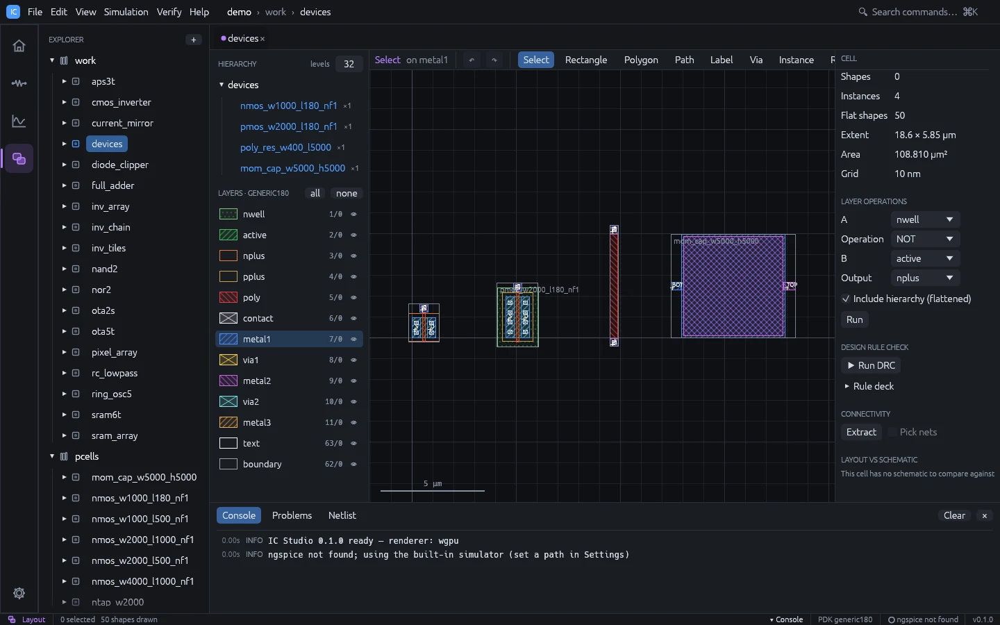

<!-- seo title="PCell과 사용자 정의 소자" description="IC Studio의 파라메트릭 셀(PCell)로 generic180, SKY130 등 어떤 공정에서도 올바른 MOSFET, 저항, 커패시터를 생성하거나 직접 정의하기." -->

# PCell과 사용자 정의 소자



IC Studio에는 여섯 가지 내장 파라미터 셀(PCell)이 있습니다. PCell은 테크놀로지 정보를 바탕으로
코드가 그리므로, 같은 파라미터로 generic180, SKY130 또는 다른 어떤 PDK에서도 올바른 소자를
얻을 수 있습니다. 내장 PCell로 그릴 수 없는 소자(직사각형이 아닌 액티브, 특수한 콘택 배치, 꺾인
게이트나 45° 게이트)는 SKILL로 생성기를 작성하십시오.
[사용자 소자 생성기](#사용자-소자-생성기)를 참고하십시오.

## 내장 PCell

| 종류 | 파라미터 | 기본값 | 단자 레이블 | 그리는 내용 |
|---|---|---|---|---|
| `nmos` | W, L, fingers, device | W 1 µm, L 0.18 µm, 핑거 1개 | `S`, `D`, `G` | 액티브, 폴리 콘택 헤드가 있는 폴리 핑거, 확산 콘택 열, n+ 임플란트, PDK 마커 레이어 |
| `pmos` | W, L, fingers, device | W 2 µm, L 0.18 µm, 핑거 1개 | `S`, `D`, `G` | `nmos`와 같고, p+ 임플란트와 n웰 추가 |
| `poly_res` | W, L | W 0.4 µm, L 5 µm | `A`, `B` | 양 끝에 폴리 콘택이 있는 폴리 본체, 저항 마커 레이어 |
| `mom_cap` | W, H | 5 µm x 5 µm | `BOT`, `TOP` | 각각 탭이 달린 metal1 하부 전극과 metal2 상부 전극, 커패시터 마커 레이어 |
| `ntap` | H | 1 µm | `B` | n웰 안의 n+ 탭(PMOS 벌크), 콘택 한 열 폭 |
| `ptap` | H | 1 µm | `B` | p+ 기판 탭, 콘택 한 열 폭 |

- **W는 핑거당 폭입니다.** W 1 µm, 핑거 2개인 `nmos`는 1 µm 트랜지스터 두 개가 병렬로 연결된
  것입니다(총 폭 2 µm). 핑거는 S / D / S 순으로 번갈아 놓입니다. 추출은 핑거마다 소자 하나를
  보고하고, LVS가 병렬 소자를 병합합니다.
- **Device**는 테크놀로지가 해당 극성의 MOS 소자를 여러 개 가진 PDK일 때 나타납니다(예: 저Vt,
  고Vt 변형). 이때 PCell은 그 소자의 마커 레이어를 그리고, 변형(variant) 이름 끝에 소자 이름이
  붙습니다. 기본값은 PDK의 첫 번째 소자입니다.
- 길이는 테크놀로지 그리드에 스냅됩니다. 원점은 액티브(MOS, 탭), 저항 본체 또는 하부 전극의
  왼쪽 아래 모서리입니다.
- `ntap`과 `ptap`은 배치 팔레트에 없습니다. 회로도 기반 레이아웃이 이를 생성하며, MCP 도구
  `place_pcell`에서도 사용할 수 있습니다.

## PCell 배치와 변경



| 위치 | 방법 |
|---|---|
| 레이아웃 편집기 | `I`를 누르고 왼쪽 패널에서 PCell을 고른 뒤 파라미터를 설정하고 클릭해 배치 |
| 인스펙터 | 배치된 PCell을 선택하고 **PCell** 섹션에서 파라미터를 수정한 뒤 **Apply** |
| 회로도 기반 레이아웃 | **Verify > Generate Layout from Schematic**이 모든 MOS를 회로도의 크기대로 PCell로 배치([회로도 기반 레이아웃](schematic-driven-layout.md) 참고) |
| 생성기 | **Layout Generators > Matched Placement**와 **By Example**이 PCell 단위 소자를 배치([도구](tools.md#layout-generators) 참고) |
| MCP | `place_pcell`(아래 참고) |

`place_pcell`은 크기를 µm 단위로 받습니다.

```json
{
  "cell": "work/amp",
  "kind": "nmos",
  "params": { "w": 2, "l": 0.5, "fingers": 4 },
  "x": 0, "y": 0, "rot": 0,
  "name": "M1"
}
```

MOS 인스턴스 이름을 회로도 소자 이름(`M1`)과 같게 지정해야 플라이라인과 LVS가 둘을 짝지을 수
있습니다.

## 변형(variant) 저장 방식

파라미터 조합마다 한 번만 생성되어 `pcells` 라이브러리에 일반 셀로 저장되며, 이름은 dbu 단위의
파라미터로 정해집니다.

| PCell | 변형 이름 |
|---|---|
| `nmos` W 1 µm, L 0.18 µm, 핑거 2개 | `nmos_w1000_l180_nf2` |
| 위와 같고 PDK 소자가 `sky130_fd_pr__nfet_01v8_lvt` | `nmos_w1000_l180_nf2_sky130_fd_pr__nfet_01v8_lvt` |
| `poly_res` W 0.4 µm, L 5 µm | `poly_res_w400_l5000` |
| `mom_cap` 5 µm x 5 µm | `mom_cap_w5000_h5000` |
| `ntap` H 1 µm | `ntap_w1000` |

같은 파라미터로 다시 배치하면 기존 변형을 재사용합니다. 인스펙터의 **Apply**는 인스턴스가 다른
변형을 가리키게 하며, 이전 변형은 `pcells`에 남습니다(아무 곳에서도 사용하지 않으면 프로젝트
트리에서 삭제하십시오).

변형의 `cell.json`은 레이아웃과 함께 파라미터(`"pcell": {"kind": "mos", ...}`)를 보관하므로,
계층 구조, GDS 내보내기, DRC, 추출에서 일반 셀처럼 다뤄집니다. 테크놀로지를 교체하면
(**Tools > Load PDK**, `ics load-pdk`) 데이터베이스 단위가 같은 한 모든 변형이 파라미터로부터
다시 생성됩니다. 변형의 레이아웃을 직접 수정하지 마십시오. 다음 재생성 때 수정 내용이
사라집니다. 먼저 다른 라이브러리로 복사하거나 생성기를 작성하십시오.

## 테크놀로지가 제공해야 하는 항목

PCell은 테크놀로지 정보만으로 그리므로, 새 PDK에는 다음 항목이 필요합니다
([테크놀로지](technology.md) 참고).

| 항목 | 용도 |
|---|---|
| `roles`: `diffusion`, `tap`, `poly`, `nwell`, `nimplant`, `pimplant` | 각 PCell이 그리는 레이어 |
| `roles`: `diff_contact`, `poly_contact` | S / D 열, 탭 콘택, 폴리 헤드에 쓰는 비아 |
| 레이어 `min_width`, `min_spacing`, `min_area` | 최소 W와 L, 콘택 플레이트 크기, 게이트-콘택 거리 |
| `rules`: `gate_contact_space`, `poly_endcap`, `implant_enc`, `nwell_enc`, `marker_enc` | 소자 내부의 간격과 인클로저 |
| `[[device]]` `layers` | 각 MOS 소자의 마커 레이어 |
| `[[resistor]]` / `[[capacitor]]` `layers` | `poly_res`(폴리 레이어 위의 저항)와 `mom_cap`(metal1과 metal2 사이의 커패시터)의 마커 레이어 |
| `[[pcell_layer]]` | `poly_contact`, `diff_contact`, `gate`, `diffusion`, `poly` 또는 이름을 지정한 레이어 주위에 그리는 추가 레이어. 선택적으로 일부 `kinds`에만 적용 |

테크놀로지로 만들 수 없는 파라미터는
`width 150 is below the minimum 220 (active width / one contact)`나
`gate length 100 is below the poly minimum width 150` 같은 메시지와 함께 거부됩니다. PDK
테스트는 SKY130과 IHP SG13G2의 모든 PCell이 DRC 클린인지 확인합니다. 새 PDK도 각 PCell을
배치하고 DRC를 실행해 같은 방식으로 확인하십시오.

## 추출이 인식하는 소자 형상

소자는 PCell 파라미터가 아니라 형상(geometry)으로 인식됩니다. 따라서 아래 규칙대로 트랜지스터를
그린 레이아웃이라면 PCell, SKILL 스크립트, GDS 가져오기, 수작업 중 어떤 방식으로 만들었든
추출되고 LVS로 비교됩니다.

| 형상 | W와 L |
|---|---|
| 직사각형 액티브 위의 직사각형 게이트 | L은 소스와 드레인 사이 게이트를 가로지르는 길이, W = 면적 / L |
| 직선 게이트가 있는 비직사각형 액티브(L, U, T자형) | 게이트마다 위와 같음. U자의 두 팔을 모두 가로지르는 폴리 하나는 게이트를 공유하는 트랜지스터 두 개가 됨 |
| 꺾인 게이트(채널 위에서 모서리를 도는 폴리, U자형 게이트 포함) | L = 면적 / 평균 에지(소스와 드레인 에지 길이의 평균). W = 평균 에지에서 `bend_corner`로 정한 만큼 모서리 사각형 몫을 뺀 값 |
| 링 게이트(enclosed layout transistor) | 꺾인 게이트와 같음. W는 안쪽과 바깥쪽 둘레의 평균 |
| 45° 또는 임의 각도의 액티브나 폴리 | 꺾인 게이트와 같음. 정확한 임의 각도 형상으로 측정 |
| 90° 배수로 회전하거나 미러된 인스턴스 | 그려진 그대로 |

직사각형이 아닌 게이트는 확산 영역을 정확히 두 조각(소스와 드레인)으로 나눠야 합니다. 그렇지
않으면 `gate ... does not separate two diffusion pieces` 경고와 함께 건너뜁니다. 연결성
판단을 위해 모든 레이어의 임의 각도 형상은 좁은 띠로 된 계단 모양(그리드 한 스텝, 최소 10 dbu)으로
대체되므로, 그 위의 배선과 콘택은 그려진 대로 연결됩니다. 소자 크기는 항상 정확한 형상을
사용합니다.

저항도 같은 규칙을 따릅니다. L자형이나 45° 저항 본체는 정확히 두 단자 조각과 이어져야 하고,
스퀘어 수 L / W는 꺾인 게이트와 같은 방식으로 측정됩니다. 임의 각도 형상 근처의 커패시터 면적과
둘레는 정확하게 계산됩니다.

**꺾임 보정.** 꺾인 게이트의 모서리 사각형을 모두 한 스퀘어로 세는 것(W = 평균 에지)은 1차
근사입니다. 파운드리 덱은 모서리를 대략 반 스퀘어로 세는 경우가 많으므로, PDK `[rules]`의
`bend_corner`를 이에 맞춰 설정하십시오.

```toml
[rules]
bend_corner = 0.5   # 1(기본값): W = 평균 에지, 0: W = 더 짧은(안쪽) 에지
```

0.5로 설정하면 위의 L자형 게이트(에지 2.82 µm와 3.18 µm, L 0.18 µm)는 W = 2.91 µm가 됩니다.

**DRC**도 임의 각도 형상을 검사합니다. 임의 각도 형상 근처에서 `width`, `space`, `separation`,
`enclosure`, `extension`은 정확한 폴리곤에서 유클리드 거리로 에지 간을 측정하므로, 최소 폭과
최소 간격으로 그린 45° 배선은 클린입니다. 한계값에서 3/4 dbu 이내의 거리는 통과하며(임의 각도
꼭짓점은 그리드로 반올림됨), 예각 모서리는 보고됩니다. 다른 룰은 계단 모양 형상을 기준으로
검사합니다([검증](verification.md) 참고).

내장 PCell은 항상 직사각형 액티브를 그립니다. L자형이나 U자형 소자에는 생성기를 사용하십시오.

## 사용자 소자 생성기

사용자 정의 PCell(`pcDefinePCell`)은 지원하지 않습니다. 파라미터 조합마다 셀을 하나씩 만드는
SKILL 프로시저로 같은 일을 할 수 있습니다. **Tools > Load SKILL (.il)**, `ics skill` 또는 MCP
도구 `run_skill`로 실행한 다음, 생성된 셀을 다른 셀처럼 `I`(**Place cell**)로 배치합니다.

다음 생성기는 액티브가 L자형이고 소스 콘택이 좁은 세로 팔에 있는 NMOS를 그립니다(generic180
레이어 이름 사용).

```lisp
; L자형 액티브의 NMOS: 소스 콘택이 세로 팔에 위치합니다.
procedure(nmosL(lib w l)
  let((name cv gx dx top)
    name = sprintf(nil "nmosL_w%d_l%d" round(w*1000) round(l*1000))
    cv = dbOpenCellViewByType(lib name "layout" "maskLayout" "w")
    gx = 1.0                     ; 게이트 왼쪽 에지
    dx = gx + l + 0.3            ; 드레인 콘택 왼쪽 에지
    top = w + 1.2                ; 소스 팔의 위쪽 끝
    dbCreatePolygon(cv "active" list(0:0 dx+0.32:0 dx+0.32:w 0.42:w 0.42:top 0:top))
    dbCreateRect(cv "poly" list(gx:-0.25 gx+l:w+0.4))
    dbCreateRect(cv "nplus" list(-0.2:-0.4 dx+0.52:top+0.2))
    foreach(c list(list(0.1 top-0.32 "S") list(dx w/2-0.11 "D"))
      let((x y)
        x = car(c)  y = cadr(c)
        dbCreateRect(cv "contact" list(x:y x+0.22:y+0.22))
        dbCreateRect(cv "metal1" list(x-0.06:y-0.06 x+0.28:y+0.28))
        dbCreateLabel(cv "metal1" x+0.11:y+0.11 caddr(c) "centerCenter" "R0" "roman" 0.1)))
    dbCreateLabel(cv "poly" gx+l/2:w+0.3 "G" "centerCenter" "R0" "roman" 0.1)
    name))

foreach(p list(list(1.0 0.18) list(2.0 0.5))
  printf("%s\n" nmosL("mylib" car(p) cadr(p))))
```

```sh
ics skill myproj nmos_l.il
ics extract myproj mylib/nmosL_w1000_l180   # M1 D G S sub nmos w=1u l=0.18u
ics drc myproj mylib/nmosL_w1000_l180       # 0 violation(s)
```

팁:

- 셀 이름에는 영문자, 숫자, `_`, `-`만 쓸 수 있습니다. 크기는 `1.0`이 아니라 nm 단위(`w1000`)로
  표기하십시오.
- 모드 `"w"`는 셀을 비우므로, 스크립트를 다시 실행하면 모든 변형이 다시 생성됩니다.
- 단자 레이블은 배선 레이어(`metal1`, `poly`)에 붙이십시오. 배치된 셀 안의 레이블은 그 셀
  내부에서만 유효하지만, 셀 자체의 LVS에서는 셀 내부 넷의 이름이 됩니다.
- 점 목록에서 다른 점 뒤에 오는 음수 좌표는 괄호로 감싸십시오(`1.5:1.5 (-0.3):1.5`).
  그렇지 않으면 마이너스가 뺄셈으로 해석됩니다.
- 룰을 하드코딩하지 말고 PDK에서 읽어 오십시오. 각 변형은 `ics drc`와 `ics extract`로
  확인하십시오.

## 내장 PCell 종류 추가

새 내장 종류는 `crates/ics-core/src/pcell.rs`에 Rust 코드로 작성합니다.

1. `enum PCell`에 dbu 단위 파라미터를 갖는 변형을 추가합니다.
2. `kind_name`, `variant_name`, `summary`, `generate`를 확장하고(테크놀로지의 role, 비아, 룰로
   그리는 `gen_*` 함수 작성), 배치 팔레트에 넣으려면 `defaults`도 확장합니다.
3. `pcell_params`(`crates/ics-studio/src/layout_view/edit.rs`)에 파라미터 편집기를 추가하고,
   `pcell_from`과 `place_pcell` 스키마(`crates/ics-mcp/src/tools.rs`)에 종류를 추가합니다.
4. 추출이 새로운 소자 유형으로 인식해야 한다면 `extract.rs`와 `lvs.rs`를 확장합니다.
5. 테스트를 추가합니다. generic180과 `pdk.rs`의 PDK 테스트에서 DRC 클린인지, 생성된 레이아웃이
   추출되는지 확인합니다.
