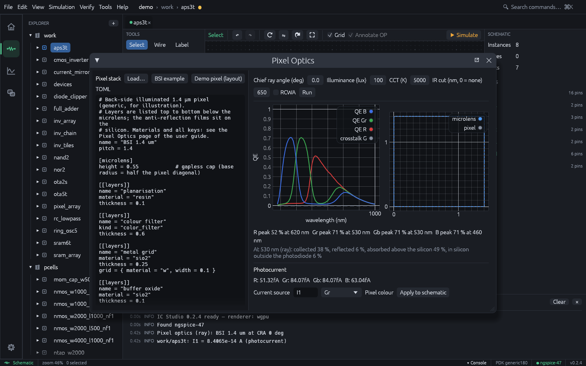
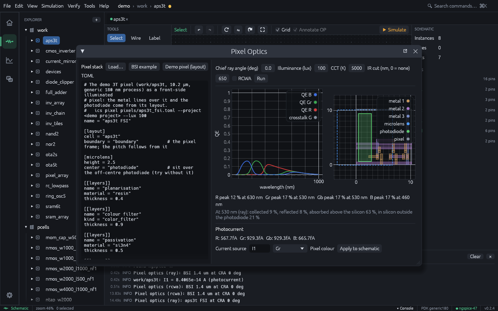
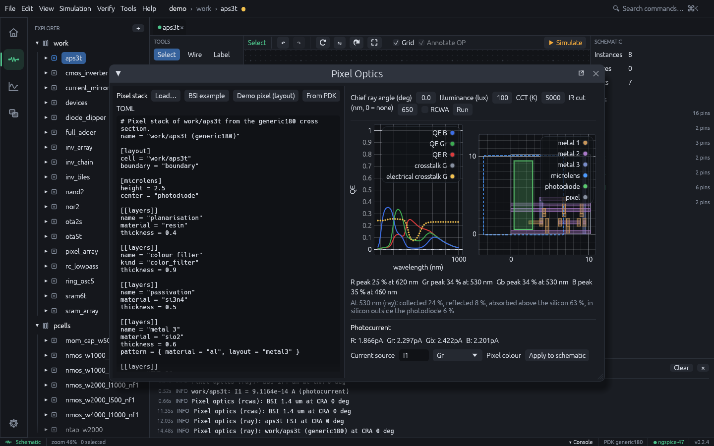
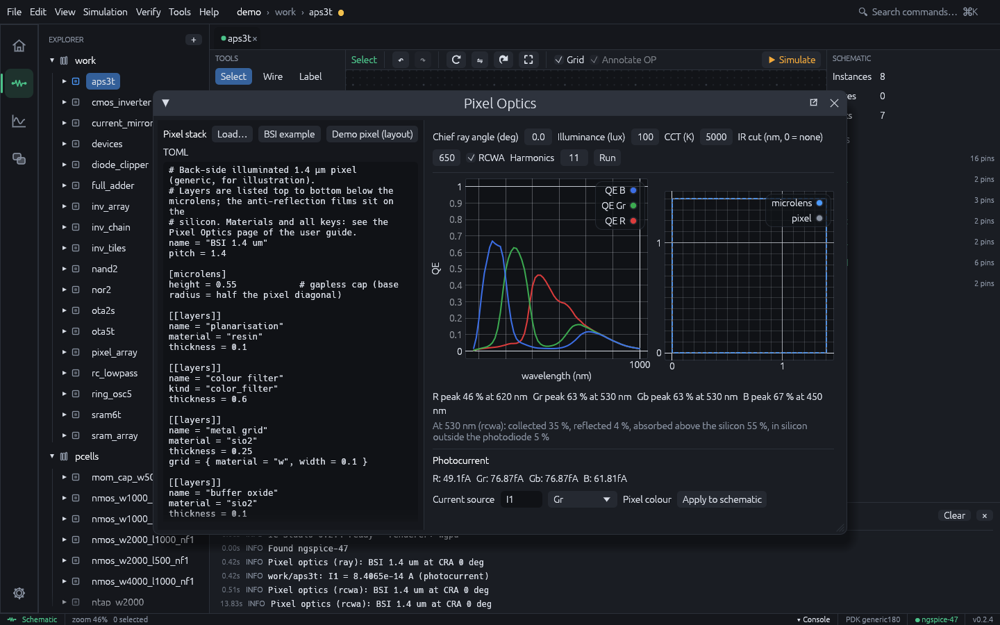
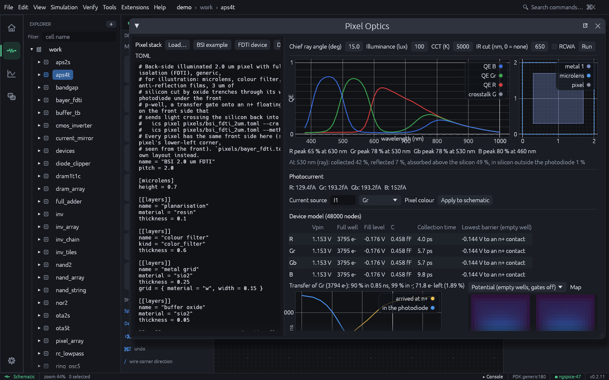

<!-- seo title="이미지센서 픽셀 광학: QE, 크로스토크, 광전류" description="IC Studio에서 이미지센서 픽셀 스택을 시뮬레이션: 마이크로렌즈, 컬러 필터, 금속 그리드, 반사 방지막으로부터 양자 효율, 주광선 각도에서의 광학 크로스토크, 픽셀 회로의 광전류를 계산합니다." -->

# 픽셀 광학

IC Studio는 이미지센서 픽셀의 스택(마이크로렌즈, 컬러 필터, 유전체와 금속 그리드, 반사 방지막,
실리콘 포토다이오드)으로부터 광학 특성을 계산합니다. Bayer 색별 양자 효율(QE), 주광선 각도(CRA)에서의
광학 크로스토크, 빛이 어디서 손실되는지, 그리고 조도에 따른 광전류를 구하며, 광전류는 픽셀 회로
시뮬레이션에 바로 들어갑니다.



- GUI: **Simulation > Pixel Optics…**(또는 명령 팔레트). 스택을 편집하고 CRA와 조명을 정한 뒤
  **Run**, 그다음 **Apply to schematic**으로 열린 셀의 전류원에 해당 색의 광전류를 씁니다(실행 취소 가능).
- CLI: `ics pixel pixels/bsi_1p4um.toml --cra 20 --lux 100 --cct 5000`. 전체 결과는 `--json`,
  전류원에 쓰려면 `--set PROJECT CELL I1 --color Gr`. 엄밀한 솔버는 `--method rcwa [--harmonics 11]`.

`pixels/`에 예제 스택이 있습니다: 후면 조사(BSI) 1.4 µm 픽셀, 금속 3층의 전면 조사(FSI) 2.8 µm 픽셀, 레이아웃에서
읽는 데모 4T 픽셀, 전체 깊이 트렌치와 [소자 모델](#소자-모델)을 쓴 2 µm BSI 픽셀(`bsi_fdti_2um.toml`), 레이아웃에서
읽는 데모 2 × 2 Bayer 셀 `bayer_fdti`.

## 레이아웃에서 가져오기

스택은 픽셀 셀의 레이아웃에서 피치, 금속 패턴, 포토다이오드를 가져올 수 있습니다. `[layout]`에 `cell`과 `boundary`
(픽셀 틀, 피치가 여기서 정해짐), 층의 `pattern = { material = "al", layout = "metal1" }`, 포토다이오드의
`layout = "active wide 1"`(폭 1 µm 이상인 확산)처럼 씁니다. `layout`에는 테크놀로지 레이어나 DRC 덱 문법의
파생 레이어 식(`and`, `not`, `interact`, `inside`, `size` 등)을 씁니다. 도형은 픽셀 틀로 잘라 모든 픽셀에
반복하며, `rects = [[x0, y0, x1, y1], ...]`(픽셀 모서리 기준 µm)로 직접 줄 수도 있습니다. 포토다이오드 면적은 가로
수집 범위를 제한하고, 그 옆에서 흡수된 빛은 손실로 보고합니다. `[microlens]`의 `center = "photodiode"`는 렌즈를
포토다이오드 중심 위로 옮깁니다(또는 `offset = [dx, dy]`).

- CLI: `ics pixel pixels/aps4t_fsi.toml --project <project> --lux 100`
- GUI: Pixel Optics 창의 **Demo pixel (layout)**이 열린 프로젝트를 읽습니다. 평면도에 패턴, 포토다이오드, 렌즈가
  표시됩니다.

포토다이오드가 10.2 µm 픽셀 가장자리에 있는 데모 픽셀에서 렌즈를 가운데 맞추면 530 nm 녹색 QE가 0.106에서
0.176으로 오릅니다.



## PDK 단면에서 가져오기

테크놀로지는 백엔드 단면을 기술할 수 있습니다([PDK 파일](technology.md#픽셀-단면)의 `cross_section`,
generic180에는 기본으로 있음). 그러면 픽셀 셀의 스택이 PDK와 레이아웃만으로 정해집니다: 유전체 층, 레이아웃
레이어에서 온 각 층의 금속, 포토다이오드 면적, 컬러 필터, 평탄화층, 마이크로렌즈, 실리콘의 캐리어 확산.

- CLI: `ics pixel --project <project> --cell aps4t --lux 100`. `--emit-stack`은 만든 스택을 출력하므로 고쳐서 쓸 수
  있습니다.
- GUI: Pixel Optics 창의 **From PDK**(또는 명령 팔레트의 **Pixel stack of the open cell from the PDK cross
  section**)가 열린 셀의 스택을 편집기에 씁니다.



## 두 가지 솔버

- **Ray**(기본): 실리콘 위 박막 광학을 결합한 기하 광선 추적. 1초 이내로 빠르며, 렌즈별 광학
  크로스토크와 상세한 손실 내역을 줍니다. 피치가 파장보다 충분히 클 때 정확합니다.
- **RCWA**(엄밀 결합파 해석): 2 × 2 Bayer 셀 전체에서 맥스웰 방정식을 풀어 회절, 모든 층의 간섭,
  그리드 근접장을 포함합니다. 1.5 µm 이하 픽셀에 쓰십시오. 마이크로렌즈는 8단 계단으로 근사합니다.
  방향당 고조파 수(`--harmonics`, **Harmonics** 칸)를 늘릴수록 정확해집니다. 1.4 µm 예제에서 550 nm 녹색 QE는
  9, 11, 15, 19 고조파에서 0.589, 0.596, 0.592, 0.594입니다. 11 고조파, 63개 파장이 10코어에서 약 8초
  걸립니다. 면내 유전율은 Li의 인수분해 규칙을 따르므로 금속 패턴도 수렴합니다. 다만 2 × 2 셀에 비해 가장
  작은 개구부를 분해할 만큼 고조파가 필요합니다. RCWA는 렌즈별 크로스토크를 주지 않고, 실리콘 위 흡수를 하나의
  값으로 보고합니다.

패턴이 없는 층만 있으면 두 솔버는 정확히 일치합니다(둘 다 박막 광학으로 귀결). 1.4 µm 예제에서 녹색
피크는 Ray 0.71, RCWA 0.61이며, 차이는 이 피치에서의 회절과 간섭 때문입니다.



### 수렴과 Ray 대 RCWA

RCWA는 고조파를 늘리면 수렴하고, 필요한 고조파 수는 Bayer 셀이 클수록 늘어납니다. 각 색 픽셀의 QE입니다.

| 픽셀 | 고조파 | 450 nm B | 550 nm Gr | 650 nm R | 750 nm R | 850 nm R | 시간 (5개 파장) |
|---|---|---|---|---|---|---|---|
| `bsi_fdti_2um` (셀 4.0 µm) | 7 | 0.51 | 0.54 | 0.37 | 0.19 | 0.11 | 3 s |
| | 11 | 0.73 | 0.71 | 0.51 | 0.29 | 0.13 | 5 s |
| | 15 | 0.76 | 0.71 | 0.51 | 0.29 | 0.14 | 15 s |
| | 19 | 0.75 | 0.72 | 0.51 | 0.30 | 0.15 | 51 s |
| `bayer_fdti` (셀 4.8 µm) | 11 | 0.69 | 0.64 | 0.45 | 0.26 | 0.13 | 8 s |
| | 15 | 0.74 | 0.67 | 0.46 | 0.24 | 0.14 | 18 s |
| | 19 | 0.75 | 0.68 | 0.47 | 0.24 | 0.15 | 58 s |
| | 23 | 0.75 | 0.68 | 0.48 | 0.25 | 0.16 | 180 s |

`--harmonics` 없이 `ics pixel --method rcwa`를 쓰면 셀 1 µm당 약 3.8개를 씁니다(홀수, 최소 11: 1.4 µm 픽셀
11, 2.0 µm 17, 2.4 µm 19). 이렇게 하면 QE가 수렴값의 약 0.01 안에 들어옵니다. 창의 Harmonics 값이 그보다 작으면
권장 값을 보여 줍니다.

Ray 모델은 몇 초면 끝나지만, 이 정도 피치에서는 과대평가합니다. `bsi_fdti_2um`(CRA 0)에서 청 0.80, 녹 0.79,
적 0.66(650 nm), 0.43(750 nm)으로, RCWA의 0.76, 0.71, 0.51, 0.29보다 높습니다. `bayer_fdti`에서는 450–750 nm에서
0.05–0.10 높습니다. 기하 광선은 모든 렌즈가 그리드 개구부로 완벽하게 집광한다고 보지만, 실제로는 회절 때문에 빛이
텅스텐 그리드와 트렌치 윗면으로 퍼지고, Ray 모델은 스택 안의 간섭도 놓칩니다. 설계 탐색에는 Ray를, 최종
수치에는 RCWA를 쓰십시오. 두 솔버는 박막 광학과 비교해 검증했고(패턴 없는 스택, 유한 두께의 흡수 실리콘: 반사율,
투과율, 흡수 오차 2e-4 이내), 트렌치로 잘린 실리콘에서 에너지 보존도 확인했습니다(0.5 % 이내). 아직 실측 픽셀로
보정하지는 않았습니다. 컬러 필터는 일반적인 흡수 곡선입니다.

## 캐리어 수집과 전기적 크로스토크

`[silicon]` 섹션이 없으면 포토다이오드 상자(면적과 깊이 범위) 안에서 생성된 캐리어만 셉니다. 있으면 캐리어가
확산합니다. 설정 항목은 `diffusion_length`(중성 실리콘의 소수 캐리어 확산 길이, µm), `epi`(에피층 두께,
바닥에 닿은 캐리어는 손실), `surface`(`reflecting` 또는 `recombining`), `dti = { depth, width }`(픽셀 경계의
deep trench isolation), `grid`(복셀 크기, 기본 피치/16 정도)입니다.

각 포토다이오드의 수집 확률 P(r)는 2 × 2 셀에서 확산 방정식 ∇²P − P/L² = 0을 풀어 구합니다(자기 공핍
영역 P = 1, 다른 포토다이오드 0, 에피 바닥 0, 트렌치는 무유속). 상반성에 따라 신호는 광학 생성률 G(r)에 P를
가중한 적분이며, 두 솔버 모두 G를 복셀 격자로 넘깁니다. 그러면 QE에 포토다이오드 옆과 아래에서 확산해 오는
캐리어가 포함되고, 색별 **전기적 크로스토크**(픽셀 아래에서 생성되어 수집된 캐리어 중 이웃이 수집한 비율)가
보고됩니다. 빨강과 근적외선은 깊이 흡수되어 캐리어가 퍼지므로 파장이 길수록 커지며, 트렌치가 이를 줄입니다.

확산 길이를 아주 짧게 하면 상자 모델 결과로 돌아갑니다(두 솔버 모두 테스트로 확인).

## 후면 조사와 deep trench

후면 조사(BSI) 픽셀은 실리콘이 얇습니다. `[silicon] thickness`를 지정합니다. 실리콘을 통과한 빛은 반대면을
지나 `[[front]]` 층(전면의 절연막과 트랜지스터 배선 금속 패턴, 위에서 아래 순서, 그 아래 `carrier` 매질, 기본
`sio2`)으로 나가고, 거기서 반사된 빛은 실리콘으로 돌아옵니다. Deep trench isolation(`dti`)은 전기적일 뿐 아니라
광학적이기도 합니다. 충전재(`fill`, 기본 `sio2`)가 실리콘을 자르고, 빛은 벽에서 반사되어(전반사, 얇은 트렌치는
일부 투과) 자기 픽셀에 남습니다. `depth`가 두께 이상이면 전체 깊이 트렌치(FDTI)이고, `side = "front"`는
반대면에서 식각합니다.

- **Ray 모델**: 실리콘 안의 광선이 트렌치 벽(각도별 실리콘 | 충전재 | 실리콘 반사율), 반대면(전면 층으로의
  반사율, 레이아웃에 금속이 있으면 금속 위 반사율), 입사면(반사 방지막을 통한 반사)에서 반사되며 경로를 따라
  흡수됩니다. 손실 내역의 `transmitted`는 전면으로 나간 빛입니다.
- **RCWA**: 실리콘이 구조의 층이 되고 트렌치는 그 안의 패턴이 됩니다. 각 복셀의 흡수는 층 내부 필드(층 모드로
  재구성하고, 슬라이스마다 전력 흐름 감소량에 정확히 맞춤)에서 구합니다. 그 아래에 전면 층과 금속 패턴,
  carrier가 이어집니다.

주광선 각도 30°에서 2 µm 예제(`pixels/bsi_fdti_2um.toml`)는 트렌치가 없으면 620 nm 빛의 6 %, 850 nm의 15 %를
다른 픽셀이 수집하지만, 전체 깊이 트렌치에서는 0이고 전기적 크로스토크도 0이 됩니다.

스택은 2 × 2 Bayer 셀 전체를 읽을 수도 있습니다. 각 픽셀은 자기 레이아웃을 가집니다(4-shared 픽셀):
`[layout] bayer = true`. 이때 프레임은 셀이고 피치는 그 절반이며, 도형은 셀 안의 위치를 그대로 유지합니다
(`pixels/bayer_fdti.toml`은 데모 셀 `bayer_fdti`를 읽습니다).

셀이 PCell Designer 마스터이면 `params`로 변형을 고르며, 실행할 때 생성됩니다:

```toml
[layout]
cell = "bayer_fdti_pc"            # 데모 bayer_fdti의 PCell (PCell 문서 참고)
boundary = "boundary"
bayer = true
params = { pitch = 3.0, pd = 1.6 } # µm; tx_l은 기본값
```

대각선 도형(PCell의 45° 모서리)은 10 nm 띠의 계단으로 읽습니다. `--apply`는 그 변형으로 회로의 포토다이오드 크기를 정합니다. 소자 모델은 스택의 도핑을 그대로 쓰므로 더 큰
포토다이오드에는 따로 도핑이 필요합니다: 피치 3.0, pd 1.6에서 같은 도핑이면 Vpin 2.43 V, full well 27.6k e-이고,
표면 n을 2.5e16 cm⁻³로 낮추면 Vpin 1.63 V, 19.6k e-이지만 20 ns 전송 뒤 전하의 2 %가 남습니다(전자가 더 넓은
포토다이오드를 건너야 함). 이는 전송 게이트 쪽으로 도핑 경사를 주어 풀어야 합니다.

## 소자 모델

`[device]` 섹션이 있으면 2 × 2 셀의 복셀 격자에서 실리콘을 반도체 소자로 풉니다(`ics_optics::device`).
임플란트로 도핑을 만들고, Poisson 방정식으로 정전 포텐셜을 구하고, 전자의 drift와 diffusion을 계산합니다.

- **도핑**: `[[device.doping]]` 임플란트입니다. 깊이 방향은 가우시안(`peak` cm⁻³, `depth`, `straggle`)이고,
  마스크 가장자리는 가우시안으로 퍼집니다(`lateral`). 들어오는 면은 `front`(트랜지스터 쪽, BSI에서는 반대면),
  `back`(입사면), 트렌치 벽(`side = "dti"`, `depth`는 벽으로부터의 거리) 중 하나입니다. 마스크는 `rects` 또는
  `layout`(레이어나 파생 레이어 식)입니다. `photodiode = true`는 저장 우물(픽셀마다 하나)을 표시하고,
  `contact = V`는 n+ 영역을 그 전압의 옴 접촉으로 만듭니다(리셋 후 플로팅 디퓨전, 소스와 드레인).
  `background`는 에피 도핑입니다.
- **게이트**: 전면의 `[[device.gate]]`입니다. `oxide`, `off`, `on` 전압을 가집니다(전송 게이트).
- **포텐셜**: 정공은 접지된 p 영역 레벨에 있고, 전자는 접촉 전압이나 우물의 채움 레벨에 있습니다. 유한체적법과
  감쇠 Newton으로 풉니다.
- **수집**: 상반성에 따라, 한 점에서 생성된 전자가 각 포토다이오드로 가는 확률은 Scharfetter-Gummel 유속을 쓴
  전자 연속 방정식의 수반 방정식으로 구합니다. 캐리어는 포텐셜을 따라 우물로 drift하고 확산하며, 재결합(SRH,
  도핑 의존 `lifetime`, 표면과 벽의 `surface_recombination`)하거나 n+ 영역에 빼앗깁니다. 여기서 QE, 전기적
  크로스토크, 그리고 색과 파장별 평균 수집 시간(first-passage time)이 나옵니다.
- **우물**: 핀닝 전압(빈 우물의 포텐셜), full well(채움 레벨이 다른 싱크로 가는 가장 낮은 장벽에 닿을 때의
  전자 수, 포텐셜을 지나는 최적 경로로 찾음), 저장 용량, 장벽 위치를 구합니다. 각 픽셀의 게이트를 켰을 때
  빠져나가는 경로의 최저점을 보면, 전송을 돌리기 전에 전송 장벽(lag)을 알 수 있습니다.
- **전하 전송** (`transfer = { pixel = "Gr", on_time = 20, settle = 5 }` 또는 `ics pixel --transfer Gr`):
  우물을 가득 채운 뒤 게이트를 켰다 끄면서 Poisson과 연속 방정식을 시간에 따라 풉니다. 우물에 남은 전자가
  lag입니다.

**회로 시뮬레이션으로.** `ics pixel <stack> --project <project> --apply`(또는 창의 **Apply to technology**)는
포토다이오드들의 평균 핀닝 전압과 저장 용량을 기술 파일의 포토다이오드에 씁니다(`pinning`, 포토다이오드 레이어
면적당 `cap_area`). `ics extract --pixel --characterize`와 Pixel Circuit 창의 pinned 포토다이오드가 이 값을
씁니다. `bayer_fdti`에 자기 전원 2.8 V(`--vdd 2.8`)를 주면 회로 모델의 full well은 8238 e-로, 소자 모델의
8057 e-와 맞습니다.

GUI에서는 QE 아래에 우물, 전송, 맵(포텐셜, 도핑, 수집 확률과 시간, 450 / 530 / 620 / 850 nm 생성률)을
보여 줍니다. **FDTI device** 버튼이 예제를 불러옵니다.



1차 모델입니다. 속도 포화와 전계 의존 이동도가 없고, 정공은 평형이며, Boltzmann 통계를 쓰고, 계면 전하와
STI가 없습니다. 게이트는 전면 복셀에만 작용하고, 접촉은 이상적인 n+ 도체입니다(플로팅 디퓨전 전압이 채워지면서
내려가지 않음). 격자(`grid`, 기본은 `[silicon]` 격자)는 전송 게이트를 분해할 만큼 촘촘해야 합니다. 복셀 몇 개짜리
게이트는 더 촘촘한 격자에서 낮아지는 장벽을 보여 줍니다.


## 마이크로렌즈 형상

기본 렌즈는 높이 h, 밑면 반지름 a(기본 p/√2, 픽셀 꼭짓점을 지남)의 구면 캡이며 구 반지름은
R = (a² + h²) / 2h입니다. 리플로나 식각 렌즈는 보통 평면에서 원보다 네모나고 단면이 구면이 아니므로,
`shape = "superellipse"`로 superellipse 밑면과 거듭제곱 sag를 씁니다:

    ρ(x, y) = (|x/Rx|^n + |y/Ry|^n)^(1/n)
    z(x, y) = h · max(0, 1 − ρ^α)

x, y는 렌즈 중심 기준입니다. `n`(≥ 1, 기본 2)은 평면 모양으로 2는 타원, 4는 둥근 사각형, 크면 직사각형입니다.
`alpha`(> 0, 기본 2)는 단면으로 2는 포물면(얕은 구면에 가까움), 1은 원뿔, 2보다 크면 윗면이 평평하고 옆이
가파릅니다. 옆면은 수직이 아니라 기울기 h·α/R로 바닥에 닿습니다. `radius`는 Rx, `radius_y`는 Ry(기본 Rx)이며,
기본값 Rx = 2^(1/n)·p/2는 밑면이 픽셀 꼭짓점을 지나 틈이 없습니다. 각 렌즈는 자기 픽셀 경계에서 잘리며, 픽셀
격자 위의 같은 렌즈들에서는 겹친 렌즈 중 높은 쪽을 택하는 것과 같으므로 픽셀보다 넓은 렌즈는 이웃과 골을 이루며
만납니다. CLI는 렌즈와 fill factor(렌즈 아래 픽셀 면적 비율)를 출력합니다.

Ray 모델은 렌즈 꼭대기에서 아래로 256단계 진행한 뒤 이분법으로 표면 교점을 찾고, 해석적 기울기의 법선으로
굴절시킵니다. RCWA는 같은 높이를 8단 계단으로 근사합니다. `pixels/bsi_1p4um.toml`(540 nm 녹색 QE):

| 렌즈 | ray, 0° | RCWA, 0° | ray, 25° | RCWA, 25° |
|---|---|---|---|---|
| 구면 | 0.750 | 0.665 | 0.634 | 0.543 |
| n = 2, α = 2 | 0.750 | 0.671 | 0.679 | 0.554 |
| n = 4, α = 2 | 0.748 | 0.694 | 0.646 | 0.558 |
| n = 4, α = 1.5 | 0.749 | 0.674 | 0.645 | 0.562 |
| n = 4, α = 3 | 0.745 | 0.710 | 0.630 | 0.544 |

수직 입사에서 Ray 모델은 형상을 거의 구분하지 못하지만(모든 렌즈가 그리드를 피해 집광), RCWA는 산란할 평평한
모서리가 없는 네모나고 평평한 렌즈에서 최대 0.045 높게 봅니다. 실측 QE에 `lens_shape`를 맞출 때는
`--method rcwa`를 쓰십시오.

## Ray 모델

광선은 무한 배열의 2 × 2 Bayer 셀 하나 위에 고르게 분포한 평면파로, 주광선 각도로 출발합니다. 각 광선은

1. 자기 픽셀의 마이크로렌즈(구면 캡 또는 superellipsoid)에서 굴절하고(렌즈 사이면 렌즈 바닥면으로),
2. 두꺼운 층을 위에서 아래로 지나며 경계마다 굴절하고 Fresnel 반사만큼 잃습니다. 컬러 필터에서는
   깊이마다 광선이 놓인 필터로 흡수되므로, 이웃 필터로 넘어간 빛은 그 필터로 걸러집니다. 금속 그리드
   선은 광선을 막습니다.
3. 입사각에서의 반사 방지막 투과율로 실리콘에 들어가고(coherent 박막 광학, s/p 평균),
4. 실리콘에서 경로를 따라 흡수됩니다. 포토다이오드 위아래 깊이 사이에서 생성된 캐리어는 생성 지점
   위 픽셀이 수집합니다.

QE는 픽셀 면적에 입사한 광자당 수집된 캐리어입니다. 크로스토크는 한 픽셀의 마이크로렌즈로 들어간
빛 중 다른 픽셀이 수집한 비율입니다. 손실 내역은 반사, 컬러 필터 흡수, 금속, 기타 층, 포토다이오드
위 실리콘, 수집, 포토다이오드 아래 실리콘(또는 투과)으로 나뉩니다.

Ray 모델의 한계: 기하 광학이므로 회절이 없고(작은 피치는 RCWA 사용), 그리드나 실리콘 표면에서 위로
되돌아가는 반사와 두꺼운 층 내부의 간섭을 다루지 않습니다. `[silicon]` 섹션이 있으면 실리콘 안의 광선은 위에서
설명한 대로 벽과 표면을 따라갑니다.

## 스택 파일

영문 페이지의 예제와 같습니다: `pitch`, `[microlens]`(`height`, 선택: `radius`, `material`, `shape`, `n`, `alpha`, `radius_y`),
위에서 아래 순서의 `[[layers]]`(`kind = "color_filter"`는 픽셀마다 필터를 따름, `grid = { material,
width }`는 픽셀 경계 중심의 금속 선), 실리콘 위 박막 `[[arc]]`, `[photodiode]`(`top`, `bottom` 수집
깊이), 선택: `[color_filters]`, `[materials.이름]`(`n`, `k` 상수 또는 `[파장 µm, n, k]` 표), `ambient`.

## 재료

`si`(Green 2008, 300 K 결정질 실리콘), `sio2`(Malitson), `si3n4`(Luke), `hfo2`(Al-Kuhaili),
`ta2o5`(Gao), `w`·`al`(Rakić), `resin`(일반 렌즈 수지), `cf_red`·`cf_green`·`cf_blue`(일반 안료
필터, 근적외선 투과), `air`. 표 데이터는 refractiveindex.info 데이터베이스(퍼블릭 도메인), 0.30 - 1.20 µm
범위입니다. 컬러 필터는 일반적인 형태일 뿐이므로 실제 설계에는 측정한 `n, k`를 쓰십시오.

## 측정 QE로 보정

측정 QE 표를 모델과 비교하고, 모델을 보정할 수 있습니다. 표는 CSV입니다. 파장 열(`wavelength`, `nm`, `lambda`.
nm 단위이며, 모든 값이 10보다 작으면 µm로 읽음)과 `R`, `Gr`, `Gb`, `B`(두 녹색 모두는 `G`) 중 있는 열을 씁니다.
값은 비율이나 퍼센트이고, `#` 뒤는 주석입니다.

- CLI: `ics pixel <stack> --measured qe.csv`는 색별 RMS 차이를 출력합니다. `--fit cf,cf_thickness`는 스택의
  파라미터를 측정값에 맞추고(`--fit-evals`, 기본 200회 모델 실행), 나머지 결과(QE 표, 광전류, 소자 모델,
  `--json`의 `calibration`)를 맞춘 스택으로 보고합니다. `--write-stack fitted.toml`은 맞춘 값을 넣은 스택 파일을
  씁니다(주석과 형식 유지). `--compare-csv cmp.csv`는 그래프용으로 파장별 측정 QE와 보정 전후 모델 값을 씁니다.
- GUI: 그래프 아래 **Measured QE…**가 표를 점으로 겹쳐 보이고 RMS 차이를 표시합니다. **Fit**은 나열한
  파라미터를 백그라운드에서 맞추고 맞춘 스택을 그립니다. **Write into the stack**은 맞춘 값을 스택 텍스트에
  넣습니다.

| 파라미터 | 바꾸는 것 | 범위 |
|---|---|---|
| `cf_red`, `cf_green`, `cf_blue` (`cf` = 셋 다) | 필터의 안료 농도: 흡수 k(`[color_filters] density`) | × 0.2 - 5 |
| `cf_density` | 세 농도를 한 배율로 | × 0.2 - 5 |
| `cf_thickness` | 컬러 필터 층 두께 | × 0.5 - 1.5 |
| `arc` | 반사 방지막 두께 | × 0.5 - 1.5 |
| `si_thickness` | 얇은 실리콘 두께(전체 깊이 트렌치도 함께) | × 0.7 - 1.3 |
| `lens` | 마이크로렌즈 높이 | × 0.5 - 1.5 |
| `lens_n`, `lens_alpha` (`lens_shape` = 둘 다) | superellipse 렌즈의 지수 n과 α, 맞춘 크기를 유지(쓴 스택에 `radius`도 기록) | × 0.5 - 4(n 최소 1), × 0.33 - 3 |
| `qe_scale` | 스택이 아님: 측정의 절대 보정 오차를 흡수하는, 측정 대비 모델 QE 배율 | × 0.7 - 1.3 |

`--method rcwa`이면 두 단계로 맞춥니다. 먼저 Ray 모델로 빠르게 맞추고, 거기서부터 RCWA가 실행 횟수의 3분의 1로
측정 파장 중 최대 15개를 써서 다듬으며, 결과는 모든 측정 파장으로 평가합니다. 파장과 비슷한 크기의 픽셀에 쓰십시오.
그런 픽셀에서는 Ray 모델이 0.05–0.15 높게 나오므로(위 참고), Ray만으로 맞추면 스택 파라미터(와 `qe_scale`)가 그
편향을 가리는 쪽으로 휩니다. 범위 끝에 걸린 파라미터는 경고로 알려 줍니다. 측정에 보이는 무언가가 스택에 빠졌을
가능성이 큽니다.

피팅은 배율의 로그에 대한 Nelder-Mead입니다. 목적 함수는 측정된 모든 색과 파장에 대한 RMS 차이이고, 선택한
솔버로 계산합니다(기본 Ray. RCWA 피팅은 느림). `si_thickness`를 맞추지 않으면 캐리어 모델과 소자 모델은 한 번만
풉니다. 필터 흡수는 농도 × 두께에 비례하므로, 둘을 함께 맞추면 주로 그 곱이 정해집니다.
`pixels/bsi_1p4um_synthetic_qe.csv`는 합성 표입니다(측정값이 아님: 1.4 µm 스택의 필터 농도를 바꾸고 필터층을 얇게
한 뒤 작은 리플을 더함). `cf,cf_thickness`를 맞추면 RMS 차이가 78회 실행 만에 0.031에서 리플 크기인 0.0035로
줄고, 농도 × 두께 곱을 0.01 안에서 되찾습니다.

### 실측 데이터로 보정하기

표 양식은 `pixels/measured_qe_template.csv`입니다. 보정 순서는 다음과 같습니다.

1. 조건 맞추기: 스택은 실제 공정대로(공정의 두께, 있다면 CF 재료의 n, k를 `[materials.이름]`으로), `--cra`는 측정
   조건대로, IR 차단 필터도 측정과 같게 둡니다(스택에는 IR 필터가 없고, `--ir-cut`은 광전류에만 영향을 줌).
2. 먼저 보기: `ics pixel stack.toml --measured qe.csv --compare-csv cmp.csv`. 모든 파장에서 같은 비율로 벌어지면
   측정 배율(또는 빛이 채우는 면적) 문제이고, 통과 대역이 밀리거나 넓으면 필터 문제, 물결무늬는 박막, 적색과
   근적외선이 너무 낮거나 높으면 실리콘 문제입니다.
3. 본 대로 몇 개씩 맞추기: Ray로 `--fit qe_scale,cf`를 맞추고, 곡선에 필요한 만큼 `cf_thickness`, `arc`,
   `si_thickness`를 더한 뒤, 마지막에 `--method rcwa`로 다듬습니다. 경고(범위 끝에 걸린 파라미터)와 색별 RMS를
   확인하십시오.
4. 남기기: `--write-stack calibrated.toml`로 저장하고, 보정된 스택으로 광전류(`--lux`, `--set`)를 구하며, 소자
   모델이 있으면 `--apply`로 기술 파일에 넣습니다.

## 광전류

광원은 색온도의 흑체 스펙트럼을 CIE 1924 명소시 곡선으로 픽셀 위 조도에 맞춘 것이며, IR 컷 파장(기본
650 nm, 0이면 없음) 위의 빛은 제거합니다. 광전류는 q ∫ QE(λ) E(λ) λ / (hc) dλ에 픽셀 면적을 곱한 값입니다.
