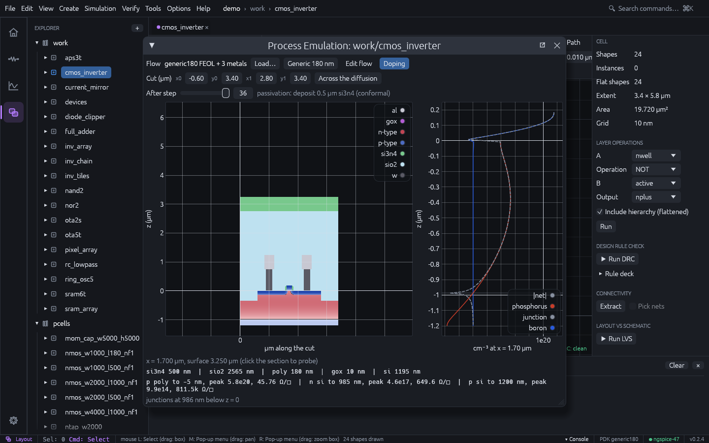
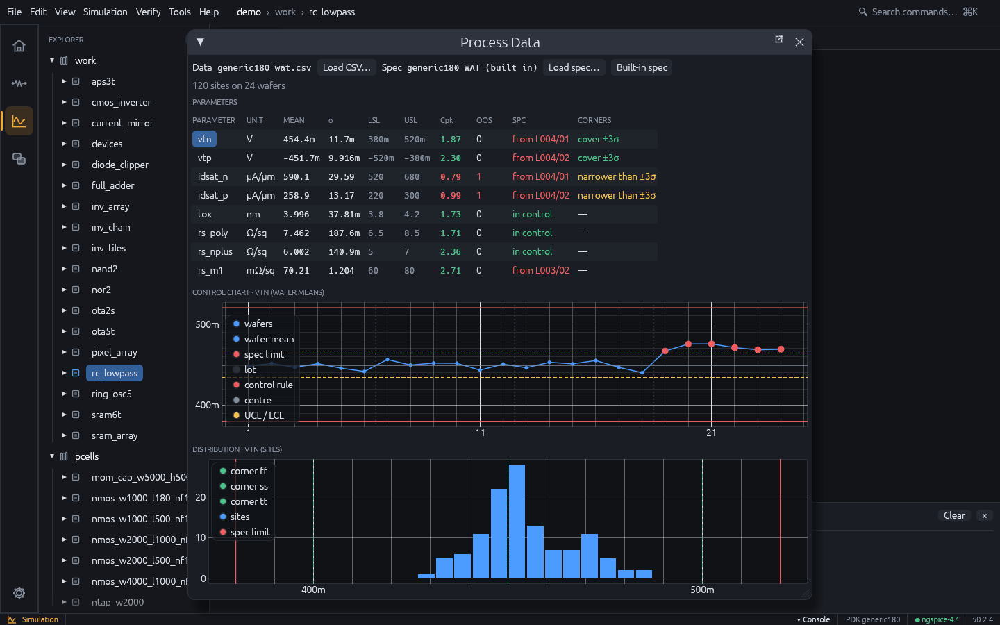
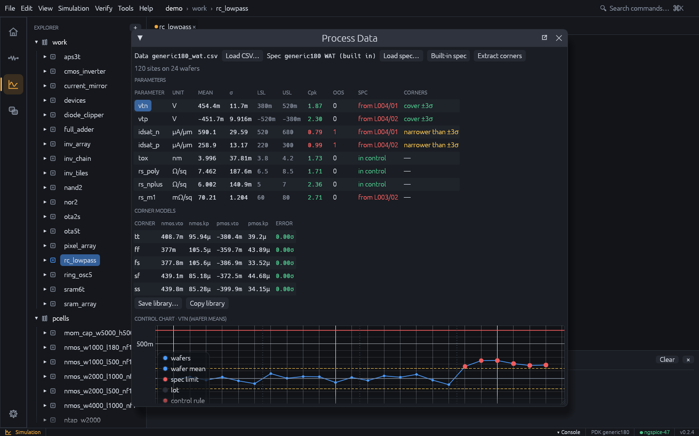

<!-- seo title="공정 에뮬레이션: 레이아웃과 공정 흐름으로 만드는 단면" description="IC Studio는 공정 흐름(증착, 식각, 이온 주입, 확산, 산화, CMP)을 2차원 격자에서 실행해 컷 라인을 따른 레이아웃 단면을 만듭니다." -->

# 공정 에뮬레이션과 공정 데이터



공정 에뮬레이터는 재료 셀의 2차원 격자(x는 컷 방향, z는 위쪽, 0은 원래 실리콘 표면)에서 공정 흐름을 한
단계씩 실행해 컷 라인을 따른 레이아웃 단면을 만듭니다. 마스크는 레이아웃 레이어나 파생 레이어 식입니다.
레이아웃이 실리콘에서 어떻게 되는지(콘택 옆 STI, 메탈에 닿는 비아, 스페이서와 이온 주입의 겹침, 접합 깊이와
소스·드레인이 게이트 아래로 들어가는 정도) 확인하거나,
설계 팀에 공정을 설명하거나, [픽셀](pixel-optics.md)이나 기생 모델의 유전체·금속 스택을 만들 때 씁니다.

- GUI: 열린 레이아웃에서 **Tools > Process Emulation**. 컷(µm, 레이아웃 좌표)을 정하고(**Across the diffusion**은
  가장 큰 확산 영역을 가로로 자름), **After step**을 움직여 각 단계 후의 웨이퍼를 보고, 단면을 클릭하면 그 위치의
  재료 스택이 나옵니다. 흐름에 도펀트가 있으면 **Doping**이 실리콘과 폴리를 순 도핑으로 칠합니다(n형은 빨강,
  p형은 파랑, 농도가 높을수록 진하고, 접합은 어두운 선). 단면 옆 그래프는 프로브 위치의 도펀트 프로파일이고, 그
  아래 줄은 도핑된 층과 접합 깊이를 보여 줍니다. **Edit flow**는 흐름을 편집하고 **Load...**는 흐름 파일을 읽습니다.
- CLI: `ics xsection <project> <cell> [--flow FILE] [--cut x0,y0,x1,y1] [--steps N] [--at X]... [--svg FILE] [--profile CSV] [--json]`
- MCP: `process_cross_section`

## 공정 흐름

흐름은 TOML 파일입니다. `process/generic180.toml`은 generic 180 nm 흐름으로, 다음 단계로 이루어집니다.

- STI
- n-well과 p-well 이온 주입, 드라이브인
- 열산화 게이트 산화막과 폴리
- 질화막 스페이서
- 비소와 BF₂ 소스/드레인 이온 주입, RTA
- 텅스텐 콘택과 비아
- 알루미늄 3층
- 패시베이션

`substrate_doping = { species = "boron", concentration = 1e15 }`(cm⁻³)은 기판 도핑이고, `semiconductors`(기본값
`["si", "poly"]`)는 도펀트를 담는 재료입니다.

| `op` | 키 | 동작 |
|---|---|---|
| `deposit` | `material`, `thickness`, `conformal` | 모든 열 위에 층을 쌓거나, 컨포멀하게(측벽과 오버행 아래까지) 쌓음. 두께의 두 배보다 좁은 트렌치는 닫히며 이음매가 남음 |
| `etch` | `mask` / `keep`, `materials`, `depth`, `isotropic` | 마스크가 열린 곳에서 나열한 재료를 제거: 표면에서 `depth`만큼 이방성으로(깊이가 없으면 다른 재료가 나올 때까지), 또는 개구부에서 `depth` 이내를 등방성으로(언더컷) |
| `implant` | `mask` / `keep`, `species`, `dose`, `energy` | 표면 아래에 가우시안 도펀트 프로파일을 더함(`dose` cm⁻², `energy` keV; `boron`, `bf2`, `phosphorus`, `arsenic`, `antimony`). 위에 있는 것은 실리콘처럼 이온을 막으므로 게이트가 채널을 가리고(게이트 자신은 도핑됨), 스페이서가 이온 주입을 게이트에서 떨어뜨림 |
| `implant` | `mask` / `keep`, `material`, `into`, `depth` | 기하 형태(도핑 형태와 함께 쓸 수 있음): 표면 아래 `depth` 이내의 `into` 재료를 `material`로 바꿈 |
| `anneal` | `temperature`(°C), `time`(분) | 반도체 안에서 모든 도펀트를 확산 |
| `oxidize` | `temperature`, `time`, `wet`, `material` | 실리콘이나 폴리 위에 산화막이나 공기만 있는 곳에 열산화막(Deal-Grove, (100) 실리콘, 건식 또는 `wet`)을 키움. 질화막이 가리고, 기존 산화막은 성장을 늦추며, 새 산화막의 44 %는 소모된 실리콘. 같은 시간 동안 도펀트도 확산 |
| `planarize` | `height` 또는 `stop` | 높이 위, 또는 어떤 재료의 가장 높은 점 위를 모두 제거(CMP) |
| `strip` | `material` | 재료를 모두 제거(레지스트) |

`mask`는 단계가 작용하는 레이어나 파생 레이어 식(`nplus and active`)이고, `keep`은 그 식이 그려지지 않은 곳에
작용합니다(전면 막에서 그린 패턴을 남기는 식각). 둘 다 없으면 전체에 작용합니다. 각 단계에 `name`을 붙일 수
있습니다.

컨포멀 증착과 등방성 식각은 격자의 정확한 유클리드 거리 변환을 쓰므로 모서리가 둥글어지고 스페이서가
형상에서 생깁니다. 스페이서는 컨포멀 증착 다음에 같은 두께의 이방성 전면 식각입니다.

### 도핑

도펀트는 반도체 셀에만 있습니다. 반도체 셀은 기판, 흐름의 `semiconductors`, 그리고 기하 이온 주입이 이들로부터
만든 재료입니다. 셀을 식각하거나 산화하면 그 셀의 도펀트는 사라집니다.

- **이온 주입.** 프로파일은 가우시안입니다. 실리콘에서의 투사 거리 Rp와 분산 ΔRp는 LSS / Gibbons 표에서 가져오고,
  측면 분산은 0.8 ΔRp입니다. BF₂는 에너지의 11/49를 붕소에 싣습니다.
- **확산.** 확산은 고유(intrinsic) 확산 `D = D0 exp(−Ea/kT)`입니다. 반도체 밖(즉 게이트 산화막 너머)으로 흐르지
  않게 2차원으로 풀며, 어닐 한 번에 최대 100 단계의 backward Euler를 씁니다.
- **면저항.** 도핑된 층마다 300 K Caughey-Thomas 이동도로 면저항을 계산합니다.

비소 이온 주입(5e15 cm⁻², 40 keV, 1000 °C에서 10분)의 접합 깊이는 해석적 가우시안과 6 nm 이내로 맞습니다. 측면
분산과 확산 때문에 접합은 게이트 가장자리 아래로 약 76 nm 들어갑니다. 둘 다 단위 테스트입니다.

한계: 도핑 모델은 1차 모델입니다. 과도 증속(TED)·산화 증속·농도 의존 확산, 계면 편석, 채널링이 없습니다. 그래서
실제 RTA 후의 접합은 에뮬레이션보다 깊습니다. 산화는 수직으로만 일어납니다(bird's beak 없음). 응력, CMP의
토포그래피 효과, 컷을 가로지르는 3차원 효과도 없습니다.

## 공정 데이터



**Tools > Process Data**는 웨이퍼 수용 시험(WAT, PCM, e-test) 결과를 공정 사양과 비교합니다. 공정 능력이 있는지
(스펙 한계 대비 Cp, Cpk), 공정이 관리 상태인지(웨이퍼 평균의 관리도), 모델 코너가 실리콘의 산포를 덮는지의 세
가지를 답합니다.

- **Data**: `lot`, `wafer`, `site` 열(없어도 됨)과 파라미터마다 한 열이 있는 CSV. 측정한 사이트마다 시간 순으로 한
  행. `#` 줄은 주석입니다.
- **Spec**(TOML): 파라미터마다 `unit`, `description`, `target`, `lsl`, `usl`과 모델 코너별 값. `baseline_wafers`는 관리
  한계를 정하는 앞쪽 웨이퍼 수(0 = 전체)입니다. `process/generic180_wat.toml`이 generic 180 nm의 내장 사양입니다.

파라미터 표에는 평균, σ, 스펙 한계, **Cpk**(1.33 이상 녹색, 1 이상 주황, 그 미만 빨강), 스펙 이탈 사이트(**OOS**),
첫 관리 경보(**SPC**), 코너가 측정된 ±3σ를 덮는지(**CORNERS**)가 나옵니다. 파라미터를 선택하면 관리도(웨이퍼 평균의
개별값 관리도, 기준 구간의 이동 범위로 정한 중심선과 3σ 한계, 스펙 한계, 로트 경계, 빨간 경보 점)와 스펙 한계·코너가
표시된 분포가 나옵니다.

경보는 Western Electric 규칙을 따릅니다: (1) 3σ 밖의 점, (2) 한쪽에서 세 점 중 두 점이 2σ 밖, (3) 한쪽에서 다섯 점
중 네 점이 1σ 밖, (4) 중심선 한쪽에 연속 여덟 점. 코너가 실리콘의 ±3σ보다 좁으면 코너에서 검증한 설계도 실제
웨이퍼에서 실패할 수 있으니 코너 모델을 넓히거나 공정을 조이세요.

`process/generic180_wat.csv`는 합성 예제 데이터(로트 4개 × 웨이퍼 6장 × 사이트 5개)로, 마지막 로트에 문턱 전압 이동이
있습니다. `ics process-data <CSV> [--spec FILE] [--json]`은 스펙 이탈이나 경보가 있으면 1로 종료하고, MCP 도구
`process_data`도 같은 요약을 돌려줍니다.

## 실리콘에서 코너 모델 만들기



코너가 실리콘을 덮지 못하거나 모델이 실리콘과 아예 맞지 않으면 새로 피팅합니다. 사양의 파라미터에 `measure`(테스트
구조 넷리스트, 해석, 파라미터를 주는 식)를 주고, 피팅할 모델 파라미터(노브)와 코너를 담은 `[extraction]` 절을
더합니다(`process/generic180_wat.toml` 참고). 넷리스트에는 테크놀로지의 모델이 붙고, 노브는 `model:NAME.PARAM`입니다
(빈 카드 포함).

명목값 `tt`는 측정 파라미터의 평균에 맞춥니다. 코너에서는 주 파라미터를 평균 + zσ로, 나머지 측정 파라미터는 주
파라미터가 주어졌을 때의 평균(사이트에 대한 선형 회귀)으로 둡니다. 그래서 빠른 코너는 더 큰 전류와 함께 가는 더
낮은 문턱 전압도 갖습니다. 각 코너는 명목값에서 시작해 Levenberg-Marquardt로 피팅하며, 오차는 데이터 σ 단위의 RMS
차이입니다.

- GUI: Process Data 창의 **Extract corners**, 그다음 **Save library...**
- CLI: `ics corners <CSV> [--spec FILE] [--project P] [--lib FILE] [--variation FILE] [--apply] [--json]`
- MCP: `extract_corners`

결과는 코너마다 `.lib` 절이 하나씩 있는 코너 라이브러리입니다. `.lib "corners.lib" ff`로 읽거나, PDK 파일의
`[models]`가 이 파일을 가리키게 하고 `corners = ["tt", "ff", "ss", "fs", "sf"]`로 두면 Corner / Sweep Manager가 코너를
돌립니다. 예제 데이터에서 기본 모델은 실리콘의 590 µA/µm 대신 1620을 주지만, 피팅한 tt는 평균과 맞고 ff / ss는 측정
idsat의 ±3σ에 놓입니다.

### 통계 모델: 공정 변동

코너는 고정된 점입니다. Monte Carlo에는 모델 파라미터가 웨이퍼마다 얼마나 변하고 서로 어떻게 함께 움직이는지도
필요합니다. 추출은 이것을 **분산 역전파(backward propagation of variance)**로 구합니다. 먼저 각 노브를 단위만큼
바꿀 때 측정 파라미터가 얼마나 움직이는지 시뮬레이션합니다(tt에서의 감도 행렬 S). 그다음 S Σ_k Sᵀ가 측정 파라미터의
공분산을 가장 잘 재현하는 노브 공분산 Σ_k를 고릅니다. 가중치 1/σ²의 가중 최소제곱이며, 노브 수와 파라미터 수가
같으면 정확합니다.

```text
Process variation (global, wafer to wafer):
  nmos.vto       408.7m σ     10.47m (  2.6 %)   r [+1.00 -0.90 -0.39 -0.29]
  nmos.kp        95.94µ σ     3.474µ (  3.6 %)   r [-0.90 +1.00 +0.41 +0.29]
  pmos.vto      -380.4m σ     9.325m (  2.5 %)   r [-0.39 +0.41 +1.00 +0.37]
  pmos.kp         39.2µ σ     1.744µ (  4.5 %)   r [-0.29 +0.29 +0.37 +1.00]
  reproduces vtn σ 11.7m (data 11.7m), vtp σ 9.916m (data 9.916m), idsat_n σ 29.59 (data 29.59), idsat_p σ 13.17 (data 13.17)
```

"reproduces" 줄로 결과를 확인합니다. 이 변동이 예측하는 측정 파라미터별 σ를 데이터의 σ와 나란히 보여 줍니다. 둘이
다르면 노브만으로는 측정된 퍼짐을 다 설명하지 못한다는 뜻입니다. 이 변동은 전역 변동(한 웨이퍼의 모든 소자에 같은
이동)입니다. 소자 간 미스매치는 계속 Monte Carlo 설정의 Pelgrom 계수가 맡습니다.

변동은 세 가지로 쓸 수 있습니다.

- **IC Studio의 Monte Carlo.** 테크놀로지에 저장합니다. Process Data 창의 **Use for Monte Carlo**,
  `ics corners --project P --apply`, 또는 `apply`를 준 `extract_corners`를 씁니다. 그러면 Monte Carlo(창과
  `ics mc`)가 일반값 **Vto sigma** / **kp sigma** 대신 이 변동을 뽑습니다. `ics mc --variation FILE`은
  `ics corners --variation FILE`로 쓴 파일을 대신 쓰고, `ics mc --generic`은 저장된 변동을 무시합니다.
- **코너 라이브러리.** 라이브러리에는 `mc` 절이 있습니다. 이 절의 노브는 명목값 + Σ_k의 Cholesky 인수 × 표준정규
  파라미터 `ics_z1` ... `ics_zN`입니다. 이 파라미터들은 0이므로, Monte Carlo 루프가 매 실행 전에 값을 넣기 전까지
  이 절은 tt처럼 시뮬레이션됩니다. ngspice에서는 루프에서 `let z = sgauss(0)`, `alterparam ics_z1 = $&z`, ...,
  `reset`으로 넣습니다. ngspice는 `agauss()`를 파라미터가 쓰이는 곳마다 새로 뽑아 노브 사이의 상관을 잃게 하므로
  라이브러리는 `agauss()`를 쓰지 않습니다.
- **다른 도구.** `ics corners --variation FILE`은 명목값과 공분산을 JSON으로 씁니다.

예제 데이터에서 idsat_n 테스트 구조를 `mc` 절로 ngspice에서 1000번 돌리면 σ = 29.4 µA/µm(데이터는 29.6), 평균은
591(데이터는 590)입니다.
