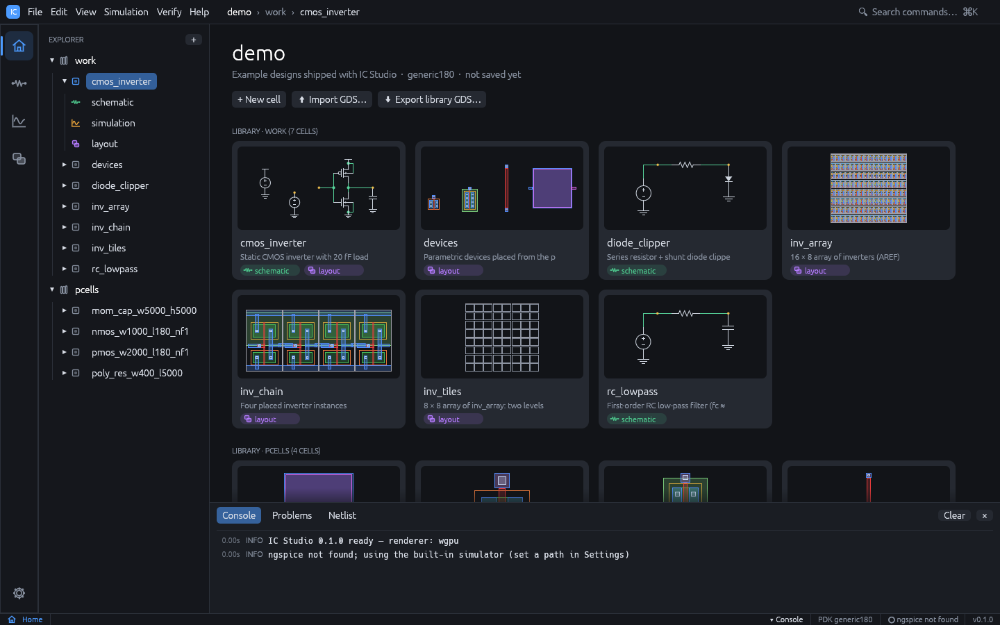

# 프로젝트, 라이브러리, 셀



## 창 구성



- **메뉴 바**(아래 **메뉴** 항목 참고)에는 `project > library > cell` 경로 표시가 있습니다. 셀
  이름 뒤의 점은 저장하지 않은 변경 사항이 있다는 뜻입니다. 오른쪽의 **Search commands...**는 명령
  팔레트를 엽니다.
- **액티비티 바**(맨 왼쪽): Home, Schematic, Simulation, Layout의 네 워크스페이스
  (`Ctrl+1` ~ `Ctrl+4`)와 아래쪽의 Settings 톱니바퀴.
- **Explorer**: 라이브러리, 셀, 그리고 각 셀의 뷰.
- **셀 탭**: 편집기 위에 표시됩니다. `Ctrl+W`로 활성 탭을 닫습니다.
- **하단 패널**(`Ctrl+J`): **Console**(로그), **CIW**(SKILL 프롬프트), **Problems**(회로도 검사기
  결과), **Netlist**(활성 셀의 SPICE 넷리스트).
- **메뉴**: File, Edit, View, Simulation, Verify, **Tools**(디자인 코파일럿, 최적화기, 계산기, 스윕,
  결과와 브라우저, 생성기, DRC 룰 디자이너, 스트림 레이어 맵, 더미 필, SKILL. [도구](tools.md) 참고),
  Help(인터랙티브 튜토리얼, 사용자 가이드, 단축키, 업데이트 확인). Layout 워크스페이스에서는 Create와
  Options 메뉴가 추가됩니다.
- **도구 창**은 메인 창 안에 도킹되어 열립니다. 창의 닫기 버튼 왼쪽에 있는 팝아웃 버튼을 누르면
  별도의 OS 창으로 분리되고, **Dock**을 누르면 다시 돌아옵니다. 선택은 도구별로 기억됩니다.
- **상태 표시줄**: 워크스페이스, 확대 배율, 선택 항목, 테크놀로지 이름, ngspice 상태, 그리고
  에이전트가 연결되어 있는 동안 "MCP live".

## 프로젝트 만들기와 열기

시작 페이지(열린 프로젝트가 없을 때 표시)에는 네 개의 카드 **Take the tutorial**
([빠른 둘러보기](quick-tour.md) 참고), **Open demo project**, **New project...**,
**Open project...**가 있고, 그 아래에 [예제 프로젝트](demos.md#예제-프로젝트) 주제별 카드와 최근
프로젝트 목록이 있습니다.

- **File > New Project...**: 이름(영문자, 숫자, `_`, `-`)과 상위 폴더를 입력합니다. 프로젝트는
  `<folder>/<name>`에 범용 180 nm 테크놀로지로 생성됩니다. 데모 옵션을 체크하면 데모 설계로
  시작합니다.
- **File > New Demo Project**: 데모 프로젝트를 메모리에 만듭니다. **File > Save**로 폴더를 선택합니다.
- **File > Open Project...**(`Ctrl+O`): 프로젝트 폴더(`ic-studio.json`이 있는 폴더)를 선택합니다.
  **File > Open Recent**에 최근 프로젝트가 나열됩니다.
- **File > Save**(`Ctrl+S`)와 **Save As...**(`Ctrl+Shift+S`). 비어 있지도 않고 기존 프로젝트도 아닌
  폴더에 저장하면 프로젝트 이름의 하위 폴더가 만들어집니다.
- **File > Close Project**. 저장하지 않은 변경 사항이 있는 상태에서 닫거나, 종료하거나, 다른
  프로젝트를 열면 **Save**, **Discard**, **Cancel** 중 하나를 묻습니다.

## 셀과 뷰

- **새 셀**(`Ctrl+N`, Explorer 헤더의 `+`, 또는 Home 페이지의 **+ New cell**): 라이브러리, 셀 이름,
  선택적 설명, 만들 뷰(schematic, layout)를 지정합니다.
- Explorer에서 셀을 클릭하면 열립니다. 펼치면 **schematic**, **simulation**, **layout** 뷰가
  보입니다. 없는 뷰는 흐리게 **+ create**로 표시되며, 클릭하면 빈 뷰가 생성됩니다.
- 셀을 오른쪽 클릭하면 **Open schematic**, **Open layout**, **Rename...**, **Delete...**가
  있습니다. 삭제한 셀의 파일은 프로젝트를 저장할 때 디스크에서 제거됩니다.
- **Home** 워크스페이스는 프로젝트 개요를 보여 줍니다. 셀마다 썸네일 카드가 있고,
  **+ New cell**, **Import GDS / OASIS...**, **Export library GDS...** 버튼이 있습니다.

## 명령 팔레트

`Ctrl+K` 또는 `Ctrl+Shift+P`로 팔레트를 엽니다. 단어를 입력해 필터링하고(모든 단어가 일치해야 함),
화살표 키와 `Enter`로 명령을 실행하며, `Esc`로 닫습니다. 모든 메뉴 동작과 함께 셀마다
**Open `<lib>/<cell>` · schematic** 및 **· layout** 항목이 들어 있어 셀 사이를 가장 빠르게 이동하는
방법입니다.

## 디스크 저장 형식

프로젝트는 버전 관리와 잘 맞는 일반 JSON 파일로 이루어진 폴더입니다.

```text
myproj/
  ic-studio.json          프로젝트 매니페스트
  tech.json               테크놀로지: 레이어, 룰, DRC 덱, 계수
  work/                   라이브러리별 폴더
    cmos_inverter/        셀별 폴더
      cell.json           셀 메타데이터 (이름, 설명)
      schematic.json      회로도 뷰 (있는 경우)
      layout.json         레이아웃 뷰 (있는 경우)
      sim.json            시뮬레이션 설정
```

GDS에서 가져온 라이브러리는 다르게 저장되어(라이브러리 폴더 안의 GDS 파일과 `library.json`) 대용량
가져오기도 간결하게 유지됩니다.

## 가져오기와 내보내기

| 작업 | 메뉴 |
|---|---|
| GDSII 또는 OASIS 파일을 새 라이브러리로 가져오기 | **File > Import > GDSII / OASIS...** |
| KLayout 레이어 속성 파일을 테크놀로지로 가져오기 | **File > Import > KLayout layer properties...** |
| 테크놀로지를 PDK 파일로 교체 | **File > Import > PDK...** |
| 활성 셀의 SPICE 넷리스트 내보내기 | **File > Export > SPICE netlist...** |
| 활성 셀과 그 셀이 배치하는 모든 것을 GDSII / OASIS로 내보내기 | **File > Export > Cell GDSII...** / **Cell OASIS...** |
| 프로젝트의 모든 레이아웃을 하나의 GDSII / OASIS 파일로 내보내기 | **File > Export > Library GDSII...** / **Library OASIS...** |
| LEF 매크로 / DEF 배치 가져오기 | **File > Import > LEF abstracts...** / **DEF placement...** |
| 활성 셀의 LEF abstract / DEF 내보내기 | **File > Export > Cell LEF abstract...** / **Cell DEF...** |

GDS / OASIS 가져오기는 계층을 유지합니다. 테크놀로지에 없는 레이어는 테크놀로지에 추가되며 콘솔에
보고됩니다. 가져오기가 끝나면 최상위 셀이 Layout 워크스페이스에서 열립니다. `.lyp`와 PDK 가져오기는
[테크놀로지](technology.md)를, abstract와 배치는 [LEF와 DEF](layout.md#lef와-def)를 참고하세요.
