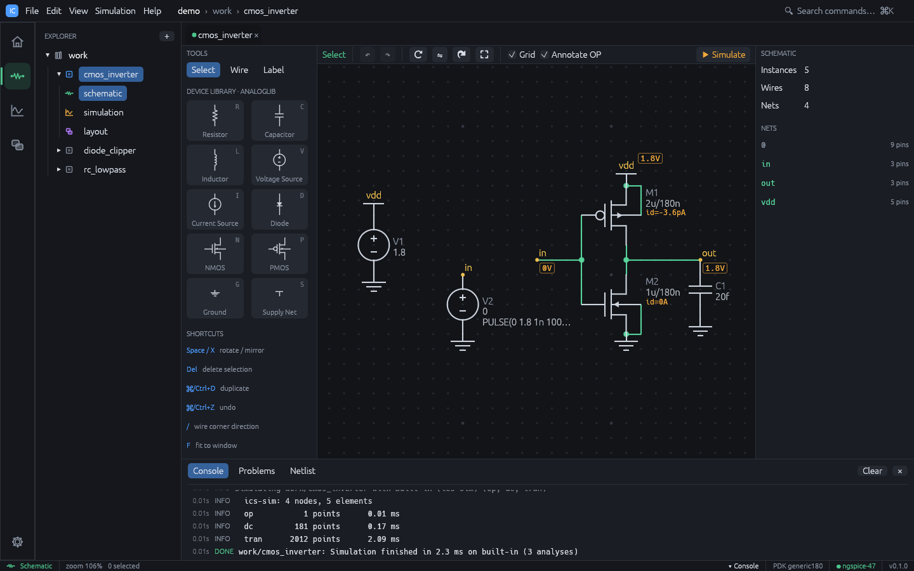
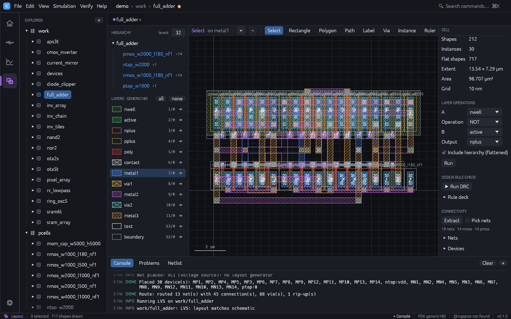
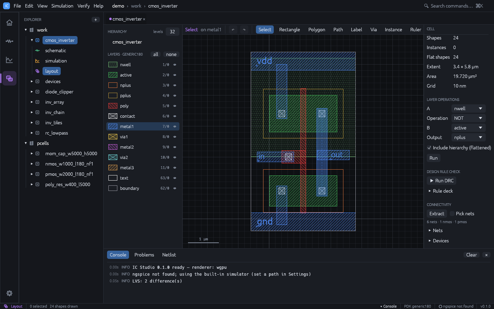

# 빠른 둘러보기

이 둘러보기에서는 데모 프로젝트로 시뮬레이션, 계층형 레이아웃, 자동 배치 배선, 검증, 포스트
레이아웃 시뮬레이션을 차례로 살펴보고, 마지막으로 작은 회로를 처음부터 만들어 봅니다.

앱 안에서 안내를 받으며 시작하려면 **Help > Interactive Tutorial**(또는 시작 페이지의 **Take the
tutorial**)을 선택합니다. 가이드 창이 데모의 `cmos_inverter`로 아홉 단계를 안내합니다. 데모 프로젝트
열기, 회로도 열기, 소자 선택, 시뮬레이션, 파형 측정, 레이아웃 열기, DRC 실행, LVS 실행, 팔레트에서
명령 찾기입니다. 각 단계는 직접 수행하면 저절로 완료되며, **Show me**는 대신 수행하고, **Skip**은
다음 단계로 넘어가며, **Back**은 이전 단계로 돌아갑니다.

## 데모 프로젝트 열기

```sh
cargo run --release -- --demo
```

또는 시작 페이지에서 **Open demo project**(**File > New Demo Project**)를 선택합니다. 데모는
`Ctrl+S`로 저장하기 전까지 메모리에만 존재합니다. 모든 셀은 `work` 라이브러리에 있으며 범용 180 nm
테크놀로지를 사용합니다.

[데모 갤러리](demos.md)에 모든 셀에 대한 설명과 IC Studio를 다른 사람에게 시연하기 위한
스크립트가 있습니다.

`pcells` 라이브러리에는 레이아웃이 사용하는 PCell 변형이 들어 있습니다.

## 1. 회로도와 시뮬레이션

1. Explorer에서 `cmos_inverter`를 클릭합니다. 회로도가 열립니다.
2. `F5`를 누릅니다. Simulation 워크스페이스가 열리고 DC 스윕과 과도 해석 결과가 표시됩니다.
3. **Signals**에서 신호를 체크하거나 해제해 플롯을 바꾸고, **Measurements**에서 MIN / MAX / FINAL을
   확인합니다.
4. `Ctrl+2`를 눌러 회로도로 돌아갑니다. 동작점의 노드 전압과 드레인 전류가 회로도에 표시됩니다.



`rc_lowpass`(AC: **f -3 dB** 열에 코너 주파수가 표시됨)와 `ota5t`(AC: 개루프 이득과 단위 이득
주파수)도 실행해 보세요.

## 2. 레이아웃과 계층

1. `cmos_inverter`를 연 상태에서 `Ctrl+4`를 누릅니다. 이 레이아웃은 손으로 그린 것입니다.
2. `inv_tiles`를 엽니다(Explorer에서, 또는 `Ctrl+K`를 누르고 `inv_tiles` 입력). `Ctrl`+휠로
   확대·축소하고, 휠이나 마우스 가운데 버튼으로 이동하며, `F`를 눌러 화면에 맞춥니다.
3. `1`, `2`, `9`를 눌러 표시할 계층 깊이를 바꿉니다.
4. 인스턴스를 더블클릭하면 배치된 셀이 열립니다.

## 3. 자동 배치 배선

1. `full_adder`를 열고 `Ctrl+4`를 누릅니다. 이 레이아웃은 그린 것이 아니라 회로도에서 생성하고
   자동으로 배선한 것입니다.
2. `Ctrl+A`와 `Delete`를 눌러 지웁니다.
3. **Verify > Generate Layout from Schematic**을 선택합니다. 28개 트랜지스터가 배치되고 연결해야 할
   곳이 플라이라인으로 표시됩니다.
4. **Verify > Route Flylines**를 선택합니다. 모든 넷이 메탈로 배선됩니다.



## 4. 검증

1. `nand2`를 열고 Layout 워크스페이스로 전환합니다.
2. 오른쪽 패널에서 **Run DRC**를 누릅니다. 위반이 없습니다.
3. **Run LVS**를 누릅니다. 레이아웃이 회로도와 일치합니다.
4. `cmos_inverter`를 열고 LVS를 실행합니다. 의도적으로 넣은 차이가 나열됩니다. 항목을 클릭하면 해당
   위치로 확대됩니다.



## 5. 포스트 레이아웃 시뮬레이션

1. Simulation 워크스페이스에서 `ring_osc5`를 엽니다.
2. `F5`를 누르고 과도 해석 플롯에서 발진 주기를 확인합니다.
3. **Include layout parasitics**를 체크하고 `F5`를 다시 누릅니다. 콘솔에 추출된 커패시턴스와
   저항이 요약됩니다. 주기를 비교해 보면 추가된 배선 커패시턴스와 저항 때문에 발진기가 느려집니다.

## 6. 인버터를 처음부터 만들기

1. `Ctrl+N`을 누르고 셀 이름을 `my_inv`로 입력한 뒤 **schematic**을 체크한 채로 **Create**를
   누릅니다.
2. `P`를 누르고 클릭해 PMOS를 배치한 다음, `N`을 누르고 그 아래를 클릭해 NMOS를 배치합니다.
   `Esc`를 누릅니다.
3. `W`를 누르고 두 드레인을 연결한 다음 두 게이트를 연결합니다. `Esc`로 와이어를 끝냅니다.
4. `S`를 누르고 PMOS 소스에 전원 심볼을 배치하고, `G`를 누르고 NMOS 소스에 접지를 배치합니다.
   와이어로 연결합니다.
5. `T`를 누르고 **Net:** 필드에 `in`을 입력한 뒤 게이트 와이어를 클릭하고, `out`을 입력한 뒤
   드레인 와이어를 클릭합니다.
6. 소스를 추가합니다. `V`를 누르고 소스를 배치한 뒤 `p` 핀을 전원 넷에, `n` 핀을 접지 심볼에
   연결하고, 인스펙터에서 **DC value**를 `1.8`로 설정합니다. `in`용 두 번째 소스를 배치하고
   **Transient**를 `PULSE(0 1.8 1n 100p 100p 2n 4n)`로 설정합니다.
7. `Ctrl+3`을 누르고 **Transient**를 켠 뒤(step `10p`, stop `10n`) `F5`를 누릅니다.
8. **Verify > Generate Layout from Schematic**을 선택합니다. 두 트랜지스터가 웰 탭과 함께 PCell로
   배치되고, 연결해야 할 곳이 플라이라인으로 표시됩니다.
9. **Verify > Route Flylines**를 선택합니다. 라우터가 넷을 메탈로 배선합니다.
10. 오른쪽 패널에서 DRC와 LVS를 실행한 뒤 `Ctrl+S`로 저장합니다.

생성기와 라우터의 동작, 소자 매칭 방법은 [회로도 기반 레이아웃](schematic-driven-layout.md)을
참고하세요.

## 7. 명령줄

같은 프로젝트를 터미널에서 검사할 수 있습니다.

```sh
ics new demo --template demo
ics sim demo ota5t
ics drc demo nand2
ics lvs demo nand2
```

[명령줄](cli.md)을 참고하세요.
