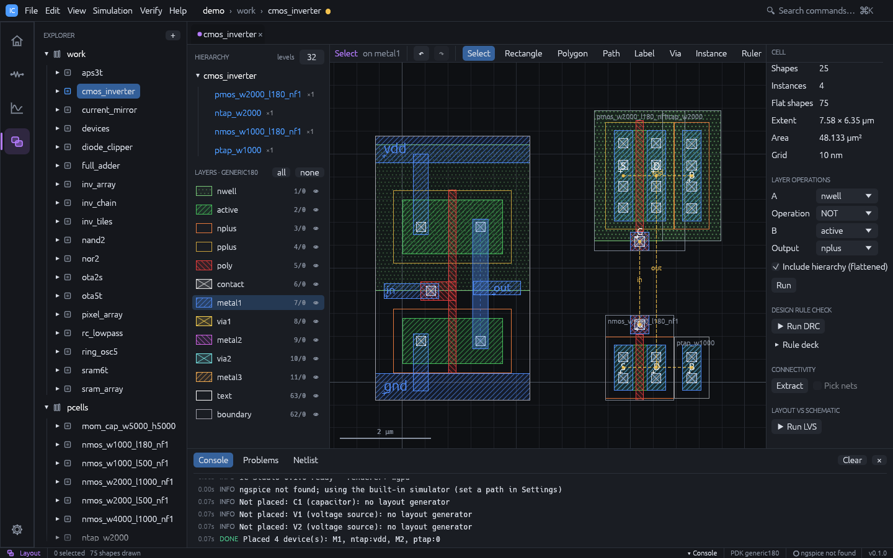

# 회로도 기반 레이아웃

IC Studio는 회로도로부터 레이아웃을 만들 수 있습니다. 트랜지스터를 PCell로 배치하고, 아직
연결되지 않은 부분을 플라이라인으로 표시한 뒤, 이를 배선합니다.



## 단계별 진행



1. 회로도를 그리고 시뮬레이션합니다. 외부 넷에는 레이블(`in`, `out`, ...)을 붙이고, 전원
   레일에는 Ground와 Supply 심볼을 사용합니다.
2. 셀이 활성화된 상태에서 **Verify > Generate Layout from Schematic**을 선택합니다. 셀에
   레이아웃 뷰가 없으면 새로 만들어지고, 플라이라인이 켜진 상태로 Layout 워크스페이스가
   열립니다.
3. 배치를 확인합니다. 원하면 소자를 옮겨도 됩니다. 이름이 회로도와의 연결을 유지합니다.
4. **Verify > Route Flylines**를 선택해 남은 연결을 배선합니다.
5. LVS가 외부 넷을 식별할 수 있도록 메탈 위에 핀 레이블을 추가합니다(Label 도구, `L`).
6. DRC와 LVS를 실행한 다음([검증](verification.md) 참고), **Include layout parasitics**를
   켜고 시뮬레이션합니다.

각 단계는 `Ctrl+Z`로 되돌릴 수 있습니다. 콘솔에는 배치, 건너뜀, 매칭, 배선된 항목이 표시됩니다.

## 데모: 자동 배치 배선

데모 셀 `full_adder`(트랜지스터 28개)와 `ota2s`(공통 중심 입력 쌍과 미러를 갖춘 2단 OTA)의
레이아웃은 이 흐름만으로 만들어졌습니다. 레이아웃을 지우고(`Ctrl+A`, `Delete`) 위의 두 명령을
실행하면 과정을 직접 볼 수 있습니다. [데모 갤러리](demos.md#2-자동-배치-배선-단계별-시연)에
전체 스크립트가 있습니다.

## 배치

- 각 NMOS와 PMOS는 회로도 소자 이름(`M1`)을 딴 PCell 인스턴스가 됩니다. W와 L은 소자의 `w`,
  `l` 파라미터에서 가져오고, `m`은 소자 수를 곱합니다. 폭이 5 µm보다 큰 소자는 핑거로
  나뉩니다. PDK를 사용하면 회로도의 모델이 PCell의 소자(그리고 저Vt 모델의 `lvtn` 같은 마커
  레이어)를 결정합니다.
- PMOS 소자는 NMOS 행 위에 행을 이루며, 게이트는 두 행 사이의 채널을 향합니다.
- 유형과 폭이 같고 소스 / 드레인 넷을 공유하는 이웃 소자는 확산을 공유하며 맞붙여
  배치됩니다.
- 웰과 임플란트는 행마다 합쳐지고, 각 행 끝에는 그 행의 벌크 넷에 연결된 벌크 탭(PMOS 행에는
  `ntap`, NMOS 행에는 `ptap`)이 놓입니다.
- 레이아웃에 이미 있는 소자(이름 기준)는 그대로 두므로, 회로도에 소자를 추가한 뒤 다시 생성할
  수 있습니다.
- 레이아웃 생성기가 없는 소자(R, C, L, 다이오드, 소스)는 건너뛰고 콘솔에 나열됩니다.

## 매칭 소자

차동 쌍과 전류 미러는 자동으로 감지됩니다.

- **차동 쌍**: 유형, W, L, m이 같고, 레일이 아닌 공통 소스 넷을 가지며, 게이트와 드레인이 서로
  다른 두 소자.
- **전류 미러**: 유형과 L이 같고 게이트와 소스를 공유하며, 게이트가 한 소자의 드레인에 연결된
  소자들.

같은 `match` 파라미터를 지정해 소자를 명시적으로 묶을 수도 있고, `match=none`으로 소자를
제외할 수도 있습니다. 인스펙터에는 표준 파라미터만 표시되므로, 셀의 `schematic.json`에서 소자의
`params`에 `match`(와 `match_rows`)를 추가하십시오.

```json
"params": { "model": "nmos", "w": "4u", "l": "500n", "m": "1", "match": "pair1" }
```

매칭 그룹은 `<device>.<k>`(예: `M1.1`, `M1.2`)라는 이름의 동일한 단위 핑거로 나뉘어 공통 중심
순서(ABBA)로 배치됩니다. 단위가 8개 이상인 그룹이나 `match_rows=2`인 그룹은 교차 결합된 두
행(ABBA / BAAB)을 사용하고, `match_rows=1`은 한 행으로 강제합니다. 각 단위 행의 양 끝에는
게이트가 벌크에 연결된 더미 핑거가 놓입니다. 더미는 항상 꺼져 있으므로 LVS는 이를 무시합니다.

콘솔은 각 그룹의 결과를 보고합니다. 예: `A, B: matched as ABBA (A = M1, B = M2)`. 매칭하지
못했다면 그 이유를 보고합니다.

## 플라이라인

레이아웃 툴바의 **Flylines** 체크박스를 켜면, 레이아웃에서 아직 연결되지 않은 회로도 연결마다
넷 이름이 표시된 점선이 그려집니다. 편집할 때마다 갱신되므로 수작업으로 배선하면서 플라이라인이
사라지는 것을 확인할 수 있습니다.

## 라우터



**Route Flylines**는 폴리 위의 배선 메탈 레이어(generic 테크놀로지에서는 metal1, metal2,
metal3)에서 메이즈 라우터(A* 탐색)를 실행합니다.

- 배선 그리드는 소자 단자에 정렬됩니다. 배선은 비아가 들어가는 단일 폭을 가지며, 트랙 사이에는
  DRC 간격이 확보됩니다.
- 기존 형상은 피해 갑니다. 짧은 넷을 먼저 배선하고, 서로 막는 넷은 뜯어내고(rip-up) 다시
  배선합니다.
- Metal1은 비용이 높고 상위 레이어마다 선호 방향이 있으므로, 긴 배선은 상위 메탈로 올라갑니다.

배선 후 완전히 연결된, 이름이 있는 모든 회로도 넷(레이블과 전원. 접지 심볼은 `gnd`가 됨)에는
단자 중 하나에 텍스트 레이블이 붙습니다. 단, 최상위 셀에 같은 이름의 레이블이 이미 있으면
붙이지 않습니다. 레이블은 첫 번째 메탈 또는 PDK가 넷 레이블용으로 지정한 레이어
(`[[pin_label]]`, 예: SG13G2의 `Metal1.text`)에 놓이므로, 외부 LVS 덱이 레이아웃의 포트를
회로도 이름으로 인식할 수 있습니다.

콘솔 요약에는 배선된 넷, 연결, 비아, rip-up 수가 표시됩니다. 배선하지 못한 넷은 이유(단자가
도전성 형상 위에 없음, 또는 도달하지 못한 조각)와 함께 플라이라인으로 남습니다. 수작업으로
마무리한 뒤 다시 배선하십시오.

## 크로스 프로빙

회로도에서 소자를 선택하고 레이아웃으로 전환하면 이름이 같은 인스턴스(단위 핑거 포함)가
선택됩니다. 반대 방향도 마찬가지입니다.

## 명령줄 또는 에이전트에서

```sh
ics route myproj nand2 --place   # 누락된 소자 배치, 배선, 저장. 넷이 남으면 종료 코드 1
```

MCP 서버는 `generate_layout`, `flylines`, `route`를 제공합니다([MCP 서버](mcp.md) 참고).
