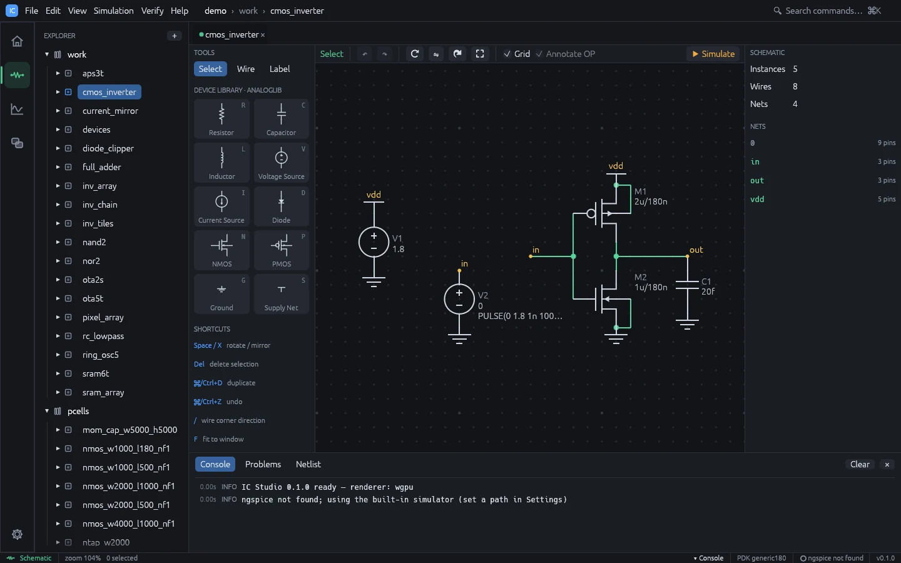
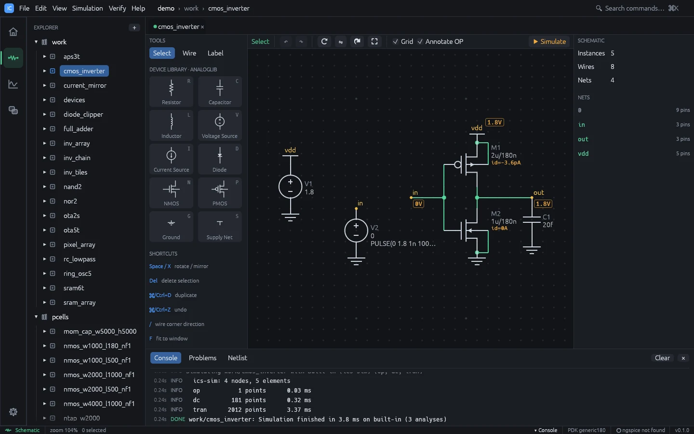

<!-- seo title="IC 설계용 회로도 편집기" description="IC Studio에서 트랜지스터 수준 회로도 그리기: 소자 라이브러리, 와이어, 레이블, 심볼, 계층 구조, SPICE 넷리스트 생성." -->

# 회로도 편집기

셀의 회로도 뷰를 열거나, 셀이 열린 상태에서 `Ctrl+2`를 눌러 편집합니다.



- **왼쪽 패널**: 프리미티브마다 타일과 단축키 문자가 표시되는 **Device Library**와 간단한
  단축키 안내. 라벨 도구를 쓰는 동안에는 붙일 넷 이름 입력란도 표시됩니다.
- **툴바**: Select, Wire, Label 도구, 현재 도구, 실행 취소 / 다시 실행, 회전, 미러, 복제, 화면 맞춤, **Grid** 및
  **Annotate OP** 체크박스, **Simulate**(`F5`).
- **오른쪽 패널**: 속성 인스펙터.

회로도 좌표는 정수 그리드 점입니다. 키 입력은 마우스가 캔버스 위에 있고 텍스트 필드에
포커스가 없을 때만 캔버스에 적용됩니다.


## 소자

| 키 | 소자 | 이름 접두사 | 핀 | 기본 파라미터 |
|---|---|---|---|---|
| `R` | 저항 (Resistor) | R | p, n | `r=1k` |
| `C` | 커패시터 (Capacitor) | C | p, n | `c=1p` |
| `L` | 인덕터 (Inductor) | L | p, n | `l=1n` |
| `V` | 전압원 (Voltage Source) | V | p, n | `dc=1` |
| `I` | 전류원 (Current Source) | I | p, n | `dc=1m` |
| `D` | 다이오드 (Diode) | D | a, k | `model=dmod` |
| `N` | NMOS | M | d, g, s, b | `model=nmos w=1u l=180n m=1` |
| `P` | PMOS | M | d, g, s, b | `model=pmos w=2u l=180n m=1` |
| `G` | 접지 (Ground) | GND | gnd | (넷 `0`) |
| `S` | 전원 넷 (Supply Net) | VDD | net | `net=vdd` |

### 소자 배치

1. 소자 키(예: `N`)를 누르거나 Device Library에서 해당 타일을 클릭합니다.
2. 커서를 따라 미리보기가 표시됩니다. 배치하기 전에 `Space`로 회전하거나 `X`로 미러할 수 있습니다.
3. 클릭해 배치합니다. 소자는 그리드에 스냅되고, 비어 있는 다음 이름(`M1`, `M2`, ...)을 받으며
   선택된 상태가 됩니다. 도구가 계속 활성화되어 있으므로 클릭할 때마다 복사본이 추가로 배치됩니다.
4. `Esc`를 누르거나 오른쪽 클릭하면 Select로 돌아갑니다.

## 와이어

1. `W`를 누릅니다(또는 **Wire** 선택).
2. 시작점을 클릭합니다. 보통 핀에서 시작합니다.
3. 다음 점을 클릭합니다. 클릭할 때마다 수평 먼저인 L자형 세그먼트 한 쌍이 추가됩니다.
   `/`를 누르면 수직 먼저로 꺾입니다.
4. 핀, 와이어 끝점 또는 다른 와이어의 중간을 클릭하면 와이어가 자동으로 끝납니다. 그렇지 않으면
   계속 클릭하고, 더블 클릭, 오른쪽 클릭 또는 `Esc`로 끝냅니다.

연결은 실시간으로 반영됩니다. 연결되지 않은 핀은 작은 사각형으로 표시되고, 세 개 이상의 연결이
만나는 곳에는 접합점(junction dot)이 나타납니다. 와이어에 마우스를 올리거나 선택하면 넷 전체가
하이라이트됩니다.

## 넷 레이블과 넷 이름

1. `T`를 누릅니다(또는 **Label** 선택). 왼쪽 패널에 **Net:** 필드가 나타납니다(기본값
   `net1`).
2. 이름을 입력하고 핀이나 와이어를 클릭해 레이블을 붙입니다. 레이블은 정확히 해당 그리드
   점에서만 연결됩니다.
3. 배치할 때마다 끝의 숫자가 1씩 증가하므로(`net1`, `net2`, ...) 레이블로 버스를 만들 때
   편리합니다.

이름이 같은 레이블은 같은 넷이므로, 와이어 없이 레이블로 회로도의 여러 부분을 연결할 수
있습니다. 넷 이름은 다음 순서로 정해집니다. **Ground** 심볼(넷 `0`), **Supply Net** 심볼의
`net` 파라미터(비워 두면 `vdd`), 넷 레이블, 그리고 자동 이름(`net1`, `net2`, ...).

### 핀

레이블 인스펙터에서 **Pin**을 `input`, `output`, `inputOutput`으로 정하면 그 레이블은 셀의
**핀**(Virtuoso 회로도 핀)이 되고 핀 모양으로 그려집니다. 핀은 셀의 포트입니다.

- CDL 넷리스트(와 LVS)는 핀을 이름순 `.SUBCKT` 포트로 쓰고 `*.PININFO`에 방향을 적습니다.
  핀이 없으면 이름 붙은 넷이 모두 포트입니다.
- CDL 가져오기(와 Virtuoso 라이브러리 가져오기)는 `*.PININFO` 핀을 회로도 핀으로 만들고, SKILL
  내보내기는 `basic` `ipin` / `opin` / `iopin` 핀을 만듭니다.
- Check Against Source는 핀마다(핀이 없으면 이름 붙은 넷마다) 레이아웃 핀 라벨을 요구합니다.
- MCP `write_schematic`은 `pins`를 받습니다. 예: `{"in": "input", "out": "output"}`.

참고:

- 넷 `0`을 만드는 것은 Ground 심볼뿐입니다. `gnd`라는 레이블은 일반 넷입니다.
- Supply Net 심볼은 넷에 이름만 붙입니다. 전원을 공급하려면 그 넷에 전압원을 연결하십시오.
- 한 넷에 서로 다른 두 이름이 붙으면 다음 경고가 표시됩니다.
  "Net names 'a' and 'b' are shorted together".

## 선택과 편집

| 동작 | 방법 |
|---|---|
| 객체 하나 선택 | 클릭(레이블이 와이어보다, 와이어가 소자보다 우선) |
| 선택에 추가 또는 제거 | `Shift`+클릭 또는 `Ctrl`+클릭 |
| 박스 선택 | 빈 공간에서 드래그(완전히 안에 들어간 객체를 선택, `Shift`는 추가) |
| 모두 선택 | `Ctrl+A` |
| 모두 선택 해제 | `Ctrl+D` |
| 이동 | 선택한 객체를 드래그. 연결된 와이어는 이동한 핀을 따라 늘어남 |
| 회전 / 미러 | `Space` / `X` 또는 툴바 버튼 |
| 복제 | `Ctrl+Shift+D`(그리드 두 점만큼 떨어진 위치에 새 이름으로 복사) |
| 삭제 | `Del` 또는 `Backspace` |
| 실행 취소 / 다시 실행 | `Ctrl+Z` / `Ctrl+Shift+Z` 또는 `Ctrl+Y` |
| 화면에 맞춤 | `F` |
| 취소 | `Esc`: 그리던 와이어를 취소하고, 다음엔 Select로 돌아가고, 그다음엔 선택을 해제 |

## 속성 인스펙터

소자 하나를 선택하면 오른쪽 패널에서 편집할 수 있습니다. 값은 넷리스트에 들어가는 그대로의
SPICE 문자열이며, SPICE 배율 접미사(`10k`, `2.2p`, `180n`, `1meg`)를 사용합니다.

- **Name**: 인스턴스 이름. 고유해야 하며, 소자와 레이아웃 인스턴스를 연결하는 역할도 합니다.
- 소자 필드: **Resistance**, **Capacitance**, **Inductance / L**, **Model**,
  **Width**, **Multiplier**, **Net name**(전원).
- 소스: **DC value**, **AC magnitude**(AC 해석용, 예: `1`), **Transient**
  (예: `PULSE(0 1 0 1n 1n 5n 10n)`, `SIN(...)`과 `PWL(...)`도 사용 가능).
- **Orientation**, **Position**, 그리고 핀별 넷을 보여 주는 **Connections** 목록.

아무것도 선택하지 않으면 인스펙터에 통계(인스턴스, 와이어, 넷), 넷 목록과 넷별 핀 수, 그리고
**Warnings**(연결되지 않은 핀, 중복 이름, 단락된 넷 이름)가 표시됩니다.

하단 패널의 **Problems** 탭은 편집하는 동안 활성 셀에 회로도 검사를 실행합니다. 접지 누락,
잘못되었거나 중복된 이름, 값 누락 또는 잘못된 값, 단락된 소자, 전압원 루프, 플로팅 넷, 끊어진
와이어 등을 찾아냅니다. 항목을 클릭하면 해당 소자가 선택됩니다. **Tools > Check Schematic**은
필요할 때 검사를 실행하고, **File > Check and Save**는 오류가 없을 때만 저장합니다. 모든 검사
항목은 [Check Schematic](tools.md#check-schematic)을 참고하십시오.

## 넷리스트

하단 패널의 **Netlist** 탭은 활성 셀의 SPICE 덱을 보여 주며, 편집하면 바로 갱신됩니다.
**File > Export > SPICE netlist...**로 내보낼 수 있습니다. 넷리스터는 다음을 출력합니다.

- `R1 p n value`, `C...`, `L...`
- `V1 p n DC <dc> [AC <ac>] [<tran>]`, 전류원도 마찬가지
- `D1 a k dmod`
- `M1 d g s b <model> w=... l=... [m=...]`. 연결되지 않은 벌크 핀은 소스에 연결됩니다.
- 사용된 경우 기본 level-1 모델 `nmos`, `pmos`, `dmod`. PDK 모델 라이브러리가 있으면 MOS
  모델은 PDK 소자로 매핑되고(서브서킷 소자는 `X` 접두사), 라이브러리는 선택한 코너로
  로드됩니다.

## Virtuoso와 회로도 주고받기

OpenAccess는 바이너리 C++ 데이터베이스이므로, IC Studio와 Cadence Virtuoso는 Virtuoso가 직접 읽고 쓰는 텍스트
형식으로 회로도를 주고받습니다.

- **Virtuoso에서 가져오기: CDL.** Virtuoso에서 CDL 넷리스트를 내보냅니다(Calibre LVS 때처럼 auCdl 넷리스터).
  IC Studio에서는 **File > Import > CDL netlist (Virtuoso)...**(또는 `ics import-cdl`, MCP `import_cdl`)를 씁니다.
  임포터는 다음을 읽습니다.

  - `*.PININFO` 방향이 있는 `.SUBCKT`
  - `/ cell`이 있거나 없는 `X` 인스턴스
  - 식을 포함한 서브서킷 파라미터(`W='wp/2'`)
  - `.GLOBAL`과 `!` 전역 넷(`gnd!`는 접지)
  - `$` 주석

  최상위 서브서킷부터 평탄화해 회로도 하나로 만듭니다. 소자 이름에는 인스턴스 경로가 붙고(`MI0/M0`은 `XI0`
  안의 `MM0`), 로컬 넷에도 경로가 붙습니다(`I0/net7`). SPICE 넷리스트처럼 모든 핀에 넷 레이블이 붙습니다.
  `$[model]`과 크기만 있는 저항·커패시터는 임시 값과 경고를 받습니다. `ics import-cdl --all`은 모든 서브서킷을
  각각 셀로 가져옵니다.
- **Virtuoso로 내보내기: SKILL.** **File > Export > Virtuoso schematic (SKILL)...**(또는 `ics export-skill`, MCP
  `export_skill_schematic`)는 스크립트를 씁니다. CIW에서 `load("inv.il")`로 읽으면 analogLib 심볼(`nmos4`, `pmos4`,
  `res`, `cap`, `ind`, `vdc`, `idc`, `diode`)로 회로도를 만들고 파라미터를 설정합니다. 각 단자에는 짧은 와이어와
  넷 이름 와이어 레이블이 붙는데, 스크립트가 실행될 때 심볼이 정의한 핀 위치를 찾아 붙이므로 연결은 심볼
  형상과 무관합니다. 끝나면 **Check and Save**를 하고, 원하면 배치를 정리합니다.

  PDK 심볼을 쓰려면 프로젝트 옆에 `virtuoso_symbols.toml`을 두거나 `--map`으로 줍니다.

  ```toml
  [[symbol]]
  kind = "nmos"            # nmos, pmos, resistor, capacitor, inductor, vsource, isource, diode
  model = "nch"            # 선택: 이 모델의 인스턴스만
  lib = "gpdk180"
  cell = "nmos1v"
  terms = { d = "D", g = "G", s = "S", b = "B" }
  params = { w = "w", l = "l", m = "m" }   # IC Studio 파라미터 = CDF 파라미터
  ```

  IC Studio의 **CDL** 넷리스트(`ics netlist --format cdl`)를 Virtuoso의 CDL 가져오기로 읽는 방법도 있습니다.

### 라이브러리 통째로: Virtuoso 덤프

CDL은 연결 정보만 담습니다. 회로도와 레이아웃을 함께 옮기려면 Virtuoso 안에서 작은 SKILL 스크립트로 라이브러리를
텍스트로 쓴 다음 그 파일을 가져옵니다.

1. **File > Export > Virtuoso dump script (icsDump.il)...**(또는 `ics dump-skill -o icsDump.il`)로 스크립트를
   저장합니다.
2. Virtuoso CIW에서 실행합니다.

   ```skill
   load("icsDump.il")
   icsDumpLib("myLib" "/tmp/myLib.icsdump")                          ; 모든 셀
   icsDumpLib("myLib" "/tmp/amp.icsdump" ?cells list("amp" "bias"))  ; 일부 셀
   icsDumpLib("myLib" "/tmp/sch.icsdump" ?views list("schematic"))   ; 회로도만
   ```

3. IC Studio에서 **File > Import > Virtuoso library dump...**(또는
   `ics import-virtuoso <project> /tmp/myLib.icsdump [--map virtuoso_symbols.toml] [--scale S] [--overwrite]`,
   MCP `import_virtuoso`)를 실행합니다.

**Virtuoso가 설치되어 있으면 한 번에**: **File > Import > Virtuoso library (dump or cds.lib)...**에서
라이브러리의 `cds.lib`를 고르고 라이브러리를 선택하거나, `ics import-virtuoso <project> path/to/cds.lib
--lib myLib`를 실행합니다(`cds.lib`가 있는 디렉터리나 라이브러리 디렉터리 자체도 됩니다). IC Studio가 사용자의
`cds.lib`를 포함하는 임시 디렉터리에서 덤프 스크립트로 Virtuoso를 배치 모드(`virtuoso -nograph -replay`)로
실행하고 덤프를 가져오므로 1~3단계가 자동으로 진행됩니다. Virtuoso는 `$ICS_VIRTUOSO`, 없으면 `PATH`의
`virtuoso`입니다. `cds.lib`에는 `INCLUDE`, `SOFTINCLUDE`, `UNDEFINE`, 환경 변수를 쓸 수 있습니다. OpenAccess
자체를 링크하지는 않습니다.

옮겨지는 내용은 다음과 같습니다.

- **회로도**: 회로도마다 셀이 하나 생깁니다. 인스턴스는 SKILL 내보내기와 같은 심볼 맵을 거꾸로 써서 IC Studio
  소자에 대응시킵니다(기본값은 analogLib). 파라미터는 인스턴스의 CDF 값이어서, 인스턴스가 바꾸지 않은 기본값도
  들어옵니다. 각 터미널의 넷은 Virtuoso의 연결 정보에서 가져옵니다. 덤프에 들어 있는 다른 회로도의 인스턴스는
  서브서킷으로 보고, CDL 임포트처럼 인스턴스 경로를 붙여 평탄화합니다(`MI0/M0`). `pPar("wp")`는 부모의 값을
  쓰고, 부모가 주지 않으면 셀의 CDF 기본값을 씁니다. 서브서킷이 없는 회로도는 Virtuoso의 배치와 방향을 그대로
  씁니다(그리드 한 칸이 `--scale` 사용자 단위). 다만 그렇게 해서 연결이 달라지면 소자를 줄 단위로 배치하고 경고를
  냅니다. 핀, 전원, `basic` 심볼은 넷이 이미 터미널에 있으므로 소자로 가져오지 않습니다. 반복 인스턴스
  (`I0<0:3>`)는 경고와 함께 건너뜁니다.
- **레이아웃**: 사각형, 폴리곤, 패스(`path`, `pathSeg`), 레이블, 인스턴스, mosaic(배열로)을 가져옵니다.
  레이어-퍼포스 쌍은 테크놀로지 레이어에 대응시킵니다. `drawing`이 아닌 퍼포스는 먼저 `metal1.pin` /
  `metal1_pin`을 찾고, 없으면 `pin`, `net`, `label`, `boundary` 퍼포스에 한해 레이어 자체를 씁니다. 알 수 없는
  레이어의 도형은 개수를 세어 알려 주고 건너뜁니다. 다른 라이브러리의 마스터(표준 셀, PDK 소자)는 그 라이브러리의
  셀로 들어옵니다. PCell variant는 `<cell>_pc<n>`이라는 고정 셀이 됩니다. 레이어와 데이터베이스 단위가 맞도록
  PDK 테크놀로지(`.tf`, `display.drf`, 레이어 맵)를 먼저 불러 오세요.

이미 있는 회로도와 레이아웃은 `--overwrite`를 주지 않으면 그대로 둡니다.

CDL 임포트는 계층 auCdl 형식 넷리스트와 데모 셀의 CDL 왕복으로 테스트했습니다. 덤프 리더는 스크립트 형식의
덤프로 테스트했습니다. 스크립트의 레이아웃 부분(`icsDumpLay`)은 IC Studio의 SKILL 인터프리터로 데모
레이아웃에서도 실행했고, 그 결과를 다시 읽으면 도형과 인스턴스가 같습니다. SKILL 내보내기와 덤프 스크립트는
아직 Virtuoso 세션에서 실행해 보지 않았습니다. 회로도 부분은 내장 인터프리터가 흉내 내지 않는 `cdfGetInstCDF`,
`instTerms`, `terminals`를 씁니다.

## 동작점 표시

동작점 시뮬레이션 후 **Annotate OP**(기본으로 켜짐)를 사용하면 각 노드 전압이 회로도에 태그로
표시되고, 각 트랜지스터와 다이오드 아래에 전류 `id=...`가 표시됩니다.



## 크로스 프로빙

셀에 회로도와 레이아웃이 모두 있으면, 한 편집기에서 소자를 선택할 때 다른 편집기에서 이름이 같은
소자가 함께 선택됩니다. 매칭된 소자의 단위 핑거(`M1.1`, `M1.2`, ...)는 `M1`에 대응됩니다.
