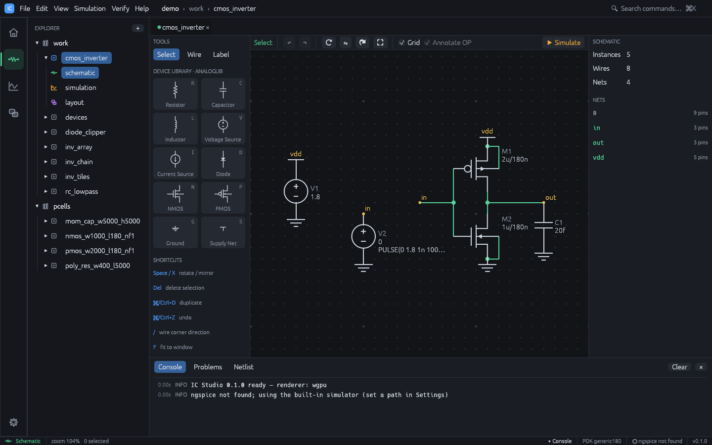
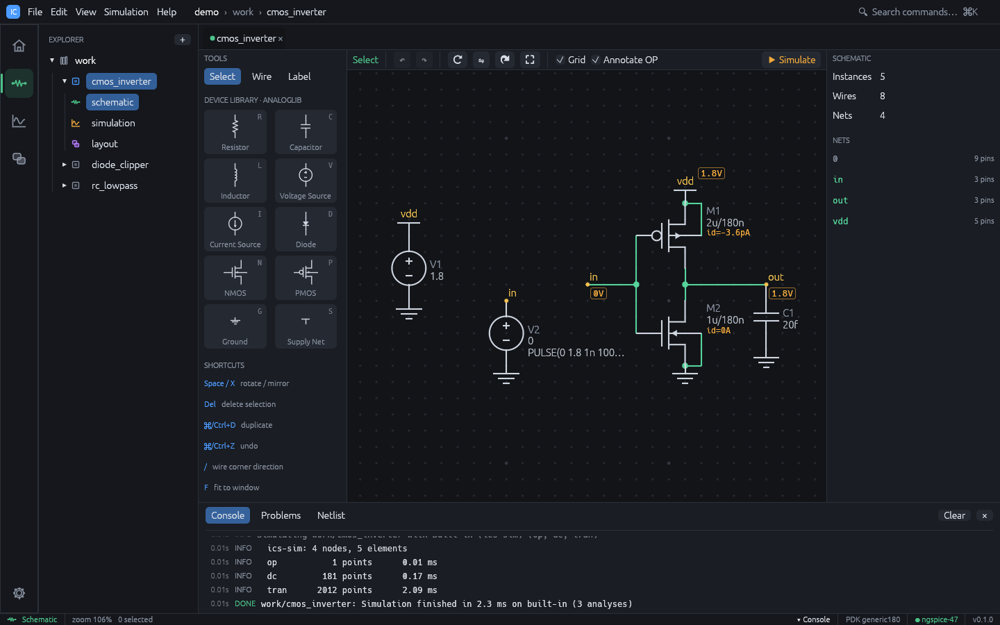

# 회로도 편집기

셀의 회로도 뷰를 열거나, 셀이 열린 상태에서 `Ctrl+2`를 눌러 편집합니다.

- **왼쪽 패널**: **Tools**(Select, Wire, Label), 프리미티브마다 타일과 단축키 문자가 표시되는
  **Device Library**, 그리고 간단한 단축키 안내.
- **툴바**: 현재 도구, 실행 취소 / 다시 실행, 회전, 미러, 복제, 화면 맞춤, **Grid** 및
  **Annotate OP** 체크박스, **Simulate**(`F5`).
- **오른쪽 패널**: 속성 인스펙터.

회로도 좌표는 정수 그리드 점입니다. 키 입력은 마우스가 캔버스 위에 있고 텍스트 필드에
포커스가 없을 때만 캔버스에 적용됩니다.

## 소자

| 키 | 소자 | 이름 접두사 | 핀 | 기본 파라미터 |
|---|---|---|---|---|
| `R` | 저항 (Resistor) | R | p, n | `r=1k` |
| `C` | 커패시터 (Capacitor) | C | p, n | `c=1p` |
| `L` | 인덕터 (Inductor) | L | p, n | `l=1n` |
| `V` | 전압원 (Voltage Source) | V | p, n | `dc=1` |
| `I` | 전류원 (Current Source) | I | p, n | `dc=1m` |
| `D` | 다이오드 (Diode) | D | a, k | `model=dmod` |
| `N` | NMOS | M | d, g, s, b | `model=nmos w=1u l=180n m=1` |
| `P` | PMOS | M | d, g, s, b | `model=pmos w=2u l=180n m=1` |
| `G` | 접지 (Ground) | GND | gnd | (넷 `0`) |
| `S` | 전원 넷 (Supply Net) | VDD | net | `net=vdd` |

### 소자 배치

1. 소자 키(예: `N`)를 누르거나 Device Library에서 해당 타일을 클릭합니다.
2. 커서를 따라 미리보기가 표시됩니다. 배치하기 전에 `Space`로 회전하거나 `X`로 미러할 수 있습니다.
3. 클릭해 배치합니다. 소자는 그리드에 스냅되고, 비어 있는 다음 이름(`M1`, `M2`, ...)을 받으며
   선택된 상태가 됩니다. 도구가 계속 활성화되어 있으므로 클릭할 때마다 복사본이 추가로 배치됩니다.
4. `Esc`를 누르거나 오른쪽 클릭하면 Select로 돌아갑니다.

## 와이어

1. `W`를 누릅니다(또는 **Wire** 선택).
2. 시작점을 클릭합니다. 보통 핀에서 시작합니다.
3. 다음 점을 클릭합니다. 클릭할 때마다 수평 먼저인 L자형 세그먼트 한 쌍이 추가됩니다.
   `/`를 누르면 수직 먼저로 꺾입니다.
4. 핀, 와이어 끝점 또는 다른 와이어의 중간을 클릭하면 와이어가 자동으로 끝납니다. 그렇지 않으면
   계속 클릭하고, 더블 클릭, 오른쪽 클릭 또는 `Esc`로 끝냅니다.

연결은 실시간으로 반영됩니다. 연결되지 않은 핀은 작은 사각형으로 표시되고, 세 개 이상의 연결이
만나는 곳에는 접합점(junction dot)이 나타납니다. 와이어에 마우스를 올리거나 선택하면 넷 전체가
하이라이트됩니다.

## 넷 레이블과 넷 이름

1. `T`를 누릅니다(또는 **Label** 선택). 왼쪽 패널에 **Net:** 필드가 나타납니다(기본값
   `net1`).
2. 이름을 입력하고 핀이나 와이어를 클릭해 레이블을 붙입니다. 레이블은 정확히 해당 그리드
   점에서만 연결됩니다.
3. 배치할 때마다 끝의 숫자가 1씩 증가하므로(`net1`, `net2`, ...) 레이블로 버스를 만들 때
   편리합니다.

이름이 같은 레이블은 같은 넷이므로, 와이어 없이 레이블로 회로도의 여러 부분을 연결할 수
있습니다. 넷 이름은 다음 순서로 정해집니다. **Ground** 심볼(넷 `0`), **Supply Net** 심볼의
`net` 파라미터(비워 두면 `vdd`), 넷 레이블, 그리고 자동 이름(`net1`, `net2`, ...).

참고:

- 넷 `0`을 만드는 것은 Ground 심볼뿐입니다. `gnd`라는 레이블은 일반 넷입니다.
- Supply Net 심볼은 넷에 이름만 붙입니다. 전원을 공급하려면 그 넷에 전압원을 연결하십시오.
- 한 넷에 서로 다른 두 이름이 붙으면 다음 경고가 표시됩니다.
  "Net names 'a' and 'b' are shorted together".

## 선택과 편집

| 동작 | 방법 |
|---|---|
| 객체 하나 선택 | 클릭(레이블이 와이어보다, 와이어가 소자보다 우선) |
| 선택에 추가 또는 제거 | `Shift`+클릭 또는 `Ctrl`+클릭 |
| 박스 선택 | 빈 공간에서 드래그(완전히 안에 들어간 객체를 선택, `Shift`는 추가) |
| 모두 선택 | `Ctrl+A` |
| 이동 | 선택한 객체를 드래그. 연결된 와이어는 이동한 핀을 따라 늘어남 |
| 회전 / 미러 | `Space` / `X` 또는 툴바 버튼 |
| 복제 | `Ctrl+D`(그리드 두 점만큼 떨어진 위치에 새 이름으로 복사) |
| 삭제 | `Del` 또는 `Backspace` |
| 실행 취소 / 다시 실행 | `Ctrl+Z` / `Ctrl+Shift+Z` 또는 `Ctrl+Y` |
| 화면에 맞춤 | `F` |
| 취소 | `Esc`: 그리던 와이어를 취소하고, 다음엔 Select로 돌아가고, 그다음엔 선택을 해제 |

## 속성 인스펙터

소자 하나를 선택하면 오른쪽 패널에서 편집할 수 있습니다. 값은 넷리스트에 들어가는 그대로의
SPICE 문자열이며, SPICE 배율 접미사(`10k`, `2.2p`, `180n`, `1meg`)를 사용합니다.

- **Name**: 인스턴스 이름. 고유해야 하며, 소자와 레이아웃 인스턴스를 연결하는 역할도 합니다.
- 소자 필드: **Resistance**, **Capacitance**, **Inductance / L**, **Model**,
  **Width**, **Multiplier**, **Net name**(전원).
- 소스: **DC value**, **AC magnitude**(AC 해석용, 예: `1`), **Transient**
  (예: `PULSE(0 1 0 1n 1n 5n 10n)`, `SIN(...)`과 `PWL(...)`도 사용 가능).
- **Orientation**, **Position**, 그리고 핀별 넷을 보여 주는 **Connections** 목록.

아무것도 선택하지 않으면 인스펙터에 통계(인스턴스, 와이어, 넷), 넷 목록과 넷별 핀 수, 그리고
**Warnings**(연결되지 않은 핀, 중복 이름, 단락된 넷 이름)가 표시됩니다.

하단 패널의 **Problems** 탭은 편집하는 동안 활성 셀에 회로도 검사를 실행합니다. 접지 누락,
잘못되었거나 중복된 이름, 값 누락 또는 잘못된 값, 단락된 소자, 전압원 루프, 플로팅 넷, 끊어진
와이어 등을 찾아냅니다. 항목을 클릭하면 해당 소자가 선택됩니다. **Tools > Check Schematic**은
필요할 때 검사를 실행하고, **File > Check and Save**는 오류가 없을 때만 저장합니다. 모든 검사
항목은 [Check Schematic](tools.md#check-schematic)을 참고하십시오.

## 넷리스트

하단 패널의 **Netlist** 탭은 활성 셀의 SPICE 덱을 보여 주며, 편집하면 바로 갱신됩니다.
**File > Export > SPICE netlist...**로 내보낼 수 있습니다. 넷리스터는 다음을 출력합니다.

- `R1 p n value`, `C...`, `L...`
- `V1 p n DC <dc> [AC <ac>] [<tran>]`, 전류원도 마찬가지
- `D1 a k dmod`
- `M1 d g s b <model> w=... l=... [m=...]`. 연결되지 않은 벌크 핀은 소스에 연결됩니다.
- 사용된 경우 기본 level-1 모델 `nmos`, `pmos`, `dmod`. PDK 모델 라이브러리가 있으면 MOS
  모델은 PDK 소자로 매핑되고(서브서킷 소자는 `X` 접두사), 라이브러리는 선택한 코너로
  로드됩니다.

## 동작점 표시

동작점 시뮬레이션 후 **Annotate OP**(기본으로 켜짐)를 사용하면 각 노드 전압이 회로도에 태그로
표시되고, 각 트랜지스터와 다이오드 아래에 전류 `id=...`가 표시됩니다.

## 크로스 프로빙

셀에 회로도와 레이아웃이 모두 있으면, 한 편집기에서 소자를 선택할 때 다른 편집기에서 이름이 같은
소자가 함께 선택됩니다. 매칭된 소자의 단위 핑거(`M1.1`, `M1.2`, ...)는 `M1`에 대응됩니다.
