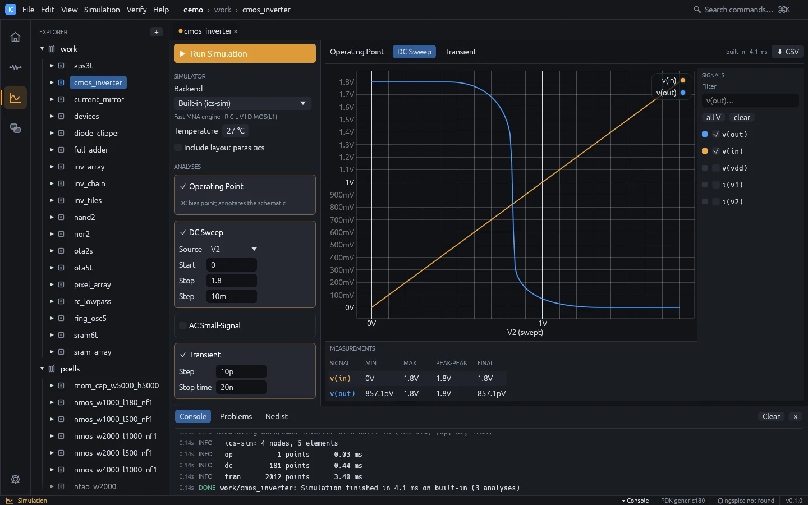
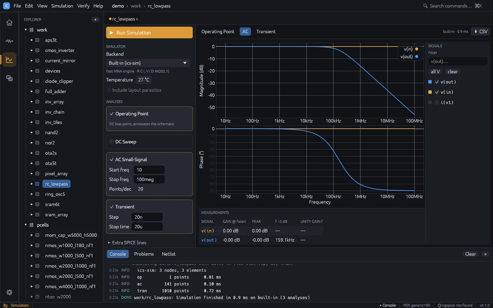

<!-- seo title="SPICE 시뮬레이션: DC, AC, 과도 해석, 몬테카를로" description="내장 엔진 또는 ngspice로 SPICE 시뮬레이션 실행: DC, AC, 과도 해석, 측정, 코너, 몬테카를로, 포스트 레이아웃 시뮬레이션." -->

# 시뮬레이션

Simulation 워크스페이스(`Ctrl+3`)에서는 활성 셀의 회로도에 대한 해석을 설정하고 실행하며 결과를
확인합니다.



## 시뮬레이션 실행

1. 회로도가 있는 셀을 열고 Simulation 워크스페이스로 전환합니다.
2. **Analyses**에서 실행할 해석을 체크하고 각 필드를 입력합니다.
3. **Run Simulation**, `F5` 또는 `Ctrl+Enter`를 누릅니다(**Simulation > Run** 메뉴나 회로도
   툴바의 **Simulate**도 가능).

시뮬레이션은 백그라운드에서 실행됩니다. 다른 워크스페이스에서 시작하면 Simulation 워크스페이스로
전환됩니다. 오류는 빨간색 **Simulation error** 상자와 콘솔에 표시됩니다.

## 설정 패널

### 시뮬레이터

| 필드 | 의미 |
|---|---|
| **Backend** | **Built-in (ics-sim)**(기본값), **ngspice**, **Auto (built-in, ngspice when needed)**([백엔드](#백엔드) 참고) |
| **Corner** | PDK 모델 라이브러리의 모델 코너. 테크놀로지의 모델에 코너가 있을 때만 표시(기본값: 라이브러리의 기본 코너) |
| **Temperature** | -55 ~ 200 °C, 기본값 27(`.temp`로 출력). 내장 엔진은 이 온도에 맞춰 모델을 스케일링 |
| **Include layout parasitics** | 셀의 레이아웃에서 추출한 기생 성분을 추가(아래 참고). 셀에 레이아웃이 없으면 비활성화 |

백엔드 아래 줄에는 ngspice를 찾았는지, 또는 테크놀로지에 모델 라이브러리가 있어 PDK 모델에
ngspice가 필요한지가 표시됩니다. **Auto**에서는 엔진이 전환할 ngspice가 무엇인지 보여 줍니다.
ngspice 경로는 **Settings**에서 지정합니다([설치](install.md#ngspice-선택-사항) 참고).

### 해석

| 해석 | 필드(기본값) | 비고 |
|---|---|---|
| **Operating Point** | 없음(기본으로 켜짐) | 회로도에 결과 표시 |
| **DC Sweep** | **Source**, **Start** `0`, **Stop** `1.8`, **Step** `10m` | Source는 회로도의 임의의 V 또는 I 소스 |
| **AC Small-Signal** | **Start freq** `1`, **Stop freq** `10g`, **Points/dec** `20` | 디케이드 스윕. 소스에 **AC magnitude**를 지정 |
| **Transient** | **Step** `10p`, **Stop time** `20n` | 소스에 **Transient** 파형을 지정 |
| **Noise** | **Output node** `out`, **Input source**, **Start freq** `1`, **Stop freq** `1g`, **Points/dec** `10` | `.noise v(out) <source> dec ...`로 출력. 입력 소스는 회로도의 소스 중에서 선택 |

값이 잘못된 필드는 빨간색으로 바뀌고, 검증 메시지가 카드 아래에 표시됩니다.

### 추가 SPICE 라인

이 접이식 섹션에 입력한 라인은 해석 구문 앞에 그대로 덱에 추가됩니다. 예: `.options reltol=1e-4`.
**Show netlist**를 누르면 생성된 덱이 결과 옆에 표시됩니다.

설정(백엔드, 코너, 해석, 온도, 기생 성분 옵션, 추가 라인,
[스윕 설정](tools.md#corner--sweep-manager))은 셀마다 `sim.json`에 저장됩니다.

## 결과

해석마다 탭이 따로 있습니다. **Operating Point**, **DC Sweep**, **AC**, **Transient**,
**Noise**.
탭 바에는 백엔드와 실행 시간이 표시되며, **CSV**는 현재 데이터셋을 내보냅니다(AC 값은
`name_re` / `name_im` 열로 출력).

### 파형

- **Signals**(오른쪽): 플롯할 신호를 체크합니다. **Filter**로 목록을 좁히고, **all V**는 모든
  노드 전압을 선택하며, **clear**는 선택을 해제합니다. 기본적으로 `v(out)`, `v(in)`,
  `v(vout)`, `v(vin)`이 있으면 표시하고, 없으면 처음 세 개의 전압을 표시합니다. 선택은 해석별로
  실행 간에 유지됩니다. [Waveform Calculator](tools.md#waveform-calculator)에서 플롯한 파형은
  수식을 이름으로 한 신호로 여기에 나타납니다.
- **Compare runs**(신호 목록 위): 셀의 이전 실행 결과입니다. 하나를 체크하면 그 신호가 같은
  플롯에 점선으로 그려지고 측정 목록에도 표시됩니다([Results Browser](tools.md#results-browser)
  참고).
- **Plot**: DC와 과도 해석 결과는 하나의 플롯을 공유합니다. AC 결과는 보드(Bode) 플롯 한 쌍으로,
  로그 주파수 축 위에 **Magnitude (dB)**와 **Phase (°)**가 위아래로 놓이며 줌과 커서가
  연동됩니다. 트레이스에 마우스를 올리면 값을 읽을 수 있습니다. 스크롤로 줌, 드래그로 이동,
  더블 클릭으로 초기화합니다.
- **Noise**: 출력 잡음 밀도 `onoise_spectrum`과 입력 환산 잡음 밀도 `inoise_spectrum`
  (V/√Hz)을 로그 축에 표시합니다. 내장 엔진은 저항과 MOS 채널의 열잡음, 다이오드 산탄 잡음,
  `kf` / `af` 플리커 잡음으로 이를 계산하고, 적분한 출력 잡음(스윕 구간의 V rms)을 로그에
  기록합니다.
- **Measurements**(아래쪽): 플롯한 신호마다 한 행씩 표시합니다.
  - DC와 과도 해석: MIN, MAX, PEAK-PEAK, FINAL.
  - AC: GAIN @ fstart, PEAK, f -3 dB, UNITY GAIN f.



### 동작점

**Operating Point** 탭에는 노드 전압과 브랜치 전류, 그리고 소자별로 다음 값이 표시됩니다.

- MOS: 동작 영역(cutoff, saturation, triode), `id`, `vgs`, `vds`, `vth`, `gm`, `gds`
- 다이오드: `vd`, `id`, `gd`
- 저항: `v`, `i`, `p`

소자 상세 값은 내장 엔진에서만 제공됩니다. 노드 전압은 회로도에도 표시됩니다
([회로도](schematic.md#동작점-표시) 참고).

## 예제: RC 저역 통과 필터의 과도 해석



1. `ic-studio --demo --cell rc_lowpass --workspace simulation`을 실행합니다.
2. 이 셀에는 Operating Point, AC, Transient가 설정되어 있습니다. `F5`를 누릅니다.
3. **AC** 탭을 엽니다. `v(out)`의 **f -3 dB** 열에 약 159 kHz가 표시됩니다.
4. **Transient** 탭을 열어 입력 펄스와 필터링된 출력을 확인합니다.
5. 입력을 바꾸려면 회로도(`Ctrl+2`)로 가서 소스를 선택하고 **Transient**를 수정한 다음 다시
   `F5`를 누릅니다.

## 측정, 코너, 몬테카를로

- **Tools > Waveform Calculator**는 `bandwidth(v(out)/v(in))`, `risetime(v(out))`,
  `phasemargin(v(out))` 같은 수식을 결과에 대해 계산하고 파생 파형을 플롯합니다.
  [Waveform Calculator](tools.md#waveform-calculator)를 참고하십시오.
- **Tools > Corner / Sweep Manager**는 모델 코너, 온도, 파라미터 값, 몬테카를로 변동에 대해
  설정을 병렬로 실행합니다. 한계값이 있는 스펙은 모든 점에서 검사되며, 통계, 수율, 겹친 파형,
  HTML 데이터시트를 제공합니다. [Corner / Sweep Manager](tools.md#corner--sweep-manager)를
  참고하십시오.
- **Tools > Results Browser**는 이전 실행 결과를 보관해 비교할 수 있게 합니다. 예를 들어
  회로도 시뮬레이션과 포스트 레이아웃 시뮬레이션을 비교할 수 있습니다.

설정 패널 상단의 **Sweep...**, **Monte Carlo...**, **Optimizer...** 버튼은 활성 셀에 대해 이
도구들을 엽니다.

### Monte Carlo 창



**Simulation > Monte Carlo...**(**Tools** 메뉴와 명령 팔레트에도 있음)는 내장 엔진에서 소자
변동을 무작위로 주며 셀의 설정을 여러 번 실행하고, 계산기 측정값의 통계를 보여 줍니다. 실행마다
다음을 뽑습니다.

- 극성이 같은 모든 MOS 소자가 공유하는 **공정(process)** 변동: 문턱 전압(**Vto sigma**,
  V, 기본값 `20m`)과 상대 트랜스컨덕턴스(**kp sigma**, 기본값 `0.03`).
- 게이트 면적에 따라 스케일되는 소자별 **미스매치**(Pelgrom): σ(ΔVth) = **Avt** / √(W L),
  σ(Δβ/β) = **Abeta** / √(W L). **Avt** 기본값은 `5n`(5 mV·µm), **Abeta** 기본값은
  `10n`(1 %·µm)입니다.

1. **Runs**(기본값 100)와 **Seed**를 설정합니다(같은 시드에서는 실행 결과가 재현됩니다).
2. **+ Measurement**로 측정을 추가합니다. 해석(`op`, `dc`, `ac`, `tran`, `noise`)과 스칼라
   결과를 내는 [계산기](tools.md#waveform-calculator) 수식을 지정합니다. 예: `op: v(out)`,
   `ac: bandwidth(v(out))`.
3. **Run**을 누릅니다. 진행 막대가 샘플 수를 세며, **Stop**을 누르면 현재 샘플이 끝난 뒤
   멈추고 그때까지의 결과를 유지합니다.
4. 표에는 측정마다 n, 평균, 시그마, 최솟값, 최댓값, 실패한 실행이 표시됩니다. 하나를 선택하면
   히스토그램을 볼 수 있습니다.

설정은 셀과 함께(`sim.json`) 저장됩니다. Monte Carlo는 내장 엔진의 모델을 변동시키므로 PDK 모델
라이브러리를 로드하는 덱은 거부됩니다. 이 경우 ngspice와 PDK 자체의 통계 코너를 사용하십시오.
[Corner / Sweep Manager](tools.md#monte-carlo)에는 어떤 백엔드에서도 동작하는, 인스턴스
파라미터와 설계 변수에 대한 별도의 몬테카를로가 있습니다. 명령줄에서는
`ics mc <project> <cell> --measure op:v(out)`을 사용합니다([명령줄](cli.md#시뮬레이션) 참고).

## 포스트 레이아웃 시뮬레이션

**Include layout parasitics**를 체크하고 셀에 레이아웃이 있으면, IC Studio는 레이아웃을
추출하고 LVS로 넷을 회로도와 매칭한 뒤 다음을 덱에 추가합니다.

- 기판에 대한 배선 커패시턴스(`Cpar_*`),
- 넷 사이의 측면 및 오버랩 결합 커패시턴스(`Cc_*`),
- 그려진 확산 영역에서 구한 MOS 드레인 / 소스 접합 크기(`ad as pd ps`),
- 배선, 비아, 게이트 저항의 RC 네트워크(`Rpar_*`). 각 MOS 단자는 해당 넷의 가장 가까운
  노드로 옮겨집니다.
- 모델 라이브러리에 `lde = true`가 설정된 PDK 모델의 레이아웃 의존 효과(LDE) 파라미터
  (SKY130이 해당, [테크놀로지](technology.md#pdk-파일) 참고): 각 MOS의 핑거 수 `nf`, 그리고
  직사각형 확산 위의 직선 게이트에 대해 BSIM4 스트레스 모델용 게이트-확산 에지 거리
  `sa` / `sb`와 게이트 간격 `sd`. `lde`가 없으면 이 값들은 생략됩니다.

회로도에 대응하는 넷이 없는 레이아웃 넷과의 결합은 접지로 합쳐집니다. 콘솔에는 한 줄 요약이
표시됩니다. 의미 있는 결과를 얻으려면 레이아웃이 LVS 클린이어야 합니다
([검증](verification.md) 참고). 명령줄에서는 `ics sim <project> <cell> --parasitics`를
사용합니다.

## 백엔드

### 내장 엔진

Rust로 작성한 수정 절점 해석(MNA) 엔진입니다. 다음을 지원합니다.

- 소자 `R C L V I D M`와 서브서킷 인스턴스 `X`(동작 모델(behavioural) 소스는 미지원),
- 소스: `DC`, `AC mag [phase]`, `PULSE(v1 v2 td tr tf pw per)`,
  `SIN(vo va freq td theta)`, `PWL(t v ...)`,
- 지시어 `.model`, `.op`, `.dc`, `.ac`, `.tran`, `.noise`, `.temp`, `.title`, `.end`.
  `.ic v(node)=value`(ngspice처럼 과도 해석의 초기 동작점에서 노드를 고정, `.tran ... uic`면 동작점
  없이 그 값에서 시작), `.nodeset`(동작점 계산의 시작값), `.option`의 `reltol abstol vntol gmin trtol
  itl1 itl4 temp`(그 밖의 옵션은 경고)를 지원합니다. 그 밖의 점(dot) 라인은 무시되며, 컴파일된 Verilog-A 모델(`pre_osdi`)을
  읽는 덱은 ngspice가 필요합니다.
- PDK 형식의 계층 덱은 시뮬레이션 전에 평탄화됩니다.
  - `.include` / `.inc` 파일과 `.lib <file> <section>` 라이브러리 섹션(경로는 포함하는 파일
    기준, `ics spice`에서는 덱 파일의 폴더 기준),
  - 수식을 쓰는 `.param`(`+ - * / ^ **`, 비교, `?:`, `sqrt exp log min max pow abs if ...`;
    `agauss` / `gauss` / `unif`는 공칭값), `{expr}`와 `'expr'` 값, 값으로 쓴 파라미터 이름,
  - `.subckt name ports [params:] k=v ...` / `.ends`(중첩 정의 포함)와 인스턴스
    `X... nodes name k=v`. 평탄화된 소자와 노드 이름은 ngspice와 같습니다(`m.x1.m1`,
    `x1.net`). `.global` 노드는 전역으로 유지됩니다.
  - 서브서킷 안의 `.model` 카드는 인스턴스마다 그 파라미터로 평가되고, `lmin lmax wmin wmax`가
    있는 `name.N` 카드는 인스턴스의 `l`과 `w`(`nf`가 있으면 finger당)로 bin이 선택됩니다.
  - 덱과 모델 라이브러리의 Spectre 문법(`.scs` 파일, 또는 `simulator lang=spectre` 이후, `simulator
    lang=spice`로 복귀): `section=`이 있는 `include`, `library` / `section`, `parameters`, `subckt` /
    `inline subckt` / `ends`, `model`(`bsim4`, `bsim3v3`, `mos1`..`mos3`, `diode`, `bjt`), 인스턴스
    `name (nodes) master params`, `resistor` / `capacitor` / `inductor`, `vsource` / `isource`(`dc`,
    `mag`, `pulse`, `sine`, `pwl`), `global`, `ic` / `nodeset`, `options`, `dc`·`ac`·`tran`·`noise` 해석.
    Spectre 배율 접미사(`M` = mega)를 그대로 해석합니다. ngspice에서는 평탄화한 SPICE 덱으로 실행됩니다.
  - HSPICE `.protect` / `.unprotect` 표시는 건너뜁니다.
  - 오류와 경고에는 원본 파일과 줄 번호가 표시됩니다.
- 다이오드 모델: `is n cjo vj m fc tt rs bv ibv kf af eg xti tnom`,
- MOS level 1: `vto kp u0 lambda gamma phi tox ld cgso cgdo cgbo cj cjsw mj mjsw pb fc is
  js rd rs rsh kf af tnom`, 인스턴스 파라미터 `w l m ad as pd ps nrd nrs`.
- MOS BSIM4(`level=14` 또는 `level=54`, 대부분의 파운드리 PDK가 쓰는 모델): 드레인 전류는 ngspice의
  BSIM4 4.8을 따르며 솔버 허용오차 이내로 일치합니다(단채널, DIBL, 협폭, 바디, 포켓 임플란트, DITS
  항을 포함한 문턱전압, poly depletion, 이동도 모델 0~2, 속도 포화와 오버슈트, source-end 속도 제한,
  내부 소스/드레인 저항, CLM / DIBL / DITS / SCBE 출력 컨덕턴스, 온도 모델 0~3, `l` / `w` / `p`
  크기 의존성과 `nf` finger). 전하는 charge-thickness 모델(`capmod=2`, `xpart` 분배), 바이어스
  의존 overlap 커패시턴스, 바닥/측벽/게이트측 측벽 접합 커패시턴스(접합 면적과 둘레는 `ad as pd ps`
  또는 finger 배치에서 계산)를 따르므로 과도 해석과 AC 결과도 ngspice와 일치합니다. 접합 전류는
  `diomod=1`(면적/측벽/게이트측 측벽 포화전류와 온도 의존성, `ijthsfwd` 이상은 선형), 잡음은
  `tnoimod=0`과 `fnoimod` 0 / 1(게이트 전류의 shot 잡음 포함)을 따릅니다. 누설 전류는 기판 전류
  (`alpha0 alpha1 beta0`), GIDL / GISL(`gidlmod` 0, 1), 게이트 터널링(`igcmod` 1 / 2와 소스/드레인 분배·
  edge 전류, `igbmod=1`)을 계산합니다. `rdsmod=1`, 게이트/바디 저항망, 비준정적(NQS) 모델,
  응력 효과는 계산하지 않고 경고로 알립니다.

BSIM4 모델은 UC Berkeley BSIM Research Group이 개발했습니다(Copyright (c) University of
California; Educational Community License 2.0).

level 1 모델은 SPICE level 1과 SPICE 다이오드를 따릅니다.

- **커패시턴스는 바이어스에 따라 변합니다.** `tox`가 주어지면 MOS 게이트 커패시턴스는 영역별
  (accumulation, depletion, triode, saturation) Meyer 모델을 따르고, 접합 및 다이오드 공핍
  커패시턴스는 `cj`, `mj`, `pb`, `fc`와 측벽 항을 따릅니다. 과도 해석은 전하를 적분하므로
  전하가 보존됩니다.
- **기생 저항**: MOS `rd` / `rs`(또는 `nrd` / `nrs`와 함께 쓰는 `rsh`)와 다이오드 `rs`는
  내부 노드를 추가합니다. MOS 벌크 접합은 다이오드로 모델링됩니다.
- **온도**: MOS `kp`, `phi`, `vto`와 벌크 접합, 다이오드 `is`(`eg`, `xti` 사용), `vj`,
  `cjo`는 `tnom`에서 해석 온도로 스케일링됩니다.
- **과도 해석 스텝 제어**: 국소 절단 오차(LTE) 추정으로 스텝 채택 여부와 크기를 정하므로,
  **Step**을 크게 잡아도 빠른 에지가 정확히 계산됩니다.

넷리스터가 출력하는 범용 `nmos` / `pmos` 모델은 `vto = ±0.45`, `kp = 280u` / `70u`,
`tox = 4n`을 사용합니다. 생략한 MOS 파라미터는 SPICE 기본값을 따릅니다
(`vto = 0`, `kp = 2e-5`, `tox`가 주어지면 `u0 · cox`. `tox`가 없으면 진성 게이트 커패시턴스
없음).

#### 내장 엔진이 근사하는 부분

엔진은 작성된 그대로 계산하지 않는 항목을 보고합니다. 1이 아닌 MOS `level`(level 1로 계산),
무시하는 모델 및 인스턴스 파라미터, 건너뛴 점(dot) 라인이 이에 해당합니다. 경고는 콘솔 로그,
실행 상태 줄(첫 번째 경고와 나머지 개수), `ics sim` / `ics spice` 출력, MCP `simulate` 결과에
표시됩니다. 외부에서 가져온 덱을 내장 엔진으로 돌린 결과를 신뢰하기 전에 확인하십시오.

### Auto

**Auto**는 내장 엔진이 덱을 작성된 그대로 계산할 수 있으면 내장 엔진을 실행하고, 그렇지 않으면
ngspice로 전환합니다. 덱이 모델 라이브러리(`.lib`, `.include`)나 컴파일된 Verilog-A 모델을
로드하거나, 엔진이 덱에 대해 경고를 낼 경우(위 참고)가 해당합니다. 전환 이유는 경고로
보고됩니다. 예: `auto: ngspice, because the deck loads external models
(...)`. ngspice가 설치되어 있지 않으면 내장 엔진을 그대로 사용하고 그 사실을 알립니다.

### ngspice

ngspice 백엔드에서는 IC Studio가 ngspice를 배치 모드로 실행하고 raw 출력을 읽습니다.
ngspice가 덱을 직접 읽으므로 서브서킷 소자(`X`), PDK의 `.include`와 `.lib` 모델 라이브러리가
동작합니다. 설정에 해석이 하나도 없을 때만 IC Studio가 덱에서 해석(`.op`, `.dc`, `.ac`,
`.tran`)을 가져옵니다.

PDK 모델 라이브러리는 컴파일된 Verilog-A 모델을 나열할 수 있으며(PDK 파일 `[models]`의
`osdi = [...]`), ngspice는 덱보다 먼저 `pre_osdi`로 이를 로드합니다. IHP SG13G2 PDK 파일은
PSP 103 모델에 이 방식을 사용합니다.

### 내장 엔진과 ngspice 비교



`ics sim`과 `ics spice`에 `--compare`를 주면 두 엔진으로 덱을 실행하고, 벡터마다 가장 큰
불일치를 출력합니다. 최대 절대 오차(AC는 복소 크기), ngspice 벡터의 최대 크기에 대한 상대
오차, 그리고 그 오차가 스윕 또는 시간 축의 어디에서 발생하는지입니다. 테스트 결과는 ngspice
스케일에 맞게 보간되며, 과도 해석은 양쪽으로 반 스텝까지 읽으므로 한 스텝 일찍 나타난 에지는
모델 오차로 계산되지 않습니다. 최악의 상대 오차가 `--tol`(기본값 `0.05`)을 넘으면 명령은
종료 코드 1로 끝납니다.

```sh
ics sim demo cmos_inverter --compare --tol 0.02
ics spice deck.cir --compare
```

저장소의 골든 상관성 테스트(`cargo test -p ics-sim --test correlation`)는 ngspice가 있을 때
같은 방식으로 여러 덱을 비교합니다. `ICS_NGSPICE`는 ngspice 실행 파일을 지정합니다(앱과 CLI의
기본 ngspice 경로로도 사용됩니다).
