<!-- seo title="설계 도구: 파형 계산기, 스윕, 옵티마이저" description="IC Studio 설계 도구: 파형 계산기, 코너/스윕 관리자, 옵티마이저, 결과/넷 브라우저, 레이아웃 생성기, 더미 필, OPC." -->

# 도구

**Tools** 메뉴에는 Cadence Virtuoso의 대응 기능을 본뜬 보조 도구가 모여 있습니다. 각 도구는
메인 창 안에 도킹된 창으로 열리며, 메인 창에 열린 프로젝트를 대상으로, 대개 활성 셀에 대해
동작합니다. 창의 닫기 버튼 왼쪽에 있는 팝아웃 버튼을 누르면 별도의 OS 창으로 분리되고, 그 창의
**Dock**을 누르면 다시 돌아옵니다. 이 선택은 도구별로 기억됩니다. 모든 도구는 명령 팔레트(`Ctrl+K`)에도
있습니다.

| 도구 | Virtuoso 대응 기능 | 대상 |
|---|---|---|
| [Design Copilot](#design-copilot), AI Models | - | [MCP](mcp.md) 도구로 열린 프로젝트를 다루고, 이 매뉴얼을 바탕으로 사용법 질문에도 답하는 AI 에이전트. AI Models에서 제공자, 모델, API 키를 설정 |
| [Optimizer](#optimizer) | ADE GXL Optimization | 활성 셀의 회로도와 스펙 |
| [Waveform Calculator](#waveform-calculator) | ViVA Calculator | 활성 셀의 시뮬레이션 결과 |
| [Corner / Sweep Manager](#corner--sweep-manager) | ADE Explorer | 활성 셀의 회로도 |
| [Verification](simulation.md#검증전체-테스트) | ADE Assembler | 스펙이 있는 모든 testbench 셀 |
| [Silicon Correlation](#silicon-correlation) | 측정 데이터와의 모델 보정 / 상관 | 활성 셀의 회로도와 측정 데이터 |
| [Results Browser](#results-browser) | Results Browser | 활성 셀의 이전 시뮬레이션 실행 |
| [Check Schematic](#check-schematic) | Check and Save | 활성 회로도 |
| [Hierarchy Browser](#hierarchy-browser) | Design Hierarchy | 프로젝트의 모든 레이아웃 |
| [Net Browser](#net-browser) | Annotation / net browser | 활성 레이아웃의 추출 결과 |
| [Layout Generators](#layout-generators) | Create Guard Ring, Create Via Array, Modgen | 활성 레이아웃 |
| [PCell Designer](pcells.md#pcell-designer) | PCell Designer | 그린 레이아웃 셀 또는 빈 도면 |
| [DRC Rule Designer](#drc-rule-designer) | 룰 덱 편집 | 테크놀로지의 DRC 덱 |
| [Stream Layer Map](#stream-layer-map) | XStream layer map | GDSII / OASIS 가져오기와 내보내기 |
| [Dummy Fill](#dummy-fill) | Metal fill | 활성 레이아웃 |
| [OPC](#opc) | 광근접 보정(Optical proximity correction) | 활성 레이아웃 |
| SKILL CIW, Load SKILL (.il) | CIW | 프로젝트([SKILL 스크립트](layout.md#skill-스크립트) 참고) |

## Design Copilot

**도구 › 설계 Copilot…**은 [MCP 서버](mcp.md)와 같은 도구로 열린 프로젝트를 다루는 AI 채팅을
엽니다. 모델이 필요합니다. **도구 › AI 모델…**에서 제공자(Gemini, OpenAI, Anthropic Claude 또는
Ollama 같은 로컬 서버를 포함한 OpenAI 호환 서버), 모델, API 키를 설정합니다. 창 위쪽에 세 가지
모드가 있습니다.

- **대신 하기**: Copilot이 작업(배치와 배선, DRC 수정, 스펙에 맞춘 크기 조정, 새 설계 파생)을
  직접 하고, 모든 편집이 실시간으로 보이며 되돌릴 수 있습니다.
- **계획 모드**: 읽기 전용 도구로 조사한 뒤 번호 붙은 계획을 보여 줍니다. 승인하기 전에는 아무것도
  편집하지 않습니다.
- **튜터**: 배우기용입니다. Copilot은 아무것도 편집하지 않고, 작업을 작은 단계로 나누어 한 번에
  하나씩 알려 줍니다. 각 단계는 창에서 그 작업을 하는 곳을 가리키고(안내 문구와 함께 깜빡이는
  테두리), 메시지 입력란 위에 **내가 할 단계**로 표시되며, 내 설계에서 확인 조건이 통과하면 저절로
  끝납니다(셀이 생김, 시뮬레이션을 실행함, 트랜지스터가 포화 영역에 있음, 이득이 목표를 넘음,
  DRC 통과 등). 확인 조건이 없는 단계는 **완료**를 누르고, **막혔어요**를 누르면 힌트를 받습니다.
  입력한 내용은 답으로 튜터에게 전달됩니다. 시뮬레이션 전에 결과를 예측해 보라고 묻기도 합니다.

어느 모드에서든 실행 취소로 되돌릴 수 없는 도구는 사용자의 확인을 기다립니다: 프로젝트 저장,
파일 내보내기(GDS, LEF/DEF, SKILL), SKILL 스크립트·사인오프 런셋·Virtuoso 가져오기 실행, 읽기
전용으로 선언되지 않은 확장 도구입니다. **허용**은 한 번 실행하고, **이 대화에서 항상 허용**은 그
도구를 더 묻지 않으며, 입력란에 쓴 내용은 거절로 전달됩니다. 설계 노트는 지시가 아닌 프로젝트
데이터로 표시되어 Copilot에 전달되고, Copilot이 작성한 SPICE 덱은 프로젝트 폴더(또는
`ICS_MCP_ROOTS`) 안의 파일만 include할 수 있습니다.

[Learn 강좌](learn/index.md)에서 실패한 확인 항목이나 틀린 퀴즈 아래의 **튜터에게 묻기**를 누르면
그 질문으로 Copilot이 튜터 모드로 열립니다.

Copilot은 모든 대화를 IC Studio 입문 자료를 알고 시작합니다. 입문 자료에는 다음이 들어 있습니다.

- 창 구성과 일상적인 설계 흐름
- 모든 메뉴 항목의 정확한 이름(창이 한국어이면 한국어 이름도)
- 레이아웃 단축키
- [수식과 모델](formulas.md)의 요약

그래서 먼저 검색하지 않고도 명령이 어디 있는지, 어떤 수치가 어떻게 계산되는지 답할 수 있습니다.
더 자세한 내용은 매뉴얼을 읽어서 답합니다.

## Waveform Calculator

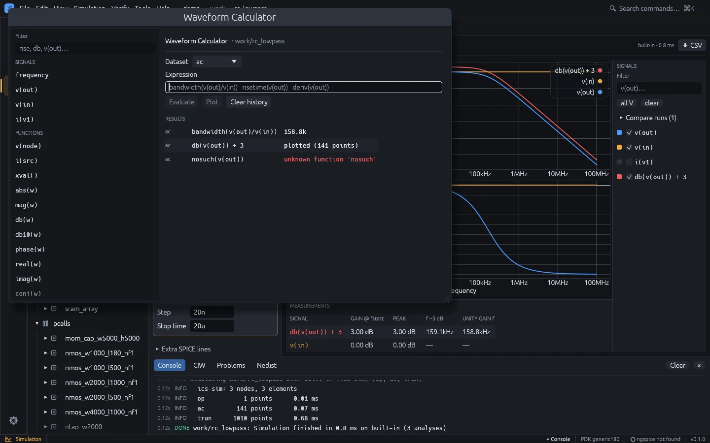

**Tools > Waveform Calculator**(또는 **Simulation > Waveform Calculator**)는 활성 셀의
시뮬레이션 결과에 대해 수식을 계산합니다.

1. 셀을 시뮬레이션(`F5`)한 뒤 계산기를 엽니다.
2. **Dataset**(`op`, `dc`, `ac`, `tran`)을 고릅니다.
3. 수식을 입력하거나, 왼쪽의 신호나 함수를 클릭해 삽입합니다.
4. **Evaluate**(또는 Enter)를 누르면 **Results**에 결과가 표시됩니다. 측정값은 숫자로, 파형은
   포인트 수로 나타납니다. **Plot**은 수식 이름을 붙인 새 신호로 Simulation 플롯에 파형을 추가합니다.

플롯된 수식은 시뮬레이션을 실행할 때마다 다시 계산되므로 플롯에 계속 남아 있습니다. **Results**의
수식을 클릭하면 다시 편집할 수 있습니다.

수식에는 `+ - * / ^`, 괄호, SPICE 접미사가 붙은 숫자(`1n`, `10k`, `2meg`)를 쓸 수 있습니다. 신호는
`v(node)`, `v(a,b)`(= `v(a) - v(b)`), `i(source)` 또는 데이터셋의 임의의 벡터 이름(`time`,
`frequency`)입니다. 특수 문자가 들어간 이름은 따옴표로 감쌉니다(`"v-sweep"`). AC 신호는 복소수이므로
`v(out)/v(in)`이 곧 전달 함수입니다.

| 분류 | 함수 |
|---|---|
| 파형 | `abs` `mag` `db` `db10` `phase` `real` `imag` `conj` `sqrt` `exp` `ln` `log10` `sin` `cos` `deriv` `integ` `xval()` |
| 통계 | `min` `max` `xmin` `xmax` `pp` `avg` `rms` `value(w, x)` |
| 타이밍 | `cross(w, level [, n [, edge]])` `delay(w1, l1, w2, l2 [, e1 [, e2]])` `risetime(w [, lo%, hi%])` `falltime(w [, hi%, lo%])` `overshoot(w)` `settling(w [, pct])` |
| 주파수 | `bandwidth(w [, db])` `ugf(w)` `phasemargin(w)` `gainmargin(w)` |

`edge`는 `rise`, `fall`, `either` 중 하나이고, `n < 0`이면 끝에서부터 교차를 셉니다. `bandwidth`는
첫 포인트보다 `db`만큼 떨어지는 지점을 찾으며, 기본값은 반전력 지점인 3.0103 dB입니다. 이는
Simulation 측정값의 f -3 dB 열과 같은 지점입니다(단일 극점이면 정확히 극점 주파수). Simulation
플롯에서 AC 데이터셋의 실수 결과(예: `db(v(out))`)는 다시 dB로 변환하지 않고 그대로 그립니다.

`rc_lowpass` 데모 예: `bandwidth(v(out)/v(in))`은 약 159 kHz이고, `tran`에서 `risetime(v(out))`은
필터링된 펄스의 10-90 % 상승 시간입니다.

## Corner / Sweep Manager

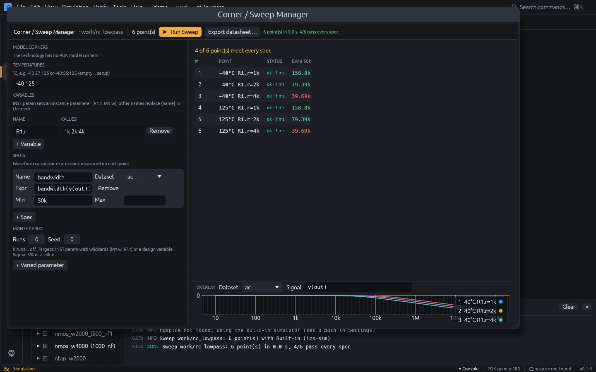

**Tools > Corner / Sweep Manager**는 활성 셀의 시뮬레이션 설정을 다음 항목의 모든 조합에 대해
실행합니다.

- **Model corners**: PDK 모델 라이브러리의 코너(아무것도 선택하지 않으면 설정의 코너);
- **Temperatures**: `-40 27 125` 같은 목록 또는 `-40:55:125`(start:step:stop) 같은 범위.
  비워 두면 설정의 온도;
- **Variables**: 각각 값 목록을 가집니다. `INST.param`은 인스턴스 파라미터(`R1.r`, `M1.w`)를
  설정하고, 그 밖의 이름은 덱의 `{name}`을 치환하는 디자인 변수입니다. 예를 들어 소스의 DC 값
  `{vdd}`가 있습니다.

툴바에는 포인트 수(최대 2000)가 표시됩니다. **Run Sweep**은 설정의 백엔드, 해석, 레이아웃 기생
성분으로 모든 CPU 코어에서 포인트를 병렬 실행합니다.

**Specs**는 각 포인트를 측정합니다. 이름, 데이터셋, 숫자를 돌려주는
[계산기](#waveform-calculator) 수식(`bandwidth(v(out))`, `max(v(out))`), 그리고 선택적인 **Min** /
**Max** 한계로 이루어집니다. 결과 표에는 모든 포인트와 스펙 값이 나열되며, 한계를 만족하면 초록색,
아니면 빨간색으로 표시됩니다. 툴바에는 모든 스펙을 만족하는 포인트 수가 표시됩니다.

**Overlay**는 모든 포인트의 한 신호나 수식을 한 플롯에 그립니다. 표의 행을 선택하면 해당 트레이스가
강조됩니다. 설정은 셀과 함께 저장됩니다(`sim.json`).

### Monte Carlo

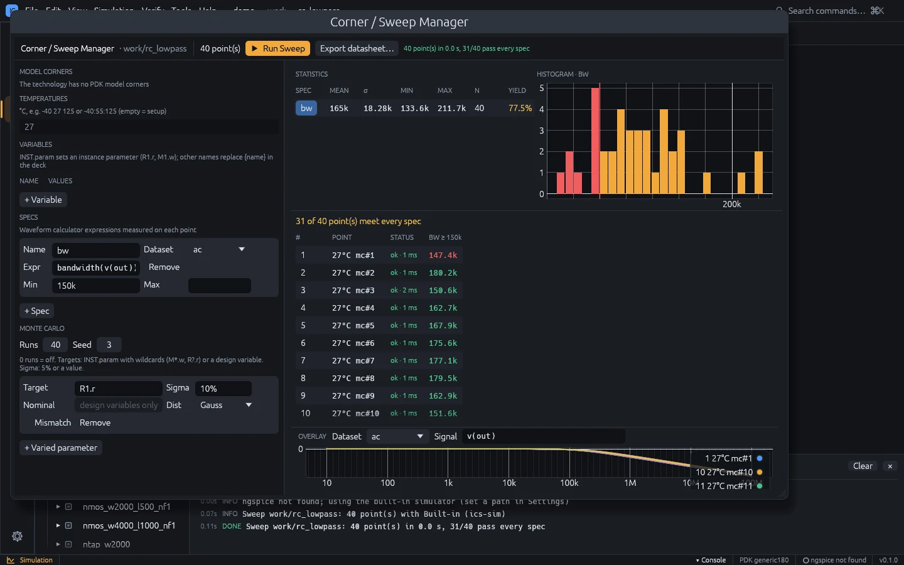

**Monte Carlo** 섹션은 모든 포인트를 무작위 파라미터 값으로 **Runs** 횟수만큼 반복합니다(모든
코너와 온도에서 같은 샘플을 쓰며, **Seed**로 재현 가능). 각 **변동 파라미터**는 다음을 가집니다.

- **Target**: 인스턴스 이름에 `*` / `?` 와일드카드를 쓴 `INST.param`(`M*.w`, `R?.r`), 또는
  **Nominal** 값을 가진 디자인 변수;
- **Sigma**: 공칭값의 백분율(`5%`) 또는 절댓값;
- **Dist**: Gauss(sigma는 표준편차) 또는 Uniform(sigma는 반폭);
- **Mismatch**: 일치하는 인스턴스마다 독립적으로 추출합니다. 끄면 모든 인스턴스가 실행마다 하나의
  추출값을 공유합니다(공정 변동).

**Measured process variation**은 실리콘에서 측정한 테크놀로지의 공정 변동([WAT 데이터에서](process.md#통계-모델-공정-변동))도
뽑습니다. 이 변동이 담은 모델 파라미터(`nmos.vto`, `nmos.kp` …)를 측정한 σ와 상관대로 바꾸며, 실행마다 한 번 뽑아
모든 소자가 공유합니다. 수율 예측은 이것들을 `nmos.vto (process)` 같은 입력으로 나열하므로, 민감도를 보면 어떤
공정 파라미터가 스펙을 제한하는지 알 수 있습니다. 모델 카드는 `.lib`로 읽는 것이 아니라 덱 안에 있어야 합니다(기본
모델, 또는 `[models]` 텍스트에 카드를 담은 PDK). 테크놀로지에 변동이 생기기 전까지 체크박스는 비활성입니다
(Process Data > Extract corners > Use for Monte Carlo).

몬테카를로 결과가 있으면 **Statistics**에 각 스펙의 평균, σ, 최솟값, 최댓값, 개수, 수율이 나열되고,
선택한 스펙의 히스토그램에서 한계를 벗어난 구간은 빨간색으로 표시됩니다.

### 수율 예측

수백 번의 시뮬레이션으로는 수율을 대략적으로만 알 수 있습니다. 40번 중 40번 통과해도 수율은 91 %일 수
있습니다. 몬테카를로 실행 후 **Predicted yield**는 랜덤 입력(변동 파라미터마다 하나, 미스매치는 인스턴스마다
하나)에 대한 각 스펙의 응답 곡면 모델을 맞춥니다. 실행 수가 항 수의 두 배 이상이면 2차, 아니면 1차입니다.
그다음 조건(코너, 온도, 스윕 값)마다 모델을 100 000번 샘플링하며, 모델의 leave-one-out 오차를 잡음으로 더해
모델이 아는 것 이상을 주장하지 않게 합니다.

- **Simulated (95% CI)**: 모든 스펙을 만족한 시뮬레이션 실행의 비율과 Wilson 구간.
- **Predicted**: 모든 스펙을 만족한 모델 샘플의 비율.
- **Sensitivity**: 선택한 스펙의 가장 나쁜 조건에서 각 입력이 스펙 분산에서 차지하는 비율과, 스펙이 그 입력에
  따라 오르는지(rises) 내리는지(falls). 막대 아래에 모델 종류, leave-one-out Q²(약 0.9 이상이면 예측을 믿을 만함),
  오차를 표시합니다.

Q²가 낮으면 스펙이 입력을 매끄럽게 따르지 않는다는 뜻입니다(레일까지 밀린 증폭기, 실패한 측정 등). 실행 수를
늘리거나 스펙 식을 확인하세요.

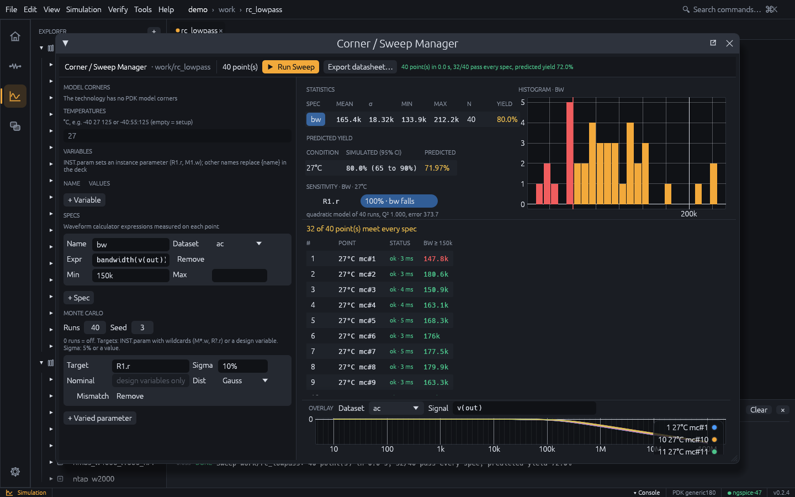

같은 계산을 화면 없이: `ics yield <project> <cell> [--runs N] [--target 0.99]`([CLI](cli.md#수율-예측) 참고)와 MCP
도구 `predict_yield`.

### 데이터시트

**Export datasheet...**는 마지막 실행 결과를 HTML 페이지로 씁니다. 스펙 요약(한계,
최소 / 평균 / 최대 / σ, 수율)과 모든 포인트의 표가 통과 / 실패 색상과 함께 들어갑니다.

## Optimizer

**Tools > Optimizer**는 [Corner / Sweep Manager](#corner--sweep-manager) 설정의 스펙을 만족할
때까지 활성 셀의 소자 파라미터를 사이징합니다(최소 하나의 스펙에 **Min** 또는 **Max** 한계가
있어야 합니다).

- **Variables**: 각 **Target**(`M1.w` 같은 `INST.param` 또는 디자인 변수)에 **Min**, **Max**,
  선택적인 **Step**, 로그 스케일 탐색용 **Log**를 지정합니다. **+ Variable**로 추가합니다.
- **Evaluations**: 시뮬레이션할 후보 수.
- **Goal**: **Best margin**(한계에 대한 최악 마진이 가장 큰 것), **Least area**(모든 스펙을
  통과한 상태에서 MOS 게이트 면적이 가장 작은 것) 또는 **Least change**(현재 크기에 가장 가까운 통과
  지점, 마진은 5 %까지: [새 설계 파생](derive.md)이 쓰는 목표로, 검증된 설계를 새 목표에 필요한
  만큼만 바꿉니다).
- **Post-layout**: 모든 후보를 배치, 배선, 추출한 뒤 기생 성분과 함께 시뮬레이션하므로, 레이아웃
  이후에도 스펙이 유지됩니다.

**Run optimizer**는 매 평가의 목적 함수 값을 플롯합니다. **Stop**은 실행을 일찍 끝내고, **Apply best
to schematic**은 최적 값을 회로도에 씁니다.

## Silicon Correlation

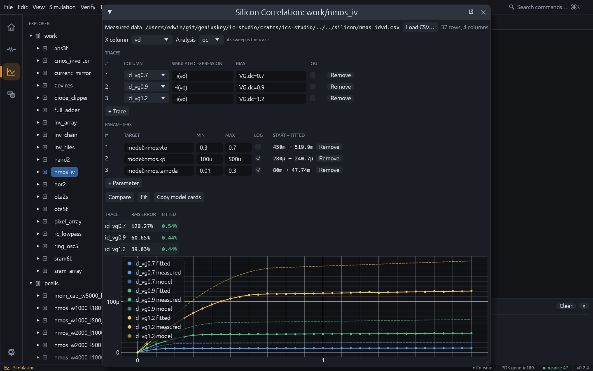

**Tools > Silicon Correlation**은 측정 곡선을 활성 셀의 시뮬레이션과 비교하고, 둘이 맞을 때까지 파라미터를
피팅합니다. 테스트 구조의 Id-Vd / Id-Vg 곡선으로 모델 카드 보정, 웨이퍼 데이터로 PDK 모델 확인, 측정한
주파수 응답으로 기생 성분 피팅 등에 씁니다.

- **Measured data**: 헤더 행이 있는 CSV 파일(쉼표, 세미콜론, 탭 구분, `#` 주석 줄, SPICE 접미사 허용).
  **Load CSV...**는 경로를 프로젝트 기준 상대 경로로 저장합니다.
- **X column**과 **Analysis**: 스윕한 양이 든 열과 그 스윕을 하는 해석(`dc`, `ac`, `tran`). 셀의 시뮬레이션
  설정에서 그 스윕을 설정합니다.
- **Traces**: 측정 열마다 비교할 **시뮬레이션 식**(파형 계산기, 예: `-i(vd)`)과 측정 **바이어스**를
  `INST.param=value` 또는 `variable=value`(`VG.dc=0.9`)로 씁니다. **Log**는 로그 스케일로 비교합니다(여러
  디케이드에 걸친 전류).
- **Parameters**: 모델 카드 파라미터는 `model:NAME.PARAM`(이름이 같은 모든 카드, 빈 카드 `NAME.1`, `NAME.2`
  포함. PDK 라이브러리는 먼저 평탄화), 인스턴스 파라미터는 `INST.param`, 또는 설계 변수. 각각 **Min** /
  **Max**와 로그 스케일 탐색용 **Log**가 있습니다.

**Compare**는 모든 바이어스를 시뮬레이션하고 트레이스별 RMS 오차를 보여 줍니다(트레이스의 가장 큰 측정값
대비 상대 오차, 로그 트레이스는 로그 비). **Fit**은 현재 값에서 시작해 범위 안에서 Levenberg-Marquardt를
실행합니다(전진 차분 야코비안, 병렬 시뮬레이션). 그래프에 측정점, 피팅 전 모델(점선), 피팅 후 모델이
표시되며, 피팅한 값마다 표준 오차(잔차와 야코비안에서 계산, 약 ±2배가 95 % 구간)가 붙습니다. **Copy model cards**는 피팅한 `.model` 카드를 복사하고, **Apply to schematic**은 피팅한 인스턴스
파라미터를 회로도에 씁니다.

`silicon/`에 예제가 있습니다. `nmos_iv.sp`(게이트와 드레인 전원이 있는 NMOS)와 `nmos_idvd.csv`(vto = 0.52 V,
kp = 240 µA/V², lambda = 0.05 V⁻¹인 level-1 NMOS에 잡음을 더한 합성 Id-Vd 곡선)입니다. 기본 모델에서 vto, kp,
lambda를 피팅하면 오차가 81 %에서 0.5 %(잡음 수준)로 줄고 0.520 V, 241 µA/V², 0.048 V⁻¹을 되찾습니다.

명령줄에서는 `ics correlate`([CLI](cli.md#실리콘-상관) 참고), MCP에서는 `correlate_silicon` 도구를 씁니다.

## Results Browser

시뮬레이션이 성공할 때마다 이전 결과가 보존됩니다. 현재 실행은 **Run N**이며, 이전 실행은 최대
12개까지 **Tools > Results Browser**와 Simulation 워크스페이스 신호 목록 위의 **Compare runs**에
나열됩니다. 실행 이름을 바꾸거나(예: "pre-layout"), 체크해서 겹쳐 그리거나, **Delete**로 삭제할 수
있습니다.

체크한 실행은 플롯된 각 신호의 색으로 점선으로 그려지고, `<run>: <signal>` 라벨이 붙으며,
**Measurements**에 별도의 행이 생깁니다. 대표적인 용도는 회로도와 포스트 레이아웃 시뮬레이션의
비교입니다. 한 번 실행하고, **Include layout parasitics**를 체크해 다시 실행한 다음, 첫 실행을
체크합니다.

## Check Schematic

**Tools > Check Schematic**은 활성 회로도를 검사합니다. **File > Check and Save**는 같은 검사를 하고
오류가 없으면 프로젝트를 저장합니다. 발견 항목은 하단 패널의 **Problems** 탭에 표시되며(편집하는
동안에도 계속 갱신됩니다), 항목을 클릭하면 회로도에서 해당 소자가 선택됩니다.

| 코드 | 심각도 | 내용 |
|---|---|---|
| `no-ground` | Error | 소자는 있지만 접지가 없음 |
| `duplicate-name`, `empty-name`, `bad-name` | Error | SPICE에서 쓸 수 없는 인스턴스 이름 |
| `missing-param`, `invalid-value` | Error | 필수 값(R, C, L, W, L, model, 소스 값)이 없거나 숫자가 아님(`{param}` 참조는 허용) |
| `parallel-vsource`, `vsource-loop` | Error | 병렬 또는 루프를 이루는 전압원 |
| `shorted-device` | Warning(소스는 Error) | 2단자 소자의 두 핀이 같은 넷에 연결됨 |
| `unconnected-pin` | Warning(MOS 벌크는 Info) | 아무것에도 닿지 않은 핀 |
| `floating-net` | Warning | 라벨 없이 핀 하나에만 연결된 넷 |
| `dangling-wire` | Warning | 아무것에도 닿지 않은 와이어 끝 |
| `label-conflict` | Warning | 한 넷에 서로 다른 라벨 두 개 |
| `overlapping-instances` | Warning | 같은 위치에 있는 같은 종류의 소자 두 개 |
| `isolated-net` | Info | 접지로 가는 DC 경로가 없음 |

## Hierarchy Browser

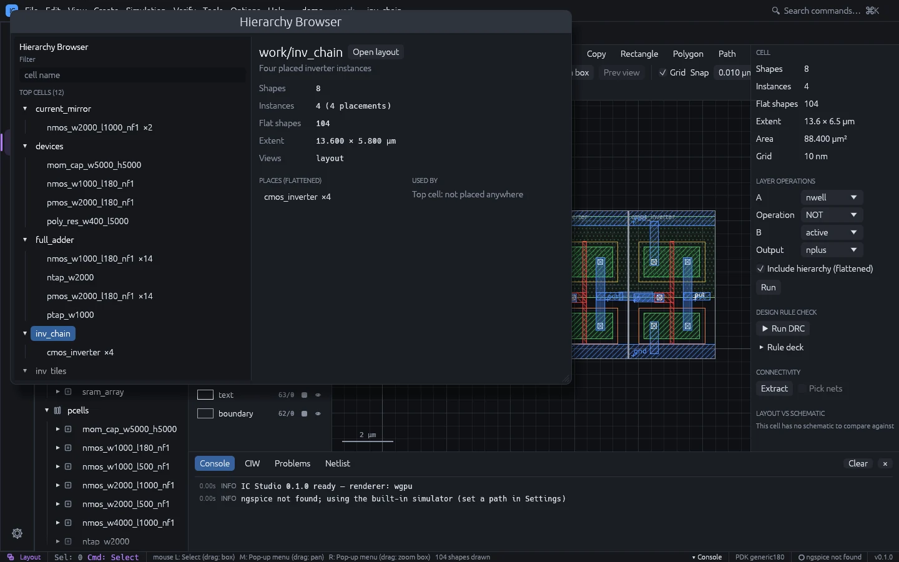

**Tools > Hierarchy Browser**는 프로젝트의 모든 레이아웃을 최상위 셀(다른 레이아웃이 배치하지 않는
레이아웃)부터 시작하는 트리로 보여 주며, 배치 횟수를 함께 표시합니다(어레이는 모든 요소를 셉니다).
**Filter**로 이름으로 셀을 찾습니다.

선택한 셀에 대해 도형, 인스턴스, 평탄화된 도형, 범위, 뷰, 계층 전체에서 배치하는 셀과 그 총 개수,
그리고 이 셀을 사용하는 셀을 보여 줍니다. **Open layout** / **Open schematic**으로 엽니다. 레이아웃
편집기의 **Hierarchy Tree** 폼(**Edit > Hierarchy Tree**, `Shift+T`)은 현재 셀 아래의 셀만
나열합니다.

## Net Browser

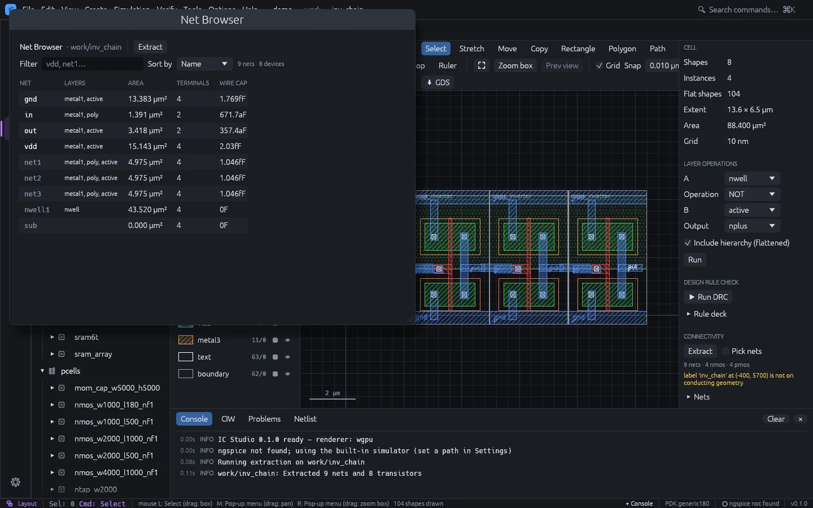

**Tools > Net Browser**는 활성 레이아웃 추출 결과의 넷을 나열합니다(아직 추출 결과가 없으면 넷을
추출하며, **Extract**로 다시 실행합니다).

| 열 | 의미 |
|---|---|
| NET | 라벨 이름(굵게), 라벨이 없는 넷은 생성된 이름 |
| LAYERS | 넷이 사용하는 도전 레이어 |
| AREA | 도체 면적(µm²) |
| TERMINALS | 넷에 연결된 트랜지스터 단자(드레인, 게이트, 소스, 벌크) |
| WIRE CAP | 테크놀로지 계수로 구한 기판 대비 커패시턴스 |

이름, 커패시턴스, 면적, 단자 수로 정렬할 수 있습니다. 넷을 클릭하면 레이아웃에서 강조되고 그
위치로 확대됩니다. 추출 이후 레이아웃이 바뀌면 경고 문구가 표시됩니다.

## Layout Generators

**Tools > Layout Generators**(**Guard Ring...**, **Via Array...**, **Matched Placement...**)는
탭 네 개가 있는 창 하나를 엽니다. 각 생성기는 활성 레이아웃에 한 단계로 추가되며, `u` / `Ctrl+Z`로
되돌릴 수 있습니다.

### Guard Ring

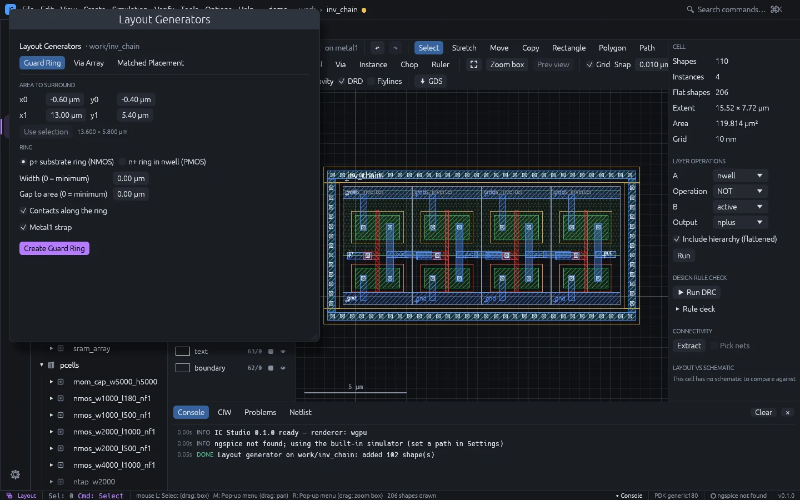

영역을 확산 링으로 둘러쌉니다. **p+ substrate ring**(NMOS용) 또는 **n+ ring in nwell**(PMOS용,
링과 영역을 덮는 nwell 포함) 중 하나입니다. 링에는 임플란트, 각 변을 따라 선택적인 **Contacts**,
선택적인 **Metal1 strap**이 들어갑니다. **Width**와 **Gap to area**를 0으로 두면 레이어와 콘택
룰의 최솟값을 씁니다. 영역을 µm로 지정하거나, **Use selection**을 눌러 선택한 도형과 인스턴스의
경계 상자를 사용합니다. 콘택과 스트랩을 넣으면 링 자체로 DRC를 통과합니다.

콘택과 스트랩이 있으면(기본값) 링은 가드 링 PCell(`pring` / `nring`, Virtuoso fluid guard ring과
같은 방식)로 배치됩니다. 선택한 뒤 아무 변이나 스트레치(`S`)하면 둘러싼 영역의 크기가 바뀌고,
속성에서 **Inner W**, **Inner H**, **Ring width**, **Gap**을 바꿀 수 있습니다. 둘 중 하나라도
없으면 일반 도형으로 추가됩니다.

임의의 맨해튼 외곽을 가진 링(Virtuoso multi-part path)은 중심선을 패스(열린 링)나 폴리곤, 사각형
(닫힌 링)으로 그린 뒤 선택하고 **Edit > Modify Shapes > P+ Guard Ring Along Shape** 또는 **N+ Guard
Ring Along Shape**(Assist 메뉴에도 있음)를 고릅니다. 도형은 링 패스 PCell(`pring_path` /
`nring_path`)이 되어 확산 띠, 임플란트, 각 구간을 따르는 콘택, metal1 스트랩, n+의 경우 띠와 닫힌
링 내부를 덮는 nwell을 갖습니다. 변을 스트레치하면 그쪽 꼭짓점이 움직이고, 속성에서 띠 폭과 닫힘
여부를 바꿉니다. MCP `place_pcell`은 `points`와 함께 `pring_path` / `nring_path`를 받습니다.

### Via Array

비아를 고른 뒤 다음 중 하나를 선택합니다.

- **Every overlap of the via's layers**: 비아의 하부 레이어와 상부 레이어가 겹치는 모든 곳(계층
  전체)에 비아 어레이를 넣습니다. 선택적으로 영역 안으로 제한할 수 있습니다.
- **Fill the area**: 들어갈 수 있는 만큼의 컷을 가운데 정렬로 넣고, 양쪽 레이어에 둘러싸는 패드를
  만듭니다.

컷 크기, 간격, 인클로저는 비아 정의에서 가져옵니다.

### Matched Placement

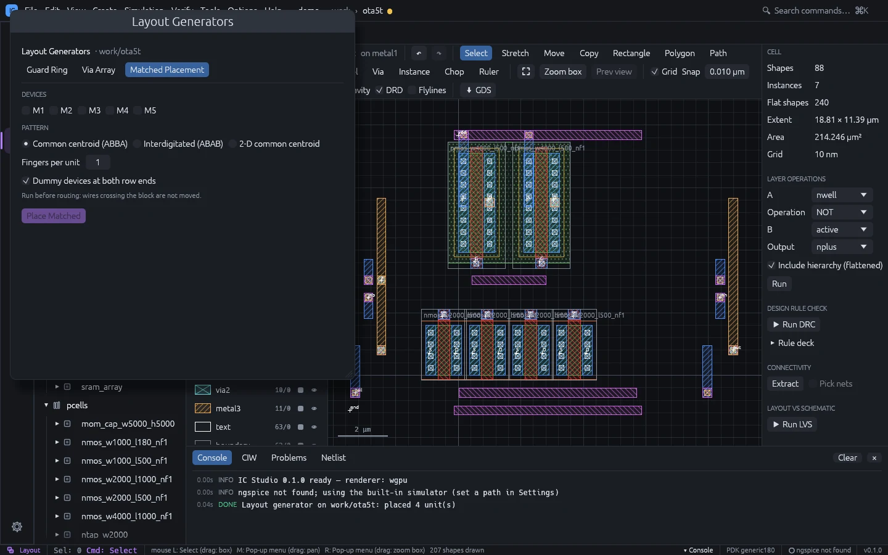

레이아웃의 매칭된 MOS 소자(예: 차동 쌍이나 전류 미러)를 단위 소자로 나누어 패턴으로 다시
배치합니다.

| 패턴 | 예 |
|---|---|
| Common centroid | `A B B A`, 한 행, 거울 대칭 |
| Interdigitated | `A B A B` |
| 2-D common centroid | `A B / B A`, **Rows**개 행, 점 대칭 |

소자를 체크하고 **Fingers per unit**과 행 양 끝에 **dummy devices**를 추가할지 정합니다. 소자들은
타입, L, 핑거 폭이 같아야 하고, 각 소자의 핑거 수는 단위의 배수여야 합니다. 각 소자는 전체 W를
유지하며, 단위 소자 이름은 `<device>.<k>`이므로 플라이라인, 배선, LVS가 여전히 회로도 소자에
대응시킵니다(LVS는 병렬 단위를 병합합니다). 더미는 게이트, 소스, 드레인이 벌크 넷에 묶이고 LVS에서
제외됩니다. 이웃 소자는 공간을 만들기 위해 옆으로 밀려납니다.

배선 전에 실행하십시오. 블록을 가로지르는 와이어는 옮겨지지 않습니다. Common centroid에서는 단위
수가 홀수인 소자를 최대 하나만 허용합니다. 단일 핑거 소자라면 interdigitated를 쓰거나 소자당 핑거
수를 늘립니다.

### By Example

같은 회로를 가진 완성된 셀의 배치를 재사용합니다. **Reference**(회로도와 배치된 레이아웃이 있는
셀)를 고르고 **Place like reference**를 누르면, 소자가 토폴로지로 매칭되어 대응 소자의 위치에
배치되고 이 셀의 회로도 값으로 사이징됩니다. 웰, 임플란트, 탭은 복사되지만 와이어는 복사되지
않으므로, 다시 배선하려면 **Route the flylines afterwards**를 체크합니다.

## DRC Rule Designer

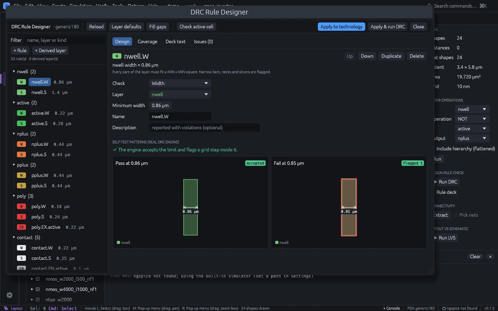

**Tools > DRC Rule Designer**(레이아웃 인스펙터의 **Rule deck** 섹션에 있는 **Rule Designer...**도
같음)는 테크놀로지의 [DRC 덱](technology.md#drc-룰-덱)을 텍스트 대신 폼으로 편집합니다.

프로젝트가 있든 없든 덱 파일도 다룰 수 있습니다. **Open...**은 덱 파일(IC Studio 덱, 또는 변환되는
SVRF 덱. 이후 **Save as...**는 IC Studio 덱으로 씁니다)을 읽고, **Save**는 초안을 원래 파일에,
**Save as...**는 새 파일에 씁니다. 프로젝트가 열려 있지 않으면 툴바의 **Technology** 메뉴에서 룰을
작성할 대상 테크놀로지를 고릅니다. **Generic technology** 또는 PDK 파일(**Load PDK...**)이며, 덱
파일과 다른 초안에는 점이 표시됩니다.

- **Start here**: DRC가 처음인 사람을 위한 단계별 안내(덱에서 시작하기, 빠진 룰 채우기, 문제 고치기,
  룰 추가하기, 활성 셀에서 덱 시험하기, 적용하기), 용어집, 각 검사 종류의 그림.
- **Rule list**(왼쪽): 레이어별로 묶인 룰과 값. **+ Rule**은 각 검사가 답하는 질문과 함께 그림으로
  그린 검사 갤러리를 열고, 선택한 레이어에 권장되는 검사를 표시합니다. **+ Derived layer**는
  프리셋(트랜지스터 게이트, 액티브 밖의 폴리, 넓은 메탈)이나 사용자 수식을 제공합니다. **Filter**로
  룰을 찾습니다.
- **Design**: 선택한 룰의 검사, 레이어, 값, 이름, 설명. 필드 옆에 테크놀로지 값이 표시되고, 다르면
  **Use** 버튼이 나타납니다. 모든 룰은 실제 DRC 엔진으로 생성된 통과 / 실패 패턴에서 **자체
  테스트**되어 나란히 그려지므로, 엔진이 한계값은 받아들이고 그보다 한 그리드 단계 안쪽은 위반으로
  잡는지 확인할 수 있습니다.
- **Coverage**: 각 레이어가 어떤 검사를 갖추었는지 보여 주는 행렬.
- **Deck text**: 생성된 덱.
- **Issues**: 린트 결과. 중복된 룰 이름, 절대 걸리지 않는 룰, 제조 그리드에서 벗어난 값, 쓰이지
  않는 파생 레이어, 폭이나 간격 룰이 없는 배선 레이어 등입니다. 대부분 원클릭 수정(그리드에 맞추기,
  이름 바꾸기, 중복 룰 제거, 빠진 룰 추가)이 제공되며, **Fix automatically**는 오류와 경고의 수정을
  모두 적용하고 빠진 룰을 추가합니다.

툴바에는 **Reload**(테크놀로지의 덱), **Layer defaults**(레이어와 비아 룰에서 파생한 덱), **Fill
gaps**(배선 레이어의 빠진 폭 / 간격 룰과 비아 인클로저를 테크놀로지 값으로 추가), **Check active
cell**(초안 덱을 실행해 룰별 위반 수를 셈), **Apply to technology**, **Apply & run DRC**가
있습니다.

## Stream Layer Map

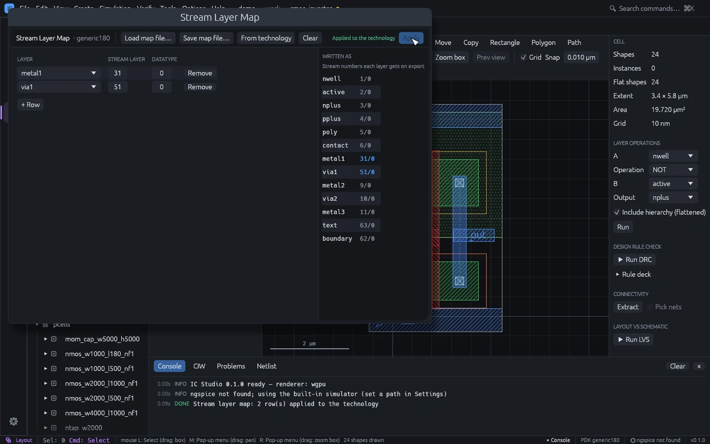

**Tools > Stream Layer Map**은 Virtuoso XStream layer map처럼, 각 테크놀로지 레이어를 어떤 GDSII /
OASIS 레이어와 데이터타입으로 쓰고 읽을지 설정합니다. 각 행은 스트림 레이어 / 데이터타입을
테크놀로지 레이어에 대응시킵니다.

- 내보낼 때 레이어는 첫 번째 행의 번호로 쓰입니다(행이 없는 레이어는 자기 번호를 유지하며,
  **Written as**에서 결과를 미리 볼 수 있습니다).
- 가져올 때 행의 번호에 있는 도형은 그 레이어로 들어가므로, 여러 스트림 번호를 한 레이어에 대응시킬
  수 있습니다. **(drop on import)**는 해당 도형을 버립니다.

**Load map file...**은 Virtuoso 레이어 맵(줄마다 `layerName purpose streamLayer streamDatatype`,
`#` 주석)을 읽습니다. `drawing`이 아닌 purpose는 레이어 이름을 `name.purpose`, `namepurpose` 또는
`name_purpose`로 만듭니다. **Save map file...**은 맵 파일을 쓰고, **From technology**는 레이어당 한
행으로 시작하며, **Clear**는 맵을 지웁니다. 문제(알 수 없는 레이어, 두 번 대응된 번호 쌍, 같은
번호로 쓰이는 두 레이어)는 표 위에 나열됩니다. **Apply**는 맵을 `tech.json`(`stream_map`)에
저장합니다.

맵은 **File > Import / Export**, `ics gds`, `ics import-gds`, MCP의 `import_gds` / `export_gds`
도구에 적용됩니다. 프로젝트 자체의 라이브러리 파일에는 영향을 주지 않습니다.

## Dummy Fill

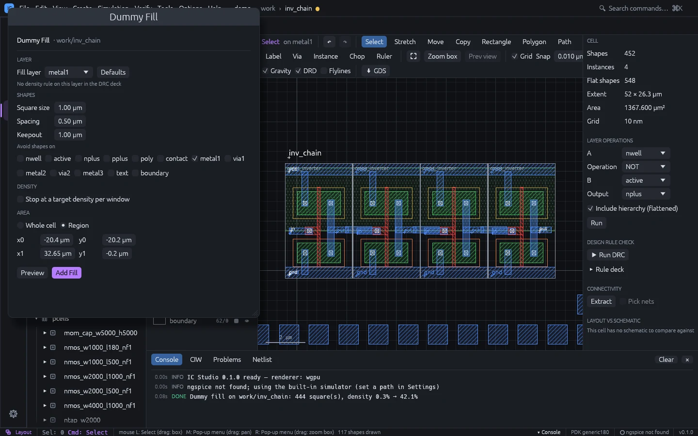

**Tools > Dummy Fill**은 [밀도 룰](technology.md#룰)을 만족하도록 레이어에 그리드 정렬된 필 사각형을
추가합니다.

1. **Fill layer**를 고릅니다. 기본값은 그 레이어의 룰에서 정해집니다. 사각형은 최소 폭의 네 배(최소
   1 µm), 간격은 최소 간격의 두 배, 킵아웃은 최소 1 µm이며, 덱에 그 레이어의 밀도 룰이 있으면 윈도,
   스텝, 그리고 룰 최솟값보다 약간 높은 목표값을 씁니다.
2. **Square size**, **Spacing**, **Keepout**, **Avoid**할 레이어를 설정합니다(필은 계층 전체에서
   그 레이어 도형으로부터 킵아웃만큼 떨어집니다).
3. 필요하면 **Stop at a target density per window**를 체크합니다. 각 윈도는 목표값까지만 채워지며
   룰의 최댓값을 넘지 않습니다.
4. **Whole cell**(경계 상자) 또는 µm 단위의 **Region**을 채웁니다.
5. **Preview**는 사각형 수, 채우기 전후의 밀도, 모든 윈도가 룰을 통과하는지를 보여 줍니다. **Add
   Fill**은 사각형을 추가합니다(되돌리기 가능).

조밀한 셀은 경계 상자 안에 필을 넣을 공간이 없을 수 있습니다. 이때는 셀 주변의 더 큰 영역을
채웁니다.

## OPC


**Tools > OPC**는 활성 레이아웃의 한 레이어를 광근접 효과에 대해 보정합니다.

리소 모델은 마스크의 가우시안 블러(**Blur sigma**)와 그 뒤의 레지스트 **Threshold**로 이루어집니다.
넓은 도형은 그린 크기대로 인쇄되지만, 좁은 선은 가늘어지고 선 끝은 당겨지며 모서리는 둥글어집니다.
레이어의 모든 에지(계층 전체를 평탄화, 맨해튼 도형만)는 최대 **Fragment length** 길이의 조각으로
나뉘며, 모서리에는 절반 길이의 조각이 놓입니다. 매 반복에서 각 조각 중앙의 에지 배치 오차(EPE: 인쇄된
에지 위치에서 그린 에지 위치를 뺀 값, 바깥쪽이 양수)를 측정하고, 조각을 법선 방향으로 오차의 반대쪽으로
최대 **Max outward move** / **Max inward move**만큼 그리드에 맞춰 옮깁니다. 모서리의 두 에지가
모두 바깥(또는 안)으로 움직이면 사각형이 추가(또는 제거)되어 세리프와 마우스 바이트가 만들어집니다.

1. **Correct**할 레이어를 고릅니다. 기본값은 최소 폭 `w`와 간격 `s`에서 정해집니다. sigma 0.45 `w`,
   조각 2 `w`, 바깥쪽 최대 `s` / 3, 안쪽 최대 `w` / 4입니다.
2. **Preview**는 보정 전후의 EPE(rms, 최대, **EPE tolerance** 안에 드는 조각)와, 그린 도형, 마스크,
   보정 전(빨강)과 보정 후(초록)의 인쇄 윤곽을 보여 줍니다. 스크롤로 확대하고 드래그로 이동합니다.
3. **Apply OPC**는 마스크를 `<layer>_opc` 레이어에 씁니다(되돌리기 가능). 이 레이어는 처음 적용할 때
   같은 GDS 레이어의 다음 빈 데이터타입으로 테크놀로지에 추가됩니다. 그린 도형은 절대 바뀌지 않으므로
   매 실행은 그 도형에서 시작합니다. 다른 설정을 시험하려면 설정을 바꾸고 다시 적용하면 되며, 셀의
   이전 마스크는 교체됩니다.

같은 보정을 명령줄(`ics opc`)과 MCP(`opc`)에서도 실행할 수 있습니다.
