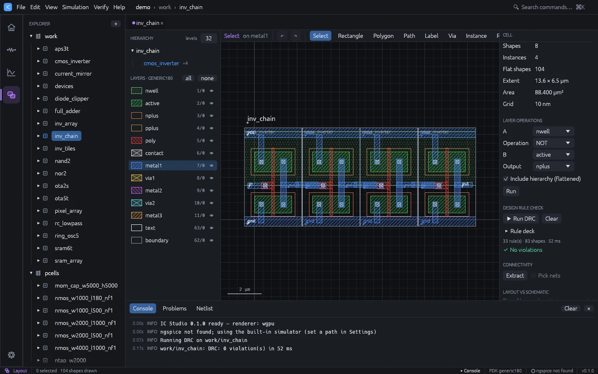
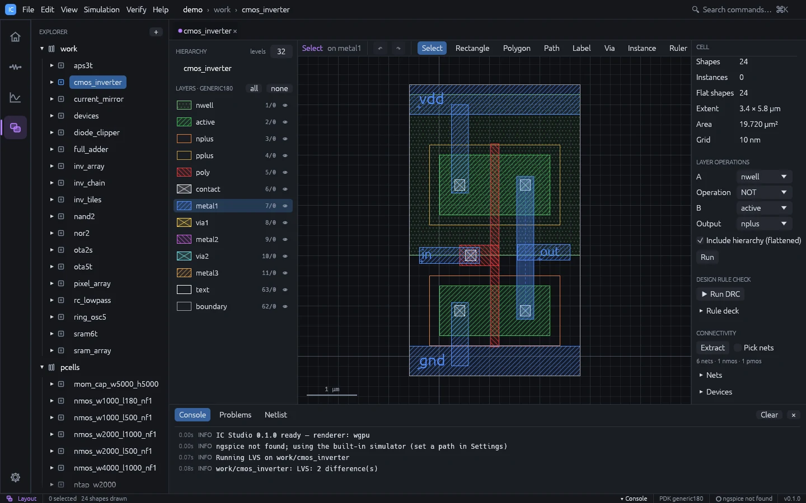

<!-- seo title="DRC, LVS, 기생 성분 추출" description="IC Studio의 레이아웃 검증: 디자인 룰 체크(DRC), 연결성 추출, LVS(레이아웃 대 회로도), 기생 성분 추출, IR 드롭과 EM 분석." -->

# 검증: DRC, 추출, LVS

검증 도구는 **Verify** 메뉴와 Layout 워크스페이스의 오른쪽 패널에 있습니다. 활성 셀의 평탄화된
레이아웃을 대상으로 백그라운드에서 실행되며, 실행 중에는 패널에 진행 상황과 **Cancel** 버튼이
표시됩니다. 레이아웃을 편집하면 패널에 결과가 최신이 아니라는 표시가 나타납니다.

## 디자인 룰 검사(DRC)





1. 셀의 레이아웃을 엽니다.
2. **Design Rule Check** 섹션에서 **Run DRC**를 누릅니다(또는 **Verify > Run DRC**).
3. 결과는 **No violations**이거나, 룰별로 묶이고 룰마다 개수가 표시된 목록입니다. 캔버스에
   마커가 그려집니다.
4. 룰을 펼치면 설명과 위반 위치가 보입니다. 위치를 클릭하면 그곳으로 확대됩니다.
5. **Clear**는 결과와 마커를 지웁니다.

룰은 테크놀로지의 덱에서 옵니다. **Rule deck**을 펼치면 덱을 그 자리에서 보고 편집할 수 있습니다.
**Run DRC**는 편집한 텍스트를 바로 사용하고, **Save to technology**는 프로젝트의 `tech.json`에
저장하며, **Reset**은 테크놀로지의 레이어 룰과 비아 룰에서 유도한 덱으로 되돌립니다. 문법 오류는
줄 번호와 함께 나열됩니다. 덱 문법은 [테크놀로지](technology.md#drc-룰-덱)를 참고하세요.
**Rule Designer...**(또는 **Tools > DRC Rule Designer**)는 덱을 폼으로 편집하고 생성된 패턴으로
모든 룰을 자체 테스트합니다. [DRC Rule Designer](tools.md#drc-rule-designer)를 참고하세요.

`density` 룰을 통과하지 못한 레이어는 **Tools > Dummy Fill**로 채울 수 있습니다
([Dummy Fill](tools.md#dummy-fill) 참고).

모서리 사이 거리는 유클리드 거리입니다. 임의 각도(예: 45°) 도형은 `width`, `space`,
`separation`, `enclosure`, `extension`으로 정확히 검사합니다. 거리는 실제 폴리곤의 변과 변
사이에서 측정하고, 한계값에서 3/4 dbu 이내의 거리는 통과시키며(45° 선을 벗어난 꼭짓점은 그리드에
반올림되므로), 예각 모서리는 표시합니다. 나머지 룰(`area`, `density`, `antenna`와 유도 선택)은
임의 각도 도형을 10 dbu 폭 띠의 계단 모양으로 봅니다.

### Live DRC

레이아웃 툴바의 **Live DRC** 체크박스는 편집할 때마다 주변을 백그라운드에서 덱으로 다시 검사하고,
위반이 생기는 즉시 점선 박스로 그립니다. 마우스를 올리면 해당 룰이 보입니다. 위반에 대한 **Quick
Fix**(`Ctrl+.`)는 최상위 도형의 편집 후보(형태 변경, 이동, 추가)를 제시하며, 각 후보는 먼저 DRC로
검사되어 **clean** 또는 새로 생기는 위반 개수가 표시됩니다. Live DRC가 꺼져 있으면 켭니다. **Fix
All Violations**(명령 팔레트)는 더 이상 도움이 되는 수정이 없을 때까지 수정을 적용하며, 한 번에
실행 취소할 수 있는 단계로 처리됩니다. 배치된 셀 안의 도형은 바꾸지 않습니다.

Live DRC는 증분적이고 계층적이어서 큰 레이아웃에서도 빠릅니다.

- 마지막 검사 결과를 보관하고, 편집 후에는 바뀐 영역에서 덱의 영향 거리 안쪽만 다시 검사합니다.
- 배치된 셀은 한 번만 검사하고 그 결과를 모든 배치에 재사용합니다. 부모 셀에서는 상호작용
  영역, 즉 배치끼리 겹치거나 가까워지는 곳, 또는 부모 자신의 도형과 가까운 곳만 평탄화된 도형으로
  다시 검사합니다. 조각 전체에 대한 룰(`area`, `separation`, `enclosure`)은 영역 안의 모든 조각이
  온전해질 때까지 영역을 넓히므로, 위반 결과가 평탄 검사와 같습니다.
- 전역 룰(`antenna`, `density`)은 평탄화된 셀 전체를 검사하는 **Run DRC**에 맡깁니다.

## 연결성 추출



1. **Connectivity** 섹션에서 **Extract**를 누릅니다(또는 **Verify > Extract Nets**).
2. 요약에 넷 수와 NMOS / PMOS 트랜지스터 수가 표시됩니다.
3. **Nets**에서 넷을 클릭하면 강조됩니다. **Pick nets**를 체크하고 캔버스에서 도형을 클릭하면 그
   도형이 속한 넷이 강조됩니다.
4. **Devices**는 각 트랜지스터의 W, L, 단자 넷을 나열합니다. 클릭하면 게이트로 확대됩니다.

**Tools > Net Browser**는 추출된 넷을 레이어, 면적, 트랜지스터 단자, 배선 커패시턴스와 함께 정렬
가능한 표로 보여 줍니다. 넷을 클릭하면 강조하고 확대합니다([Net Browser](tools.md#net-browser)
참고).

추출기 동작 방식:

- 도전 레이어는 비아로 연결되는 레이어입니다. 확산은 `active`에서 `poly`를 뺀 영역입니다.
- 트랜지스터는 `active` 위의 `poly`입니다. `pplus` 안에 있으면(임플란트가 없으면 `nwell` 안에
  있으면) PMOS입니다. L은 게이트를 가로질러 측정하고, W는 면적 / L입니다. 꺾인 게이트, 링 게이트,
  45° 게이트는 소스와 드레인 변 길이의 평균으로 W를 구하고 PDK의 `bend_corner` 보정을 적용합니다
  ([소자 형태](pcells.md#추출이-인식하는-소자-형상) 참고).
- 임의 각도 도형은 연결성 계산에서는 촘촘한 계단 모양으로 근사하고, 게이트 W / L은 정확한 도형으로
  구합니다.
- **저항**은 테크놀로지의 `[[resistor]]` 본체입니다. 마커 레이어 아래에 있는 도전 레이어로, 두
  단자 조각 사이에 놓입니다. R = 면저항 × 스퀘어 수(L / W, 꺾인 본체는 꺾인 게이트처럼 측정).
- **커패시터**는 마커 레이어 아래에서 아래 판과 위 판이 겹치는 `[[capacitor]]` 영역입니다. C =
  면적 × 면적 커패시턴스(+ 둘레 × 둘레 커패시턴스). [테크놀로지](technology.md#pdk-파일)와
  `poly_res` / `mom_cap` [PCell](pcells.md)을 참고하세요.
- **바이폴라 트랜지스터**는 마커 레이어 아래의 `[[bjt]]` 소자입니다. vertical PNP(`nwell` 안의
  p+ 이미터, 그 웰이 베이스, 기판이 컬렉터)와, triple-well 테크놀로지(`dnwell` 역할)에서는
  vertical NPN(isolated p-well 안의 n+ 이미터, p-well이 베이스, deep n-well이 컬렉터)을
  인식합니다. 면적 계수는 이미터 면적을 `unit_area`로 나눈 값입니다(없으면 이미터 하나에 1).
  LVS는 회로도의 `Npn` / `Pnp` 인스턴스와 베이스·이미터·컬렉터, 면적, 모델(회로도가 범용
  `npn` / `pnp`를 쓰면 생략)을 비교합니다.
- **Triple well**: `dnwell` 역할이 있으면 deep n-well 안이면서 `nwell` 밖인 영역이 isolated
  p-well(라벨이 없으면 `pwellN`)이 됩니다. 그 안의 p+ 탭과 NMOS 바디는 기판 대신 이 p-well에
  연결되고, deep n-well 위의 nwell은 deep n-well과 연결됩니다.
- **웰 탭은 soft connection입니다**: `nwell` 안의 n+ 탭(또는 기판의 p+ 탭)은 웰에 자신의 넷을
  부여하지만, Calibre의 `SOFT CONNECT`처럼 웰을 통해 두 넷을 잇지는 않습니다. 여러 넷에서 탭을
  받은 웰이나 기판(`vss`와 `agnd`, 한 웰 안의 두 전원)은 탭이 가장 많은 넷으로 보고, LVS가
  `soft connection: ... is tapped from nets ...` 경고를 냅니다.
- 넷 이름은 최상위 셀의 도전 레이어 위 라벨에서 옵니다. 이름 없는 넷은 `netN`이 됩니다.
- 경고는 도전 도형 위에 있지 않은 라벨, 서로 단락된 두 라벨, 연결되지 않은 여러 조각에 붙은
  라벨을 보고합니다.

넷을 하이라이트하면(**Nets**에서 클릭하거나 **Mark Net**) **Net ...: electrical** 아래에 그 넷의
전기적 정보가 나옵니다. 기판 대비 용량, 다른 넷과의 가장 큰 커플링 용량, 첫 소자 단자에서 다른
단자까지 배선의 최악 저항(추출한 RC 네트워크를 풀어서 계산), 대략적인 지연 상한인 R x C입니다.

### 포토다이오드와 픽셀(이미지 센서)

기술 파일의 단면에 포토다이오드가 정의되어 있으면([픽셀 단면](technology.md#픽셀-단면)의
`photodiode`) 추출이 포토다이오드도 찾고, 그로부터 픽셀 트랜지스터를
연결 관계만으로 찾습니다.

- **포토다이오드**: 포토다이오드 `layer` 아래의 확산 영역입니다. 확산 조각마다 하나이며, p-well이나
  기판 안의 n+(애노드 = well, 캐소드 = 그 조각) 또는 nwell 안의 p+입니다. 전용 레이어(이미지 센서
  PDK에 있는 PD 마커나 임플란트)는 그려진 그대로 씁니다. 데모의 `active wide 1` 같은 파생 식은
  휴리스틱이므로, 이때는 pinned 포토다이오드처럼 콘택이 없고 MOS 커패시터 플레이트가 없는 확산만
  인정합니다. 포토다이오드는 면적과 둘레와 함께 나열됩니다(SPICE의
  `* photodiode D1 sub pd area=...`). 접합은 이미 전송 게이트의 소스 접합에 들어 있습니다.
- **TG**: 소스나 드레인이 포토다이오드에 붙은 트랜지스터이고, 반대편이 플로팅 디퓨전 **FD**입니다.
  TG들이 한 FD를 공유하는 포토다이오드들은 하나의 공유 픽셀입니다. 포토다이오드 위의 다른
  게이트(안티 블루밍, 오버플로)는 `other`로 나열됩니다. TG가 없고 포토다이오드가 직접 게이트를
  구동하면 3T 픽셀입니다.
- **SF**는 FD가 게이트이고, **RST**는 FD에서 SF의 한쪽(전원)으로, **SEL**은 팔로워 출력에서 컬럼
  라인으로 이어집니다.

**Verify > Schematic from Layout**은 추출 결과를 회로도로 그립니다. 픽셀은 교과서 배치로
그리고(소자 이름은 `M1_TG`, `M4_RST` 등이며 W / L과 `as ps ad pd`는 레이아웃에서 가져오고,
포토다이오드는 광전류원 `IPH_D1`로 표현), 나머지 소자는 줄지어 놓고, 모든 핀에 넷 라벨을
붙입니다. 테스트벤치도 함께 넣습니다. 전원, 리셋과 전송 펄스, 행 선택, 컬럼 전류 부하, 설정
줄로 들어가는 FD 배선 용량, 과도 해석이 들어 있어 바로 시뮬레이션할 수 있습니다. 셀에 회로도가
아직 없으면 그 셀에 넣고(그러면 LVS로 둘을 비교할 수 있음), 있으면 새 셀
`<cell>_from_layout`에 넣습니다. 명령줄에서는 다음과 같습니다.

```bash
ics extract demo aps4t --pixel                      # 역할, W / L, 접합, PD와 FD 형상
ics extract demo aps4t --pixel --characterize       # + C_FD, 변환 이득, SF 이득, C_PD 등
ics extract demo aps4t --pixel --characterize --temp 60
ics extract demo aps4t --schematic --into aps4t_sch # 테스트벤치와 함께 회로도 생성
ics sim demo aps4t_sch
```

`--characterize`(MCP `extract`의 `characterize: true`, **Schematic from Layout**은 첫 픽셀에 대해
자동 수행)는 각 픽셀을 기술 파일의 소자 모델로 단독 시뮬레이션합니다. FD와 모든 포토다이오드를
리셋하고 RST와 TX를 끈 뒤, FD와 첫 포토다이오드에서 전자 500개를 차례로 빼냅니다. C = Q / ΔV에는
노드에 걸린 모든 접합, 오버랩, 게이트 용량과 레이아웃의 배선 용량이 들어갑니다.

```
pixel 1 FD: reset 0.946 V, C = 1.638 fF, CG = 97.8 uV/e- at FD, 81.6 uV/e- at the column (SF gain 0.834)
  Dark current: 3.86 aA = 24.1 e-/s at 27 C (doubles every 9.0 C)
  PD (pinned): reset 0.443 V, C = 6.512 fF; transfer of 500 e-: 480.4 e- out, lag 19.6 e-; full well 32740 e- (saturates at -0.363 V)
```

**Pinned 포토다이오드.** 기술 파일의 포토다이오드에 `pinning`을 지정하면 회로도와 시뮬레이션에서
pinned로 모델링합니다. 전하는 저장 용량(`cap_area` × 면적 + `cap_perimeter` × 둘레, `CPD_D1`)을 가진
저장 노드 `<pd>_q`에 있고, 이 노드는 포토다이오드 노드와 컨덕턴스로 이어지되 pinning 전압 위로는
절대 충전되지 않습니다(`BPIN_D1 pd pd_q I=1m*(min(V(pd),0.5)-V(pd_q))`). 비워지면 TX와 FD가 어떻게
되든 전하를 갖지 않으므로 kTC 노이즈 없이 pinning 전압으로 리셋되고 완전 전송됩니다. TG에는
포토다이오드 영역 밖 확산의 접합만 남깁니다. 블루밍(TX 너머로, 또는 기판으로의 순방향)은 소자
모델에서 나옵니다.

이때 특성 추출은 첫 포토다이오드에 대해 다음도 보고합니다.

- **전송과 lag**: TX가 전자 500개를 전송합니다. 그 전하가 없는 실행(같은 TX 피드스루와 채널 전하)과
  비교해 포토다이오드에 남은 전하가 lag이며, 남겨졌거나 TX가 꺼질 때 되돌아온(spill-back) 것입니다.
  일반 접합은 전송 대신 FD와 전하를 나누므로 전송 수치가 없습니다. spill-back은 턴오프 때 채널 전하가
  나뉘는 방식에 달려 있습니다. 기본 level-1 모델(Meyer 용량)은 이 전하를 보존하지 않으므로, lag는 전하
  보존 모델(PDK의 BSIM4)로 보세요.
- **암전류**(포토다이오드의 `dark_area` / `dark_perimeter`가 있을 때): `dark_temp`에서의 밀도를
  exp(Ea / k (1 / T_ref − 1 / T))로 테스트벤치 온도(`--temp`, 기본 27 °C)에 맞춰 aA와 초당 전자 수로
  보고하고, 두 배가 되는 온도 간격(0.6 eV에서 약 9 °C)도 함께 냅니다. 그려진 테스트벤치에는 전하
  노드에서 나가는 `IDK_D1`로 테스트벤치 온도 값이 들어갑니다(나중에 설정 온도를 바꿔도 갱신되지 않음).
- **Full well**: FD를 리셋에 묶어 두고, 1.5 µs 안에 비울 수 있는 속도의 세 배로 빛을 넣어 포토다이오드를
  채웁니다. FWC = C × (리셋 − 포화 전압). 끝에서도 계속 움직이면 `not yet saturated`로 알립니다.

자체 문턱 전압 임플란트가 있는 전송 게이트는, 기술 파일이 그 임플란트를 마커 레이어로 가진
소자(`[[device]]`의 `layers`)를 정의하면 다른 트랜지스터와 마찬가지로 그 PDK 모델을 씁니다.

## 레이아웃 대 회로도 비교(LVS)





1. 셀에 회로도와 레이아웃이 모두 있어야 합니다. 소자 이름은 일치하지 않아도 되지만, 레이아웃 핀의
   라벨(`in`, `out`, `vdd` 등)이 도움이 됩니다. 같은 넷 이름이 비교의 기준점이 됩니다.
2. **Run LVS**를 누릅니다(또는 **Verify > Run LVS**).
3. 결과는 **Layout matches schematic**이거나 차이 목록이며, 각 차이에는 태그가 붙습니다.
   - `[missing]`: 레이아웃에서 찾지 못한 회로도 소자,
   - `[extra]`: 회로도에 없는 레이아웃 소자,
   - `[param]`: W나 L, 저항값이나 커패시턴스, 또는 소자 모델이 다름(크기와 값은 1 % 넘게 다를 때),
   - `[net]`: 연결이 다른 넷.

   위치가 있는 차이를 클릭하면 그곳으로 확대됩니다.

비교 규칙:

- MOS 트랜지스터, 저항, 커패시터를 비교합니다. 전압원과 전류원은 무시하고, 그 밖의 회로도
  소자(다이오드, 인덕터)는 추출되지 않은 것으로 보고합니다.
- 같은 단자(MOS는 L도 같음)를 가진 병렬 소자는 합칩니다. MOS 폭과 커패시턴스는 더하고, 저항은
  컨덕턴스로 합성합니다. 멀티 핑거 레이아웃은 단일 회로도 소자와 매칭되며, 회로도의 `m`은 W에
  곱해집니다.
- 같은 모델의 저항이 다른 무엇과도 닿지 않는 이름 없는 넷을 통해 직렬로 연결되면 하나로 합쳐지므로,
  여러 세그먼트로 그린 저항이 회로도 저항 하나와 매칭됩니다. 그 사이에 라벨이 붙은 넷이 있으면
  합치지 않습니다. 합쳐진 소자는 이름을 `+`로 이어서 보고합니다.
- 저항이나 커패시터의 모델은 회로도에 모델 이름이 있을 때만 비교합니다.
- 벌크 단자는 무시합니다.
- 더미 핑거처럼 항상 꺼져 있는 소자(게이트가 벌크에 묶인 경우)는 매칭에서 제외하며, 레이아웃의
  이런 소자는 회로도에 없어도 됩니다. 다만 드레인이나 소스가 다른 넷에 있는 회로도 소자(GGNMOS
  ESD 클램프 등)는 레이아웃에 같은 종류의 off 소자가 같은 넷 사이에 같은 총 W로 있어야 하며,
  없으면 `[missing]`(W가 다르면 `[param]`)으로 보고합니다.
- 넷 이름은 대소문자를 구분하지 않고 비교하며, `0`, `gnd`, `vss`는 같은 것으로 취급합니다.

데모 셀 `cmos_inverter`에는 의도적으로 LVS 지적 사항(PMOS 폭과 부하 커패시터)이 있습니다.
`nand2`, `nor2`, `ring_osc5`, `current_mirror`, `ota5t`, `sram6t`, `aps4t`, `full_adder`,
`ota2s`는 깨끗합니다.

## IR 강하와 일렉트로마이그레이션



오른쪽 패널의 **IR Drop / EM** 섹션(명령 팔레트의 **IR drop / EM analysis**도 같음)은 넷 하나를
분석합니다. 보통 `vdd`나 `gnd` 같은 전원 넷입니다.

1. **Net** 이름을 입력합니다. 넷에는 최상위 셀의 라벨이 있어야 합니다. 라벨이 패드가 되며 패드
   전압으로 고정됩니다.
2. **mA / device**를 설정합니다. 넷 위의 모든 소자가 끌어가는 전류입니다. `0`이면 회로도의 동작점을
   시뮬레이션하여 각 MOS가 자신의 드레인 전류를 끌어갑니다.
3. **Run IR / EM**을 누릅니다.

면저항이 있는 레이어 위의 넷 배선은 타일로 잘리고, 타일 사이의 저항과 각 비아 컷의 저항으로
연결됩니다. 소스나 드레인이 넷에 연결된 모든 MOS는 게이트에서 가장 가까운 타일에서 전류를 끌어가며,
네트워크를 풀어 패드로부터의 전압 강하를 구합니다. 그라운드 넷으로 되돌아오는 전류는 끌어가는
전류가 만드는 강하만큼 전압 상승을 만듭니다.

- 요약에는 노드, 저항, 패드, 부하와 총 전류, 그리고 최악의 강하와 그 위치가 표시됩니다. 어느
  패드에도 연결되지 않은 타일은 보고됩니다.
- 캔버스에 강하의 히트맵이 파란색(0 V)부터 빨간색(최악의 강하)까지 표시됩니다.
- **EM**은 배선 폭 µm당 전류를 레이어의 한계와, 비아 컷당 전류를 비아의 한계와 비교합니다. 위반은
  목록으로 나열되고(클릭하면 확대) 캔버스에 빨간색 윤곽으로 표시됩니다.

한계값은 테크놀로지에서 옵니다. 레이어의 기생 계수(PDK 파일의 `[[cap]]`)에 있는 `em`(폭 µm당 A)과
`resistance`(스퀘어당 Ω), 그리고 `[[via]]`의 `em`(컷당 A)과 `resistance`(컷당 Ω)입니다.
한계값이 0이면 검사하지 않습니다. generic 테크놀로지에는 예시 값이 들어 있습니다. 명령줄에서는
`ics emir <project> <cell> --net vdd [--currents FILE] [--json]`(EM 위반 시 종료 코드 1), MCP에서는
`emir` 도구를 사용합니다.

## 외부 도구로 사인오프

내장 검사는 빠르고 반복 작업에 적합합니다. 사인오프를 위해 테크놀로지에 파운드리나 PDK 덱을 외부
도구로 실행하는 **런셋(runset)**을 등록할 수 있습니다.

| 도구 | 검사 | 덱 |
|---|---|---|
| KLayout | DRC, LVS | KLayout `.drc` / `.lvs` 스크립트 |
| Siemens Calibre | DRC, LVS | SVRF 룰 파일 |
| netgen | LVS | netgen 설정 파일(IC Studio의 추출 결과를 회로도와 비교) |
| built-in | DRC | IC Studio 또는 SVRF 덱 파일, 내장 엔진에서 실행 |

Layout 워크스페이스에서 테크놀로지에 런셋이 있으면 **Sign-off** 섹션이 나타납니다. **Runset**을
고르고 **Run <tool>**을 누릅니다(또는 **Verify > Run Sign-off Runset**). IC Studio는 셀과 그 셀이
배치하는 모든 셀을 새 임시 폴더의 `<cell>.gds`로 쓰고, LVS용으로 회로도를 `.subckt`로 함께 쓴 뒤,
그 폴더에서 도구를 실행하고 리포트를 읽습니다.

- DRC 위반은 내장 DRC처럼 캔버스에 마커로 표시됩니다. 도구가 하위 셀 안에서 보고한 위반은 하위 셀
  좌표를 유지하고 셀 이름을 표시합니다.
- LVS는 레이아웃의 일치 여부와 도구의 메시지를 보여 줍니다.
- 폴더(결과 아래에 표시)에는 입력, 리포트, 도구 로그가 남습니다.

각 도구를 호출하는 방식:

- KLayout: `klayout -b -r DECK -rd input=CELL.gds -rd topcell=CELL -rd report=FILE`, LVS에는
  `-rd schematic=CELL_sch.cir`와 런셋의 `vars`를 추가합니다. 변수 이름은
  `klayout = { input = "...", topcell = "...", report = "...", schematic = "..." }`로 바꿀 수
  있습니다.
- Calibre: 제어 파일이 `LAYOUT PATH`, `LAYOUT PRIMARY`, `LAYOUT SYSTEM`, ASCII 결과 데이터베이스
  (DRC) 또는 `SOURCE PATH` / `LVS REPORT`(LVS)를 설정하고, 변수마다 `#DEFINE`을 추가한 뒤 덱을
  `INCLUDE`합니다. 덱 자체에서는 이 구문들을 설정하면 안 됩니다. 그다음
  `calibre -drc -hier` 또는 `calibre -lvs -hier -spice`를 실행합니다.
- netgen: `netgen -batch lvs "CELL_lay.cir CELL" "CELL_sch.cir CELL" SETUP REPORT`.

회로도 넷리스트는 런셋의 `skip`에 있는 소자 문자(기본값 `V`와 `I`)를 제외하고, 그라운드 넷의
이름을 `ground`(기본값 `gnd`)로 지정합니다. 실행 파일은 일반적인 설치 경로와 `PATH`에서 찾으며,
`ICS_KLAYOUT`, `ICS_CALIBRE`, `ICS_NETGEN`을 설정해 바꿀 수 있습니다.

런셋은 [PDK 파일](technology.md#pdk-파일)(`[[signoff]]`) 또는 `tech.json`의 `signoff` 배열에서
옵니다.

```json
"signoff": [
  {"name": "KLayout DRC", "tool": "klayout", "check": "drc", "deck": "/pdk/rules.drc",
   "vars": {"feol": "true"}},
  {"name": "Calibre LVS", "tool": "calibre", "check": "lvs", "deck": "/pdk/calibre.lvs",
   "skip": ["V", "I", "C"]}
]
```

### 다른 곳에서 실행한 결과

DRC와 LVS는 흔히 서버 팜에서 돌립니다. 그 결과를 로컬 실행 결과처럼 셀 위에 표시할 수 있습니다.

- GUI: Sign-off 섹션(또는 명령 팔레트)의 **Import Sign-off Results...**
- CLI: `ics results <project> <cell> <file>`. 위반이나 LVS 불일치가 있으면 0이 아닌 코드로 종료합니다.

형식은 파일 내용으로 판별합니다: Calibre ASCII DRC 결과 데이터베이스, Calibre LVS 리포트, KLayout
리포트 데이터베이스(`.lyrdb`)나 LVS 데이터베이스(`.lvsdb`), netgen 리포트. DRC 마커는 셀 좌표에
놓입니다.

## 명령줄에서

```sh
ics drc myproj nand2 [--deck rules.drc]   # 위반 시 종료 코드 1
ics extract myproj nand2                  # 추출된 SPICE 넷리스트
ics lvs myproj nand2                      # 차이가 있으면 종료 코드 1
ics emir myproj nand2 --net vdd           # EM 위반 시 종료 코드 1
ics signoff myproj nand2                  # 사인오프 런셋 목록
ics signoff myproj nand2 "KLayout DRC"    # 하나 실행. 위반 / 불일치 시 종료 코드 1
```

이 종료 코드 덕분에 검사를 CI에서 사용할 수 있습니다. [명령줄](cli.md)을 참고하세요.
