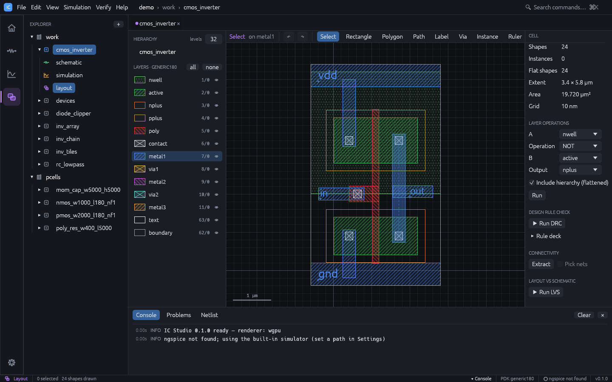
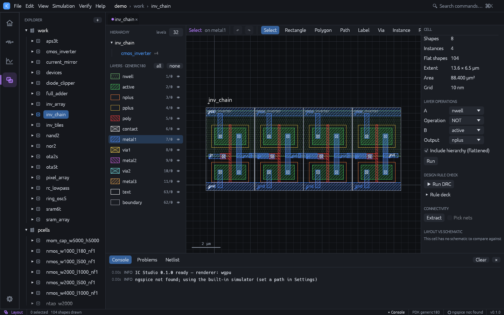
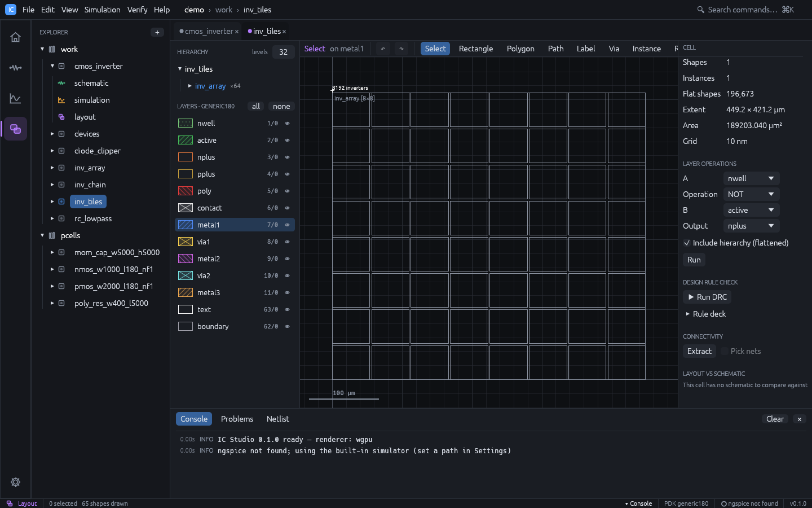
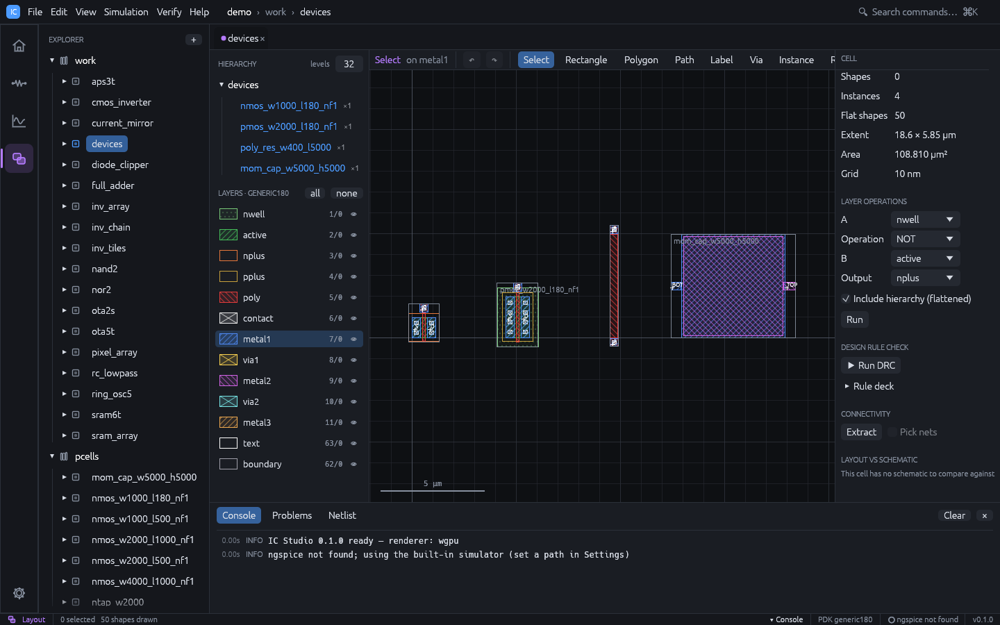

# Layout editor

Open a cell's layout view (or press `Ctrl+4` with a cell open). Layout coordinates are
database units (1 dbu = 1 nm in the generic technology, y pointing up); the inspector shows
µm. Every point snaps to the snap grid (the **Snap** field in the toolbar, a multiple of the
technology grid). The editor follows Virtuoso conventions: two-click commands with a prompt
in the top-left corner of the canvas, bindkeys (`S` stretch, `M` move, `C` copy, `Shift+C` chop, `O` via, `T` layer tap, `u` undo,
`Z` zoom box, `W` previous view, ...; see [Keyboard shortcuts](shortcuts.md)),
gravity snapping and design-rule-driven feedback.

- **Left panel**: **Hierarchy** (drawn levels and the tree of placed cells), **Layers**,
  and the options of the current tool.
- **Toolbar**: undo / redo, the tools (**Select**, **Stretch**, **Move**, **Copy**, **Rectangle**,
  **Polygon**, **Path**, **Label**, **Via**, **Instance**, **Chop**, **Ruler**), fit,
  **Zoom box**, **Prev view**, **Grid**, **Snap**, **Gravity**, **DRD**, **Flylines**, and
  **GDS** to export the cell.
- **Status bar**: cursor position and, while a command is in progress, dx / dy from its
  reference point.
- **Right panel**: cell statistics or the inspector, **Edit** operations, **Layer
  operations**, and the verification sections (see [Verification](verification.md)).

## Layers

- Click a layer row to make it the **active layer**; new shapes are drawn on it.
- Click the eye to show or hide a layer. Click the small box left of the eye to make a
  layer **selectable** or not: shapes on non-selectable (or hidden) layers are drawn but
  cannot be picked, like Virtuoso's LSW. **AV** / **NV** show / hide every layer, **AS** /
  **NS** make every layer selectable / not.
- **Filter** narrows the list by name; **Instances selectable** controls whether placed
  cells can be picked.
- Each row shows the fill pattern, the name and the GDS `layer/datatype`. Hover a row to
  see its minimum width and spacing.

## Drawing

Keys act on the canvas only while the mouse is over it.

| Tool | Key | How to use |
|---|---|---|
| Select | `Esc` | Click, `Shift`/`Ctrl`+click, or drag a box |
| Stretch | `S` | Click an edge or vertex of a shape, then the destination (or drag it) |
| Rectangle | `R` | Drag from corner to corner, or click two corners; the size is shown |
| Polygon | `Shift+P` | Click each vertex; `Enter`, double-click or right-click closes it |
| Path | `P` | Click points; `Enter`, double-click or right-click finishes it |
| Label | `L` | Type the **Text** in the left panel, click to place |
| Via | `O` | Pick a via in the left panel; click for one cut, drag to fill an area |
| Instance | `I` | Pick a cell or PCell in the left panel, click to place |
| Chop | `Shift+C` | Drag or click a box; it is cut out of the selected shapes (or of every selectable shape it touches) |
| Ruler | `K` | Drag or click two points; rulers stay until `Shift+K` |

While drawing a polygon or path, `Backspace` removes the last point and `Esc` cancels.

- **Gravity** (on by default, `G` toggles) snaps the cursor to vertices (diamond marker) and edges
  (circle marker) of nearby shapes and instance boxes, so new geometry abuts exactly.
- **DRD** (design-rule-driven editing, on by default) shows the minimum-spacing halo of a
  rectangle being drawn and marks in red every gap to a same-layer shape that is closer
  than the minimum spacing, and shapes narrower than the minimum width. It works while
  drawing rectangles and paths, moving, copying and pasting. Neighbours inside placed cells
  count too (at any depth), as do the shapes around a cell edited in place; a moved or
  pasted instance is checked by the shapes along its outline.
- **Layer tap**: `T` makes the layer of the shape under the cursor the active layer.
- **Changing metal while routing**: with the Path tool, press `+` (or `=` / `PageUp`) to
  end the path at the cursor, drop the via to the routing layer above and continue on it;
  `-` (or `PageDown`) goes down.

- **Polygons** are Manhattan by default: each point is aligned horizontally or vertically
  to the previous one. Hold `Shift` (or `Ctrl`) while clicking for any angle. The closing
  edge gets an extra corner so a Manhattan outline stays Manhattan.
- **Paths** are always Manhattan. **Width (nm)** in the left panel sets the width; `0`
  uses the layer's minimum width. Path ends are extended by half the width.
- **Labels** on a routing layer name the net under them (used by extraction and LVS).
- **Vias** come from the technology (bottom layer, cut, top layer); dragging an area
  fills it with as many cuts as fit.

### Rectangle step by step

1. Click the `metal1` row in **Layers**.
2. Press `R` and drag on the canvas.
3. Press `Esc` to return to Select, click the rectangle and type exact
   coordinates in the inspector (**x0**, **y0**, **x1**, **y1** in µm).

## Selecting and editing

| Action | How |
|---|---|
| Select | Click; the smallest shape under the cursor wins. Click the same spot again to cycle through the items under it |
| Add / remove | `Shift`+click or `Ctrl`+click |
| Box select | Drag on empty space: left to right selects items fully inside, right to left (dashed box) every item it touches; `Shift` adds |
| Select all | `Ctrl+A` |
| Move | Drag a selected item; or `M`, click a reference point, click the destination; or nudge with `Shift`+arrow keys (10 snap steps). Right-click while moving rotates 90°, `Shift`+right-click flips sideways |
| Copy | `C`, click a reference point, then click destinations (each click places another copy, `Esc` ends); rotate / flip as for Move |
| Stretch | `S`, click an edge or vertex, click the destination |
| Yank / paste | `y` or `Ctrl+C` copies the selection (`Ctrl+X` cuts it); `Shift+Y` or `Ctrl+V` attaches it to the cursor, click to place. The clipboard also works between cells |
| Merge / chop | `Shift+M` / `Shift+C` |
| Reshape | With one shape selected, drag a vertex handle (square) or an edge handle (round); Manhattan shapes stay Manhattan |
| Rotate 90° / flip | `Shift+O`, or **Rotate 90°**, **Flip X**, **Flip Y** |
| Deselect all | `Ctrl+D` |
| Delete | `Del` or `Backspace` |
| Undo / redo | `u` / `Shift+U`, or `Ctrl+Z` / `Ctrl+Shift+Z` or `Ctrl+Y` |
| Edit in place | `Shift+X` over an instance (or with one selected) edits its cell, or the array element under the cursor, inside the parent: the surroundings stay visible, dimmed, in the parent's orientation, and DRD checks against them. `Shift+B` or **Return** in the toolbar goes back |
| Open a placed cell | Double-click the instance, or **Open** in the inspector |

The **Edit** section of the right panel (shown when something is selected) also has:

- **Flatten**: replace the selected instances with their contents (one level).
- **Make cell**: move the selection into a new cell and place an instance of it.
- **Merge**: union the selected shapes per layer.
- **Size** with **Apply**: grow (positive µm) or shrink (negative) the selected shapes.
- **Align** (two or more items): align left, centre or right edges, bottom, centre or top
  edges; **Space X** / **Space Y** spread three or more items with equal gaps.

## Navigation

| Action | How |
|---|---|
| Zoom | Mouse wheel or pinch, `[` / `]` at the cursor, `Shift+Z` out |
| Zoom box | `Z` (or **Zoom box**), then drag or click two corners |
| Previous / next view | `W` / `Shift+W` (or **Prev view**) |
| Fit | `F` |
| Pan | Middle or right drag, `Shift`+wheel, or the arrow keys |

## Layer operations

With nothing selected, **Layer operations** computes Boolean results:

1. Choose layer **A**, an **Operation** (AND, OR, NOT, XOR, SIZE) and layer **B** (or a
   distance **By** in µm for SIZE).
2. Choose the **Output** layer.
3. Keep **Include hierarchy (flattened)** checked to include placed cells.
4. Press **Run**. The result shapes are added to the output layer and selected.

Boolean operations work on Manhattan geometry; other shapes are skipped and reported.

## Hierarchy

### Placing a cell or an array

1. Press `I`. The left panel lists **PCell** variants and **Place cell** (every other
   cell with a layout that would not create a cycle).
2. Pick a cell, set **Rotation**, **Mirror about x**, **Columns** and **Rows**. Array
   elements abut at the cell's extent.
3. Click to place.

Select an instance to edit its position, rotation and mirroring in the inspector. Check
**Array** to turn it into an array (GDS AREF) with **Columns**, **Rows**, **Column pitch**
and **Row pitch**.

### Drawn depth

The **levels** field in **Hierarchy** (keys `0` to `8`, and `9` for all levels) sets how
many levels of placed cells are drawn with their contents. Deeper instances are drawn as
labelled boxes. Missing cells are drawn in red.

Large designs stay fast: cells that are small on screen collapse to boxes and tiny shapes
to dots.

The hierarchy tree lists the cells placed in the current cell with their counts; click
one to open it.

## PCells

Parametric cells are generated from the technology and stored as ordinary cells in the
`pcells` library (for example `nmos_w1000_l180_nf2`).

| PCell | Parameters | Defaults |
|---|---|---|
| `nmos` | W, L, fingers, device | W 1 µm, L 0.18 µm, 1 finger |
| `pmos` | W, L, fingers, device | W 2 µm, L 0.18 µm, 1 finger |
| `poly_res` | W, L | W 0.4 µm, L 5 µm |
| `mom_cap` | W, H | 5 µm x 5 µm |

**Device** appears when the technology is a PDK with several MOS devices of that polarity
(for example low- and high-Vt variants): the PCell then draws that device's marker layers,
and the variant name ends with the device name. The default is the PDK's first device.

To place one, press `I`, choose the PCell in the left panel, set its parameters and click.
To change a placed PCell, select it, edit the parameters in the **PCell** section of the
inspector and press **Apply**. Well and substrate taps (`ntap`, `ptap`) are created by
[schematic-driven layout](schematic-driven-layout.md); their parameters can be edited in
the inspector the same way.

## GDSII

- **File > Import > GDSII...** reads a GDS file into a new library with full hierarchy.
- **GDS** in the toolbar or **File > Export > Cell GDSII...** writes the cell and every
  cell it places; **Export > Library GDSII...** writes every layout in the project.

Layers are mapped by GDS layer / datatype. Layers the technology does not have are added
to it on import, so nothing is lost.
