<!-- seo title="Analog IC Design Basics: gm, Gain, Current Mirrors" description="An introduction to analog IC design: biasing, small-signal transconductance gm and output resistance ro, the common-source amplifier, gain and bandwidth, current mirrors, differential pairs and the OTA." -->

# Analog building blocks

Digital circuits use transistors as switches. **Analog** circuits use them as
*amplifiers*: a small change at the gate makes a proportional change of drain current.
Sensors, radios, audio, power management and every data converter are analog at heart.
This chapter introduces the ideas behind every analog circuit, using the numbers of the
generic 180 nm technology.

## Bias first, then signal

An analog circuit is analysed in two steps:

1. **Bias** (the DC operating point): fixed voltages and currents that put every
   transistor in **saturation**, where it behaves as a current source controlled by
   V<sub>GS</sub> (see [the MOSFET](mosfet.md#the-three-regions)).
2. **Small signal**: small variations around that point. If they are small enough, the
   circuit is *linear* and simple formulas predict its gain.

In SPICE, step 1 is the **operating point** analysis and step 2 is the **AC** analysis,
which linearises every device around its operating point.

## Transconductance g<sub>m</sub> and output resistance r<sub>o</sub>

Two small-signal numbers describe a transistor in saturation:

- **Transconductance g<sub>m</sub>**: how much the drain current changes per volt of
  gate voltage. From the square law:

  ```text
  g_m = ∂I_D/∂V_GS = 2·I_D / V_ov = √(2·k'·(W/L)·I_D)
  ```

  More current, or a smaller overdrive, gives more g<sub>m</sub> per microamp.

- **Output resistance r<sub>o</sub>**: the flat curves of the saturation region are not
  perfectly flat. Their slope is the output conductance g<sub>ds</sub> = 1/r<sub>o</sub>
  ≈ λ·I<sub>D</sub>. Longer transistors have a smaller λ and a higher r<sub>o</sub>.

After an operating-point simulation, IC Studio lists `gm` and `gds` for every transistor
on the **Operating Point** tab. Reading them is half of analog design.

<!-- quiz
? A transistor in saturation carries I<sub>D</sub> = 20 µA at V<sub>ov</sub> = 0.2 V. What is its g<sub>m</sub>, in µS?
= 200 ±5 µS
> g<sub>m</sub> = 2·I<sub>D</sub> / V<sub>ov</sub> = 2 · 20 µA / 0.2 V = 200 µS.
-->

## The common-source amplifier



The basic amplifier: an NMOS with its source at ground, the input on its gate, and a load
resistor R<sub>D</sub> from the drain to V<sub>DD</sub>.

- A small increase v<sub>in</sub> of the gate voltage increases the drain current by
  g<sub>m</sub>·v<sub>in</sub>.
- That extra current flows through R<sub>D</sub> and *lowers* the drain voltage by
  g<sub>m</sub>·v<sub>in</sub>·R<sub>D</sub>.

So the **voltage gain** is

```text
A_v = v_out / v_in = −g_m · (R_D ∥ r_o)
```

The minus sign means the output is inverted. With W/L = 2 µm / 1 µm biased at
V<sub>GS</sub> = 0.7 V and R<sub>D</sub> = 50 kΩ, the simulator finds g<sub>m</sub> =
145 µS and r<sub>o</sub> = 1.43 MΩ, so A<sub>v</sub> = −145 µS × 48.3 kΩ ≈ **−7.0**
(17 dB). You will build exactly this in the [next tutorial](tutorial-amplifier.md).

<!-- quiz
? The same amplifier (g<sub>m</sub> = 145 µS, r<sub>o</sub> = 1.43 MΩ) with R<sub>D</sub> = 30 kΩ: what is the magnitude of its gain |A<sub>v</sub>|?
= 4.3 ±0.2
> R<sub>D</sub> ∥ r<sub>o</sub> = 30 k · 1430 k / 1460 k ≈ 29.4 kΩ, so |A<sub>v</sub>| = 145 µS · 29.4 kΩ ≈ 4.3.
-->

### Choosing the bias

The output must sit where it can swing both ways while M1 stays in saturation
(V<sub>DS</sub> > V<sub>ov</sub>). With I<sub>D</sub> = 18.1 µA, R<sub>D</sub> drops
0.91 V, leaving V<sub>out</sub> ≈ 0.89 V: comfortably between V<sub>ov</sub> = 0.25 V and
1.8 V. A larger R<sub>D</sub> gives more gain, but pushes V<sub>out</sub> down until M1
falls into triode and the gain collapses. Gain, swing, and power always trade against
each other.

<!-- quiz
? What happens when R<sub>D</sub> is made much larger, say 100 kΩ?
- The gain keeps growing in proportion
+ V<sub>out</sub> drops until M1 enters triode, and the gain collapses
- M1 turns off
- The bandwidth grows
> R<sub>D</sub> drops I<sub>D</sub>·R<sub>D</sub>: at 100 kΩ that is about 1.8 V, the whole supply, so V<sub>DS</sub> falls below V<sub>ov</sub>. M1 still conducts, but in triode it no longer acts as a current source.
-->

## Bandwidth

Every node has capacitance. The output node of the amplifier sees R<sub>D</sub> ∥
r<sub>o</sub> in parallel with the load capacitance C<sub>L</sub>, which forms the same
[RC low-pass](circuits.md#frequency-response-decibels-and-bode-plots) as before:

```text
f_-3dB = 1 / (2π · (R_D ∥ r_o) · C_L)
```

With 100 fF of load, f<sub>-3dB</sub> ≈ 33 MHz (simulated: 33 MHz). Above it the gain
drops by 20 dB per decade, until it reaches 1 (0 dB) at the **unity-gain frequency**:

```text
f_u ≈ |A_v| · f_-3dB ≈ g_m / (2π · C_L)       ≈ 230 MHz
```

The **gain-bandwidth product** g<sub>m</sub>/C<sub>L</sub> is fixed by the current you
spend and the capacitance you drive. More gain means less bandwidth.

<!-- quiz
? With g<sub>m</sub> = 145 µS driving C<sub>L</sub> = 200 fF, what is the unity-gain frequency f<sub>u</sub>, in MHz?
= 115 ±5 MHz
> f<sub>u</sub> ≈ g<sub>m</sub> / (2π · C<sub>L</sub>) = 145 µS / (2π · 200 fF) ≈ 115 MHz: twice the load, half the gain-bandwidth.
-->

## The current mirror

Analog circuits need precise bias currents. A **current mirror** copies one reference
current to many places:

```text
      I_ref ↓                 ↓ I_out
            │                 │
       d ┌──┤                 ├── d
         │  M1 ─ g ───── g ─ M2
         └──┘ (gate = drain)  │
            │ s             s │
           GND               GND
```

M1 is **diode-connected** (gate tied to drain): the reference current sets its
V<sub>GS</sub>. M2 has the same V<sub>GS</sub>, so in saturation it carries the same
current, or (W<sub>2</sub>/L<sub>2</sub>)/(W<sub>1</sub>/L<sub>1</sub>) times it.

In simulation (both 2 µm / 1 µm, I<sub>ref</sub> = 20 µA): the output current is 20.1 µA
at 0.9 V and rises slowly with the output voltage (from r<sub>o</sub>), from 19.8 µA at
0.5 V to 20.8 µA at 1.8 V. Below about 0.26 V (V<sub>ov</sub>) M2 leaves saturation and
the current collapses.

<!-- quiz
? In the mirror, M2 is made 4 µm / 1 µm while M1 stays 2 µm / 1 µm, with I<sub>ref</sub> = 20 µA. What output current do you expect, in µA?
= 40 ±2 µA
> I<sub>out</sub> = I<sub>ref</sub> · (W<sub>2</sub>/L<sub>2</sub>) / (W<sub>1</sub>/L<sub>1</sub>) = 20 µA · 2 = 40 µA, a little more at high output voltage because of r<sub>o</sub>.
-->

## The differential pair and the OTA

A **differential pair** is two matched transistors sharing a tail current source. It
amplifies the *difference* between its two inputs and rejects what is common to both
(noise on a shared supply, for example). Load it with a current mirror and you get the
**five-transistor OTA** (operational transconductance amplifier), the core of most
op-amps:

```text
A_v = g_m1 · (r_o2 ∥ r_o4)
```

The demo `ota5t` (input pair 2 µm / 0.5 µm, mirror 4 µm / 0.5 µm, 11.3 µA tail) has a gain
of about **121** (42 dB): g<sub>m</sub> = 117 µS, g<sub>ds2</sub> + g<sub>ds4</sub> =
0.96 µS. Add a second gain stage and you get `ota2s`, about 83 dB.

## Matching and variation

Two "identical" transistors are never quite identical: random dopant fluctuations shift
their thresholds a little. The random part shrinks with the gate area (**Pelgrom's
law**):

```text
σ(V_th) = A_Vt / √(W·L)        per device; a pair differs by √2 times as much
```

with A<sub>Vt</sub> ≈ 5 mV·µm in a 180 nm process. A 2 µm × 1 µm transistor has σ ≈ 3.5 mV, a
0.5 µm × 0.18 µm one about 17 mV. This is why analog transistors are larger than digital
ones, and laid out with matching techniques (see
[From circuit to silicon](layout-basics.md#layout-techniques-you-will-see)). IC Studio's
**Monte Carlo** simulates this variation.

<!-- quiz
? With A<sub>Vt</sub> = 5 mV·µm, what is σ(V<sub>th</sub>) of a 2 µm × 2 µm transistor, in mV?
= 2.5 ±0.1 mV
> σ = 5 mV·µm / √(4 µm²) = 2.5 mV. Doubling L from the 2 µm × 1 µm example divides σ by √2.
-->

## Analog design in one loop

1. Choose the bias current from the power budget.
2. Choose V<sub>ov</sub> (often 0.15 to 0.3 V) and compute W/L from the square law.
3. Compute gain and bandwidth by hand.
4. Simulate the operating point: is every transistor in saturation? Then the AC response.
5. Adjust, then check corners, temperature and Monte Carlo.

<div class="callout say">

**Try it:** open the demos:

```sh
ic-studio --demo --cell current_mirror --workspace simulation
```

Press `F5` and look at the output current against the output voltage in the **DC Sweep**
tab. Then open `ota5t`, press `F5` and read **GAIN @ fstart** and **UNITY GAIN f** in the
AC measurements. Go to its schematic (`Ctrl+2`) to see the operating point of each
transistor.

</div>

<!-- try: Simulate current_mirror | simulate current_mirror -->

<!-- try: Simulate ota5t | simulate ota5t -->

<!-- try: Open the ota5t schematic | open ota5t schematic -->

Next: [Hands-on: an amplifier](tutorial-amplifier.md).
