<!-- seo title="Circuit Basics for IC Design: Voltage, Current, RC" description="The electronics you need before designing chips: voltage, current, Ohm's law, Kirchhoff's laws, capacitors, the RC time constant, frequency response, decibels and SPICE netlists." -->

# Circuits in ten minutes

Chip design rests on a few ideas from basic electronics. This chapter covers just those,
with an example you can simulate at the end.

## Voltage, current and resistance

- **Voltage** (V, volts) is the electrical "pressure" between two points. It is always
  measured between two nodes; when only one node is named, the other is **ground** (0 V).
- **Current** (I, amperes) is the flow of charge through a wire or device. Chips work
  with milliamps (mA, 10⁻³ A), microamps (µA, 10⁻⁶ A) and less.
- **Resistance** (R, ohms Ω) is how hard a device resists current.

They are tied together by **Ohm's law**:

```text
V = I · R          1 V across 1 kΩ drives 1 mA
```

A resistor turns electrical energy into heat. The **power** it burns is `P = V · I`. Power
is why chips get warm, and why designers care about every microamp.

## Kirchhoff's laws: how circuits are solved

Two rules are enough to solve any circuit, and they are exactly what a SPICE simulator
does:

1. **Current law (KCL)**: the currents into a node add up to zero. What flows in, flows
   out.
2. **Voltage law (KVL)**: the voltages around any closed loop add up to zero.

A simulator writes one KCL equation per node, with each device's current as a function of
its node voltages, and solves the whole set at once. This is called **modified nodal
analysis**, and it is what the built-in engine of IC Studio does.

## Nodes, nets and ground

In a schematic, every set of connected wires is one **net** (or **node**). Nets get names
(`in`, `out`, `vdd`) or automatic names (`net1`). The ground net is called `0` in SPICE.
Every circuit needs a ground: it is the reference all voltages are measured from.

The **supply** (`vdd`) is the net that feeds power to the circuit. In the generic
technology it is **1.8 V**.

## Capacitors and the RC time constant

A **capacitor** (C, farads F) stores charge: `Q = C · V`. It is two conductors separated
by an insulator. On a chip, capacitors are everywhere, whether you want them or not:
every gate of a transistor is a small capacitor, and every wire has capacitance to the
substrate and to its neighbours. Values are tiny: femtofarads (fF, 10⁻¹⁵ F) to picofarads
(pF, 10⁻¹² F).

The voltage on a capacitor cannot jump; it takes time to charge through a resistance.
Charging C through R, the voltage follows an exponential with the **time constant**:

```text
τ = R · C          1 kΩ · 1 nF = 1 µs
```

After one τ the capacitor has reached 63 % of the final voltage, after 3τ 95 %, after 5τ
99 %.



<div class="callout">

**Why this matters for chips:** a logic gate driving the next gate is a resistor (the
transistor that is on) charging a capacitor (the next gate plus the wire). The RC product
sets how fast a chip can run. Almost every speed question in digital design comes back to
"how big is R, and how big is C?"

</div>

## Frequency response, decibels and Bode plots

The same RC circuit behaves differently for slow and fast signals. A slow sine wave passes
through; a fast one is shorted to ground by the capacitor before it can charge. It is a
**low-pass filter** with a **corner (−3 dB) frequency**:

```text
f(-3 dB) = 1 / (2π · R · C)          1 kΩ, 1 nF → 159 kHz
```

The ratio of output to input amplitude is the **gain**, usually in **decibels**:

| Gain (ratio) | Gain (dB) = 20 · log₁₀(ratio) |
|---|---|
| 100 | 40 dB |
| 10 | 20 dB |
| 2 | 6 dB |
| 1 | 0 dB |
| 0.707 | −3 dB (the "corner": half the power) |
| 0.1 | −20 dB |

A **Bode plot** draws gain in dB and phase in degrees against a logarithmic frequency
axis. Above its corner, an RC filter loses 20 dB per decade (a factor of 10 in frequency).
**AC analysis** in a simulator computes exactly this plot.

## The three main analyses

| Analysis | Question it answers | Example |
|---|---|---|
| **Operating point** (OP) | What are the DC voltages and currents with the inputs held still? | Is every transistor biased correctly? |
| **DC sweep** | How does a DC output change as one source is swept? | An inverter's transfer curve |
| **AC** (small-signal) | How do small sine waves pass through, at each frequency? | An amplifier's gain and bandwidth |
| **Transient** | What happens over time with real waveforms? | A gate's delay, an oscillator's period |

## Reading a SPICE netlist

Underneath every schematic is a **netlist**: one line per device, listing its nodes and
its value. IC Studio shows it in the **Netlist** tab of the bottom panel. The RC filter:

```spice
* RC low-pass
V1 in 0 DC 0 AC 1 PULSE(0 1 0.5u 1n 1n 10u 20u)   ; source between in and ground
R1 in out 1k                                      ; 1 kΩ from in to out
C1 out 0 1n                                       ; 1 nF from out to ground
.ac dec 20 1 10meg                                ; AC: 20 points per decade
.tran 10n 5u                                      ; transient: 5 µs
.end
```

- The first letter is the device type: `R` resistor, `C` capacitor, `V` voltage source,
  `M` MOSFET, `D` diode.
- Then the nodes it connects, then the value.
- Values use **SPICE suffixes**: `f` 10⁻¹⁵, `p` 10⁻¹², `n` 10⁻⁹, `u` 10⁻⁶, `m` 10⁻³,
  `k` 10³, `meg` 10⁶, `g` 10⁹. Careful: `m` is milli, so a megohm is `1meg`.
- Lines starting with `.` are commands: models, analyses, options.

<div class="callout say">

**Try it:** open the demo's `rc_lowpass`:

```sh
ic-studio --demo --cell rc_lowpass --workspace simulation
```

Press `F5`. On the **AC** tab, the **f -3 dB** column shows about 159 kHz. On the
**Transient** tab you see the exponential charging. Then go to the schematic (`Ctrl+2`),
change `R1` to `2k` in the inspector and press `F5` again. Before you look: what will the
corner frequency be?<sup>1</sup>

</div>

<sup>1</sup> Doubling R doubles τ and halves the corner: about 80 kHz.

Next: [The MOSFET](mosfet.md), the device the rest of the course is built on.
