<!-- seo title="CMOS Logic Gates: Inverter, NAND, NOR Explained" description="How CMOS logic works: transistors as switches, the CMOS inverter and its transfer curve, NAND and NOR gates, propagation delay, power and transistor sizing." -->

# CMOS logic

Digital chips are built from **CMOS** (complementary MOS) logic: every gate pairs NMOS
transistors that pull the output down with PMOS transistors that pull it up. This chapter
builds the inverter, then NAND and NOR, and explains what makes a gate fast or slow.

## Transistors as switches

For logic, a MOSFET is a switch controlled by its gate:

| | Gate = 0 (0 V) | Gate = 1 (V<sub>DD</sub>) |
|---|---|---|
| **NMOS** | off | on |
| **PMOS** | on | off |

An NMOS passes a good 0 (it connects to ground well) and a PMOS passes a good 1 (it
connects to V<sub>DD</sub> well). CMOS uses each for what it is good at: **NMOS in the
pull-down network to ground, PMOS in the pull-up network to V<sub>DD</sub>.**

## The inverter



The simplest gate: one PMOS from V<sub>DD</sub> to the output, one NMOS from the output
to ground, both gates tied to the input.

- **in = 0**: the PMOS is on, the NMOS is off. The output is connected to V<sub>DD</sub>:
  **out = 1**.
- **in = 1**: the NMOS is on, the PMOS is off. The output is connected to ground:
  **out = 0**.

In either steady state one of the two transistors is off, so **no current flows from
V<sub>DD</sub> to ground**. A CMOS gate that is not switching burns (almost) no power.
This single property is why CMOS won.

### The voltage transfer curve

Sweep the input slowly from 0 to 1.8 V and plot the output: that is the **voltage
transfer curve** (VTC), shown on the right of the figure (simulated in IC Studio with the
generic technology, NMOS 1 µm, PMOS 2 µm, both 180 nm long).

- The output stays at 1.8 V for low inputs and at 0 V for high inputs: logic levels are
  **restored**, so noise does not accumulate through a chain of gates.
- In the middle the curve is very steep (a gain of about −55): small changes of the input
  around the threshold give large changes of the output.
- The **switching threshold V<sub>M</sub>** is where out = in. Here it is about
  **0.82 V**, a little below the middle (0.9 V), because the NMOS is stronger than the
  PMOS.
- **Noise margins**: inputs below V<sub>IL</sub> ≈ 0.67 V are read as 0 and inputs above
  V<sub>IH</sub> ≈ 0.92 V as 1 (the points where the slope is −1).

Only while the input passes through the middle region are both transistors partly on,
and a short-circuit current flows from V<sub>DD</sub> to ground (about 118 µA at the peak
for this inverter).

## NAND and NOR



Every static CMOS gate follows one recipe:

1. Build the **pull-down network** of NMOS transistors that conducts when the output
   should be 0. **Series** NMOS = AND; **parallel** NMOS = OR.
2. Build the **pull-up network** of PMOS transistors as its **dual**: series becomes
   parallel and parallel becomes series.

| Gate | Output | Pull-down (NMOS) | Pull-up (PMOS) |
|---|---|---|---|
| Inverter | NOT A | one | one |
| NAND2 | NOT (A AND B) | two in **series** | two in **parallel** |
| NOR2 | NOT (A OR B) | two in **parallel** | two in **series** |

The output is always inverted: a single CMOS stage can only make **inverting** functions.
An AND is a NAND followed by an inverter. NAND and NOR are each **universal**: any logic
function can be built from either one alone.

<div class="callout">

**Why designers prefer NAND to NOR:** series transistors are slower (their resistances
add). NOR puts the *PMOS*, already the weaker device, in series, so a NOR needs very wide
PMOS to be fast. NAND puts the NMOS in series, which costs less.

</div>

## Delay: why gates take time

A gate's output drives a **load capacitance** C<sub>L</sub>: the gates of the next stages,
the wires and its own drain junctions. Switching the output means charging or
discharging C<sub>L</sub> through the transistor that is on, which acts like a resistor
R<sub>on</sub>. As in the [RC circuit](circuits.md#capacitors-and-the-rc-time-constant),
that takes time:

```text
t_p ≈ 0.69 · R_on · C_L
```

The **propagation delay** t<sub>p</sub> is measured from the input crossing 50 % of the
swing to the output crossing 50 %. There are two of them: **t<sub>pHL</sub>** (output
falling, through the NMOS) and **t<sub>pLH</sub>** (output rising, through the PMOS).

For the inverter above with a 20 fF load, IC Studio simulates **t<sub>pHL</sub> ≈ 36 ps**
and **t<sub>pLH</sub> ≈ 52 ps**: rising is slower because the PMOS is weaker.

To make a gate faster, lower R<sub>on</sub> (wider transistors) or lower C<sub>L</sub>
(fewer or smaller gates to drive, shorter wires). But wider transistors also have larger
gates, which load the stage *before*. Sizing is a balance.

## Power

A CMOS chip burns power in three ways:

| Kind | Cause | Formula |
|---|---|---|
| **Dynamic** (switching) | Charging and discharging load capacitances | P = α · C<sub>L</sub> · V<sub>DD</sub>² · f |
| **Short-circuit** | Both transistors briefly on during an input transition | Small with sharp input edges |
| **Leakage** (static) | Transistors that are "off" still leak a little | Matters in advanced nodes |

α is the fraction of clock cycles the node switches. Because power goes with
V<sub>DD</sub>², lowering the supply voltage is the most effective way to save power, which
is why supplies have dropped from 5 V to below 1 V over the decades.

## Sizing the transistors

The PMOS of the generic technology has k' = 70 µA/V² against 280 µA/V² for the NMOS: it
is four times weaker for the same W/L. Two common choices:

| PMOS width | V<sub>M</sub> | t<sub>pHL</sub> / t<sub>pLH</sub> | Comment |
|---|---|---|---|
| W<sub>p</sub> = 2·W<sub>n</sub> (2 µm) | 0.82 V | 36 / 52 ps | A common compromise: smaller, a bit unbalanced |
| W<sub>p</sub> = 4·W<sub>n</sub> (4 µm) | 0.90 V | 39 / 37 ps | Balanced: symmetric threshold and delays |

(Simulated with a 20 fF load. The balanced version has equal rise and fall delays, but
its bigger PMOS also loads the stage driving it, so a 2:1 ratio is often the better
choice inside a chain of gates.)

From the square law, setting the NMOS and PMOS currents equal at the switching point
gives

```text
V_M = (V_th,n + r · (V_DD − |V_th,p|)) / (1 + r),   r = √(k'_p·W_p/L_p / (k'_n·W_n/L_n))
```

With W<sub>p</sub> = 4·W<sub>n</sub>, r = 1 and V<sub>M</sub> = V<sub>DD</sub>/2 exactly.

<div class="callout say">

**Try it:** the demo has a ready-made inverter, NAND and NOR, and a ring oscillator:

```sh
ic-studio --demo --cell cmos_inverter --workspace simulation
```

Press `F5` and look at the **DC Sweep** and **Transient** tabs. Then open `nand2` and
`nor2` (Explorer, or `Ctrl+K`), and `ring_osc5`: five inverters in a loop, which
oscillates because each stage's delay keeps the loop from ever settling. Its period is
2 × 5 × t<sub>p</sub>.

</div>

Now build one yourself: [Hands-on: design an inverter](tutorial-inverter.md).
