<!-- seo title="Learn IC Design: A Beginner's Course" description="Learn how chips are designed, from the transistor up: circuits, MOSFETs, CMOS logic, layout and analog amplifiers, with hands-on IC Studio tutorials." -->

# Learn IC design: start here

This part of the guide is a short course on how integrated circuits (ICs) are designed. It
assumes no background in semiconductors. If you remember that voltage pushes current
through a resistor, you have enough to start. By the end you will have designed a CMOS
inverter and a small amplifier, drawn their layouts, checked them and simulated them with
the parasitics of the real wiring, all in IC Studio.

## What is a chip, really?

A chip is a small piece of silicon with **millions to billions of transistors** on it,
wired together by several layers of metal. Each transistor is a tiny **voltage-controlled
switch**. Put switches together and you get logic gates; put gates together and you get
adders, memories and processors. Put a few transistors together carefully and you get
amplifiers, filters and data converters, the analog circuits that connect chips to the
real world.

The picture above zooms in four steps:

| Level | Size | What you design there |
|---|---|---|
| Wafer | 300 mm | Nothing: the factory (fab) prints hundreds of copies of your chip on it |
| Chip (die) | a few mm | The floorplan: where the blocks go and how power and signals reach them |
| Cell | a few µm | A gate, a memory bit or an amplifier: a handful of transistors and their wiring |
| Transistor | ~100 nm | Its width W and length L, the two numbers a circuit designer chooses |

**Full-custom design**, the kind IC Studio is built for, works at the cell and transistor
level: you choose every transistor and draw (or generate) every shape.

<!-- quiz
? At which level does full-custom design, the kind IC Studio is built for, work?
- The wafer: placing copies of the chip
- The die floorplan only
+ The cell and transistor: every transistor and every shape
- Software that runs on the finished chip
> Full-custom design chooses each transistor's W and L and draws (or generates) every shape. The fab handles the wafer; floorplanning is the level above the cells.
-->

## How a chip is designed

1. **Specification**: what the circuit must do. "Invert a 1.8 V signal in under 50 ps",
   "amplify by 10 up to 30 MHz".
2. **Schematic**: the circuit as symbols and wires: which transistors, how big, connected
   how.
3. **Simulation**: a SPICE simulator solves the circuit's equations and shows you
   voltages and currents, before anything is built.
4. **Layout**: the circuit drawn as the coloured polygons the factory turns into masks,
   one per layer of the manufacturing process.
5. **Verification**: **DRC** checks the drawing follows the factory's design rules;
   **LVS** checks the drawing is the same circuit as the schematic.
6. **Parasitic extraction**: the real wires add resistance and capacitance. They are
   extracted from the layout and put back into the simulation to see their effect.
7. **Tape-out**: the verified layout is sent to the fab as a GDSII file. Weeks later,
   chips come back.

Steps 2 to 6 repeat until the specification is met. IC Studio keeps all of them on one
design database, so going round the loop is a few key presses.

<!-- quiz
? A layout passes DRC. What does LVS check in addition?
- That the shapes are wide enough and far enough apart
+ That the drawing is the same circuit as the schematic
- That the circuit meets its speed specification
- That the GDSII file can be read by the fab
> DRC checks the geometry against the design rules; LVS extracts the circuit from the layout and compares it with the schematic. Speed is a simulation question.
-->

<!-- quiz
? Why is the circuit simulated again after parasitic extraction?
- Because the first simulation was not accurate enough
+ To see the effect of the real wires' resistance and capacitance
- Because the fab requires two simulations
- To check the design rules
> The schematic has ideal wires. Extraction adds the resistance and capacitance of the drawn wiring, which make the circuit slower.
-->

## The course

1
<h3><a href="circuits.html">Circuits in ten minutes</a></h3>

Voltage, current, resistors, capacitors, the RC time constant, frequency response and
decibels. Read a SPICE netlist.

2
<h3><a href="mosfet.html">The MOSFET</a></h3>

How a transistor works: silicon, doping, the channel, threshold voltage, the triode
and saturation regions and the square law.

3
<h3><a href="cmos-logic.html">CMOS logic</a></h3>

Transistors as switches: the inverter, NAND and NOR, the transfer curve, delay and
power, and how to size transistors.

4
<h3><a href="tutorial-inverter.html">Hands-on: design an inverter</a></h3>

Draw the schematic, simulate it, measure the switching point and the delay, and size
the PMOS to balance it.

5
<h3><a href="layout-basics.html">From circuit to silicon</a></h3>

How chips are made layer by layer, what layout layers mean, design rules, and where
parasitics come from.

6
<h3><a href="tutorial-layout.html">Hands-on: lay out the inverter</a></h3>

Generate and route the layout, run DRC and LVS, simulate with parasitics and export
GDSII.

7
<h3><a href="analog-basics.html">Analog building blocks</a></h3>

Small-signal thinking: gm and ro, the common-source amplifier, gain and bandwidth,
current mirrors and the differential pair.

8
<h3><a href="tutorial-amplifier.html">Hands-on: an amplifier</a></h3>

Bias and simulate a common-source amplifier, read its gain and bandwidth from a Bode
plot, and explore the OTA demos.

9
<h3><a href="tutorial-derive.html">Hands-on: start from a working design</a></h3>

Make a faster inverter from the demo one: read its specs and notes, set new targets,
let the Derive wizard size and lay it out, and judge what else changed.

A [glossary](glossary.md) explains every term used in the course, with pointers for
further reading.

## How to use the course

- **Read in order** if you are new to the field. Each chapter takes 15 to 30 minutes.
  The hands-on chapters take about as long in the app.
- **Keep IC Studio open** next to the text ([Installation](../install.md)). Every theory
  chapter ends with a "Try it" box that opens a demo cell so you can see the idea in a
  simulation straight away.
- **Or read it inside IC Studio**: **Help › Learn IC Design…** (or **Start the course** on
  the welcome page) opens this course in a window next to the canvas, in the language of
  the UI (English or Korean); **Dock** puts it at the right side so it does not cover the
  canvas. There the "Try it" buttons run the step in the app, each section ends with a
  short quiz, and the hands-on chapters check your own cell live (devices placed,
  operating region, measured delay or gain, DRC and LVS). Your progress is kept between
  sessions.
- **When a check fails**, it says what to try. **Show me where** points at the place in the
  window where the step is done, and **Ask the tutor** opens the copilot in Tutor mode
  (it needs an AI model, set in **Tools › AI Models…**): it gives you one step at a time,
  points at what to click, checks your work as you go and edits nothing itself. If your
  cell has another name than the course's (`my_inv`), pick it under the check.
- **In the app, play with the equations**: the MOSFET and CMOS chapters have sliders for
  W, L and the voltages that redraw the curves as you move them. Hover an underlined term
  for its meaning from the [glossary](glossary.md). **Report…** saves your progress
  (chapters, quizzes, checks) as a Markdown file, for a teacher or for yourself.
- **New to the app itself?** The 5-minute tour walks you round the windows with the demo
  inverter, pointing at each button.
- **Do the exercises.** Changing one number and predicting what will happen before you
  press `F5` is the fastest way to build intuition.
- Everything uses the **generic 180 nm technology** that new projects start with. It is
  illustrative, not a real foundry process, but its numbers are realistic: a 1.8 V supply,
  a 180 nm minimum gate length and a threshold voltage of 0.45 V.

**Numbers in this course are real.** Every value quoted (switching thresholds, delays,
gains) was simulated with IC Studio's built-in engine on the generic technology, so you
should see the same numbers on your screen, give or take the last digit.

<!-- try: Take the 5-minute app tour | tutorial -->

<!-- try: Open the demo project | demo -->

<!-- quiz
? What is the supply voltage of the generic technology the course uses, in volts?
= 1.8 ±0.01 V
> The generic 180 nm technology has a 1.8 V supply, a 180 nm minimum gate length and a 0.45 V threshold voltage.
-->

Ready? Start with [Circuits in ten minutes](circuits.md), or jump straight to
[the MOSFET](mosfet.md) if you know your Ohm's law.
