<!-- seo title="IC Layout Basics: Layers, Masks and Design Rules" description="How a schematic becomes silicon: how chips are manufactured layer by layer, what layout layers mean, how a transistor looks in layout, design rules, DRC, LVS and parasitics." -->

# From circuit to silicon

A schematic says *what* is connected. A **layout** says *where everything physically is*:
the exact shapes the factory prints on the wafer. This chapter explains how chips are
manufactured, how to read a layout, and why layouts must follow design rules.

## How a chip is made

A chip is built on a silicon wafer in a sequence of several hundred process steps:
oxidation, deposition, implantation, etching, polishing. The steps that make a pattern use
**photolithography**: the wafer is coated with light-sensitive resist, exposed through a
**mask** (a stencil of the pattern), developed, and then etched or implanted only where
the resist is open.

**Each mask is one layer of your layout.** When you draw a rectangle on the `poly` layer,
you are drawing part of the poly mask.

The animation builds the inverter from the [CMOS logic](cmos-logic.md) chapter, one mask
at a time:

| # | Layer | What the fab does with it | What it is for |
|---|---|---|---|
| 1 | substrate | (the starting wafer, p-type) | Body of every NMOS |
| 2 | `nwell` | Implants n-type dopant deep into the substrate | Body of the PMOS |
| 3 | `active` | Defines where silicon stays exposed; elsewhere thick isolation oxide grows | Transistors and substrate contacts |
| 4 | `poly` | Patterns polysilicon on the thin gate oxide | Gates (and short wires) |
| 5 | `nplus` / `pplus` | Implants n+ or p+ dopant into active not covered by poly | Sources and drains, taps |
| 6 | `contact` | Etches holes in the oxide above active or poly, fills them with metal | Connects metal1 down to silicon |
| 7 | `metal1` | Patterns the first metal layer | Local wiring |
| 8 | `via1` | Holes between metal1 and metal2 | Connects the metal layers |
| 9 | `metal2`, `metal3` … | More metal layers | Longer, wider routing and power |

**Self-aligned gates.** Poly is patterned *before* the source/drain implant, so the gate
itself blocks the implant: the source and drain end exactly at the gate edge. This is why,
in layout, **a transistor is simply poly crossing active**. The channel length L is the
width of the poly line; the channel width W is the width of the active under it.

**Tools > Process Emulation** in IC Studio runs a process flow on your own layout and
draws the resulting cross-section along any cut line. See
[Process emulation](../process.md).

<!-- quiz
? In layout, what sets a transistor's channel length L?
+ The width of the poly line where it crosses active
- The width of the active under the poly
- The size of the contacts
- The metal1 wire width
> A transistor is poly crossing active. The poly line's width is L; the width of the active under it is W.
-->

<!-- quiz
? Which layer is the body of the PMOS?
- The p-type substrate
+ `nwell`
- `pplus`
- `poly`
> The PMOS sits in an n-well, tied to VDD through an n+ tap. The substrate is the body of the NMOS; `pplus` forms the PMOS source and drain.
-->

## Reading a layout

A layout is viewed from above, each layer in its own colour and fill pattern. The inverter
in top view:

- Two horizontal strips of **active** (green): the NMOS at the bottom, the PMOS at the top
  inside the **n-well**.
- A vertical **poly** line (red) crosses both: it is the shared gate, the input.
- **Contacts** (white squares) on the active either side of the gate connect to
  **metal1** (blue): the sources go to the VDD and ground rails, the two drains
  are joined to form the output.
- **Taps**: a p+ contact to the substrate (tied to ground) and an n+ contact to the n-well
  (tied to VDD) keep the bodies at the right voltage.

The [Layout editor](../layout.md) page explains each tool. Key facts:

- Layout coordinates are in **database units**: 1 dbu = 1 nm in the generic technology,
  and y points up.
- **Labels** on metal name the nets (`in`, `out`, `vdd`), which extraction and LVS use.
- The **Layers** panel shows each layer's GDS number; hover a layer to see its minimum
  width and spacing.

## Design rules

The factory cannot print arbitrarily small or close shapes: light diffracts, masks
misalign, etches undercut. Its limits are written as **design rules**. The most common:

| Rule | Meaning | Example (generic 180 nm) |
|---|---|---|
| **Width** | Smallest size of a shape | poly ≥ 180 nm, metal1 ≥ 230 nm |
| **Spacing** | Smallest gap between two shapes on one layer | poly ≥ 240 nm, metal1 ≥ 230 nm |
| **Enclosure** | How far one layer must extend around another | active around a contact ≥ 100 nm |
| **Extension** | How far poly must stick out beyond active (the "end cap") | so the gate cuts the channel completely |
| **Area**, **density** | Minimum area of a shape; fraction of the chip covered by a layer | for polishing (CMP) uniformity |

Shapes that break a rule may still be *manufactured*, but with a high chance of shorts or
opens. A layout must be **DRC clean** (Design Rule Check) before tape-out.

IC Studio helps while you draw: **DRD** shows the spacing halo of a shape being drawn,
**Magnet** snaps shapes to exactly the minimum spacing, and **Live DRC** marks violations
as they appear. See [Verification](../verification.md).

<!-- quiz
? Parallel metal1 wires of minimum width at minimum spacing: what is their pitch (centre to centre), in nm?
= 460 ±5 nm
> Pitch = width + spacing = 230 nm + 230 nm = 460 nm.
-->

## LVS: is it the same circuit?

A DRC-clean layout can still be the *wrong circuit*: a missing contact, two nets
accidentally shorted, a transistor of the wrong width. **LVS** (Layout Versus Schematic)
extracts the circuit from the layout (transistors where poly crosses active, nets from
connected metal) and compares it with the schematic, device by device and net by net.

Two **clean** reports, DRC and LVS, are the minimum for any layout.

<!-- quiz
? A layout is DRC clean, but a contact between metal1 and the drain is missing. Which check finds it?
- DRC
+ LVS
- Neither: it cannot be found before silicon
> A missing contact breaks no geometric rule, but it opens a net: the extracted circuit no longer matches the schematic, which LVS reports.
-->

## Parasitics: the wires are not ideal

In the schematic a wire is a perfect connection. In silicon it is a strip of metal with:

- **resistance**: a few hundredths of an ohm per square for metal, several ohms per square
  for poly (that is why long wires are drawn in metal, not poly);
- **capacitance** to the substrate below and to neighbouring wires (tens of aF per µm²);
- the **junction capacitance** of every source and drain.

These **parasitics** slow circuits down. **Parasitic extraction** (PEX) computes them from
the layout and adds them to the netlist, so a **post-layout simulation** shows the real
speed.

<!-- quiz
? Why are long wires drawn in metal rather than poly?
+ Poly has a far higher sheet resistance
- Poly cannot cross active
- Metal has no capacitance
- The design rules forbid long poly
> Metal has a few hundredths of an ohm per square, poly several ohms per square. Metal still has capacitance; and poly crossing active is exactly what makes a transistor.
-->

## Layout techniques you will see

- **Shared diffusion**: two transistors in series or with a common node share one
  source/drain region, saving area and capacitance. The generated layouts in IC Studio do
  this automatically.
- **Fingers**: a wide transistor is split into several parallel narrow ones side by side,
  which shortens the gate and reduces drain capacitance.
- **Matching** (analog): transistors that must be identical are interleaved
  (`ABBA`, common centroid) with **dummies** at the ends, so process gradients affect them
  equally. See [Schematic-driven layout](../schematic-driven-layout.md#matched-devices).
- **Guard rings and taps**: rings of substrate or well contacts that collect stray
  currents and prevent **latch-up**, a parasitic thyristor in every CMOS process.

## Schematic-driven layout

Drawing every rectangle by hand is slow. In **schematic-driven layout** the tool places
the transistors of the schematic as **PCells** (parameterised cells that draw themselves
from W and L), shows the connections still to make as **flylines**, and routes them.

That is the flow of the next tutorial.

**Try it:** open the hand-drawn inverter of the demo:

(The buttons below the box open it. From a terminal:
`ic-studio --demo --cell cmos_inverter --workspace layout`.)

Find the active, poly, contacts and metal1 in the **Layers** panel; hide and show layers
with the eye icons. Press **Extract** in the right panel and click a net in **Nets** to
see which shapes form it. Press **Run LVS**: this layout has deliberate mistakes; click a
difference to zoom to it.

<!-- try: Open the cmos_inverter layout | open cmos_inverter layout -->

<!-- try: Run LVS on cmos_inverter | lvs cmos_inverter -->

<!-- try: Run DRC on cmos_inverter | drc cmos_inverter -->

Next: [Hands-on: lay out the inverter](tutorial-layout.md).
