<!-- seo title="How a MOSFET Works: A Visual Introduction" description="How the MOS transistor works, explained visually: silicon and doping, the gate and channel, threshold voltage, triode and saturation regions, the square law, W/L and the PMOS." -->

# The MOSFET

Almost every transistor on a modern chip is a **MOSFET**: a metal-oxide-semiconductor
field-effect transistor. This chapter explains what it is made of, how a voltage on its
gate turns it on, and the few equations a designer actually uses.

## Silicon and doping

Pure silicon conducts poorly. Its conductivity is set by adding tiny amounts of other
elements, called **doping**:

- **n-type** silicon is doped with phosphorus or arsenic, which bring extra **electrons**
  (negative carriers).
- **p-type** silicon is doped with boron, which leaves **holes** (missing electrons that
  behave as positive carriers).

Heavily doped regions are written **n+** and **p+**. Where n-type and p-type meet, a
**pn junction** forms: a diode that conducts one way only. In normal operation the
junctions of a MOSFET are reverse-biased, so they block current and isolate the
transistor from the silicon around it.

## The structure



An **NMOS** transistor is built in p-type silicon (the **substrate** or **body**):

- two **n+** regions, the **source** (S) and the **drain** (D);
- between them, a thin layer of insulating **gate oxide** (a few nanometres of SiO₂);
- on the oxide, the **gate** (G), made of polysilicon ("poly") in older processes.

The gate, the oxide and the silicon under it form a capacitor. That is the whole trick.

## How the gate turns it on

1. **Gate at 0 V.** The source and drain are two n+ islands in p-type silicon, back to
   back diodes. No current flows: the switch is **off**.
2. **Gate voltage rising.** The positive gate pushes the holes away from the surface,
   leaving a **depletion** region with no free carriers.
3. **Gate above the threshold voltage V<sub>th</sub>.** The gate now attracts enough
   electrons to the surface to **invert** it: a thin n-type **channel** connects source
   and drain. With a voltage between drain and source, electrons flow: the switch is
   **on**.

The higher the gate voltage above threshold, the more electrons in the channel and the
more current. The amount by which V<sub>GS</sub> exceeds V<sub>th</sub> is the
**overdrive voltage**, V<sub>ov</sub> = V<sub>GS</sub> − V<sub>th</sub>. It is the most
important number in analog design.

<div class="callout">

**No current flows into the gate.** The gate is insulated by the oxide, so in DC it draws
nothing. That is why MOS logic burns almost no power when it is not switching, and why one
gate can drive many others.

</div>

## The four terminals and the voltages that matter

| Terminal | Role | NMOS connection |
|---|---|---|
| Gate (G) | Controls the channel | Input signal |
| Source (S) | Where carriers come from | The lower voltage (often ground) |
| Drain (D) | Where carriers go | The higher voltage |
| Body / bulk (B) | The silicon underneath | Lowest voltage: ground |

Everything is described with voltages relative to the source: V<sub>GS</sub> (gate to
source) and V<sub>DS</sub> (drain to source). The current through the channel is the
**drain current** I<sub>D</sub>.

## The three regions



The output curves above are I<sub>D</sub> against V<sub>DS</sub>, one curve per gate
voltage, simulated for the generic 180 nm NMOS. They show three regions:

| Region | Condition | Behaves like | Drain current |
|---|---|---|---|
| **Cut-off** | V<sub>GS</sub> < V<sub>th</sub> | An open switch | ≈ 0 |
| **Triode** (linear) | V<sub>DS</sub> < V<sub>ov</sub> | A resistor controlled by the gate | k'·(W/L)·(V<sub>ov</sub>·V<sub>DS</sub> − V<sub>DS</sub>²/2) |
| **Saturation** | V<sub>DS</sub> ≥ V<sub>ov</sub> | A current source controlled by the gate | ½·k'·(W/L)·V<sub>ov</sub>²·(1 + λ·V<sub>DS</sub>) |

The dashed line V<sub>DS</sub> = V<sub>ov</sub> separates triode from saturation. In
saturation the channel is "pinched off" near the drain, so the current hardly depends on
V<sub>DS</sub> any more: the curves go flat. The small remaining slope is **channel-length
modulation**, set by λ.

- **Digital** circuits swing between cut-off (switch off) and triode (switch on, a
  resistor).
- **Analog** circuits bias transistors in **saturation**, where they act as
  voltage-controlled current sources, the basis of every amplifier.

### The square law

The saturation equation is called the **square law**:

```text
I_D = ½ · k' · (W/L) · (V_GS − V_th)²
```

- **k'** = µ·C<sub>ox</sub> is a process constant: how mobile the carriers are times the
  oxide capacitance per area. You cannot change it.
- **W/L** (width over length of the channel) is **yours to choose**. A wider transistor
  carries more current; a longer one carries less but is more ideal.
- **V<sub>th</sub>** is set by the process: 0.45 V in the generic technology.

Real short-channel transistors deviate from the square law (velocity saturation, DIBL,
subthreshold leakage); foundry models like BSIM4 capture this, and IC Studio's built-in
engine evaluates them. The square law is still the right way to *think* about a design:
calculate with it, then check with the simulator.

### A worked example

The generic NMOS has k' = 280 µA/V² and V<sub>th</sub> = 0.45 V. With W = 2 µm, L = 1 µm
and V<sub>GS</sub> = 0.7 V:

```text
V_ov = 0.7 − 0.45 = 0.25 V
I_D  = ½ · 280µ · (2/1) · 0.25² = 17.5 µA      (simulator: 18.7 µA, with λ)
```

You will meet this exact transistor again in the [amplifier tutorial](tutorial-amplifier.md).

## The PMOS: the complementary twin

A **PMOS** is the mirror image: p+ source and drain in an **n-well** (an n-type island in
the p-type substrate), with holes forming the channel. Everything is reversed:

| | NMOS | PMOS |
|---|---|---|
| Channel carriers | Electrons | Holes |
| Turns on when the gate is | High (V<sub>GS</sub> > V<sub>th</sub>) | Low (V<sub>GS</sub> < −\|V<sub>th</sub>\|) |
| Source usually at | Ground | V<sub>DD</sub> |
| Body at | Ground (substrate) | V<sub>DD</sub> (n-well) |
| k' (generic 180 nm) | 280 µA/V² | 70 µA/V² |

Holes are slower than electrons, so a PMOS carries about a quarter of the current of an
NMOS of the same size in this technology. To match an NMOS, a PMOS must be made wider.
That ratio is the subject of [sizing](cmos-logic.md#sizing-the-transistors).

On a schematic the PMOS is drawn with a small circle (a "bubble") on its gate, a reminder
that it turns on with a low input.

## W, L and the parameters in IC Studio

In the schematic editor, a placed MOSFET (`N` for NMOS, `P` for PMOS) has the parameters:

| Inspector field | SPICE parameter | Default | Meaning |
|---|---|---|---|
| **Model** | `model` | `nmos` / `pmos` | Which device model (a PDK can offer several) |
| **Width (W)** | `w` | `1u` / `2u` | Channel width W |
| **Length (L)** | `l` | `180n` | Channel length L |
| **Multiplier (M)** | `m` | `1` | Number of identical devices in parallel |

The netlist line is `M1 d g s b nmos w=1u l=180n`. The generic models behind it are SPICE
level-1 (square-law) models:

```spice
.model nmos nmos (level=1 vto=0.45 kp=280u lambda=0.08 ...)
.model pmos pmos (level=1 vto=-0.45 kp=70u lambda=0.1 ...)
```

Level 1 on its own gives every transistor the same channel-length modulation `lambda`,
whatever its L. In silicon a longer channel modulates less: that is why long transistors
make better current sources and more gain. So the `lambda` above holds at L = 0.5 µm, and
the simulation deck gets a copy of the card per drawn length with `lambda` scaled by
0.5 µm / L (`nmos__l180` for 180 nm, `lambda` about 0.22; `nmos__l1000` for 1 µm, 0.04).
Lengthening L therefore raises the output resistance and the gain, as on a real chip.

After an **operating point** simulation, the **Operating Point** results tab shows every
MOSFET's region (cutoff, triode, saturation), I<sub>D</sub>, V<sub>GS</sub>,
V<sub>DS</sub>, V<sub>th</sub>, g<sub>m</sub> and g<sub>ds</sub>. Checking regions there is
the first thing an analog designer does after every change.

<div class="callout say">

**Try it:** plot the output curves yourself. Create a cell with one NMOS (`W` = `1u`,
`L` = `180n`), a voltage source on its gate and one on its drain, and ground on source and
body. Rename the sources `VG` and `VD` in the inspector's **Name** field and give `VG` a
**DC value** of `1.2`. In the Simulation workspace, enable **DC Sweep** of
`VD` from `0` to `1.8` and plot `i(VD)`. You get the 1.2 V curve from the figure above
(the current comes out negative: SPICE counts current flowing *into* the source's `+`
terminal). Then open **Tools > Corner / Sweep Manager**, add the variable `VG.dc` with the
values `0.8 1.0 1.2 1.4 1.6 1.8` and press **Run Sweep**: **Overlay** draws the whole
family.

</div>

Next: [CMOS logic](cmos-logic.md), where NMOS and PMOS are paired into logic gates.
