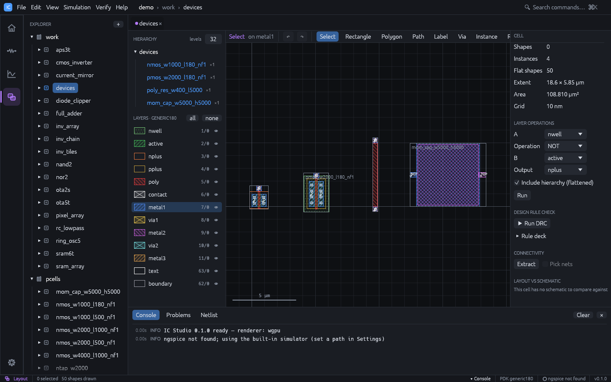

# PCells and custom devices



IC Studio has six built-in parametric cells (PCells). They are drawn by code from the
technology, so the same parameters give a correct device in generic180, SKY130 or any
other PDK. For devices the built-in PCells cannot draw (non-rectangular active, special
contact arrangements, bent or 45° gates), write a generator in SKILL: see
[Your own device generators](#your-own-device-generators).

## Built-in PCells

| Kind | Parameters | Defaults | Terminal labels | Draws |
|---|---|---|---|---|
| `nmos` | W, L, fingers, device | W 1 µm, L 0.18 µm, 1 finger | `S`, `D`, `G` | Active, poly fingers with a poly contact head, diffusion contact columns, n+ implant, PDK marker layers |
| `pmos` | W, L, fingers, device | W 2 µm, L 0.18 µm, 1 finger | `S`, `D`, `G` | As `nmos`, plus p+ implant and an nwell |
| `poly_res` | W, L | W 0.4 µm, L 5 µm | `A`, `B` | Poly body with a poly contact at each end, resistor marker layers |
| `mom_cap` | W, H | 5 µm x 5 µm | `BOT`, `TOP` | metal1 bottom plate and metal2 top plate with a tab each, capacitor marker layers |
| `ntap` | H | 1 µm | `B` | n+ tap in an nwell (PMOS bulk), one contact column wide |
| `ptap` | H | 1 µm | `B` | p+ substrate tap, one contact column wide |

- **W is per finger.** An `nmos` with W 1 µm and 2 fingers is two 1 µm transistors in
  parallel (total width 2 µm); fingers alternate S / D / S. Extraction reports one device
  per finger, and LVS merges parallel devices.
- **Device** appears when the technology is a PDK with several MOS devices of that polarity
  (for example low- and high-Vt variants). The PCell then draws that device's marker layers
  and the variant name ends with the device name. The default is the PDK's first device.
- Lengths snap to the technology grid. The origin is the lower-left corner of the active
  (MOS, taps), of the resistor body or of the bottom plate.
- `ntap` and `ptap` are not in the placement palette: schematic-driven layout creates them,
  and the MCP tool `place_pcell` accepts them.

## Placing and changing PCells

| Where | How |
|---|---|
| Layout editor | Press `I`, pick the PCell in the left panel, set its parameters, click to place |
| Inspector | Select a placed PCell, edit the parameters in the **PCell** section, press **Apply** |
| Schematic-driven layout | **Verify > Generate Layout from Schematic** places every MOS as a PCell sized from the schematic (see [Schematic-driven layout](schematic-driven-layout.md)) |
| Generators | **Layout Generators > Matched Placement** and **By Example** place PCell units (see [Tools](tools.md#layout-generators)) |
| MCP | `place_pcell` (see below) |

`place_pcell` takes sizes in µm:

```json
{
  "cell": "work/amp",
  "kind": "nmos",
  "params": { "w": 2, "l": 0.5, "fingers": 4 },
  "x": 0, "y": 0, "rot": 0,
  "name": "M1"
}
```

Name MOS instances after their schematic devices (`M1`) so that flylines and LVS can pair
them.

## How variants are stored

Each parameter set is generated once and stored as an ordinary cell in the `pcells`
library, named after its parameters in dbu:

| PCell | Variant name |
|---|---|
| `nmos` W 1 µm, L 0.18 µm, 2 fingers | `nmos_w1000_l180_nf2` |
| the same with PDK device `sky130_fd_pr__nfet_01v8_lvt` | `nmos_w1000_l180_nf2_sky130_fd_pr__nfet_01v8_lvt` |
| `poly_res` W 0.4 µm, L 5 µm | `poly_res_w400_l5000` |
| `mom_cap` 5 µm x 5 µm | `mom_cap_w5000_h5000` |
| `ntap` H 1 µm | `ntap_w1000` |

Placing the same parameters again reuses the variant. **Apply** in the inspector points the
instance at another variant; the old variant stays in `pcells` (delete it from the project
tree when nothing uses it).

A variant's `cell.json` keeps its parameters (`"pcell": {"kind": "mos", ...}`) next to the
layout, so hierarchy, GDS export, DRC and extraction treat it as a normal cell. When the
technology is replaced (**Tools > Load PDK**, `ics load-pdk`) every variant is regenerated
from its parameters, as long as the database unit stays the same. Do not edit a variant's
layout by hand: the edit is lost on the next regeneration. Copy it to another library
first, or write a generator.

## What the technology must provide

PCells draw only from the technology, so a new PDK needs these entries (see
[Technology](technology.md)):

| Entry | Used for |
|---|---|
| `roles`: `diffusion`, `tap`, `poly`, `nwell`, `nimplant`, `pimplant` | The layers each PCell draws |
| `roles`: `diff_contact`, `poly_contact` | The vias for S / D columns, tap contacts and poly heads |
| Layer `min_width`, `min_spacing`, `min_area` | Minimum W and L, contact plate size, gate-to-contact distance |
| `rules`: `gate_contact_space`, `poly_endcap`, `implant_enc`, `nwell_enc`, `marker_enc` | Spacings and enclosures inside the device |
| `[[device]]` `layers` | Marker layers of each MOS device |
| `[[resistor]]` / `[[capacitor]]` `layers` | Marker layers of `poly_res` (resistor on the poly layer) and `mom_cap` (capacitor between metal1 and metal2) |
| `[[pcell_layer]]` | Any further layer, drawn around `poly_contact`, `diff_contact`, `gate`, `diffusion`, `poly` or a named layer, optionally only for some `kinds` |

Parameters the technology cannot build are refused with a message such as
`width 150 is below the minimum 220 (active width / one contact)` or
`gate length 100 is below the poly minimum width 150`. The PDK tests check that every
PCell of SKY130 and IHP SG13G2 is DRC clean; do the same for a new PDK by placing each
PCell and running DRC.

## Device shapes extraction understands

Devices are recognised from geometry, not from the PCell parameters, so any layout that
draws a transistor the way the rules below expect is extracted and compared by LVS,
whether it came from a PCell, a SKILL script, GDS import or hand drawing.

| Shape | W and L |
|---|---|
| Rectangular gate on rectangular active | L across the gate between source and drain, W = area / L |
| Non-rectangular active (L-, U- or T-shaped) with straight gates | As above for each gate. One poly crossing both arms of a U makes two transistors with a shared gate |
| Bent gate (poly turning a corner over the channel, also U-shaped gates) | L = area / mean edge (the mean of the source and drain edge lengths); W = the mean edge, less a share of the corner squares set by `bend_corner` |
| Ring gate (enclosed layout transistor) | As a bent gate: W is the mean of the inner and outer perimeter |
| 45° or any-angle active or poly | As a bent gate, measured on the exact any-angle geometry |
| Instances rotated by 90° multiples or mirrored | As drawn |

A gate that is not a rectangle must split the diffusion into exactly two pieces (source and
drain); otherwise it is skipped with the warning
`gate ... does not separate two diffusion pieces`. For connectivity, any-angle shapes on
every layer are replaced by a staircase of narrow bands (a grid step, at least 10 dbu), so
wires and contacts on them connect as drawn; device sizes always use the exact geometry.

Resistors follow the same rules: an L-shaped or 45° resistor body must join exactly two
terminal pieces, and its squares are L / W measured like a bent gate. Capacitor areas and
perimeters near any-angle shapes are exact.

**Bend correction.** Counting each corner square of a bent gate fully (W = mean edge) is the
first-order estimate. Foundry decks often count a corner as about half a square; set
`bend_corner` in the PDK `[rules]` to match:

```toml
[rules]
bend_corner = 0.5   # 1 (default): W = mean edge; 0: W = the shorter (inner) edge
```

With 0.5, the L-shaped gate above (edges 2.82 and 3.18 µm, L 0.18 µm) has W = 2.91 µm.

**DRC** checks any-angle geometry too: near any-angle shapes, `width`, `space`, `separation`,
`enclosure` and `extension` are measured on the exact polygons, edge to edge in the
Euclidean metric, so a 45° wire at the minimum width and spacing is clean. Distances within
3/4 dbu of the limit pass (any-angle vertices are rounded to the grid), and acute corners
are reported. The other rules see the staircase (see [Verification](verification.md)).

The built-in PCells always draw rectangular active. For an L- or U-shaped device, use a
generator.

## Your own device generators

User-defined PCells (`pcDefinePCell`) are not supported. A SKILL procedure that writes one
cell per parameter set does the same job: run it with **Tools > Load SKILL (.il)**,
`ics skill` or the MCP tool `run_skill`, then place the generated cells with `I`
(**Place cell**) like any other cell.

This generator draws an NMOS whose active is L-shaped, with the source contact in a
narrow vertical arm (generic180 layer names):

```lisp
; NMOS with an L-shaped active: the source contact sits in a vertical arm.
procedure(nmosL(lib w l)
  let((name cv gx dx top)
    name = sprintf(nil "nmosL_w%d_l%d" round(w*1000) round(l*1000))
    cv = dbOpenCellViewByType(lib name "layout" "maskLayout" "w")
    gx = 1.0                     ; gate left edge
    dx = gx + l + 0.3            ; drain contact left edge
    top = w + 1.2                ; top of the source arm
    dbCreatePolygon(cv "active" list(0:0 dx+0.32:0 dx+0.32:w 0.42:w 0.42:top 0:top))
    dbCreateRect(cv "poly" list(gx:-0.25 gx+l:w+0.4))
    dbCreateRect(cv "nplus" list(-0.2:-0.4 dx+0.52:top+0.2))
    foreach(c list(list(0.1 top-0.32 "S") list(dx w/2-0.11 "D"))
      let((x y)
        x = car(c)  y = cadr(c)
        dbCreateRect(cv "contact" list(x:y x+0.22:y+0.22))
        dbCreateRect(cv "metal1" list(x-0.06:y-0.06 x+0.28:y+0.28))
        dbCreateLabel(cv "metal1" x+0.11:y+0.11 caddr(c) "centerCenter" "R0" "roman" 0.1)))
    dbCreateLabel(cv "poly" gx+l/2:w+0.3 "G" "centerCenter" "R0" "roman" 0.1)
    name))

foreach(p list(list(1.0 0.18) list(2.0 0.5))
  printf("%s\n" nmosL("mylib" car(p) cadr(p))))
```

```sh
ics skill myproj nmos_l.il
ics extract myproj mylib/nmosL_w1000_l180   # M1 D G S sub nmos w=1u l=0.18u
ics drc myproj mylib/nmosL_w1000_l180       # 0 violation(s)
```

Tips:

- Cell names allow letters, digits, `_` and `-`: encode sizes in nm (`w1000`), not `1.0`.
- Mode `"w"` clears the cell, so running the script again regenerates every variant.
- Label the terminals on a routing layer (`metal1`, `poly`): labels in a placed cell are
  local to it, but they name the nets inside the cell for LVS of the cell itself.
- In point lists, write a negative coordinate after another point in parentheses,
  `1.5:1.5 (-0.3):1.5`, or the minus is read as a subtraction.
- Read rules from your PDK rather than hard-coding them, and check each variant with
  `ics drc` and `ics extract`.

## Adding a built-in PCell kind

A new built-in kind is Rust code in `crates/ics-core/src/pcell.rs`:

1. Add a variant to `enum PCell` with its parameters in dbu.
2. Extend `kind_name`, `variant_name`, `summary` and `generate` (write a `gen_*` function
   that draws from the technology roles, vias and rules), and `defaults` if it belongs in
   the placement palette.
3. Add the parameter editor in `pcell_params` (`crates/ics-studio/src/layout_view/edit.rs`)
   and the kind in `pcell_from` and the `place_pcell` schema (`crates/ics-mcp/src/tools.rs`).
4. If extraction should recognise it as a new device type, extend `extract.rs` and `lvs.rs`.
5. Add tests: DRC clean in generic180 and in the PDK tests of `pdk.rs`, and extraction of
   the generated layout.
