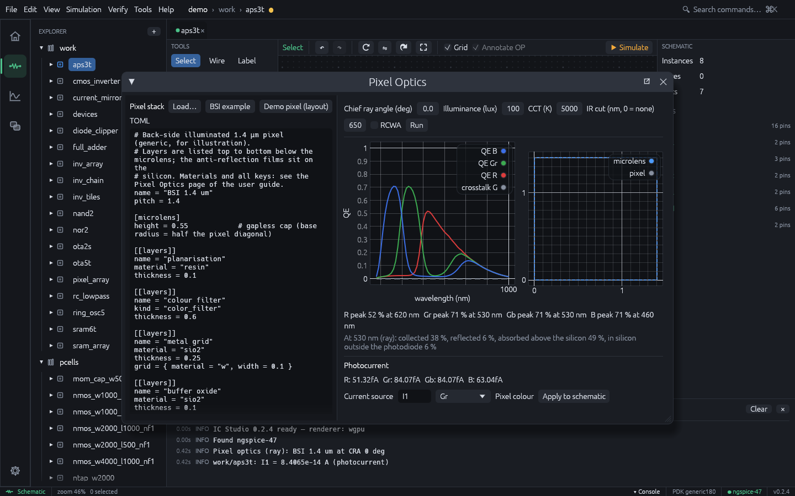
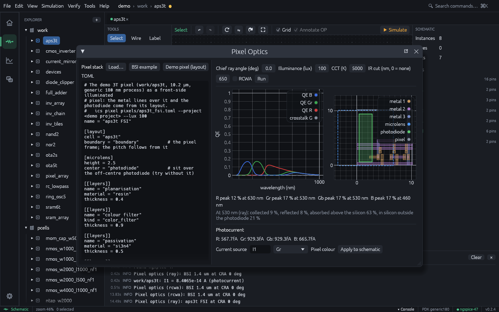
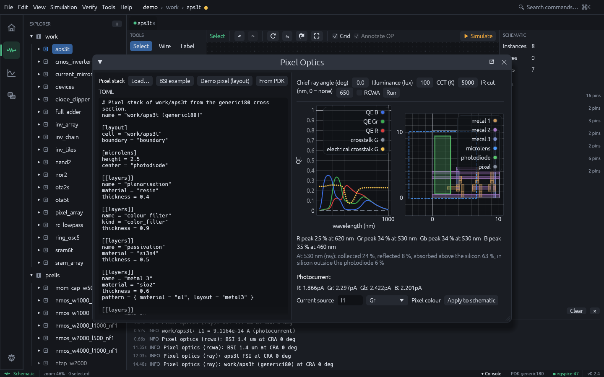
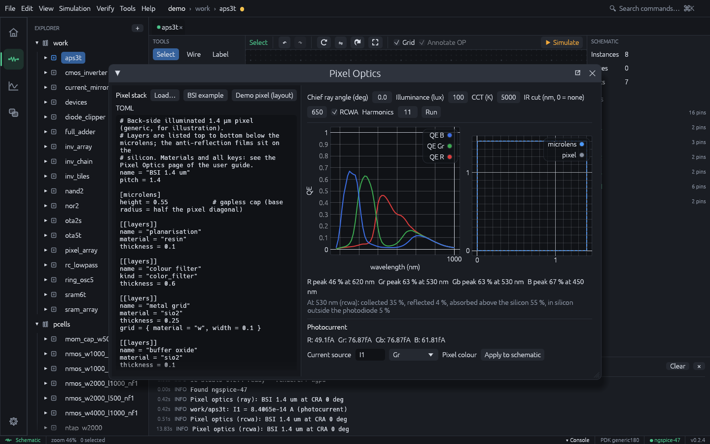
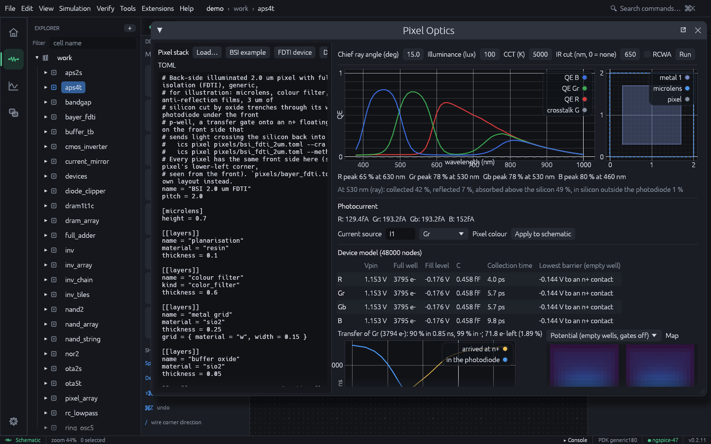

<!-- seo title="Image Sensor Pixel Optics: QE, Crosstalk, Photocurrent" description="Simulate an image sensor pixel stack in IC Studio: microlens, colour filters, metal grid and anti-reflection films give quantum efficiency, optical crosstalk at a chief ray angle, and the photocurrent of the pixel circuit." -->

# Pixel optics

IC Studio models the optics of an image sensor pixel from its stack: microlens, colour
filters, dielectrics and metal grid, anti-reflection films and the silicon photodiode. It
gives the quantum efficiency (QE) of each Bayer colour, the optical crosstalk at a chief ray
angle (CRA), where the light is lost, and the photocurrent for an illuminance, which goes
straight into the pixel circuit's simulation.



- GUI: **Simulation > Pixel Optics…** (or the command palette). Edit the stack, set the CRA
  and the illumination, **Run**, then **Apply to schematic** to write the photocurrent of a
  colour into a current source of the open cell (undoable).
- CLI: `ics pixel pixels/bsi_1p4um.toml --cra 20 --lux 100 --cct 5000`, with `--json` for
  the full result and `--set PROJECT CELL I1 --color Gr` to write the photocurrent into a
  current source. `--method rcwa [--harmonics 11]` selects the rigorous solver.

Example stacks ship in `pixels/`: a back-side illuminated 1.4 µm pixel, a front-side
illuminated 2.8 µm pixel with three metal levels, the demo 4T pixel read from its layout, a
2 µm BSI pixel with full-depth trenches and the [device model](#device-model)
(`bsi_fdti_2um.toml`), and the demo 2 × 2 Bayer cell `bayer_fdti` read from its layout.

## From the layout

A stack can take its pitch, metal patterns and photodiode from a pixel cell's layout:

```toml
[layout]
cell = "aps4t"
boundary = "boundary"                 # the pixel frame; the pitch follows from it

[microlens]
height = 2.5
center = "photodiode"                 # or offset = [dx, dy] in µm

[[layers]]
name = "metal 1"
material = "sio2"
thickness = 0.5
pattern = { material = "al", layout = "metal1" }

[photodiode]
top = 0.1
bottom = 3.0
layout = "active wide 1"   # the diffusion at least 1 µm wide (not the transistors)
```

`layout` takes a technology layer or a derived-layer expression of the DRC deck syntax
(`and`, `not`, `interact`, `inside`, `size`, ...). The shapes are clipped to the frame and
repeated in every pixel. Patterns can also be written directly as
`rects = [[x0, y0, x1, y1], ...]` (µm from the pixel's corner). The photodiode area limits
collection laterally; light absorbed beside it is reported as lost. `center = "photodiode"`
shifts each microlens over the photodiode's centre.

- CLI: `ics pixel pixels/aps4t_fsi.toml --project <project> --lux 100`
- GUI: **Demo pixel (layout)** in the Pixel Optics window reads the open project. The plan
  view shows the patterns, the photodiode and the lens.

On the demo pixel, whose photodiode sits at the edge of the 10.2 µm pixel, centring the
lens raises the green QE at 530 nm from 0.106 to 0.176.



## From the PDK cross section

A technology can describe its back-end cross section (`cross_section` in a
[PDK file](technology.md#pixel-cross-section); generic180 has one). The stack of a pixel cell
then follows from the PDK and the layout alone: the dielectric levels, the metals of each
level from their layout layers, the photodiode area, the colour filter, planarisation and
microlens, and the carrier diffusion in the silicon.

- CLI: `ics pixel --project <project> --cell aps4t --lux 100`, or `--emit-stack` to print the
  generated stack and edit it.
- GUI: **From PDK** in the Pixel Optics window (or **Pixel stack of the open cell from the PDK
  cross section** in the command palette) writes the open cell's stack into the editor.



## Two solvers

- **Ray** (default): geometric rays with thin-film optics on the silicon. Fast (under a
  second), gives per-lens optical crosstalk and a detailed light budget. Accurate while the
  pitch is well above the wavelength.
- **RCWA** (rigorous coupled-wave analysis): solves Maxwell's equations over the 2 × 2 Bayer
  cell, so it includes diffraction, interference in every layer and the near field of the
  grid; use it for pixels around 1.5 µm and below. The microlens is staircased in 8 slices.
  Accuracy grows with the harmonics per direction (`--harmonics`, the **Harmonics** field):
  for the 1.4 µm example the green QE at 550 nm is 0.589, 0.596, 0.592 and 0.594 for 9, 11,
  15 and 19 harmonics. 11 harmonics over 63 wavelengths take about 8 s on 10 cores. In-plane
  permittivities follow Li's factorisation rules, so metal patterns converge; a pattern needs
  enough harmonics to resolve its smallest opening against the 2 × 2 cell. RCWA reports no
  per-lens crosstalk, and absorption above the silicon is one figure.

The solvers agree exactly without patterned layers (both reduce to thin-film optics); on the
1.4 µm example the ray model gives a green peak of 0.71 and RCWA 0.61, the difference being
diffraction and interference at that pitch.



### Convergence and ray versus RCWA

RCWA converges with the harmonics; the number needed grows with the Bayer cell. Green /
blue / red QE of their own pixels:

| Pixel | Harmonics | 450 nm B | 550 nm Gr | 650 nm R | 750 nm R | 850 nm R | Time (5 wavelengths) |
|---|---|---|---|---|---|---|---|
| `bsi_fdti_2um` (4.0 µm cell) | 7 | 0.51 | 0.54 | 0.37 | 0.19 | 0.11 | 3 s |
| | 11 | 0.73 | 0.71 | 0.51 | 0.29 | 0.13 | 5 s |
| | 15 | 0.76 | 0.71 | 0.51 | 0.29 | 0.14 | 15 s |
| | 19 | 0.75 | 0.72 | 0.51 | 0.30 | 0.15 | 51 s |
| `bayer_fdti` (4.8 µm cell) | 11 | 0.69 | 0.64 | 0.45 | 0.26 | 0.13 | 8 s |
| | 15 | 0.74 | 0.67 | 0.46 | 0.24 | 0.14 | 18 s |
| | 19 | 0.75 | 0.68 | 0.47 | 0.24 | 0.15 | 58 s |
| | 23 | 0.75 | 0.68 | 0.48 | 0.25 | 0.16 | 180 s |

Without `--harmonics`, `ics pixel --method rcwa` takes about 3.8 per µm of the cell (odd, at
least 11: 11 for 1.4 µm pixels, 17 for 2.0 µm, 19 for 2.4 µm), which keeps QE within about
0.01 of the converged value; the window shows that number when its Harmonics field is lower.

The ray model runs in seconds but, at these pitches, overestimates: on `bsi_fdti_2um` (CRA 0)
it gives blue 0.80, green 0.79, red 0.66 at 650 nm and 0.43 at 750 nm against RCWA's 0.76,
0.71, 0.51 and 0.29; on `bayer_fdti` it is 0.05 - 0.10 high from 450 to 750 nm. Geometric
rays focus every lens perfectly through the grid's openings, while diffraction spreads the
light onto the tungsten grid and the trench tops, and the ray model misses the interference in
the stack. Use rays to explore a design and RCWA for its figures. Both solvers are checked
against thin-film optics (stacks without patterns, and a finite absorbing silicon: reflectance,
transmittance and absorption within 2e-4) and for energy conservation in silicon cut by
trenches (within 0.5 %). They are not yet calibrated against measured pixels: the colour
filters are generic absorption curves.

## Carrier collection and electrical crosstalk

Without a `[silicon]` section, carriers count when they are generated inside the photodiode's
box (its area and depth range). With one, they diffuse:

```toml
[silicon]
diffusion_length = 20     # µm, minority carriers in the neutral silicon
epi = 4.0                 # epitaxial layer: carriers reaching its bottom are lost
surface = "reflecting"    # or "recombining"
dti = { depth = 2.0, width = 0.1 }   # deep trench isolation on the pixel boundaries
# grid = 0.08             # voxel size (µm); default about pitch / 16
```

Each photodiode's collection probability P(r) solves the diffusion equation ∇²P − P/L² = 0
over the 2 × 2 cell (P = 1 in its depletion region, 0 in the other photodiodes', 0 at the
epi bottom, no flux through the trenches), and its signal is the optical generation G(r)
weighted by P, by reciprocity. Both solvers deliver G on the voxel grid. QE then includes the
carriers that diffuse in from beside and below the photodiode, and the **electrical
crosstalk** is reported per colour: of the carriers generated under a pixel and collected,
the fraction a neighbour collects. It grows with wavelength, as red and near-infrared light
is absorbed deep where carriers spread; trenches cut it.

With a very short diffusion length the model gives the box result again (checked in the
tests for both solvers).

## Back-side illumination and deep trenches

A back-side illuminated (BSI) pixel has a thinned silicon: set `[silicon] thickness`. Light
that crosses it leaves through its far side into the `[[front]]` layers (the front side's
dielectrics and the metal patterns of the transistors' wiring, top to bottom, over the
`carrier` medium, default `sio2`), and what they reflect comes back into the silicon. Deep
trench isolation (`dti`) is optical as well as electrical: its fill (default `sio2`) cuts the
silicon, light reflects off the walls (total internal reflection, frustrated through thin
trenches) and stays in its pixel. `depth` at least the thickness makes a full-depth trench
(FDTI); `side = "front"` etches it from the far side.

```toml
[silicon]
thickness = 3.0
dti = { depth = 3.0, width = 0.15, fill = "sio2" }

[[front]]
name = "metal 1"
material = "sio2"
thickness = 0.2
pattern = { material = "al", layout = "metal1" }
```

- **Ray model**: rays in the silicon follow their path off the trench walls (the reflectance
  of silicon | fill | silicon at each angle), the far side (reflectance into the front layers,
  over metal where the layout has it) and back to the illuminated surface (through the
  anti-reflection films). The budget's `transmitted` is the light that goes into the front side.
- **RCWA**: the silicon becomes layers of the structure, the trenches a pattern in them, and
  the power absorbed in each voxel comes from the fields inside (rebuilt from the layer modes
  and scaled, slice by slice, to the exact drop of the power flux). The front layers and their
  metal patterns follow, over the carrier.

At a 30° chief ray angle, the 2 µm example (`pixels/bsi_fdti_2um.toml`) collects 6 % of
620 nm and 15 % of 850 nm light in the wrong pixel without trenches, none with full-depth
ones; the electrical crosstalk goes to zero too.

A stack can read a whole 2 × 2 Bayer cell, each pixel with its own layout (a 4-shared pixel):
`[layout] bayer = true`. The frame is then the cell, the pitch half of it, and shapes keep their
place in the cell (`pixels/bayer_fdti.toml` reads the demo cell `bayer_fdti`).

## Device model

With a `[device]` section the silicon is solved as a semiconductor device on the voxel grid of
the 2 × 2 cell (`ics_optics::device`): the doping from implants, the electrostatic potential
from Poisson's equation, and the electrons' drift and diffusion.

- **Doping**: `[[device.doping]]` implants, Gaussian in depth (`peak` cm⁻³, `depth`, `straggle`)
  with a Gaussian spread at the mask's edges (`lateral`), from the `front` (the transistors'
  side: the far side of a BSI silicon), the `back` (the illuminated surface) or along the
  trench walls (`side = "dti"`, `depth` = distance from the wall). Masks are `rects` or a
  `layout` layer / derived-layer expression. `photodiode = true` marks the storage wells (one
  per pixel); `contact = V` makes an n+ region an ohmic contact at that voltage (floating
  diffusions after reset, sources and drains). `background` is the epi doping.
- **Gates**: `[[device.gate]]` on the front surface with their `oxide`, `off` and `on`
  voltages (transfer gates).
- **Potential**: holes stay at the grounded p regions' level, electrons at their contact's
  voltage or their well's fill level; damped Newton on finite volumes.
- **Collection**: by reciprocity, the probability that an electron generated at a point ends
  in each photodiode solves the adjoint of the electron continuity equation with
  Scharfetter-Gummel fluxes: carriers drift down the potential into the wells and diffuse,
  recombine (SRH, doping-dependent `lifetime`, `surface_recombination` on the surfaces and
  walls) and are lost to n+ regions. QE and electrical crosstalk follow, and the mean
  collection time (first-passage time) per colour and wavelength.
- **Wells**: the pinning voltage (the empty well's potential), the full well (electrons held
  when the fill level reaches the lowest barrier to another sink, found as the best path
  through the potential), the storage capacitance and the barrier's place. With each pixel's
  gates on, the lowest point on the way out shows a transfer barrier (lag) before running it.
- **Charge transfer** (`transfer = { pixel = "Gr", on_time = 20, settle = 5 }`, or `ics pixel
  --transfer Gr`): a full well, the gates on and off again, Poisson and the continuity
  equation in time; electrons left in the well are the lag.

```text
$ ics pixel pixels/bsi_fdti_2um.toml --cra 15
device model (48000 nodes): drift-diffusion collection, photodiode wells
       Vpin (V)   full well  level (V)    C (fF) t_coll (ps)  lowest barrier (empty well)
  R       1.153      3795 e     -0.176     0.458         4.0  -0.144 V to an n+ contact
  ...
  transfer of Gr (3794 e): 90 % in 0.85 ns, 99 % in -, 71.8 e left in the photodiode (1.892 %)
```

**Into the circuit simulation.** `ics pixel <stack> --project <project> --apply` (or **Apply to
technology** in the window) writes the photodiodes' mean pinning voltage and storage
capacitance into the technology's photodiode (`pinning`, `cap_area` per area of its photodiode
layer), which the pinned photodiode of `ics extract --pixel --characterize` and the Pixel
Circuit window use. On `bayer_fdti` with its 2.8 V supply (`--vdd 2.8`) the circuit model then
gives a full well of 8238 e-, against 8057 e- from the device model.

The GUI shows the wells, the transfer and maps (potential, doping, collection probability and
time, generation at 450 / 530 / 620 / 850 nm) under the QE; **FDTI device** loads the example.



The model is first order: no velocity saturation or field-dependent mobility, holes in
equilibrium, Boltzmann statistics, no interface charge or STI, gates over the front surface
voxels only, contacts as ideal n+ conductors (a floating diffusion does not fall as it fills).
The grid (`grid`, default the `[silicon]` grid) should resolve the transfer gate: a gate of a few
voxels shows barriers that a finer grid lowers.

## Microlens shape

The default lens is a spherical cap of height h over a base of radius a (default p/√2, through
the pixel's corners), with sphere radius R = (a² + h²) / 2h. Reflowed and etched lenses are
usually squarer than a circle in plan and not spherical in section; for those,
`shape = "superellipse"` takes a superellipse footprint with a power-law sag:

    ρ(x, y) = (|x/Rx|^n + |y/Ry|^n)^(1/n)
    z(x, y) = h · max(0, 1 − ρ^α)

with x, y from the lens centre. `n` (≥ 1, default 2) sets the plan: 2 is an ellipse, 4 a
rounded square, large n a rectangle. `alpha` (> 0, default 2) sets the section: 2 is a
paraboloid (close to a shallow sphere), 1 a cone, above 2 a flatter top with steeper sides; the
sides meet the base at a slope h·α/R, not vertically. `radius` is Rx and `radius_y` Ry (default
Rx); the default Rx = 2^(1/n)·p/2 puts the footprint through the pixel's corners, gapless. Every
lens is cut at its pixel's edges; for identical lenses on the pixel grid this is the same as
the taller of overlapping lenses, so a lens wider than the pixel meets its neighbours in a
valley. The CLI prints the lens and its fill factor (the pixel's area under a lens).

The ray model finds a ray's hit on the surface by stepping down from the lenses' top (256 steps)
and bisecting, and refracts it about the normal from the analytic gradient. RCWA staircases the
same height in its 8 slices. On `pixels/bsi_1p4um.toml` (green, 540 nm, QE):

| Lens | ray, 0° | RCWA, 0° | ray, 25° | RCWA, 25° |
|---|---|---|---|---|
| sphere | 0.750 | 0.665 | 0.634 | 0.543 |
| n = 2, α = 2 | 0.750 | 0.671 | 0.679 | 0.554 |
| n = 4, α = 2 | 0.748 | 0.694 | 0.646 | 0.558 |
| n = 4, α = 1.5 | 0.749 | 0.674 | 0.645 | 0.562 |
| n = 4, α = 3 | 0.745 | 0.710 | 0.630 | 0.544 |

At normal incidence the ray model hardly sees the shape (every lens focuses clear of the grid),
while RCWA reads up to 0.045 more for the squarer, flatter lenses, which leave no flat corners to
scatter from. Fit `lens_shape` against measured QE with `--method rcwa`.

## The ray model

Rays start uniformly over one 2 × 2 Bayer cell of an infinite array, as a plane wave at the
chief ray angle. Each ray

1. refracts at its pixel's microlens (a spherical cap or a superellipsoid; between lenses it
   falls onto the lens base),
2. passes the thick layers top to bottom, refracting at each interface and losing the
   Fresnel reflection; in the colour filter it is absorbed according to the filter it is in
   at each depth, so light crossing into a neighbour's filter is filtered by that filter;
   metal grid lines stop it,
3. enters silicon with the transmission of the anti-reflection films at its angle (coherent
   thin-film optics, s and p averaged),
4. is absorbed along its path in silicon. Carriers generated between the photodiode's top
   and bottom depth count for the pixel above the point of generation.

QE is carriers collected per photon incident on the pixel. Crosstalk is the fraction of the
light entering through a pixel's microlens that another pixel collects. The budget splits the
light into reflected, absorbed in the colour filter, metal, other layers, silicon above the
photodiode, collected, and silicon below it (or transmitted).

Limits of the ray model: geometric optics, so no diffraction (use RCWA for small pitches),
no reflections back up from the grid or the silicon's surface, no interference inside the thick
layers. With a `[silicon]` section the rays in the silicon follow the walls and surfaces as
described above.

## Stack file

```toml
name = "BSI 1.4 um"
pitch = 1.4                    # µm

[microlens]
height = 0.55                  # cap height
# radius = 0.99                # base radius; default half the pixel diagonal (gapless)
# material = "resin"
# shape = "superellipse"       # instead of a spherical cap; see "Microlens shape"
# n = 4                        # footprint exponent (2 ellipse, large = rectangle)
# alpha = 2                    # sag exponent, z = h (1 - rho^alpha) (2 paraboloid, > 2 flatter)
# radius_y = 0.83              # Ry; default radius (Rx)

[[layers]]                     # thick layers below the lens, top to bottom
name = "colour filter"
kind = "color_filter"          # takes each pixel's filter
thickness = 0.6

[[layers]]
name = "metal grid"
material = "sio2"
thickness = 0.25
grid = { material = "w", width = 0.1 }   # lines centred on the pixel boundaries

[[arc]]                        # thin films on the silicon, top to bottom
material = "ta2o5"
thickness = 0.055

[photodiode]
top = 0.05                     # collection depth below the surface (µm)
bottom = 3.0

[color_filters]                # optional: own filter materials
# red = "my_red"

[materials.my_red]             # optional: own materials
# n = 1.6, k = 0.0, or a table of [wavelength µm, n, k] rows:
# table = [[0.40, 1.62, 0.30], [0.60, 1.60, 0.002], [0.80, 1.59, 0.0]]
```

`ambient` sets the medium above the lens (default `air`).

## Materials

| Name | Data |
|---|---|
| `si` | crystalline silicon at 300 K, M. A. Green (2008) |
| `sio2` | fused silica, I. H. Malitson (1965) |
| `si3n4` | K. Luke et al. (2015) |
| `hfo2` | M. F. Al-Kuhaili (2004) |
| `ta2o5` | L. Gao et al. (2012) |
| `w`, `al` | A. D. Rakić et al. (1998) |
| `resin` | generic microlens resin, n = 1.55 + 0.005/λ² |
| `cf_red`, `cf_green`, `cf_blue` | generic pigment filters (passbands with a few % leakage, transparent in the near infrared) |
| `air` | 1 |

Tabulated data come from the refractiveindex.info database (public domain), 0.30 - 1.20 µm.
The colour filters are generic shapes, not a vendor's dyes: use measured `n, k` of your filter
materials for real designs.

## Calibration against measured QE

A measured QE table compares with the model and calibrates it. The table is CSV: a wavelength
column (`wavelength`, `nm` or `lambda`; nm, or µm when all values are below 10) and any of `R`,
`Gr`, `Gb`, `B` (or `G` for both greens), as fractions or percent; `#` starts a comment.

- CLI: `ics pixel <stack> --measured qe.csv` prints the RMS difference per colour;
  `--fit cf,cf_thickness` fits parameters of the stack to it (`--fit-evals`, default 200
  model runs) and reports the rest (QE table, photocurrent, device model, `--json` under
  `calibration`) for the fitted stack. `--write-stack fitted.toml` writes the stack file with
  the fitted values (comments and layout kept), `--compare-csv cmp.csv` the measured QE and the
  model before and after per wavelength, for plotting.
- GUI: **Measured QE…** under the plot shows the table as points with its RMS difference;
  **Fit** fits the listed parameters on a worker thread and plots the fitted stack; **Write into
  the stack** puts the fitted values into the stack text.

| Parameter | Changes | Range |
|---|---|---|
| `cf_red`, `cf_green`, `cf_blue` (`cf` = all three) | a filter's pigment density: its absorption k (`[color_filters] density`) | × 0.2 - 5 |
| `cf_density` | the three densities by one factor | × 0.2 - 5 |
| `cf_thickness` | the colour filter layers' thickness | × 0.5 - 1.5 |
| `arc` | the anti-reflection films' thickness | × 0.5 - 1.5 |
| `si_thickness` | a thinned silicon's thickness (and a full-depth trench with it) | × 0.7 - 1.3 |
| `lens` | the microlens height | × 0.5 - 1.5 |
| `lens_n`, `lens_alpha` (`lens_shape` = both) | a superellipse microlens's exponents n and α, at its fitted size (the written stack gets `radius` too) | × 0.5 - 4 (n at least 1), × 0.33 - 3 |
| `qe_scale` | not the stack: a factor on the model's QE against the measurement, for an error of its absolute calibration | × 0.7 - 1.3 |

With `--method rcwa` the fit runs in two stages: the ray model fits first (fast), then RCWA
refines from there with a third of the runs on at most 15 of the measured wavelengths, and
the result is judged on all of them. Use it for pixels near the wavelength in size, where the
ray model reads 0.05 - 0.15 high (see above): fitted with rays alone, the stack's parameters
(and a `qe_scale`) bend to hide that bias. A parameter that ends at its bound is reported as a
warning: the stack probably lacks something the measurement shows.

The fit is Nelder-Mead on the factors' logarithms, with the RMS difference over all measured
colours and wavelengths as its objective, run with the chosen solver (rays by default: RCWA fits
are slow). The carrier and device models are solved once, unless `si_thickness` is fitted.
A filter's absorption goes with density × thickness, so fitting both mostly fixes their
product. `pixels/bsi_1p4um_synthetic_qe.csv` is a synthetic table (not a measurement: the 1.4 µm
stack with other filter densities and a thinner filter layer, plus a small ripple); fitting
`cf,cf_thickness` brings the RMS difference from 0.031 to 0.0035, the ripple's size, in 78 runs
and recovers the density × thickness products within 0.01.

### With your measurement

`pixels/measured_qe_template.csv` is the table's template. A calibration then goes:

1. Match the conditions: the stack as built (thicknesses from the process, the CF materials'
   n, k if you have them, `[materials.name]`), `--cra` as measured, the IR-cut filter as in the
   measurement (the stack has none; `--ir-cut` only affects the photocurrent).
2. Look first: `ics pixel stack.toml --measured qe.csv --compare-csv cmp.csv`. A gap of the same
   ratio at every wavelength is the measurement's scale (or the fill of the light); a shifted or
   wider passband is the filters; ripples are the films; red / NIR too low or high is the silicon.
3. Fit what the look suggests, few at a time: `--fit qe_scale,cf` with rays, then add
   `cf_thickness`, `arc`, `si_thickness` as the curves need, and finish with `--method rcwa`.
   Watch the warnings (parameters at their bounds) and the per-colour RMS.
4. Keep it: `--write-stack calibrated.toml`, then use the calibrated stack for the photocurrent
   (`--lux`, `--set`) and, with a device model, `--apply` into the technology.

## Photocurrent

The illuminant is a blackbody at the colour temperature, scaled to the illuminance at the
pixel with the CIE 1924 photopic curve; light above the IR-cut edge (default 650 nm, 0 for
none) is removed. The photocurrent of a pixel is q ∫ QE(λ) E(λ) λ / (hc) dλ times its area.
