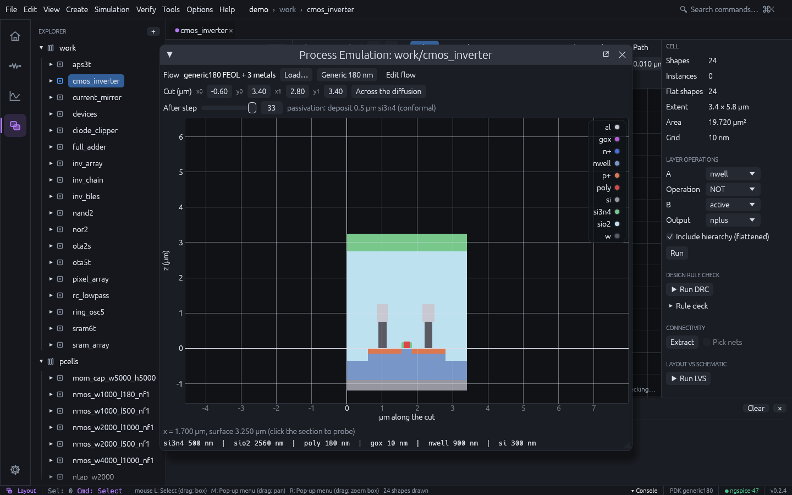
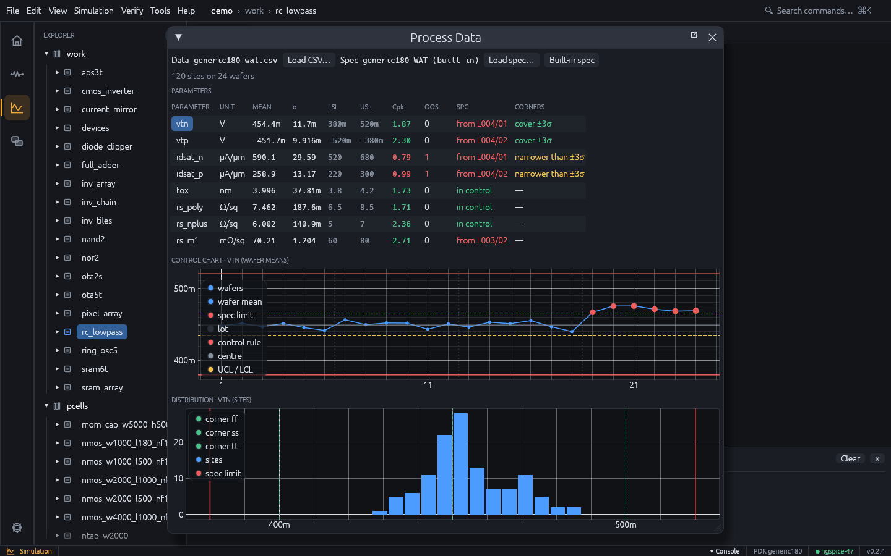
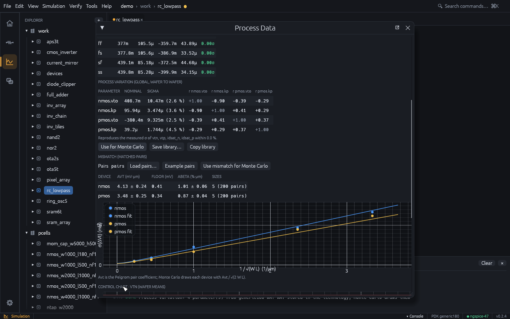

<!-- seo title="Process Emulation: Cross-Sections from Layout and Process Flow" description="IC Studio builds the cross-section of a layout along a cut line by running a process flow: deposition, etching, implantation, diffusion, oxidation and CMP on a 2-D grid." -->

# Process emulation and process data



The process emulator builds the cross-section of a layout along a cut line by running a
process flow step by step on a 2-D grid of material cells: x along the cut, z up, 0 at the
original silicon surface. Masks are layout layers or derived-layer expressions. Use it to
check what a layout becomes in silicon (STI next to a contact, a via landing on metal,
spacer and implant overlap, junction depths and how far source and drain reach under a
gate), to explain a process to a design team, or to make the dielectric and metal stack of
a [pixel](pixel-optics.md) or a parasitic model.

- GUI: **Tools > Process Emulation** for the open layout. Set the cut (µm, layout
  coordinates; **Across the diffusion** cuts horizontally through the largest diffusion
  area), move **After step** to see the wafer after any step, and click the section to list
  the material stack at that point. With dopants in the flow, **Doping** colours silicon and
  poly by net doping (red n-type, blue p-type, darker with the concentration, junctions as
  dark lines). The plot beside the section is the dopant profile at the probe, and the lines
  below it list the doped layers and the junction depths. **Edit flow** edits the flow,
  **Load...** reads a flow file.
- CLI: `ics xsection <project> <cell> [--flow FILE] [--cut x0,y0,x1,y1] [--steps N] [--at X]... [--svg FILE] [--profile CSV] [--json]`
- MCP: `process_cross_section`

```text
$ ics xsection myproj cmos_inverter --at 1.7 --svg inv.svg
work/cmos_inverter: generic180 FEOL + 3 metals along (-0.600, 3.400) - (2.800, 3.400), 3.400 µm, 36 of 36 steps, 680 x 1474 cells in 1.43 s
after: passivation: deposit 0.5 µm si3n4 (conformal)
  x =   1.700  surface  3.250  si 1.195 | gox 0.010 | poly 0.180 | sio2 2.565 | si3n4 0.500
                       doping  p poly 0.185..0.005 peak 5.8e20 45.76 Ω/sq | n si -0.005..-0.985 peak 4.6e17 649.6 Ω/sq | p si -0.985..-1.200 peak 9.9e14 811.5k Ω/sq
```

At x = 1.7 µm the cut crosses the PMOS gate: p+ poly, then the n-well channel down to the
well junction at 0.985 µm, then the p substrate. In the source and drain the p+ junction is
0.14 µm deep with 46 Ω/□. `--profile FILE` writes the concentration of every species
against depth at the first `--at` position as CSV, for comparison with SIMS data.

## Process flow

A flow is a TOML file; `process/generic180.toml` is the generic 180 nm flow:

- STI;
- n-well and p-well implants with a drive-in;
- thermal gate oxide and poly;
- nitride spacers;
- arsenic and BF₂ source/drain implants with an RTA;
- tungsten contacts and vias;
- three aluminium metals;
- passivation.

```toml
name = "my flow"
substrate = "si"
substrate_depth = 1.2      # µm of substrate shown
resolution = 0.005         # grid step (µm)
colors = { gox = "#c080ff" }
substrate_doping = { species = "boron", concentration = 1e15 }   # cm⁻³
semiconductors = ["si", "poly"]   # materials that hold dopants (the default)

[[step]]
name = "STI etch"
op = "etch"
keep = "active"            # etched where active is not drawn
materials = ["si"]
depth = 0.35
```

| `op` | Keys | Effect |
|---|---|---|
| `deposit` | `material`, `thickness`, `conformal` | Add a layer on top of every column, or conformally (also on sidewalls and under overhangs; trenches narrower than twice the thickness close, leaving seams) |
| `etch` | `mask` / `keep`, `materials`, `depth`, `isotropic` | Remove the listed materials where the mask is open: anisotropically from the surface down by `depth` (without a depth, until another material), or isotropically within `depth` of the opening (undercut) |
| `implant` | `mask` / `keep`, `species`, `dose`, `energy` | Add a Gaussian dopant profile (`dose` cm⁻², `energy` keV; `boron`, `bf2`, `phosphorus`, `arsenic`, `antimony`) below the surface. Whatever lies on top stops ions like silicon, so a gate masks its channel (and is doped itself) and spacers offset the implant from the gate |
| `implant` | `mask` / `keep`, `material`, `into`, `depth` | Geometric form, combinable with the doping form: turn the `into` materials within `depth` below the surface into `material` |
| `anneal` | `temperature` (°C), `time` (minutes) | Diffuse every dopant within the semiconductors |
| `oxidize` | `temperature`, `time`, `wet`, `material` | Thermal oxide (Deal-Grove, (100) silicon, dry or `wet`) where silicon or poly lies under oxide or air only: nitride masks it, existing oxide slows it, 44 % of the new oxide is consumed silicon. Dopants diffuse for the same time |
| `planarize` | `height` or `stop` | Remove everything above a height, or above the highest point of a material (CMP) |
| `strip` | `material` | Remove a material everywhere (resist) |

`mask` is a layer or derived-layer expression where the step acts (`nplus and active`);
`keep` acts where the expression is not drawn (for etching drawn features out of a blanket
film). Without either, the step acts everywhere. Each step may have a `name`.

Conformal deposition and isotropic etching use the exact Euclidean distance transform of
the grid, so corners round and spacers form from the geometry; a spacer is a conformal
deposition followed by an anisotropic blanket etch of the same thickness.

### Doping

Dopants live in the semiconductor cells: the substrate, the `semiconductors` of the flow and
what geometric implants make of them. Etching or oxidising a cell removes its dopants.

- **Implants.** The profile is Gaussian. The projected range Rp and straggle ΔRp in silicon
  come from LSS / Gibbons tables, and the lateral straggle is 0.8 ΔRp. BF₂ carries 11/49 of
  its energy on the boron.
- **Diffusion.** Diffusion is intrinsic, `D = D0 exp(−Ea/kT)` per species. It is solved in 2-D
  with no flux out of the semiconductors (so not through the gate oxide), by up to 100
  backward-Euler steps per anneal.
- **Sheet resistance.** Each doped layer's sheet resistance uses Caughey-Thomas mobility at
  300 K.

The junction depth of an arsenic implant (5e15 cm⁻², 40 keV, 10 minutes at 1000 °C) is
within 6 nm of the analytic Gaussian. Lateral straggle and diffusion take the junction
about 76 nm under the gate edge. Both are unit tests.

Limits: the doping models are first-order. There is no transient enhanced, oxidation
enhanced or concentration-dependent diffusion, no segregation at interfaces, and no
channelling. Real junctions after an RTA come out deeper than the emulated ones. Oxidation
is vertical only (no bird's beak). Also missing are stress, topography effects of CMP, and
3-D effects across the cut.

### Pinned photodiode

`--pinned-pd X` analyses the column at X (µm along the cut) as a pinned photodiode: the
buried n region between the p+ pinning layer and the p region below, fully depleted. Solving
Poisson's equation in the depletion approximation for edges where the charge balances and
both p sides sit at 0 V gives the **pinning voltage** (the potential maximum) and the
**storage capacitance** per area (the two depletion layers in parallel at full depletion).
`--apply` writes both into the technology's photodiode (`pinning`, `cap_area`), which the
pixel characterisation then simulates (see
[Photodiodes and pixels](verification.md#photodiodes-and-pixels-image-sensors)).
`process/generic180_ppd.toml` is the generic flow with such a photodiode under the demo
pixels' wide diffusion (kept out of the p-well and the n+ implant):

```bash
ics xsection demo aps4t --flow process/generic180_ppd.toml --cut 0,1.5,5.6,1.5 --pinned-pd 2.8 --apply
# pinning 1.126 V, storage capacitance 0.3754 fF/µm^2
ics extract demo aps4t --pixel --characterize            # 1.8 V: FD resets below Vpin, lag
ics extract demo aps4t --pixel --characterize --vdd 3.3  # complete transfer
```

A mask can be a sequence of definitions separated by `;`, the last one the mask:
`pd = active wide 1; nplus not pd`.

## Process data



**Tools > Process Data** sets wafer acceptance test (WAT, PCM, e-test) results against the
process specification. It answers three questions: is the process capable (Cp, Cpk against
the spec limits), is it in control (control charts of the wafer means), and do the model
corners cover what silicon does?

- **Data**: CSV with `lot`, `wafer` and `site` columns (any may be missing) and one column per
  parameter, one row per measured site in time order. `#` lines are comments.
- **Spec** (TOML): every parameter with `unit`, `description`, `target`, `lsl`, `usl` and the
  value of each model corner. `baseline_wafers` sets how many wafers at the start of the
  data set the control limits (0 = all). `process/generic180_wat.toml` is the built-in spec
  of the generic 180 nm technology:

```toml
name = "generic180 WAT"
baseline_wafers = 12

[[param]]
name = "vtn"
unit = "V"
description = "NMOS threshold voltage, W/L = 10/0.18 µm"
target = 0.45
lsl = 0.38
usl = 0.52
corners = { ff = 0.40, tt = 0.45, ss = 0.50 }
```

The parameter table lists mean, σ, the spec limits, **Cpk** (green from 1.33, amber from 1,
red below), out-of-spec sites (**OOS**), the first control alarm (**SPC**) and whether the
corners span the measured ±3σ (**CORNERS**). Select a parameter for its control chart
(individuals chart of the wafer means, centre and 3σ limits from the moving range of the
baseline, spec limits, lot boundaries, alarms in red) and its distribution with the spec
limits and corners.

Alarms follow the Western Electric rules: (1) a point beyond 3σ, (2) two of three beyond 2σ
on one side, (3) four of five beyond 1σ on one side, (4) eight in a row on one side of the
centre. When the corners are narrower than ±3σ of silicon, designs verified at the corners
can still fail on real wafers: widen the corner models or tighten the process.

`process/generic180_wat.csv` is synthetic example data (4 lots of 6 wafers, 5 sites each)
whose last lot has a threshold shift:

```text
$ ics process-data process/generic180_wat.csv
process/generic180_wat.csv: 120 sites on 24 wafers against generic180 WAT
  param        unit        mean      sigma     Cp    Cpk   OOS  corners
  vtn             V      454.4m      11.7m   1.99   1.87     0  cover ±3σ
  idsat_n     µA/µm       590.1      29.59   0.90   0.79     1  NARROWER than ±3σ (ff +2.4σ, ss -1.7σ, tt +0.3σ)
  ...
  SPC vtn: out of control from lot L004 wafer 01 (beyond the 3σ control limits (+3.5σ)), 6 wafer(s) flagged, rules 1, 2, 3
  correlated: vtn / idsat_n  r = -0.96
```

`ics process-data <CSV> [--spec FILE] [--json]` exits with 1 on out-of-spec sites or alarms;
the MCP tool `process_data` returns the same summary.

## Corner models from silicon


When the corners do not cover silicon, or the models do not match it at all, fit new ones. Give
the parameters of the spec a `measure`, a test-structure netlist with the analysis and the
expression that gives the parameter, and add an `[extraction]` section with the model
parameters to fit (the knobs) and the corners:

```toml
[[param]]
name = "idsat_n"
unit = "µA/µm"
# ...
measure = { analysis = "op", expr = "-i(vd) * 1e5", netlist = """
VG g 0 DC 1.8
VD d 0 DC 1.8
M1 d g 0 0 nmos w=10u l=0.18u
.op
""" }

[extraction]
knobs = [
  { target = "model:nmos.vto", min = "0.2", max = "0.8" },
  { target = "model:nmos.kp", min = "20u", max = "500u", log = true },
]

[extraction.corners]
ff = { idsat_n = 3.0, idsat_p = 3.0 }
ss = { idsat_n = -3.0, idsat_p = -3.0 }
```

The netlists get the technology's models; knobs are `model:NAME.PARAM` (binned cards
included). The nominal `tt` is fitted to the means of the measured parameters. In a corner,
the primary parameters go to mean + zσ and every other measured parameter to its mean given
the primaries (linear regression over the sites), so a fast corner also gets the lower
threshold that goes with the higher current. Each corner is fitted by Levenberg-Marquardt
from the nominal; the error is the RMS miss in units of the data's σ.

- GUI: **Extract corners** in the Process Data window, then **Save library...**
- CLI: `ics corners <CSV> [--spec FILE] [--project P] [--lib FILE] [--variation FILE] [--apply] [--json]`
- MCP: `extract_corners`

The result is a corner library, one `.lib` section per corner. Load it with
`.lib "corners.lib" ff`, or point a PDK file's `[models]` at it with
`corners = ["tt", "ff", "ss", "fs", "sf"]` so that the Corner / Sweep Manager runs them:

```text
$ ics corners process/generic180_wat.csv --lib corners.lib
  corner           nmos.vto            nmos.kp           pmos.vto            pmos.kp   error
  tt                 408.7m             95.94µ            -380.4m              39.2µ   0.000σ
  ff                   377m             105.5µ            -359.7m             43.89µ   0.000σ
  ss                 439.8m             85.28µ            -399.9m             34.15µ   0.000σ
                          vtn                  vtp              idsat_n              idsat_p
  ff          420.5m (420.5m)    -427.1m (-427.1m)        678.9 (678.9)        298.4 (298.4)
```

On the example data the generic models give 1620 µA/µm where silicon has 590. The fitted tt
matches the means, and ff / ss sit at ±3σ of the measured idsat. The bundled spec fits two
knobs per device to two parameters per device, so the fit is exact; with more measured
parameters than knobs it is a least-squares compromise, and the error column shows how good.

### Statistical models: the process variation

Corners are fixed points. Monte Carlo also needs how the model parameters vary from wafer to
wafer, and how they move together. The extraction gets these by **backward propagation of
variance**: it simulates how much each measured parameter moves per unit of each knob
(sensitivity matrix S, at tt), then chooses the knob covariance Σ_k whose propagation
S Σ_k Sᵀ best reproduces the measured covariance of the parameters. This is weighted least
squares with weights 1/σ², and it is exact when there are as many knobs as parameters.

```text
Process variation (global, wafer to wafer):
  nmos.vto       408.7m σ     10.47m (  2.6 %)   r [+1.00 -0.90 -0.39 -0.29]
  nmos.kp        95.94µ σ     3.474µ (  3.6 %)   r [-0.90 +1.00 +0.41 +0.29]
  pmos.vto      -380.4m σ     9.325m (  2.5 %)   r [-0.39 +0.41 +1.00 +0.37]
  pmos.kp         39.2µ σ     1.744µ (  4.5 %)   r [-0.29 +0.29 +0.37 +1.00]
  reproduces vtn σ 11.7m (data 11.7m), vtp σ 9.916m (data 9.916m), idsat_n σ 29.59 (data 29.59), idsat_p σ 13.17 (data 13.17)
```

The "reproduces" line checks the result: it gives the σ of each measured parameter that the
variation predicts, next to the σ of the data. A gap means the knobs cannot explain all of
the measured spread. The variation is global (the same shift for every device of a wafer);
device-to-device mismatch stays with the Pelgrom coefficients of the Monte Carlo setup.

You can use the variation in three ways:

- **Monte Carlo in IC Studio.** Store it in the technology: **Use for Monte Carlo** in the
  Process Data window, `ics corners --project P --apply`, or `extract_corners` with
  `apply`. Monte Carlo (the window and `ics mc`) then draws it in place of the generic
  **Vto sigma** / **kp sigma**. In the Corner / Sweep Manager, **Measured process
  variation** draws it for yield prediction (`ics yield --process`, MCP `predict_yield`
  with `process`). `ics mc --variation FILE` uses a file written by
  `ics corners --variation FILE` instead, and `ics mc --generic` ignores the stored one.
- **The corner library.** The library has an `mc` section. Its knobs are the nominal plus
  the Cholesky factor of Σ_k times standard normal parameters `ics_z1` ... `ics_zN`. These
  are 0, so the section simulates as tt until a Monte Carlo loop sets them before each run.
  In ngspice:

  ```spice
  .lib "corners.lib" mc
  .control
  let k = 0
  while k < 1000
    let z = sgauss(0)
    alterparam ics_z1 = $&z
    * ... the same for ics_z2 ... ics_zN
    reset
    op
    let k = k + 1
  end
  .endc
  ```

  The library does not use `agauss()`, because ngspice draws it anew at every place a
  parameter is used, and that would lose the correlations between the knobs.
- **Other tools.** `ics corners --variation FILE` writes the nominals and the covariance as
  JSON.

On the example data, 1000 ngspice runs of the idsat_n test structure with the `mc` section
give σ = 29.4 µA/µm (the data has 29.6) and a mean of 591 (the data has 590).

## Mismatch from matched pairs



Device-to-device mismatch comes from matched pairs: two identical transistors side by side,
measured at several sizes. Give the pairs as CSV with one row per pair:

```text
device,w,l,pair,dvt,dbeta
nmos,0.5,0.18,1,0.012841,-0.019604
nmos,10,2,1,-0.000377,0.002115
```

The columns are:

- `device`: `nmos`, `pmos` or a model name; a name starting with `p` is p-channel;
- `w`, `l`: the size in µm;
- `dvt`: the threshold difference of the two transistors, in V;
- `dbeta`: the relative current factor difference (0.01 = 1 %), optional.

For each device and size, the extraction computes the σ of the differences and fits
Pelgrom's law, σ²(ΔVt) = Avt² / (W L) + σ0², by least squares. The fit weights each size by
the uncertainty of its sample variance. The floor σ0 is dropped when the data does not
support it. Δβ/β gets the same fit. Each coefficient comes with its standard error, and the
plot shows the measured σ against 1 / √(W L) with the fitted law.

- GUI: **Mismatch (matched pairs)** in the Process Data window: **Load pairs...** or
  **Example pairs**, then **Use mismatch for Monte Carlo**
- CLI: `ics mismatch [CSV] [--project P --apply] [--json]`
- MCP: `extract_mismatch`

```text
$ ics mismatch
generic180 pairs (built in): 400 pairs
  nmos   Avt 4.132 ± 0.239 mV·µm (floor 0.410 mV)   Abeta 1.013 ± 0.055 %·µm
         W/L   0.5/0.18  n  40  σ(ΔVt) 13.375 mV (fit 13.778)  mean  +1.394 mV
         ...
  pmos   Avt 3.477 ± 0.248 mV·µm (floor 0.344 mV)   Abeta 0.867 ± 0.044 %·µm
```

The bundled pairs (`process/generic180_mismatch.csv`) are synthetic. They were generated
with Avt 4.0 / 3.5 mV·µm and Aβ 1.0 / 0.9 %·µm, which the fit recovers within its error.

Avt is the Pelgrom **pair** coefficient. Monte Carlo varies every device about its own
nominal, so stored in the technology it draws each device with Avt / √(2 W L). A pair then
differs by Avt / √(W L), as measured. The per-polarity coefficients replace the generic
**Avt** / **Abeta** of the Monte Carlo window and `ics mc`; `ics mc --generic` ignores them.
