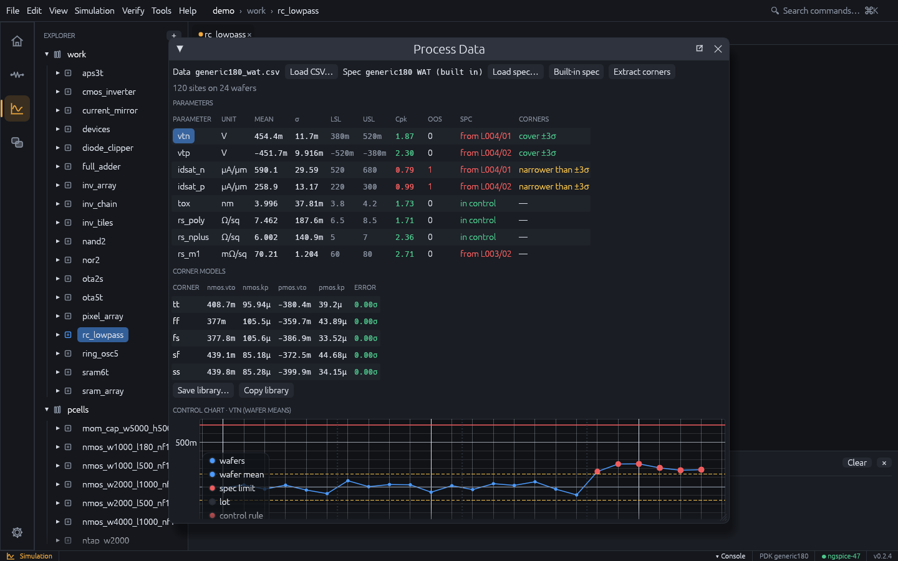

<!-- seo title="Process Emulation: Cross-Sections from Layout and Process Flow" description="IC Studio builds the cross-section of a layout along a cut line by running a process flow: deposition, etching, implantation and CMP on a 2-D grid." -->

# Process emulation and process data


The process emulator builds the cross-section of a layout along a cut line by running a
process flow step by step on a 2-D grid of material cells: x along the cut, z up, 0 at the
original silicon surface. Masks are layout layers or derived-layer expressions. Use it to
check what a layout becomes in silicon (STI next to a contact, a via landing on metal,
spacer and implant overlap), to explain a process to a design team, or to make the
dielectric and metal stack of a [pixel](pixel-optics.md) or a parasitic model.

- GUI: **Tools > Process Emulation** for the open layout. Set the cut (µm, layout
  coordinates; **Across the diffusion** cuts horizontally through the largest diffusion
  area), move **After step** to see the wafer after any step, and click the section to list
  the material stack at that point. **Edit flow** edits the flow, **Load...** reads a flow
  file.
- CLI: `ics xsection <project> <cell> [--flow FILE] [--cut x0,y0,x1,y1] [--steps N] [--at X]... [--svg FILE] [--json]`
- MCP: `process_cross_section`

```text
$ ics xsection myproj cmos_inverter --at 1.7 --svg inv.svg
work/cmos_inverter: generic180 FEOL + 3 metals along (-0.600, 3.400) - (2.800, 3.400), 3.400 µm, 33 of 33 steps, 680 x 1474 cells in 0.09 s
after: passivation: deposit 0.5 µm si3n4 (conformal)
  x =   1.700  surface  3.250  si 0.300 | nwell 0.900 | gox 0.010 | poly 0.180 | sio2 2.560 | si3n4 0.500
```

## Process flow

A flow is a TOML file; `process/generic180.toml` is the generic 180 nm flow (STI, n-well,
gate oxide and poly, nitride spacers, n+ / p+ implants, tungsten contacts and vias, three
aluminium metals, passivation).

```toml
name = "my flow"
substrate = "si"
substrate_depth = 1.2      # µm of substrate shown
resolution = 0.005         # grid step (µm)
colors = { gox = "#c080ff" }

[[step]]
name = "STI etch"
op = "etch"
keep = "active"            # etched where active is not drawn
materials = ["si"]
depth = 0.35
```

| `op` | Keys | Effect |
|---|---|---|
| `deposit` | `material`, `thickness`, `conformal` | Add a layer on top of every column, or conformally (also on sidewalls and under overhangs; trenches narrower than twice the thickness close, leaving seams) |
| `etch` | `mask` / `keep`, `materials`, `depth`, `isotropic` | Remove the listed materials where the mask is open: anisotropically from the surface down by `depth` (without a depth, until another material), or isotropically within `depth` of the opening (undercut) |
| `implant` | `mask` / `keep`, `material`, `into`, `depth` | Turn the `into` materials within `depth` below the surface into `material`; whatever lies on top counts towards the depth, so a gate masks its channel |
| `planarize` | `height` or `stop` | Remove everything above a height, or above the highest point of a material (CMP) |
| `strip` | `material` | Remove a material everywhere (resist) |

`mask` is a layer or derived-layer expression where the step acts (`nplus and active`);
`keep` acts where the expression is not drawn (for etching drawn features out of a blanket
film). Without either, the step acts everywhere. Each step may have a `name`.

Conformal deposition and isotropic etching use the exact Euclidean distance transform of
the grid, so corners round and spacers form from the geometry; a spacer is a conformal
deposition followed by an anisotropic blanket etch of the same thickness.

Limits: the model is geometric. It has no diffusion profiles, oxidation consuming silicon,
stress, topography effects of CMP or 3-D effects across the cut.

## Process data


**Tools > Process Data** sets wafer acceptance test (WAT, PCM, e-test) results against the
process specification. It answers three questions: is the process capable (Cp, Cpk against
the spec limits), is it in control (control charts of the wafer means), and do the model
corners cover what silicon does?

- **Data**: CSV with `lot`, `wafer` and `site` columns (any may be missing) and one column per
  parameter, one row per measured site in time order. `#` lines are comments.
- **Spec** (TOML): every parameter with `unit`, `description`, `target`, `lsl`, `usl` and the
  value of each model corner. `baseline_wafers` sets how many wafers at the start of the
  data set the control limits (0 = all). `process/generic180_wat.toml` is the built-in spec
  of the generic 180 nm technology:

```toml
name = "generic180 WAT"
baseline_wafers = 12

[[param]]
name = "vtn"
unit = "V"
description = "NMOS threshold voltage, W/L = 10/0.18 µm"
target = 0.45
lsl = 0.38
usl = 0.52
corners = { ff = 0.40, tt = 0.45, ss = 0.50 }
```

The parameter table lists mean, σ, the spec limits, **Cpk** (green from 1.33, amber from 1,
red below), out-of-spec sites (**OOS**), the first control alarm (**SPC**) and whether the
corners span the measured ±3σ (**CORNERS**). Select a parameter for its control chart
(individuals chart of the wafer means, centre and 3σ limits from the moving range of the
baseline, spec limits, lot boundaries, alarms in red) and its distribution with the spec
limits and corners.

Alarms follow the Western Electric rules: (1) a point beyond 3σ, (2) two of three beyond 2σ
on one side, (3) four of five beyond 1σ on one side, (4) eight in a row on one side of the
centre. When the corners are narrower than ±3σ of silicon, designs verified at the corners
can still fail on real wafers: widen the corner models or tighten the process.

`process/generic180_wat.csv` is synthetic example data (4 lots of 6 wafers, 5 sites each)
whose last lot has a threshold shift:

```text
$ ics process-data process/generic180_wat.csv
process/generic180_wat.csv: 120 sites on 24 wafers against generic180 WAT
  param        unit        mean      sigma     Cp    Cpk   OOS  corners
  vtn             V      454.4m      11.7m   1.99   1.87     0  cover ±3σ
  idsat_n     µA/µm       590.1      29.59   0.90   0.79     1  NARROWER than ±3σ (ff +2.4σ, ss -1.7σ, tt +0.3σ)
  ...
  SPC vtn: out of control from lot L004 wafer 01 (beyond the 3σ control limits (+3.5σ)), 6 wafer(s) flagged, rules 1, 2, 3
  correlated: vtn / idsat_n  r = -0.96
```

`ics process-data <CSV> [--spec FILE] [--json]` exits with 1 on out-of-spec sites or alarms;
the MCP tool `process_data` returns the same summary.

## Corner models from silicon



When the corners do not cover silicon, or the models do not match it at all, fit new ones. Give
the parameters of the spec a `measure`, a test-structure netlist with the analysis and the
expression that gives the parameter, and add an `[extraction]` section with the model
parameters to fit (the knobs) and the corners:

```toml
[[param]]
name = "idsat_n"
unit = "µA/µm"
# ...
measure = { analysis = "op", expr = "-i(vd) * 1e5", netlist = """
VG g 0 DC 1.8
VD d 0 DC 1.8
M1 d g 0 0 nmos w=10u l=0.18u
.op
""" }

[extraction]
knobs = [
  { target = "model:nmos.vto", min = "0.2", max = "0.8" },
  { target = "model:nmos.kp", min = "20u", max = "500u", log = true },
]

[extraction.corners]
ff = { idsat_n = 3.0, idsat_p = 3.0 }
ss = { idsat_n = -3.0, idsat_p = -3.0 }
```

The netlists get the technology's models; knobs are `model:NAME.PARAM` (binned cards
included). The nominal `tt` is fitted to the means of the measured parameters. In a corner,
the primary parameters go to mean + zσ and every other measured parameter to its mean given
the primaries (linear regression over the sites), so a fast corner also gets the lower
threshold that goes with the higher current. Each corner is fitted by Levenberg-Marquardt
from the nominal; the error is the RMS miss in units of the data's σ.

- GUI: **Extract corners** in the Process Data window, then **Save library...**
- CLI: `ics corners <CSV> [--spec FILE] [--project P] [--lib FILE] [--json]`
- MCP: `extract_corners`

The result is a corner library, one `.lib` section per corner. Load it with
`.lib "corners.lib" ff`, or point a PDK file's `[models]` at it with
`corners = ["tt", "ff", "ss", "fs", "sf"]` so that the Corner / Sweep Manager runs them:

```text
$ ics corners process/generic180_wat.csv --lib corners.lib
  corner           nmos.vto            nmos.kp           pmos.vto            pmos.kp   error
  tt                 408.7m             95.94µ            -380.4m              39.2µ   0.000σ
  ff                   377m             105.5µ            -359.7m             43.89µ   0.000σ
  ss                 439.8m             85.28µ            -399.9m             34.15µ   0.000σ
                          vtn                  vtp              idsat_n              idsat_p
  ff          420.5m (420.5m)    -427.1m (-427.1m)        678.9 (678.9)        298.4 (298.4)
```

On the example data the generic models give 1620 µA/µm where silicon has 590. The fitted tt
matches the means, and ff / ss sit at ±3σ of the measured idsat. The bundled spec fits two
knobs per device to two parameters per device, so the fit is exact; with more measured
parameters than knobs it is a least-squares compromise, and the error column shows how good.
