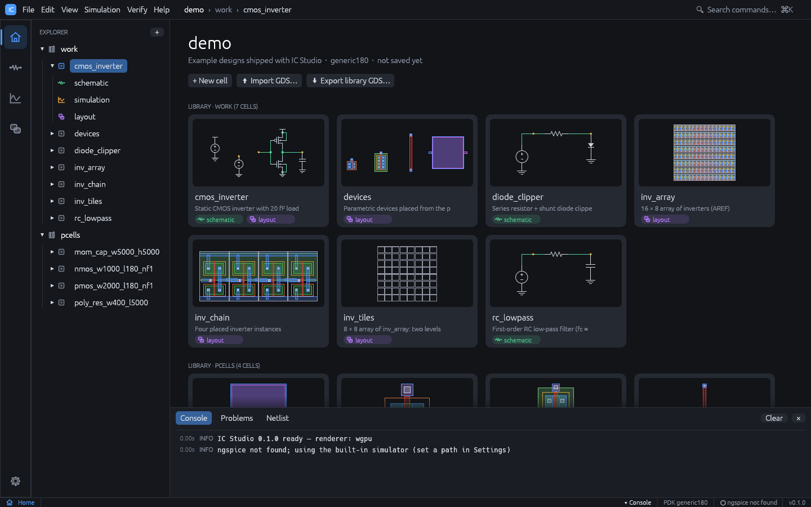

# Projects, libraries and cells

## The window



- **Menu bar** (File, Edit, View, Simulation, Verify, Help) with a breadcrumb
  `project > library > cell`. A dot after the cell name means unsaved changes. On the
  right, **Search commands...** opens the command palette.
- **Activity bar** (far left): the four workspaces Home, Schematic, Simulation and Layout
  (`Ctrl+1` to `Ctrl+4`), and the Settings gear at the bottom.
- **Explorer**: libraries, cells and their views.
- **Cell tabs** above the editor. `Ctrl+W` closes the active tab.
- **Bottom panel** (`Ctrl+J`): **Console** (log), **CIW** (SKILL prompt), **Problems**
  (schematic checker findings) and **Netlist** (the SPICE netlist of the active cell).
- **Menus**: File, Edit, View, Simulation, Verify, **Tools** (calculator, sweeps, browsers,
  generators, DRC rule designer, stream layer map, dummy fill, SKILL; see
  [Tools](tools.md)) and Help. In the Layout workspace the Create and Options menus are
  added.
- **Status bar**: workspace, zoom, selection, technology name, ngspice status and, while
  an agent is connected, "MCP live".

## Creating and opening projects

The welcome page (shown when no project is open) has three cards: **Open demo project**,
**New project...** and **Open project...**, plus a list of recent projects.

- **File > New Project...**: enter a name (letters, digits, `_` and `-`) and a parent
  folder. The project is created in `<folder>/<name>` with the generic 180 nm technology.
  Check the demo option to start from the demo designs instead.
- **File > New Demo Project**: creates the demo project in memory. Use **File > Save** to
  choose a folder.
- **File > Open Project...** (`Ctrl+O`): pick the project folder (the one containing
  `ic-studio.json`). **File > Open Recent** lists recent projects.
- **File > Save** (`Ctrl+S`) and **Save As...** (`Ctrl+Shift+S`). When saving to a
  folder that is neither empty nor an existing project, a subfolder named after the
  project is created.
- **File > Close Project**. Closing, quitting or opening another project with unsaved
  changes asks whether to **Save**, **Discard** or **Cancel**.

## Cells and views

- **New cell** (`Ctrl+N`, the `+` in the Explorer header or **+ New cell** on the Home
  page): choose the library, a cell name, an optional description and which views to
  create (schematic, layout).
- Click a cell in the Explorer to open it. Expand it to see its **schematic**,
  **simulation** and **layout** views; a missing view is shown dimmed with **+ create**,
  and clicking it creates an empty view.
- Right-click a cell for **Open schematic**, **Open layout**, **Rename...** and
  **Delete...**. Deleting removes the cell's files from disk when the project is saved.
- The **Home** workspace shows the project overview: a thumbnail card per cell, plus
  **+ New cell**, **Import GDS...** and **Export library GDS...** buttons.

## Command palette

`Ctrl+K` or `Ctrl+Shift+P` opens the palette. Type words to filter (all words must
match), use the arrow keys and `Enter` to run a command, `Esc` to close. It contains every
menu action plus **Open `<lib>/<cell>` · schematic** and **· layout** entries for every
cell, which makes it the fastest way to jump between cells.

## On-disk format

A project is a folder of plain JSON files that work well with version control:

```text
myproj/
  ic-studio.json          project manifest
  tech.json               technology: layers, rules, DRC deck, coefficients
  work/                   one folder per library
    cmos_inverter/        one folder per cell
      cell.json           cell metadata (name, description)
      schematic.json      schematic view (if present)
      layout.json         layout view (if present)
      sim.json            simulation setup
```

Libraries imported from GDS are stored differently (as a GDS file in the library folder
with a `library.json`), so large imports stay compact.

## Import and export

| Action | Menu |
|---|---|
| Import a GDSII file as a new library | **File > Import > GDSII...** |
| Import a KLayout layer properties file as the technology | **File > Import > KLayout layer properties...** |
| Export the active cell's SPICE netlist | **File > Export > SPICE netlist...** |
| Export the active cell and everything it places to GDSII | **File > Export > Cell GDSII...** |
| Export every layout in the project to one GDSII | **File > Export > Library GDSII...** |

GDS import keeps the hierarchy. Layers that are not in the technology are added to it
(and reported in the console). After import, the top cell opens in the Layout workspace.
See [Technology](technology.md) for `.lyp` import.
