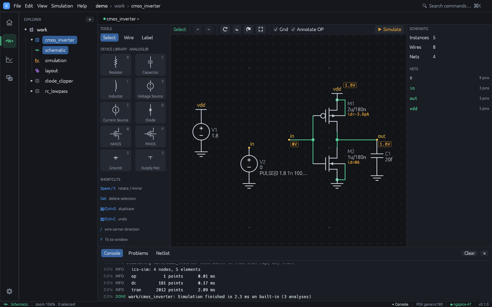
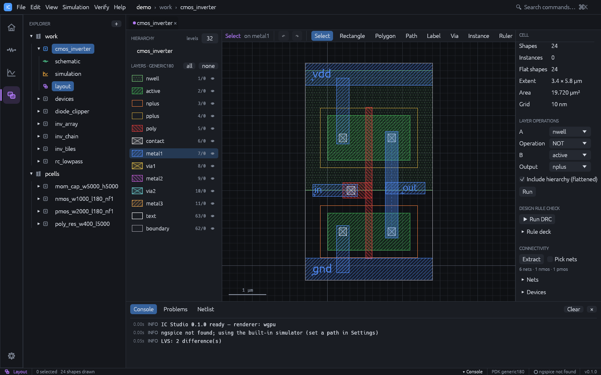

# Quick tour

This tour walks through the demo project and then builds a small circuit from scratch.

## Open the demo project

```sh
cargo run --release -- --demo
```

Or choose **Open demo project** on the welcome page (**File > New Demo Project**). The demo
lives in memory until you save it with `Ctrl+S`. All cells are in the `work` library and
use the generic 180 nm technology.

| Cell | What it shows |
|---|---|
| `cmos_inverter` | Inverter with a hand-drawn layout; LVS reports deliberate findings (PMOS W, load cap) |
| `rc_lowpass` | RC low-pass filter (fc about 159 kHz): OP, AC and transient |
| `diode_clipper` | Resistor and shunt diode clipper: transient and DC sweep |
| `nand2` | 2-input NAND: schematic plus routed PCell layout, DRC and LVS clean |
| `nor2` | 2-input NOR: schematic plus routed PCell layout, DRC and LVS clean |
| `ring_osc5` | 5-stage ring oscillator, fully routed |
| `current_mirror` | NMOS current mirror with a 20 µA reference: DC sweep of the output |
| `ota5t` | 5-transistor OTA: about 42 dB open-loop gain in AC |
| `inv_chain` | Four placed `cmos_inverter` instances |
| `inv_array` | 16 x 8 array of inverters |
| `inv_tiles` | 8 x 8 array of `inv_array`: 8192 inverters, two levels of hierarchy |
| `devices` | One instance of every PCell |

The `pcells` library holds the PCell variants the layouts use.

## 1. Schematic and simulation

1. In the Explorer, click `cmos_inverter`. The schematic opens.
2. Press `F5`. The Simulation workspace opens with the DC sweep and transient results.
3. Tick or untick signals in **Signals** to change the plot; read MIN / MAX / FINAL in
   **Measurements**.
4. Press `Ctrl+2` to go back to the schematic: node voltages and drain currents from the
   operating point are annotated on it.



Try `rc_lowpass` (AC: the **f -3 dB** column shows the corner frequency) and `ota5t`
(AC: open-loop gain and unity-gain frequency).

## 2. Layout and hierarchy

1. Press `Ctrl+4` with `cmos_inverter` open. This layout was drawn by hand.
2. Open `inv_tiles` (Explorer, or `Ctrl+K` and type `inv_tiles`). Zoom with the wheel,
   pan with the right mouse button, and press `F` to fit.
3. Press `1`, `2` and `9` to change how many hierarchy levels are drawn.
4. Double-click an instance to open the placed cell.

## 3. Verification

1. Open `nand2` and switch to the Layout workspace.
2. In the right panel, press **Run DRC**: no violations.
3. Press **Run LVS**: the layout matches the schematic.
4. Open `cmos_inverter` and run LVS: it lists the deliberate differences. Click one to
   zoom to it.



## 4. Post-layout simulation

1. Open `ring_osc5` in the Simulation workspace.
2. Press `F5` and note the oscillation period in the transient plot.
3. Tick **Include layout parasitics** and press `F5` again. The console summarises the
   extracted capacitance and resistance. Compare the period: the added wire
   capacitance and resistance slow the oscillator down.

## 5. Build an inverter from scratch

1. Press `Ctrl+N`, name the cell `my_inv`, keep **schematic** checked, and press
   **Create**.
2. Press `P` and click to place a PMOS, then press `N` and click below it to place an
   NMOS. Press `Esc`.
3. Press `W` and wire the two drains together, then the two gates. `Esc` ends a wire.
4. Press `S` and place a supply symbol on the PMOS source; press `G` and place ground on
   the NMOS source. Wire them.
5. Press `T`, type `in` in the **Net:** field and click on the gate wire; type `out` and
   click on the drain wire.
6. Add the sources: press `V`, place a source, wire its `p` pin to the supply net and its
   `n` pin to a ground symbol; set **DC value** to `1.8` in the inspector. Place a second
   source for `in` with **Transient** `PULSE(0 1.8 1n 100p 100p 2n 4n)`.
7. Press `Ctrl+3`, enable **Transient** (step `10p`, stop `10n`) and press `F5`.
8. Choose **Verify > Generate Layout from Schematic**. The two transistors are placed as
   PCells with well taps, and flylines show the connections to make.
9. Choose **Verify > Route Flylines**. The router wires the nets on metal.
10. Run DRC and LVS from the right panel, then save with `Ctrl+S`.

See [Schematic-driven layout](schematic-driven-layout.md) for what the generator and the
router do, and how to match devices.

## 6. Command line

The same project can be checked from a terminal:

```sh
ics new demo --template demo
ics sim demo ota5t
ics drc demo nand2
ics lvs demo nand2
```

See [Command line](cli.md).
