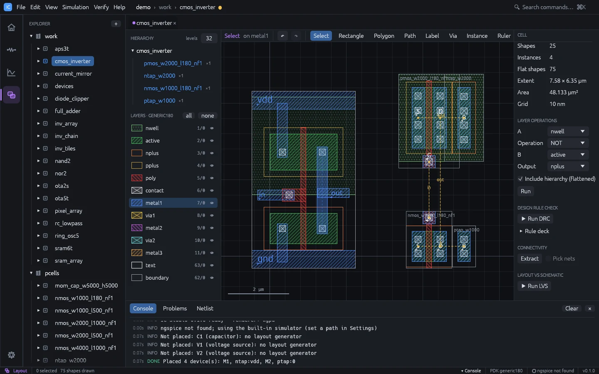

<!-- seo title="Schematic-Driven Layout and Auto Routing" description="Generate a layout from a schematic in IC Studio: place transistors as PCells, follow flylines and route the connections automatically, LVS clean." -->

# Schematic-driven layout

IC Studio can build a layout from a schematic: it places the transistors as PCells,
shows the connections still to be made as flylines, and routes them.



## Step by step



1. Draw and simulate the schematic. Give the external nets labels (`in`, `out`, ...);
   use the Ground and Supply symbols for the rails.
2. With the cell active, choose **Verify > Generate Layout from Schematic**. The cell gets
   a layout view if it has none, and the Layout workspace opens with flylines on.
3. Inspect the placement. Move devices if you want; their names keep the link to the
   schematic.
4. Choose **Verify > Route Flylines** to route the remaining connections.
5. Add pin labels on metal for the external nets (Label tool, `L`) so that LVS can anchor
   them.
6. Run DRC and LVS (see [Verification](verification.md)), then simulate with
   **Include layout parasitics**.

Each step can be undone with `Ctrl+Z`. The console lists what was placed, skipped,
matched and routed.

## Demo: auto P&R

The demo cells `full_adder` (28 transistors) and `ota2s` (two-stage OTA with a
common-centroid input pair and mirror) have layouts made only by this flow. Clear one
(`Ctrl+A`, `Delete`) and run the two commands above to watch it happen. The
[demo gallery](demos.md#2-auto-place-and-route-step-by-step) has a complete script.

## Placement

- Each NMOS and PMOS becomes a PCell instance named after the schematic device (`M1`).
  W and L come from the device's `w` and `l` parameters; `m` multiplies the device.
  Devices wider than 5 µm are split into fingers. With a PDK, the schematic model selects
  the PCell's device (and its marker layers, such as `lvtn` for a low-Vt model).
- PMOS devices form a row above the NMOS row, gates facing the channel between the rows.
- Neighbouring devices of the same type and width that share a source / drain net are
  abutted with shared diffusion.
- Wells and implants are merged across each row, and each row ends with a bulk tap
  (`ntap` in the PMOS row, `ptap` in the NMOS row) on the row's bulk net.
- Devices already in the layout (by name) are left alone, so you can generate again after
  adding devices to the schematic.
- Devices without a layout generator (R, C, L, diodes, sources) are skipped and listed
  in the console.

## Matched devices

Differential pairs and current mirrors are detected automatically:

- **Differential pair**: two devices of the same type, W, L and m with a common source
  net that is not a rail, and different gates and drains.
- **Current mirror**: devices of the same type and L with a common gate and source, where
  the gate is tied to one device's drain.

You can also group devices explicitly by giving them the same `match` parameter, or opt a
device out with `match=none`. The inspector shows only the standard parameters, so add
`match` (and `match_rows`) to the device's `params` in the cell's `schematic.json`:

```json
"params": { "model": "nmos", "w": "4u", "l": "500n", "m": "1", "match": "pair1" }
```

A matched group is split into equal unit fingers named `<device>.<k>` (for example
`M1.1`, `M1.2`), placed in common-centroid order (ABBA). Groups of 8 units or more, or
groups with `match_rows=2`, use two cross-coupled rows (ABBA / BAAB); `match_rows=1`
forces a single row. Each unit row is closed by dummy fingers at both ends whose gates
are tied to bulk; LVS ignores them because they are always off.

The console reports each group, for example `A, B: matched as ABBA (A = M1, B = M2)`, or
why it could not be matched.

## Flylines

The **Flylines** checkbox in the layout toolbar draws a dashed line, labelled with the net
name, for every schematic connection that is not yet made in the layout. They update after
every edit, so you can route by hand and watch them disappear.

## Router



**Route Flylines** runs a maze router (A* search) over the routing metal layers above
poly (metal1, metal2 and metal3 in the generic technology):

- The routing grid is aligned to the device terminals; wires have one width that fits a
  via, with DRC spacing between tracks.
- Existing geometry is avoided. Short nets are routed first; nets that block each other
  are ripped up and rerouted.
- Metal1 is expensive and each higher layer has a preferred direction, so long runs move
  to upper metals.

Every named schematic net (labels and supplies; the ground symbol becomes `gnd`) that is
fully connected after routing gets a text label at one of its terminals, unless the top
cell already has a label of that name. The label goes on the first metal, or on the layer
the PDK names for its net labels (`[[pin_label]]`, e.g. `Metal1.text` in SG13G2), so
external LVS decks see the layout's ports with their schematic names.

The console summary gives the routed nets, connections, vias and rip-ups. Nets that could
not be routed stay as flylines with a reason (terminals not on conducting geometry, or
pieces not reached). Finish them by hand and route again.

## Pins

Schematic pins (see [Schematic editor](schematic.md)) are placed with the devices: a pin
shape on the first metal with its label, on the cell boundary (inputs left, outputs right,
inouts on top). They are terminals of their nets, so flylines and the router connect them.
**Update Components and Nets** places the pins that are missing.

While drawing a path, the wire takes the net of the conductor it starts on; when it is
finished, a short it makes with another schematic net is reported and marked.

## Check against source and update (ECO)

When the schematic changes after the layout is placed, **Verify > Check Against Source**
(or **Check** in the **Check Against Source** section of the Verify panel) compares the
layout with the schematic, like Layout XL's *Check Against Source*:

| Kind | Meaning |
|---|---|
| missing | A schematic MOS device has no layout instance |
| extra | A named layout device is no longer in the schematic (row taps and dummies are left alone) |
| parameters | A placed device's W, L, m or model differs from the schematic (unit fingers of matched devices are compared by total width) |
| short | One layout conductor reaches the terminals of several schematic nets |
| open | A schematic net's terminals are on several unconnected conductors (the flylines) |
| pin | A named schematic net (label or supply) has no pin label in the layout |

Click an entry to zoom to it; shorts, extra and changed devices are also outlined on the
canvas. Tick **Live** to run the check again after every edit (cells of up to 5 000
top-level items).

**Verify > Update Components and Nets** (**Update** in the panel) then places the new
devices, gives changed ones the schematic's parameters in place (a new PCell master at the
same placement; unit fingers keep their count and share the new width), and with
**Update and Delete Extra Devices** removes devices that left the schematic. Named nets
that are connected get their pin label (as the router adds them). It is one
undoable edit. Wiring is not changed: a device that grew may now overlap a wire, which the
check reports as a short; compact the row and route again.

## Abutment

Select two or more MOS PCell instances of one type and finger width and choose **Assist >
Abut MOS Devices** (also in the pop-up menu over instances). Left to right, each device
slides onto its neighbour so their outer source / drain columns coincide and the diffusion
is shared, with the active areas aligned. With a schematic the shared columns must be on the
same net: a device is flipped left-right when that makes them match, and the abutment is
refused when no flip would (it would short two nets). MCP: `abut`.

Abutment also happens on its own: a single MOS device moved (dragged or with `M`) so that
an outer column lands within the largest layer spacing of a compatible neighbour's column
snaps onto it, flipped if the nets need it. Turn this off with **Auto-abut moved MOS
devices** in the Layout Editor Options (`Shift+E`).

## Cross-probing

Select a device in the schematic and switch to the layout: the instances with the same
name (including its unit fingers) are selected, and the other way round.

## From the command line or an agent

```sh
ics route myproj nand2 --place   # place missing devices, route, save; exit 1 if nets remain
ics eco myproj nand2              # check against the schematic; exit 1 on differences
ics eco myproj nand2 --update --remove-extra --allow-opens   # update, save, then check
```

The MCP server offers `generate_layout`, `flylines`, `route`, `check_against_source` and
`update_from_source` (see [MCP server](mcp.md)).
