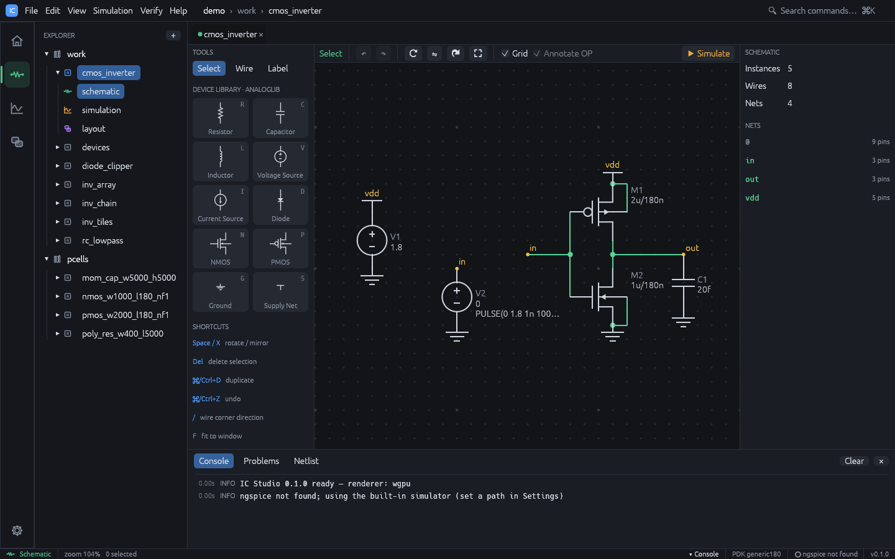
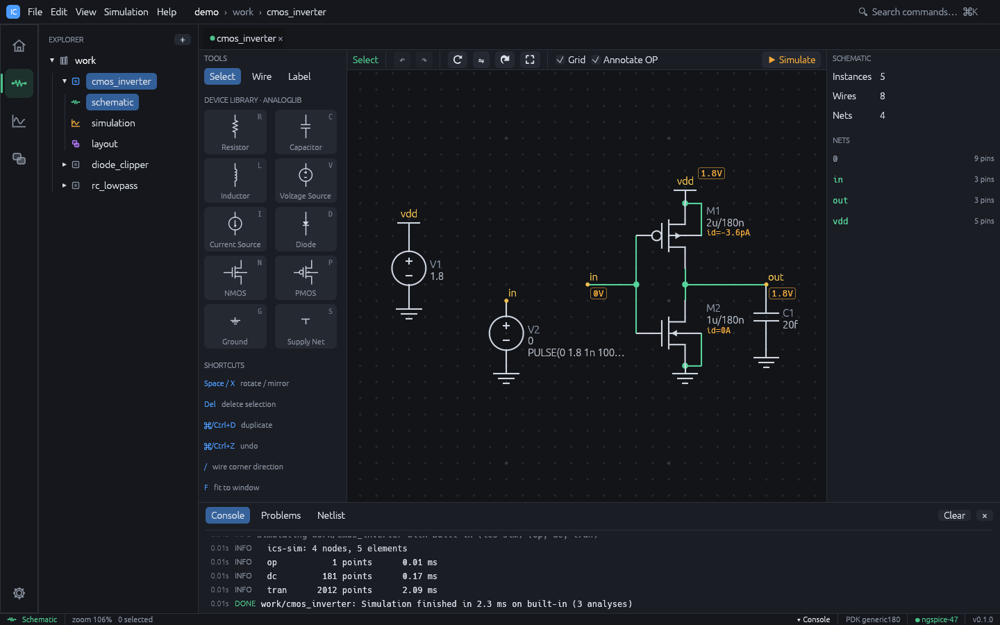

# Schematic editor

Open a cell's schematic view (or press `Ctrl+2` with a cell open) to edit it.

- **Left panel**: **Tools** (Select, Wire, Label), the **Device Library** with one tile per
  primitive and its shortcut letter, and a short shortcut reminder.
- **Toolbar**: the current tool, undo / redo, rotate, mirror, duplicate, fit, the **Grid**
  and **Annotate OP** checkboxes, and **Simulate** (`F5`).
- **Right panel**: the property inspector.

Schematic coordinates are integer grid points. Keys act on the canvas only while the
mouse is over it and no text field has focus.

## Devices

| Key | Device | Name prefix | Pins | Default parameters |
|---|---|---|---|---|
| `R` | Resistor | R | p, n | `r=1k` |
| `C` | Capacitor | C | p, n | `c=1p` |
| `L` | Inductor | L | p, n | `l=1n` |
| `V` | Voltage Source | V | p, n | `dc=1` |
| `I` | Current Source | I | p, n | `dc=1m` |
| `D` | Diode | D | a, k | `model=dmod` |
| `N` | NMOS | M | d, g, s, b | `model=nmos w=1u l=180n m=1` |
| `P` | PMOS | M | d, g, s, b | `model=pmos w=2u l=180n m=1` |
| `G` | Ground | GND | gnd | (net `0`) |
| `S` | Supply Net | VDD | net | `net=vdd` |

### Placing a device

1. Press the device key (for example `N`) or click its tile in the Device Library.
2. A ghost follows the cursor. Press `Space` to rotate or `X` to mirror it before placing.
3. Click to place. The device snaps to the grid, gets the next free name (`M1`, `M2`, ...)
   and is selected. The tool stays active, so further clicks place more copies.
4. Press `Esc` or right-click to return to Select.

## Wires

1. Press `W` (or choose **Wire**).
2. Click the start point, usually a pin.
3. Click the next point. Each click adds an L-shaped pair of segments, horizontal first;
   press `/` to bend vertical first.
4. The wire ends automatically when a click lands on a pin, a wire end or the interior of
   another wire. Otherwise keep clicking, and end with double-click, right-click or `Esc`.

Connections are live: pins that are not connected are drawn as small squares, and a
junction dot appears where three or more connections meet. Hovering or selecting a wire
highlights its whole net.

## Net labels and net names

1. Press `T` (or choose **Label**). A **Net:** field appears in the left panel (default
   `net1`).
2. Type the name and click on a pin or wire to attach the label. Labels connect only at
   their exact grid point.
3. A trailing number is incremented after each placement (`net1`, `net2`, ...), which is
   handy for buses of labels.

Labels with the same name are the same net, so labels connect parts of a schematic
without wires. Net names are chosen in this order: the **Ground** symbol (net `0`), the
**Supply Net** symbol's `net` parameter (blank means `vdd`), net labels, then automatic
names (`net1`, `net2`, ...).

Notes:

- Only the Ground symbol makes net `0`. A label called `gnd` is an ordinary net.
- A Supply Net symbol only names a net. Place a voltage source on it to power it.
- Two different names on one net produce the warning
  "Net names 'a' and 'b' are shorted together".

## Selecting and editing

| Action | How |
|---|---|
| Select one object | Click it (labels take priority over wires, wires over devices) |
| Add or remove from selection | `Shift`+click or `Ctrl`+click |
| Box select | Drag on empty space (selects objects fully inside; `Shift` adds) |
| Select all | `Ctrl+A` |
| Move | Drag a selected object; attached wires stretch with moved pins |
| Rotate / mirror | `Space` / `X`, or the toolbar buttons |
| Duplicate | `Ctrl+D` (copies offset by two grid points, renamed) |
| Delete | `Del` or `Backspace` |
| Undo / redo | `Ctrl+Z` / `Ctrl+Shift+Z` or `Ctrl+Y` |
| Fit to window | `F` |
| Cancel | `Esc` cancels a wire, then returns to Select, then clears the selection |

## Property inspector

Select a single device to edit it in the right panel. Values are SPICE strings typed as
they would appear in a netlist, with SPICE scale suffixes: `10k`, `2.2p`, `180n`, `1meg`.

- **Name**: the instance name. It must be unique; it also ties the device to its layout
  instance.
- Device fields: **Resistance**, **Capacitance**, **Inductance / L**, **Model**,
  **Width**, **Multiplier**, **Net name** (supply).
- Sources: **DC value**, **AC magnitude** (for AC analysis, e.g. `1`) and **Transient**
  (e.g. `PULSE(0 1 0 1n 1n 5n 10n)`; `SIN(...)` and `PWL(...)` also work).
- **Orientation** and **Position**, and a **Connections** list showing the net on each pin.

With nothing selected, the inspector shows statistics (instances, wires, nets), the list
of nets with their pin counts, and any **Warnings** (unconnected pins, duplicate names,
shorted net names).

The **Problems** tab of the bottom panel runs the schematic checker on the active cell as
you edit: missing ground, bad or duplicate names, missing or invalid values, shorted
devices, voltage-source loops, floating nets, dangling wires and more. Click a finding to
select its devices. **Tools > Check Schematic** runs the check on demand, and **File >
Check and Save** saves only when there are no errors. See
[Check Schematic](tools.md#check-schematic) for every check.

## Netlist

The **Netlist** tab of the bottom panel shows the SPICE deck of the active cell, updated
as you edit. Export it with **File > Export > SPICE netlist...**. The netlister writes:

- `R1 p n value`, `C...`, `L...`
- `V1 p n DC <dc> [AC <ac>] [<tran>]`, likewise for current sources
- `D1 a k dmod`
- `M1 d g s b <model> w=... l=... [m=...]`; an unconnected bulk pin is tied to the source
- default level-1 models `nmos`, `pmos` and `dmod` when they are used. With a PDK model
  library, MOS models map to the PDK devices (subcircuit devices get an `X` prefix) and the
  library is loaded at the chosen corner.

## Operating point annotation

After an operating point simulation, **Annotate OP** (on by default) shows each node
voltage as a tag on the schematic and the current `id=...` under each transistor and
diode.

## Cross-probing

When a cell has both a schematic and a layout, selecting devices in one editor selects the
devices with the same names in the other. Unit fingers of a matched device (`M1.1`,
`M1.2`, ...) map back to `M1`.
