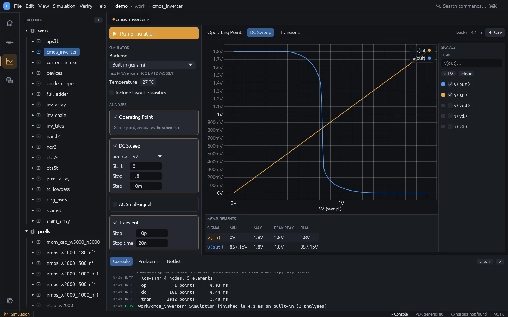
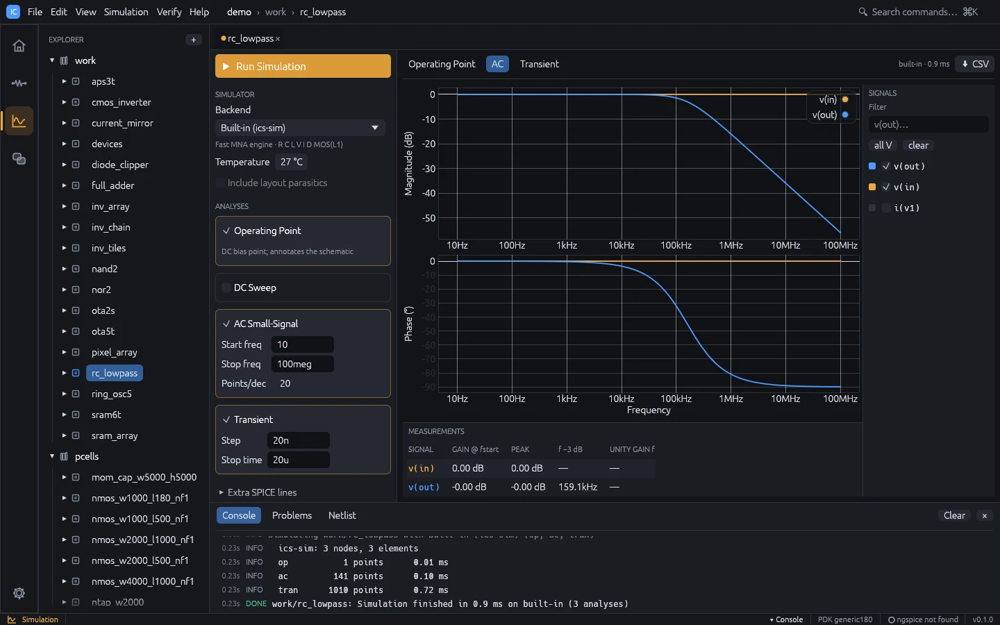

<!-- seo title="SPICE Simulation: DC, AC, Transient, Monte Carlo" description="Run SPICE simulations in IC Studio with the built-in engine or ngspice: DC, AC and transient analyses, measurements, corners, Monte Carlo and post-layout runs." -->

# Simulation

The Simulation workspace (`Ctrl+3`) sets up and runs analyses of the active cell's
schematic and shows the results.



## Running a simulation

1. Open a cell with a schematic and switch to the Simulation workspace.
2. In **Analyses**, tick the analyses to run and fill in their fields.
3. Press **Run Simulation**, `F5` or `Ctrl+Enter` (also **Simulation > Run** or
   **Simulate** in the schematic toolbar).

Simulation runs in the background. Starting it from another workspace switches to the
Simulation workspace. Errors appear in a red **Simulation error** box and in the console.

## Setup panel

### Simulator

| Field | Meaning |
|---|---|
| **Backend** | **Built-in (ics-sim)** (default), **ngspice**, or **Auto (built-in, ngspice when needed)** (see [Backends](#backends)) |
| **Corner** | Model corner of the PDK model library; shown only when the technology's models have corners (default: the library's default corner) |
| **Temperature** | -55 to 200 °C, default 27 (written as `.temp`); the built-in engine scales its models with it |
| **Include layout parasitics** | Add parasitics extracted from the cell's layout (see below); disabled when the cell has no layout |

The line under the backend shows whether ngspice was found, or that PDK models need
ngspice when the technology has a model library. With **Auto** it shows which ngspice
the engine would switch to. Set the ngspice path in
**Settings** (see [Installation](install.md#ngspice-optional)).

### Analyses

| Analysis | Fields (defaults) | Notes |
|---|---|---|
| **Operating Point** | none (on by default) | Annotates the schematic |
| **DC Sweep** | **Source**, **Start** `0`, **Stop** `1.8`, **Step** `10m` | Source is any V or I source in the schematic |
| **AC Small-Signal** | **Start freq** `1`, **Stop freq** `10g`, **Points/dec** `20` | Decade sweep; give a source an **AC magnitude** |
| **Transient** | **Step** `10p`, **Stop time** `20n` | Give a source a **Transient** waveform |
| **Noise** | **Output node** `out`, **Input source**, **Start freq** `1`, **Stop freq** `1g`, **Points/dec** `10` | Written as `.noise v(out) <source> dec ...`; the input source is picked from the schematic's sources |

Fields with an invalid value turn red; validation messages appear under the card.

### Extra SPICE lines

Lines in this collapsible section are appended verbatim to the deck before the analyses,
for example `.options reltol=1e-4`. **Show netlist** displays the generated deck next to the
results.

The setup (backend, corner, analyses, temperature, parasitics flag, extra lines and the
[sweep setup](tools.md#corner--sweep-manager)) is saved per cell in `sim.json`.

## Results

Each analysis has its own tab: **Operating Point**, **DC Sweep**, **AC**, **Transient**,
**Noise**.
The tab bar shows the backend and run time, and **CSV** exports the current dataset (AC
values as `name_re` / `name_im` columns).

### Waveforms

- **Signals** (right): tick signals to plot. **Filter** narrows the list, **all V** selects
  every node voltage, **clear** clears the selection. By default `v(out)`, `v(in)`,
  `v(vout)` and `v(vin)` are shown when present, otherwise the first three voltages. The
  selection is kept per analysis between runs. Waveforms plotted from the
  [Waveform Calculator](tools.md#waveform-calculator) appear here as signals named after
  their expression.
- **Compare runs** (above the signal list): the earlier runs of the cell. Tick one to draw
  its signals dashed on the same plot and list them in the measurements (see
  [Results Browser](tools.md#results-browser)).
- **Plot**: DC and transient results share one plot. AC results are a Bode pair:
  **Magnitude (dB)** over **Phase (°)** on a logarithmic frequency axis, with linked zoom
  and cursor. Hover a trace to read values. Scroll to zoom, drag to pan, double-click to
  reset.
- **Noise**: the output noise density `onoise_spectrum` and the input-referred density
  `inoise_spectrum` (V/√Hz) on logarithmic axes. The built-in engine computes them from
  resistor and MOS channel thermal noise, diode shot noise and `kf` / `af` flicker noise,
  and writes the integrated output noise (V rms over the sweep) to the log.
- **Measurements** (bottom), one row per plotted signal:
  - DC and transient: MIN, MAX, PEAK-PEAK, FINAL.
  - AC: GAIN @ fstart, PEAK, f -3 dB, UNITY GAIN f.



### Operating point

The **Operating Point** tab lists node voltages and branch currents, and per device:

- MOS: region (cutoff, saturation, triode), `id`, `vgs`, `vds`, `vth`, `gm`, `gds`
- diode: `vd`, `id`, `gd`
- resistor: `v`, `i`, `p`

Device details come from the built-in engine only. The node voltages are also drawn on
the schematic (see [Schematic](schematic.md#operating-point-annotation)).

## Example: transient of the RC low-pass



1. Run `ic-studio --demo --cell rc_lowpass --workspace simulation`.
2. The cell has Operating Point, AC and Transient set up. Press `F5`.
3. Open the **AC** tab: the **f -3 dB** column shows about 159 kHz for `v(out)`.
4. Open the **Transient** tab to see the input pulse and the filtered output.
5. To change the input, go to the schematic (`Ctrl+2`), select the source, edit
   **Transient**, and press `F5` again.

## Measurements, corners and Monte Carlo

- **Tools > Waveform Calculator** evaluates expressions on the results, such as
  `bandwidth(v(out)/v(in))`, `risetime(v(out))` or `phasemargin(v(out))`, and plots derived
  waveforms. See [Waveform Calculator](tools.md#waveform-calculator).
- **Tools > Corner / Sweep Manager** runs the setup over model corners, temperatures and
  parameter values, and Monte Carlo variations, in parallel; specs with limits are checked
  on every point, with statistics, yield, overlaid waveforms and an HTML datasheet. See
  [Corner / Sweep Manager](tools.md#corner--sweep-manager).
- **Tools > Results Browser** keeps earlier runs for comparison, for example the schematic
  against the post-layout simulation.

The **Sweep...**, **Monte Carlo...** and **Optimizer...** buttons at the top of the setup
panel open these tools for the active cell.

### Monte Carlo window



**Simulation > Monte Carlo...** (also in the **Tools** menu and the command palette) runs
the cell's setup many times on the built-in engine with random device variation, and shows
statistics of calculator measurements. Every run draws:

- a **process** shift shared by all MOS devices of one polarity: threshold (**Vto sigma**,
  V, default `20m`) and relative transconductance (**kp sigma**, default `0.03`);
- a per-device **mismatch** scaled by gate area (Pelgrom): σ(ΔVth) = **Avt** / √(W L) and
  σ(Δβ/β) = **Abeta** / √(W L), with **Avt** default `5n` (5 mV·µm) and **Abeta** default
  `10n` (1 %·µm).

1. Set **Runs** (default 100) and **Seed** (runs are reproducible for a seed).
2. Add a measurement with **+ Measurement**: an analysis (`op`, `dc`, `ac`, `tran`,
   `noise`) and a [calculator](tools.md#waveform-calculator) expression with a scalar
   result, such as `op: v(out)` or `ac: bandwidth(v(out))`.
3. Press **Run**. A progress bar counts the samples; **Stop** ends the run after the
   current sample and keeps the results so far.
4. The table lists n, mean, sigma, min, max and the failed runs of every measurement;
   select one to see its histogram.

The setup is saved with the cell (`sim.json`). Monte Carlo varies the built-in engine's
models, so a deck that loads a PDK model library is rejected: use the PDK's own statistical
corners with ngspice instead. The [Corner / Sweep Manager](tools.md#monte-carlo) has a
separate Monte Carlo of instance parameters and design variables on any backend. From the
command line: `ics mc <project> <cell> --measure op:v(out)` (see
[Command line](cli.md#simulation)).

## Post-layout simulation

When **Include layout parasitics** is ticked and the cell has a layout, IC Studio
extracts the layout, matches its nets to the schematic through LVS and adds to the deck:

- wire capacitance to substrate (`Cpar_*`),
- lateral and overlap coupling capacitance between nets (`Cc_*`),
- MOS drain / source junction sizes (`ad as pd ps`) from the drawn diffusion,
- an RC network of wire, via and gate resistance (`Rpar_*`), with each MOS terminal moved
  to the nearest node of its net,
- layout-dependent effect parameters for PDK models whose model library sets `lde = true`
  (SKY130 does; see [Technology](technology.md#pdk-files)): the finger count `nf` of each
  MOS and, for straight gates on rectangular diffusion, the gate-to-diffusion-edge
  distances `sa` / `sb` and the gate spacing `sd`, for BSIM4 stress models. Without
  `lde` these are left out.

Coupling to a layout net with no schematic counterpart is lumped to ground. The console
shows a one-line summary. For a useful result, the layout should be LVS clean (see
[Verification](verification.md)). From the command line: `ics sim <project> <cell> --parasitics`.

## Backends

### Built-in engine

A modified nodal analysis engine written in Rust. It supports:

- elements `R C L V I D M` and subcircuit instances `X` (no behavioural sources),
- sources: `DC`, `AC mag [phase]`, `PULSE(v1 v2 td tr tf pw per)`,
  `SIN(vo va freq td theta)`, `PWL(t v ...)`,
- directives `.model`, `.op`, `.dc`, `.ac`, `.tran`, `.noise`, `.temp`, `.title`, `.end`;
  other dot lines such as `.options` and `.ic` are ignored, and decks that load compiled
  Verilog-A models (`pre_osdi`) need ngspice,
- hierarchical decks as PDKs write them, flattened before simulation:
  - `.include` / `.inc` files and `.lib <file> <section>` library sections, with paths
    relative to the including file (for `ics spice`, to the deck's folder),
  - `.param` with expressions (`+ - * / ^ **`, comparisons, `?:`, `sqrt exp log min max
    pow abs if ...`; `agauss` / `gauss` / `unif` give their nominal value), `{expr}` and
    `'expr'` values and bare parameter names as values,
  - `.subckt name ports [params:] k=v ...` / `.ends` with nested definitions, and instances
    `X... nodes name k=v`; flattened devices and nodes are named like ngspice (`m.x1.m1`,
    `x1.net`), and `.global` nodes stay global,
  - `.model` cards inside subcircuits, evaluated with each instance's parameters, and model
    binning: cards `name.N` with `lmin lmax wmin wmax` are selected by an instance's `l` and
    `w` (per finger with `nf`),
  - errors and warnings name the file and line they come from,
- diode model: `is n cjo vj m fc tt rs bv ibv kf af eg xti tnom`,
- MOS level 1: `vto kp u0 lambda gamma phi tox ld cgso cgdo cgbo cj cjsw mj mjsw pb fc is
  js rd rs rsh kf af tnom`, with instance parameters `w l m ad as pd ps nrd nrs`,
- MOS BSIM4 (`level=14` or `level=54`), the model of most foundry PDKs: the drain current
  follows BSIM4 4.8 as in ngspice and matches it to the solver tolerance (threshold voltage
  with short-channel, DIBL, narrow-width, body, pocket-implant and DITS terms, poly
  depletion, mobility models 0 to 2, velocity saturation and overshoot, source-end velocity
  limit, internal source / drain resistance, CLM / DIBL / DITS / SCBE output conductance,
  temperature models 0 to 3, `l` / `w` / `p` size dependence and `nf` fingers). Gate charges
  use Meyer capacitances with the card's overlap capacitances, so transient and AC results
  are approximate and the automatic backend prefers ngspice for these decks. Gate tunnelling,
  GIDL, substrate current, `rdsmod=1`, gate / body resistance networks and stress effects
  are not evaluated and are reported as warnings.

The BSIM4 model is developed by the BSIM Research Group of the University of California,
Berkeley (Copyright (c) University of California; Educational Community License 2.0).

The level-1 models follow SPICE level 1 and the SPICE diode:

- **Capacitances depend on bias.** MOS gate capacitance follows the Meyer model per region
  (accumulation, depletion, triode, saturation) when `tox` is given; junction and diode
  depletion capacitances follow `cj`, `mj`, `pb`, `fc` and the sidewall terms. Transient
  analysis integrates charge, so it is conserved.
- **Parasitic resistances**: MOS `rd` / `rs` (or `rsh` with `nrd` / `nrs`) and diode `rs`
  add internal nodes; MOS bulk junctions are modelled as diodes.
- **Temperature**: MOS `kp`, `phi`, `vto` and the bulk junctions, and diode `is` (with `eg`,
  `xti`), `vj` and `cjo` scale from `tnom` to the analysis temperature.
- **Transient step control**: steps are accepted and sized by a local truncation error
  estimate, so fast edges are resolved even with a coarse **Step**.

The generic `nmos` / `pmos` models the netlister writes use `vto = ±0.45` and
`kp = 280u` / `70u` with `tox = 4n`. A MOS parameter left out takes its SPICE default
(`vto = 0`, `kp = 2e-5`, or `u0 · cox` when `tox` is given; no intrinsic gate capacitance
without `tox`).

#### What the built-in engine approximates

The engine reports what it does not evaluate as written: a MOS `level` other than 1
(evaluated as level 1), model and instance parameters it ignores, and dot lines it skips.
The warnings appear in the console log, in the status line of the run (the first one,
with a count of the rest), in `ics sim` / `ics spice` output and in the MCP `simulate`
result. Check them before trusting a built-in result of a foreign deck.

### Auto

**Auto** runs the built-in engine when it evaluates the deck as written, and switches to
ngspice when it would not: the deck loads model libraries (`.lib`, `.include`) or compiled
Verilog-A models, or the engine would warn about the deck (see above). The reason is
reported as a warning, for example `auto: ngspice, because the deck loads external models
(...)`. Without ngspice installed it stays on the built-in engine and says so.

### ngspice

With the ngspice backend, IC Studio runs ngspice in batch mode and reads its raw output.
ngspice reads the deck itself, so subcircuit devices (`X`), `.include` and `.lib` model
libraries of a PDK work; IC Studio only takes the analyses (`.op`, `.dc`, `.ac`, `.tran`)
from the deck when the setup lists none.

A PDK model library can list compiled Verilog-A models (`osdi = [...]` in the PDK file's
`[models]`), which ngspice loads with `pre_osdi` before the deck; the IHP SG13G2 PDK file
uses this for its PSP 103 models.

### Built-in engine versus ngspice



`--compare` on `ics sim` and `ics spice` runs the deck on both engines and prints, per
vector, the worst disagreement: the largest absolute error (complex magnitude for AC), the
error relative to the largest magnitude of the ngspice vector, and where on the sweep or
time axis it occurs. The test results are interpolated onto the ngspice scale; transients
are read up to half a step either side, so an edge that lands a step earlier is not
counted as a model error. The command exits with 1 when the worst relative error exceeds
`--tol` (default `0.05`).

```sh
ics sim demo cmos_inverter --compare --tol 0.02
ics spice deck.cir --compare
```

The repository's golden correlation suite (`cargo test -p ics-sim --test correlation`)
compares a set of decks the same way when ngspice is available; `ICS_NGSPICE` sets the
ngspice executable (it also becomes the default ngspice path of the app and the CLI).
