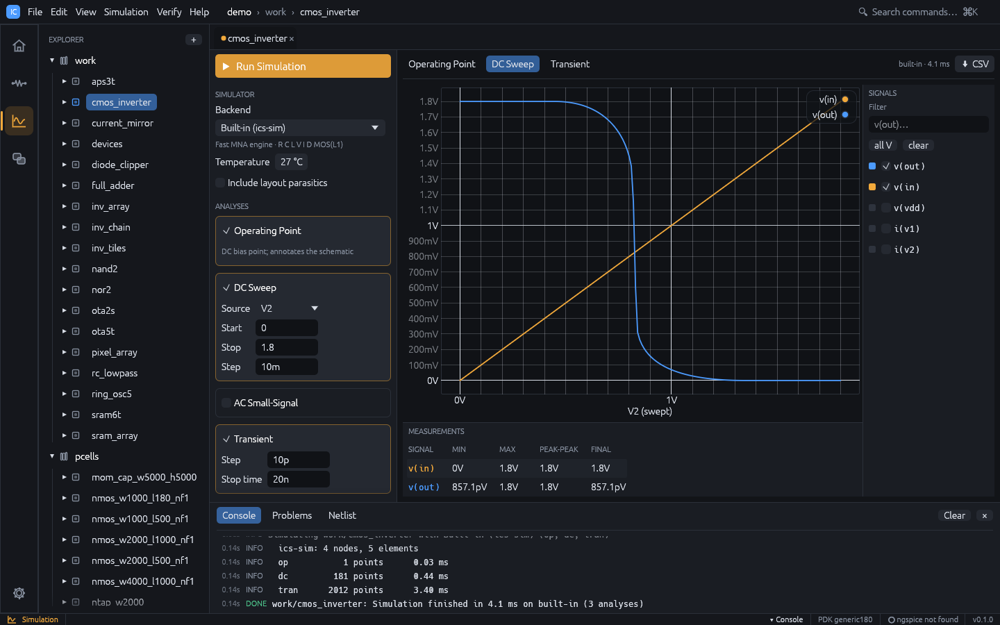
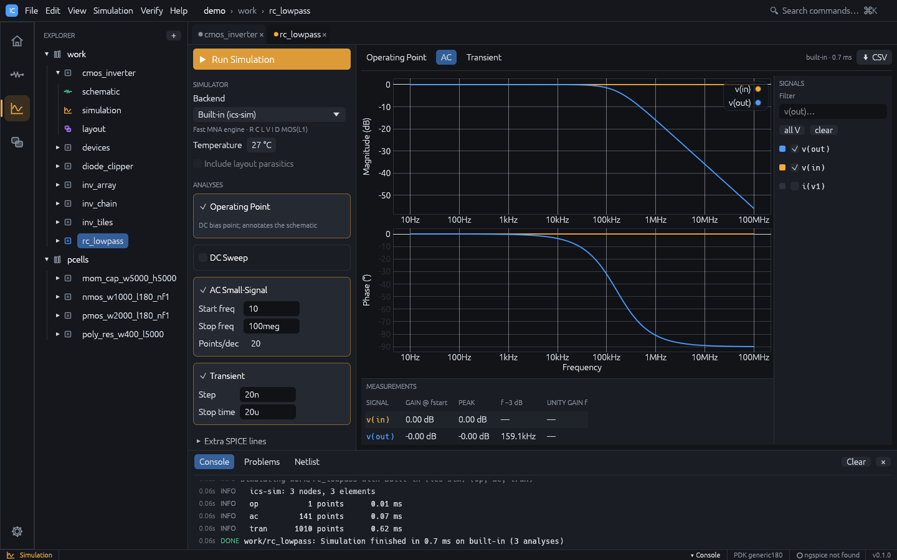

# Simulation

The Simulation workspace (`Ctrl+3`) sets up and runs analyses of the active cell's
schematic and shows the results.

## Running a simulation

1. Open a cell with a schematic and switch to the Simulation workspace.
2. In **Analyses**, tick the analyses to run and fill in their fields.
3. Press **Run Simulation**, `F5` or `Ctrl+Enter` (also **Simulation > Run** or
   **Simulate** in the schematic toolbar).

Simulation runs in the background. Starting it from another workspace switches to the
Simulation workspace. Errors appear in a red **Simulation error** box and in the console.

## Setup panel

### Simulator

| Field | Meaning |
|---|---|
| **Backend** | **Built-in (ics-sim)** (default) or **ngspice** |
| **Temperature** | -55 to 200 °C, default 27 (written as `.temp`) |
| **Include layout parasitics** | Add parasitics extracted from the cell's layout (see below); disabled when the cell has no layout |

The line under the backend shows whether ngspice was found. Set its path in
**Settings** (see [Installation](install.md#ngspice-optional)).

### Analyses

| Analysis | Fields (defaults) | Notes |
|---|---|---|
| **Operating Point** | none (on by default) | Annotates the schematic |
| **DC Sweep** | **Source**, **Start** `0`, **Stop** `1.8`, **Step** `10m` | Source is any V or I source in the schematic |
| **AC Small-Signal** | **Start freq** `1`, **Stop freq** `10g`, **Points/dec** `20` | Decade sweep; give a source an **AC magnitude** |
| **Transient** | **Step** `10p`, **Stop time** `20n` | Give a source a **Transient** waveform |

Fields with an invalid value turn red; validation messages appear under the card.

### Extra SPICE lines

Lines in this collapsible section are appended verbatim to the deck before the analyses,
for example `.options reltol=1e-4`. **Show netlist** displays the generated deck next to the
results.

The setup (backend, analyses, temperature, parasitics flag and extra lines) is saved per
cell in `sim.json`.

## Results

Each analysis has its own tab: **Operating Point**, **DC Sweep**, **AC**, **Transient**.
The tab bar shows the backend and run time, and **CSV** exports the current dataset (AC
values as `name_re` / `name_im` columns).

### Waveforms

- **Signals** (left): tick signals to plot. **Filter** narrows the list, **all V** selects
  every node voltage, **clear** clears the selection. By default `v(out)`, `v(in)`,
  `v(vout)` and `v(vin)` are shown when present, otherwise the first three voltages. The
  selection is kept per analysis between runs.
- **Plot**: DC and transient results share one plot. AC results are a Bode pair:
  **Magnitude (dB)** over **Phase (°)** on a logarithmic frequency axis, with linked zoom
  and cursor. Hover a trace to read values. Scroll to zoom, drag to pan, double-click to
  reset.
- **Measurements** (bottom), one row per plotted signal:
  - DC and transient: MIN, MAX, PEAK-PEAK, FINAL.
  - AC: GAIN @ fstart, PEAK, f -3 dB, UNITY GAIN f.

### Operating point

The **Operating Point** tab lists node voltages and branch currents, and per device:

- MOS: region (saturation, triode), `id`, `vgs`, `vds`, `vth`, `gm`, `gds`
- diode: `vd`, `id`, `gd`
- resistor: `v`, `i`, `p`

Device details come from the built-in engine only. The node voltages are also drawn on
the schematic (see [Schematic](schematic.md#operating-point-annotation)).

## Example: transient of the RC low-pass

1. Run `ic-studio --demo --cell rc_lowpass --workspace simulation`.
2. The cell has Operating Point, AC and Transient set up. Press `F5`.
3. Open the **AC** tab: the **f -3 dB** column shows about 159 kHz for `v(out)`.
4. Open the **Transient** tab to see the input pulse and the filtered output.
5. To change the input, go to the schematic (`Ctrl+2`), select the source, edit
   **Transient**, and press `F5` again.

## Post-layout simulation

When **Include layout parasitics** is ticked and the cell has a layout, IC Studio
extracts the layout, matches its nets to the schematic through LVS and adds to the deck:

- wire capacitance to substrate (`Cpar_*`),
- lateral and overlap coupling capacitance between nets (`Cc_*`),
- MOS drain / source junction sizes (`ad as pd ps`) from the drawn diffusion,
- an RC network of wire, via and gate resistance (`Rpar_*`), with each MOS terminal moved
  to the nearest node of its net.

Coupling to a layout net with no schematic counterpart is lumped to ground. The console
shows a one-line summary. For a useful result, the layout should be LVS clean (see
[Verification](verification.md)). From the command line: `ics sim <project> <cell> --parasitics`.

## Backends

### Built-in engine

A modified nodal analysis engine written in Rust. It supports:

- elements `R C L V I D M` (no subcircuits or behavioural sources),
- sources: `DC`, `AC mag [phase]`, `PULSE(v1 v2 td tr tf pw per)`,
  `SIN(vo va freq td theta)`, `PWL(t v ...)`,
- directives `.model`, `.op`, `.dc`, `.ac`, `.tran`, `.temp`, `.end`; other dot lines
  such as `.include`, `.options`, `.param` and `.subckt` are ignored,
- diode model (`is`, `n`, `cjo`) and MOS level 1 (`vto`, `kp`, `lambda`, `gamma`, `phi`,
  `tox`, `cgso`, `cgdo`, `cj`, `cjsw`) with instance parameters `w l m ad as pd ps`.

The default `nmos` / `pmos` models use `vto = ±0.7`, `kp = 2e-5`.

### ngspice

With the ngspice backend, IC Studio runs ngspice in batch mode and reads its raw output.
The deck is still checked by the built-in parser first, so it must only use the elements
listed above, and models must be defined in the deck (models only reachable through
`.include` are reported as unknown).
