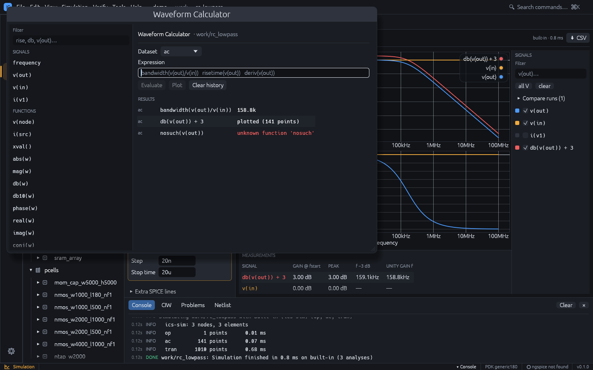
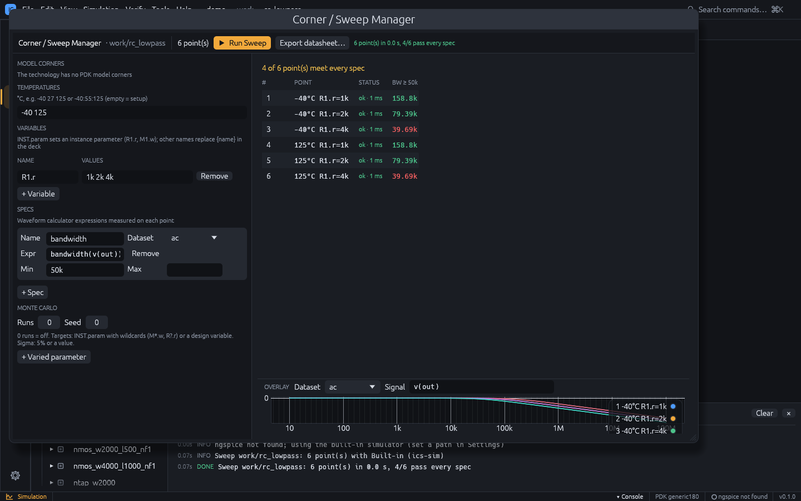
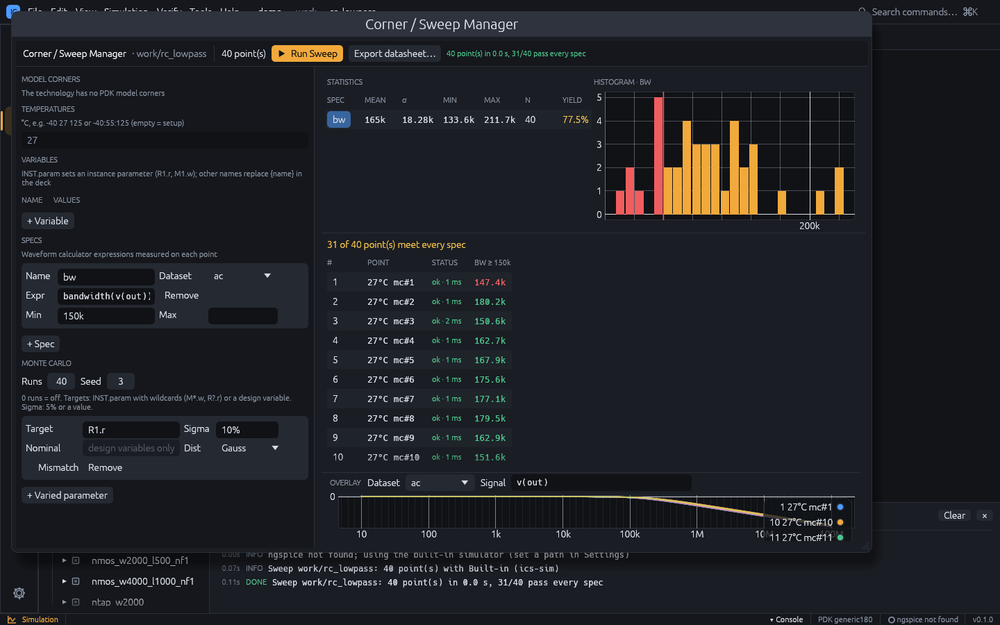
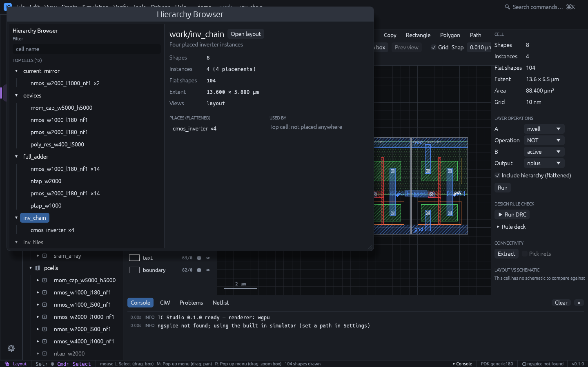
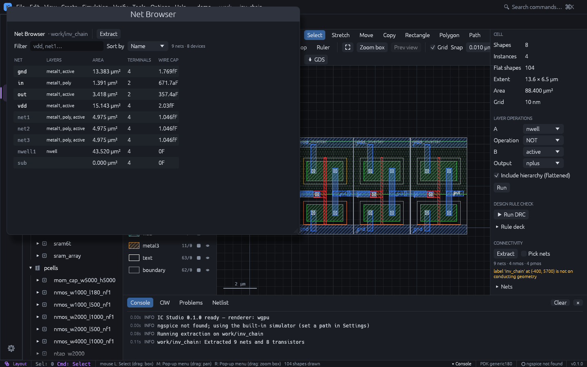
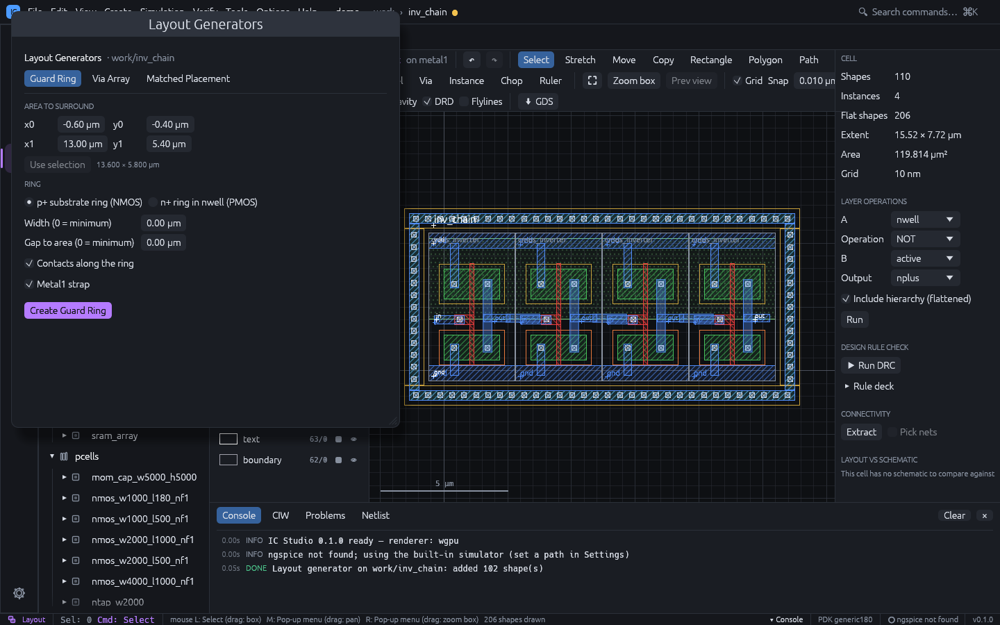
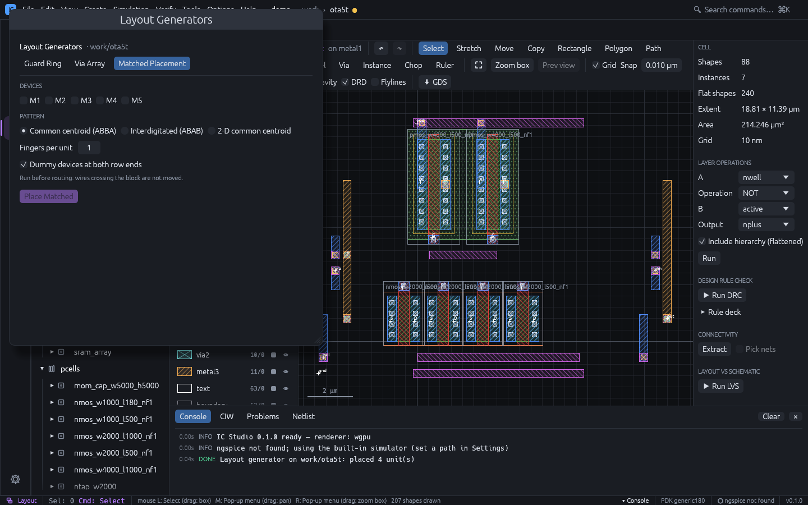
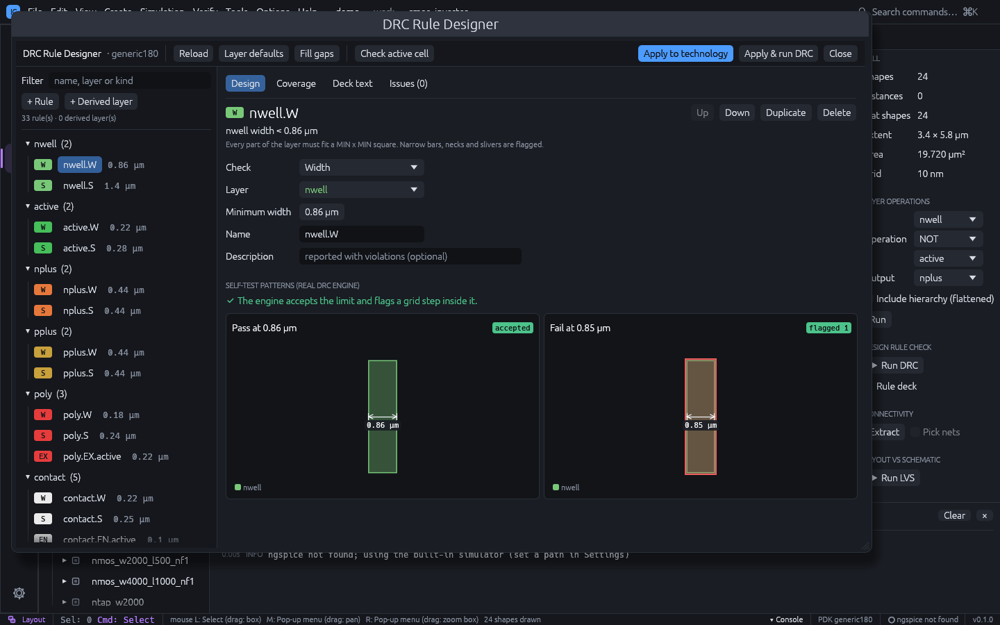
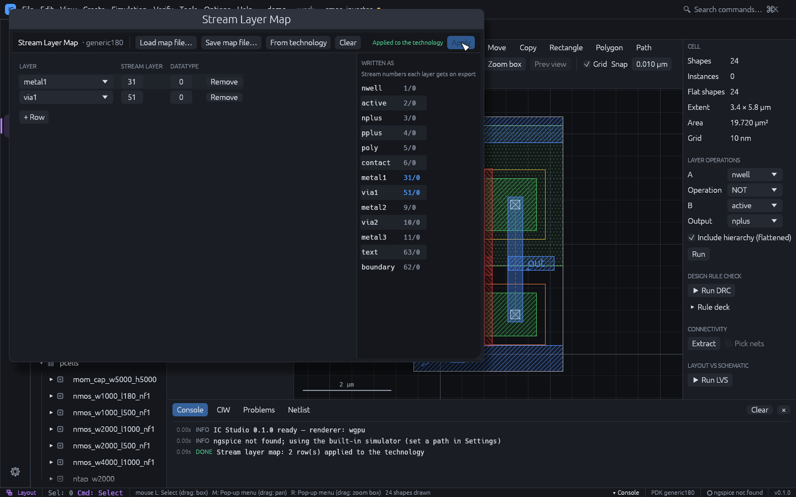
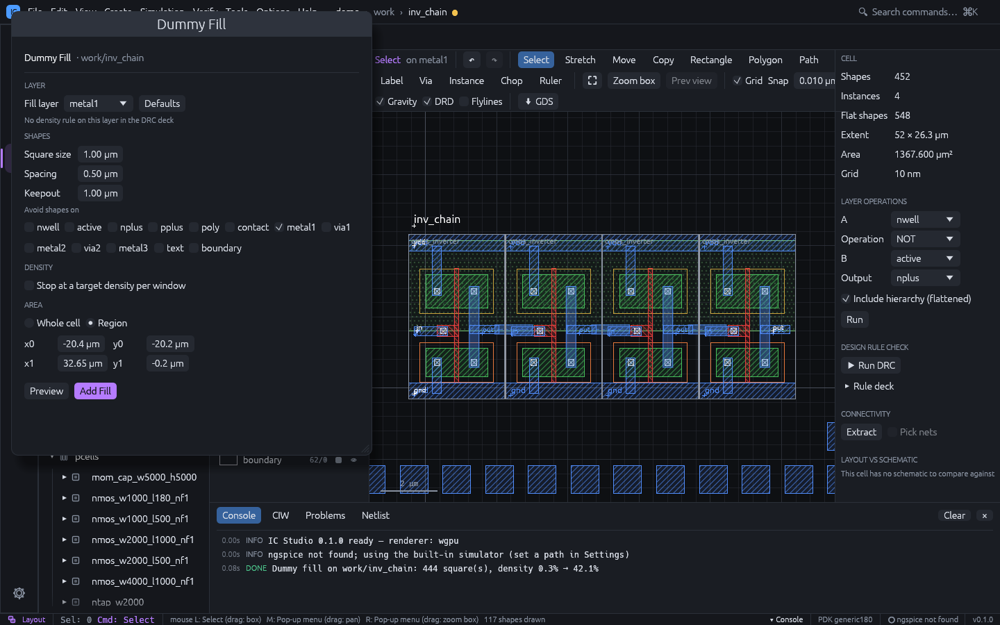

# Tools

The **Tools** menu collects the sub-tools, modelled on their Cadence Virtuoso
counterparts. Each opens in its own window and works on the project open in the main
window, usually on the active cell. Every tool is also in the command palette (`Ctrl+K`).

| Tool | Virtuoso counterpart | Works on |
|---|---|---|
| [Waveform Calculator](#waveform-calculator) | ViVA Calculator | Simulation results of the active cell |
| [Corner / Sweep Manager](#corner--sweep-manager) | ADE Explorer / Assembler | Active cell's schematic |
| [Results Browser](#results-browser) | Results Browser | Earlier simulation runs of the active cell |
| [Check Schematic](#check-schematic) | Check and Save | Active schematic |
| [Hierarchy Browser](#hierarchy-browser) | Design Hierarchy | Every layout of the project |
| [Net Browser](#net-browser) | Annotation / net browser | Extraction of the active layout |
| [Layout Generators](#layout-generators) | Create Guard Ring, Create Via Array, Modgen | Active layout |
| [DRC Rule Designer](#drc-rule-designer) | Rule deck editing | The technology's DRC deck |
| [Stream Layer Map](#stream-layer-map) | XStream layer map | GDSII / OASIS import and export |
| [Dummy Fill](#dummy-fill) | Metal fill | Active layout |
| SKILL CIW, Load SKILL (.il) | CIW | The project (see [SKILL scripts](layout.md#skill-scripts)) |

## Waveform Calculator

**Tools > Waveform Calculator** (also **Simulation > Waveform Calculator**) evaluates
expressions on the active cell's simulation results.

1. Simulate the cell (`F5`), then open the calculator.
2. Pick the **Dataset** (`op`, `dc`, `ac`, `tran`).
3. Type an expression, or click a signal or a function on the left to insert it.
4. **Evaluate** (or Enter) shows the result in **Results**: a number for measurements, or
   the point count of a waveform. **Plot** adds a waveform to the Simulation plot as a new
   signal named after the expression.

Plotted expressions are evaluated again after every simulation run, so they stay on the
plot. Click an expression in **Results** to edit it again.

Expressions use `+ - * / ^`, parentheses and numbers with SPICE suffixes (`1n`, `10k`,
`2meg`). Signals are `v(node)`, `v(a,b)` (= `v(a) - v(b)`), `i(source)` or any vector name
of the dataset (`time`, `frequency`); quote names with special characters (`"v-sweep"`).
AC signals are complex, so `v(out)/v(in)` is the transfer function.

| Kind | Functions |
|---|---|
| Waveform | `abs` `mag` `db` `db10` `phase` `real` `imag` `conj` `sqrt` `exp` `ln` `log10` `sin` `cos` `deriv` `integ` `xval()` |
| Statistics | `min` `max` `xmin` `xmax` `pp` `avg` `rms` `value(w, x)` |
| Timing | `cross(w, level [, n [, edge]])` `delay(w1, l1, w2, l2 [, e1 [, e2]])` `risetime(w [, lo%, hi%])` `falltime(w [, hi%, lo%])` `overshoot(w)` `settling(w [, pct])` |
| Frequency | `bandwidth(w [, db])` `ugf(w)` `phasemargin(w)` `gainmargin(w)` |

`edge` is `rise`, `fall` or `either`; `n < 0` counts crossings from the end. In the
Simulation plot, a real-valued result on an AC dataset (such as `db(v(out))`) is drawn as
it is rather than converted to dB again.

Examples on the `rc_lowpass` demo: `bandwidth(v(out)/v(in))` is about 159 kHz;
`risetime(v(out))` on `tran` is the 10-90 % rise time of the filtered pulse.

## Corner / Sweep Manager

**Tools > Corner / Sweep Manager** runs the active cell's simulation setup over every
combination of:

- **Model corners**: the PDK model library's corners (none checked = the setup's corner);
- **Temperatures**: a list such as `-40 27 125` or a range `-40:55:125` (start:step:stop);
  empty = the setup's temperature;
- **Variables**: each with a value list. `INST.param` sets an instance parameter
  (`R1.r`, `M1.w`); any other name is a design variable that replaces `{name}` in the
  deck, for example a source's DC value `{vdd}`.

The toolbar shows the number of points (at most 2000). **Run Sweep** runs them in parallel
on every CPU core with the setup's backend, analyses and layout parasitics.

**Specs** measure each point: a name, the dataset, a [calculator](#waveform-calculator)
expression that gives a number (`bandwidth(v(out))`, `max(v(out))`) and optional **Min** /
**Max** limits. The results table lists every point with its spec values, green when they
meet the limits and red when not, and the toolbar counts the points that meet every spec.

**Overlay** draws one signal or expression of every point on one plot; select a row of the
table to highlight its trace. The setup is saved with the cell (`sim.json`).

### Monte Carlo

The **Monte Carlo** section repeats every point **Runs** times with random parameter
values (the same samples at every corner and temperature, reproducible with **Seed**).
Each **varied parameter** has:

- **Target**: `INST.param` with `*` / `?` wildcards in the instance name (`M*.w`, `R?.r`),
  or a design variable with its **Nominal** value;
- **Sigma**: a percentage of the nominal (`5%`) or an absolute value;
- **Dist**: Gauss (sigma is the standard deviation) or Uniform (sigma is the half range);
- **Mismatch**: draw every matching instance independently. Off, all of them share one draw
  per run (process variation).

With Monte Carlo results, **Statistics** lists mean, σ, min, max, count and yield of every
spec, and a histogram of the selected spec marks the bins outside its limits in red.

### Datasheet

**Export datasheet...** writes an HTML page of the last run: the spec summary (limits,
min / mean / max / σ and yield) and the table of every point with pass / fail colours.

## Results Browser

Every successful simulation keeps the previous results: the current run is **Run N**, and
up to 12 earlier runs are listed in **Tools > Results Browser** and in **Compare runs**
above the signal list of the Simulation workspace. Rename a run (for example
"pre-layout"), tick it to overlay it, or **Delete** it.

A ticked run is drawn dashed in the colour of each plotted signal, labelled
`<run>: <signal>`, and gets its own rows in **Measurements**. A typical use is to compare
the schematic with the post-layout simulation: run once, tick **Include layout
parasitics**, run again and tick the first run.

## Check Schematic

**Tools > Check Schematic** checks the active schematic; **File > Check and Save** does the
same and saves the project when there are no errors. The findings appear in the
**Problems** tab of the bottom panel (also kept up to date while you edit); click one to
select its devices in the schematic.

| Code | Severity | Finding |
|---|---|---|
| `no-ground` | Error | Devices but no ground |
| `duplicate-name`, `empty-name`, `bad-name` | Error | Instance names SPICE cannot use |
| `missing-param`, `invalid-value` | Error | A required value (R, C, L, W, L, model, source value) missing or not a number (`{param}` references are allowed) |
| `parallel-vsource`, `vsource-loop` | Error | Voltage sources in parallel or in a loop |
| `shorted-device` | Warning (Error for sources) | Both pins of a two-terminal device on one net |
| `unconnected-pin` | Warning (Info for a MOS bulk) | A pin touching nothing |
| `floating-net` | Warning | A net on a single pin with no label |
| `dangling-wire` | Warning | A wire end touching nothing |
| `label-conflict` | Warning | Two different labels on one net |
| `overlapping-instances` | Warning | Two devices of the same kind at the same place |
| `isolated-net` | Info | No DC path to ground |

## Hierarchy Browser

**Tools > Hierarchy Browser** shows every layout of the project as a tree from its top
cells (layouts no other layout places), with placement counts (arrays count every
element). **Filter** finds a cell by name.

For the selected cell it shows shapes, instances, flat shapes, extent and views, the cells
it places throughout its hierarchy with their total counts, and the cells that use it.
**Open layout** / **Open schematic** open it. The layout editor's **Hierarchy Tree**
form (**Edit > Hierarchy Tree**, `Shift+T`) lists only the cells under the current cell.

## Net Browser

**Tools > Net Browser** lists the nets of the active layout's extraction (it extracts the
nets when there is no extraction yet; **Extract** runs it again):

| Column | Meaning |
|---|---|
| NET | Label name (bold), or a generated name for unlabelled nets |
| LAYERS | Conducting layers the net uses |
| AREA | Conductor area in µm² |
| TERMINALS | Transistor terminals (drain, gate, source, bulk) on the net |
| WIRE CAP | Capacitance to substrate from the technology's coefficients |

Sort by name, capacitance, area or terminals. Click a net to highlight it in the layout and
zoom to it. A note warns when the layout changed after the extraction.

## Layout Generators

**Tools > Layout Generators** has three tabs. Each adds to the active layout as one step
that `u` / `Ctrl+Z` undoes.

### Guard Ring

Surrounds an area with a diffusion ring: a **p+ substrate ring** (for NMOS) or an **n+
ring in nwell** (for PMOS, with an nwell covering the ring and the area). The ring has its
implant, optional **Contacts** along every side and an optional **Metal1 strap**. **Width**
and **Gap to area** of 0 use the minimum from the layer and contact rules. Set the area in
µm, or press **Use selection** to take the bounding box of the selected shapes and
instances. With contacts and the strap, the ring is DRC clean on its own.

### Via Array

Pick a via, then either:

- **Every overlap of the via's layers**: a via array in each overlap of its bottom and top
  layers (through the hierarchy), optionally only within the area; or
- **Fill the area**: as many cuts as fit, centred, with enclosing pads on both layers.

Cut size, spacing and enclosure come from the via definition.

### Matched Placement

Re-places matched MOS devices of the layout (for example a differential pair or a current
mirror) as unit devices in a pattern:

| Pattern | Example |
|---|---|
| Common centroid | `A B B A`, one row, mirror-symmetric |
| Interdigitated | `A B A B` |
| 2-D common centroid | `A B / B A`, **Rows** rows, point-symmetric |

Tick the devices, set **Fingers per unit** and whether to add **dummy devices** at both
row ends. The devices must have the same type, L and finger width, and every device's
fingers must be a multiple of the unit. Each device keeps its total W; its units are named
`<device>.<k>`, so flylines, routing and LVS still map them to the schematic device (LVS
merges the parallel units). Dummies have gate, source and drain tied to the bulk net and
are dropped by LVS. Neighbouring devices are moved aside to make room.

Run it before routing: wires crossing the block are not moved. Common centroid allows at
most one device with an odd number of units; with single-finger devices use
interdigitated, or more fingers per device.

## DRC Rule Designer

**Tools > DRC Rule Designer** (also **Rule Designer...** in the **Rule deck** section of
the layout inspector) edits the technology's [DRC deck](technology.md#drc-rule-deck) as
forms instead of text.

- **Rule list** (left): rules grouped by layer with their values; **+ Rule** and **+
  Derived layer** add one, **Filter** finds one.
- **Design**: the selected rule's check, layers, value, name and description. Every rule
  is **self-tested** on generated pass and fail patterns with the real DRC engine, drawn
  side by side, so you see that the engine accepts the limit and flags a violation one grid
  step inside it.
- **Coverage**: a matrix of which checks each layer has.
- **Deck text**: the generated deck.
- **Issues**: lint findings, such as duplicate rule names, rules that can never fire,
  values off the manufacturing grid, unused derived layers and routing layers without a
  width or space rule.

The toolbar has **Reload** (the technology's deck), **Layer defaults** (the deck derived
from the layer and via rules), **Fill gaps** (adds missing width / space rules of routing
layers and via enclosures with technology values), **Check active cell** (runs the draft
deck and counts violations per rule), **Apply to technology** and **Apply & run DRC**.

## Stream Layer Map

**Tools > Stream Layer Map** sets which GDSII / OASIS layer and datatype each technology
layer is written as and read from, like a Virtuoso XStream layer map. Each row maps a
stream layer / datatype to a technology layer:

- on export, a layer is written with the numbers of its first row (layers without a row
  keep their own numbers; **Written as** previews the result);
- on import, shapes on the row's numbers go to that layer, so several stream numbers can
  map to one layer; **(drop on import)** discards them.

**Load map file...** reads a Virtuoso layer map (`layerName purpose streamLayer
streamDatatype` per line, `#` comments); a purpose other than `drawing` names the layer
`name.purpose`, `namepurpose` or `name_purpose`. **Save map file...** writes one, **From
technology** starts with one row per layer, **Clear** removes the map. Problems (unknown
layers, a number pair mapped twice, two layers written as the same numbers) are listed
above the table. **Apply** stores the map in `tech.json` (`stream_map`).

The map applies to **File > Import / Export**, `ics gds`, `ics import-gds` and the MCP
`import_gds` / `export_gds` tools. The project's own library files are not affected.

## Dummy Fill

**Tools > Dummy Fill** adds grid-aligned fill squares to a layer, to meet a
[density rule](technology.md#rules).

1. Pick the **Fill layer**. The defaults come from its rules: squares of four times the min
   width (at least 1 µm), spacing twice the min spacing, keepout of at least 1 µm, and the
   window, step and a target just above the minimum of the deck's density rule on the
   layer, if there is one.
2. Set **Square size**, **Spacing**, **Keepout** and the layers to **Avoid** (fill keeps
   the keepout from their shapes, through the hierarchy).
3. Optionally tick **Stop at a target density per window**: each window is filled only up
   to the target, and never above the rule's maximum.
4. Fill the **Whole cell** (its bounding box) or a **Region** in µm.
5. **Preview** shows the square count, the density before and after, and whether every
   window passes the rule; **Add Fill** adds the squares (undoable).

A compact cell may have no room for fill inside its bounding box; fill a larger region
around it instead.
