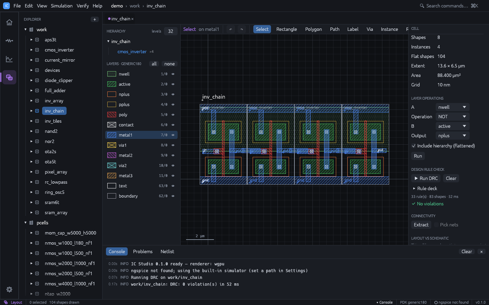
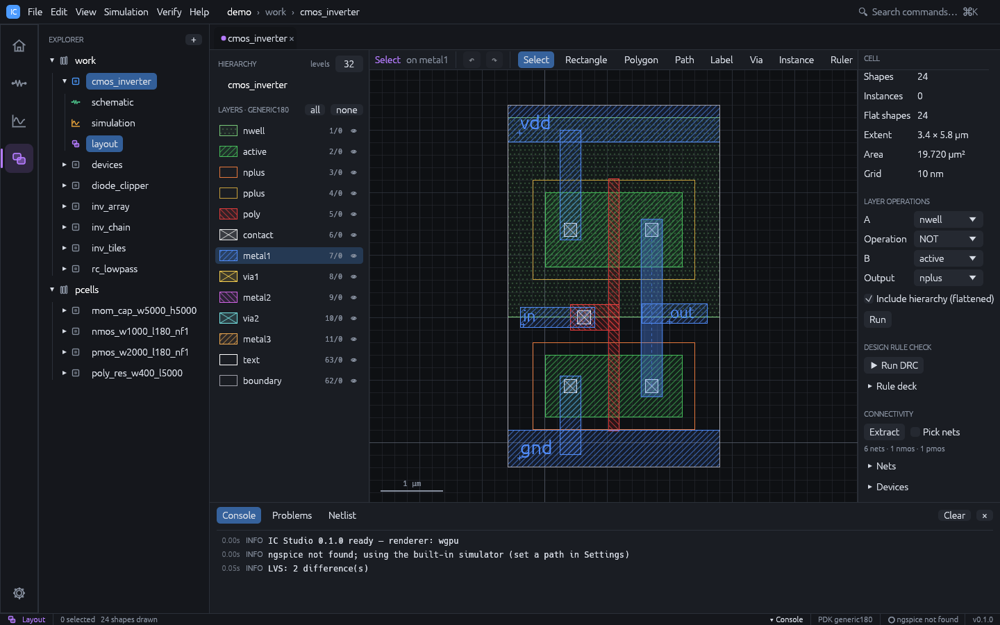

# Verification: DRC, extraction and LVS

The verification tools are in the **Verify** menu and in the right panel of the Layout
workspace. They run in the background on the flattened layout of the active cell; while
one runs, the panel shows its progress and a **Cancel** button. After you edit the layout,
the panel notes that results are out of date.

## Design rule check (DRC)



1. Open the cell's layout.
2. Press **Run DRC** in the **Design Rule Check** section (or **Verify > Run DRC**).
3. The result is either **No violations** or a list grouped by rule, with a count per
   rule. Markers are drawn on the canvas.
4. Expand a rule to see its description and the violation locations; click one to zoom to
   it.
5. **Clear** removes the results and markers.

The rules come from the technology's deck. Expand **Rule deck** to view and edit it in
place: **Run DRC** uses the edited text right away, **Save to technology** stores it in
the project's `tech.json`, and **Reset** replaces it with the deck derived from the
technology's layer and via rules. Syntax errors are listed by line. See
[Technology](technology.md#drc-rule-deck) for the deck syntax.

DRC checks Manhattan geometry; other shapes are skipped and counted. Distances between
corners are Euclidean.

## Connectivity extraction

1. Press **Extract** in the **Connectivity** section (or **Verify > Extract Nets**).
2. The summary shows the number of nets and NMOS / PMOS transistors.
3. Click a net in **Nets** to highlight it. Check **Pick nets** and click a shape on the
   canvas to highlight the net it belongs to.
4. **Devices** lists each transistor with W, L and its terminal nets; click one to zoom to
   its gate.

How the extractor works:

- Conducting layers are the layers joined by vias. Diffusion is `active` minus `poly`.
- A transistor is `poly` over `active`. It is PMOS when it is inside `pplus` (or inside
  `nwell` when there is no implant). L is measured across the gate; W is area / L.
- Net names come from labels in the top cell on conducting layers. Unnamed nets are called
  `netN`.
- Warnings report labels not on conducting geometry, two labels shorted together, and a
  label on several unconnected pieces.

## Layout versus schematic (LVS)



1. The cell needs both a schematic and a layout. Device names do not have to match, but
   labels on the layout's pins (`in`, `out`, `vdd`, ...) help: equal net names anchor
   the comparison.
2. Press **Run LVS** (or **Verify > Run LVS**).
3. The result is **Layout matches schematic** or a list of differences, each tagged:
   - `[missing]`: a schematic device not found in the layout,
   - `[extra]`: a layout device not in the schematic,
   - `[param]`: W or L differ by more than 1 %,
   - `[net]`: a net whose connections differ.

   Click a difference with a location to zoom to it.

Comparison rules:

- Only MOS transistors are compared. Voltage and current sources are ignored; other
  schematic devices (R, C, diodes) are reported as not extracted.
- Parallel devices with the same terminals and L are merged and their widths summed, so
  multi-finger layouts match single schematic devices; the schematic `m` multiplies W.
- Bulk terminals are ignored.
- Devices that are always off (gate tied to bulk), such as dummy fingers, are dropped.
- Net names are compared case-insensitively; `0`, `gnd` and `vss` are treated as the same.

The demo cell `cmos_inverter` deliberately has LVS findings (a PMOS width and the load
capacitor); `nand2`, `nor2`, `ring_osc5`, `current_mirror` and `ota5t` are clean.

## Sign-off with external tools

The built-in checks are fast and good for iterating. For sign-off, a technology can list
**runsets** that run a foundry or PDK deck in an external tool:

| Tool | Checks | Deck |
|---|---|---|
| KLayout | DRC, LVS | KLayout `.drc` / `.lvs` script |
| Siemens Calibre | DRC, LVS | SVRF rule file |
| netgen | LVS | netgen setup file (compares IC Studio's extraction with the schematic) |

In the Layout workspace, the **Sign-off** section appears when the technology has
runsets. Pick a runset and press **Run** (or **Verify > Run Sign-off Runset**). IC Studio
writes the cell and every cell it places to `<cell>.gds` in a new temporary folder, plus
the schematic as a `.subckt` for LVS, runs the tool there and reads its report:

- DRC violations appear as markers on the canvas, like the built-in DRC. Violations the
  tool reports inside sub-cells keep sub-cell coordinates and name the cell.
- LVS shows whether the layout matches and the tool's messages.
- The folder (shown under the result) keeps the inputs, reports and the tool's log.

How each tool is called:

- KLayout: `klayout -b -r DECK -rd input=CELL.gds -rd topcell=CELL -rd report=FILE`, plus
  `-rd schematic=CELL_sch.cir` for LVS and the runset's `vars`. The variable names can be
  changed with `klayout = { input = "...", topcell = "...", report = "...", schematic = "..." }`.
- Calibre: a control file sets `LAYOUT PATH`, `LAYOUT PRIMARY`, `LAYOUT SYSTEM`, the ASCII
  results database (DRC) or `SOURCE PATH` / `LVS REPORT` (LVS), adds `#DEFINE` for each var
  and `INCLUDE`s the deck. The deck itself must not set these statements. Then
  `calibre -drc -hier` or `calibre -lvs -hier -spice`.
- netgen: `netgen -batch lvs "CELL_lay.cir CELL" "CELL_sch.cir CELL" SETUP REPORT`.

The schematic netlist leaves out the element letters in the runset's `skip` (default
`V` and `I`) and names the ground net `ground` (default `gnd`). Executables are found on
the usual install paths and `PATH`; set `ICS_KLAYOUT`, `ICS_CALIBRE` or `ICS_NETGEN` to
override them.

Runsets come from a [PDK file](technology.md#pdk-files) (`[[signoff]]`) or the `signoff`
array in `tech.json`:

```json
"signoff": [
  {"name": "KLayout DRC", "tool": "klayout", "check": "drc", "deck": "/pdk/rules.drc",
   "vars": {"feol": "true"}},
  {"name": "Calibre LVS", "tool": "calibre", "check": "lvs", "deck": "/pdk/calibre.lvs",
   "skip": ["V", "I", "C"]}
]
```

## From the command line

```sh
ics drc myproj nand2 [--deck rules.drc]   # exit code 1 on violations
ics extract myproj nand2                  # extracted SPICE netlist
ics lvs myproj nand2                      # exit code 1 on differences
ics signoff myproj nand2                  # list the sign-off runsets
ics signoff myproj nand2 "KLayout DRC"    # run one; exit code 1 on violations / mismatch
```

These exit codes make the checks usable in CI. See [Command line](cli.md).
