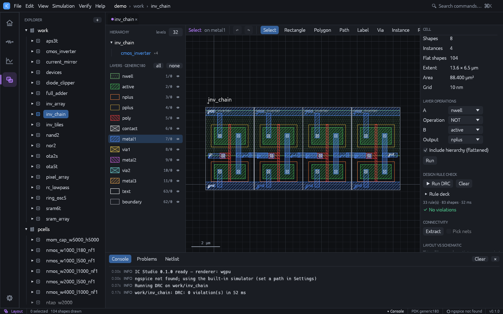
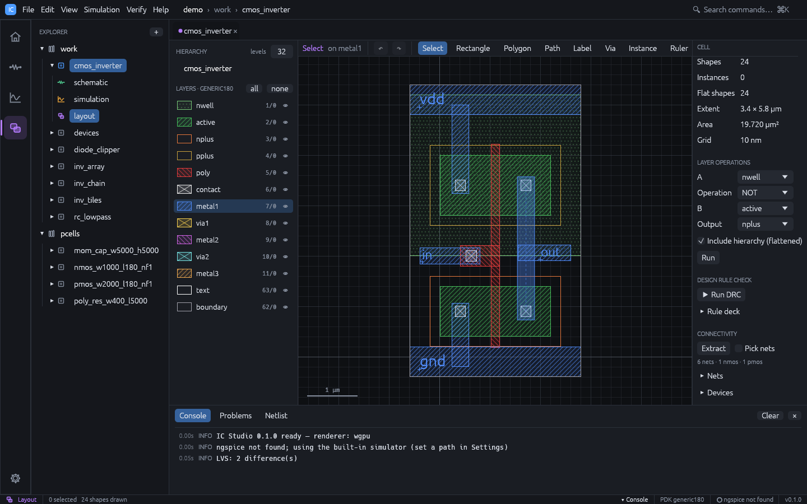

# Verification: DRC, extraction and LVS

The verification tools are in the **Verify** menu and in the right panel of the Layout
workspace. They run in the background on the flattened layout of the active cell; while
one runs, the panel shows its progress and a **Cancel** button. After you edit the layout,
the panel notes that results are out of date.

## Design rule check (DRC)





1. Open the cell's layout.
2. Press **Run DRC** in the **Design Rule Check** section (or **Verify > Run DRC**).
3. The result is either **No violations** or a list grouped by rule, with a count per
   rule. Markers are drawn on the canvas.
4. Expand a rule to see its description and the violation locations; click one to zoom to
   it.
5. **Clear** removes the results and markers.

The rules come from the technology's deck. Expand **Rule deck** to view and edit it in
place: **Run DRC** uses the edited text right away, **Save to technology** stores it in
the project's `tech.json`, and **Reset** replaces it with the deck derived from the
technology's layer and via rules. Syntax errors are listed by line. See
[Technology](technology.md#drc-rule-deck) for the deck syntax. **Rule Designer...** (also
**Tools > DRC Rule Designer**) edits the deck as forms and self-tests every rule on
generated patterns; see [DRC Rule Designer](tools.md#drc-rule-designer).

A layer that fails a `density` rule can be filled with **Tools > Dummy Fill** (see
[Dummy Fill](tools.md#dummy-fill)).

Distances between corners are Euclidean. Any-angle (for example 45°) shapes are checked
exactly by `width`, `space`, `separation`, `enclosure` and `extension`: distances are
measured edge to edge on the true polygons, distances within 3/4 dbu of the limit pass
(vertices off 45° lines are rounded to the grid) and acute corners are flagged. The other
rules (`area`, `density`, `antenna` and derived selections) see any-angle shapes as a
staircase of 10 dbu bands.

### Live DRC

The **Live DRC** checkbox in the layout toolbar re-checks the deck around every edit in the
background and draws the violations as dashed boxes as they appear; hover one to see its
rule. **Quick Fix** (`Ctrl+.`) on a violation offers candidate edits of top-level shapes
(reshape, move or add), each checked with DRC first and marked **clean** or with the number
of new violations it causes; it turns live DRC on when it is off. **Fix All Violations**
(command palette) applies fixes until none helps any more, as one undoable step. Geometry
inside placed cells is not changed.

Live DRC is incremental and hierarchical, so it stays fast on large layouts:

- It keeps the result of the last check and, after an edit, re-checks only the area within
  the deck's reach of the changed region.
- Each placed cell is checked once and its result reused for every placement. In a parent
  cell, only the interaction zones are checked again on the flattened geometry: where
  placements overlap or come near each other or the parent's own shapes. Rules on whole
  pieces (`area`, `separation`, `enclosure`) widen the zone until every piece in it is
  complete, so the violations equal those of a flat check.
- Global rules (`antenna`, `density`) are left to **Run DRC**, which checks the whole
  flattened cell.

## Connectivity extraction



1. Press **Extract** in the **Connectivity** section (or **Verify > Extract Nets**).
2. The summary shows the number of nets and NMOS / PMOS transistors.
3. Click a net in **Nets** to highlight it. Check **Pick nets** and click a shape on the
   canvas to highlight the net it belongs to.
4. **Devices** lists each transistor with W, L and its terminal nets; click one to zoom to
   its gate.

**Tools > Net Browser** lists the extracted nets in a sortable table with their layers,
area, transistor terminals and wire capacitance; click one to highlight it and zoom to it
(see [Net Browser](tools.md#net-browser)).

How the extractor works:

- Conducting layers are the layers joined by vias. Diffusion is `active` minus `poly`.
- A transistor is `poly` over `active`. It is PMOS when it is inside `pplus` (or inside
  `nwell` when there is no implant). L is measured across the gate; W is area / L. Bent,
  ring and 45° gates take W from the mean of the source and drain edge lengths, with the
  PDK's `bend_corner` correction (see
  [Device shapes](pcells.md#device-shapes-extraction-understands)).
- Any-angle shapes are approximated by a fine staircase for connectivity; gate W / L use
  the exact geometry.
- **Resistors** are the technology's `[[resistor]]` bodies: a conducting layer under its
  marker layers, between two terminal pieces. R = sheet resistance × squares (L / W, bent
  bodies measured like bent gates).
- **Capacitors** are the `[[capacitor]]` overlaps of a bottom and a top plate under the
  marker layers. C = area × area capacitance (+ perimeter × perimeter capacitance). See
  [Technology](technology.md#pdk-files) and the `poly_res` / `mom_cap`
  [PCells](pcells.md).
- Net names come from labels in the top cell on conducting layers. Unnamed nets are called
  `netN`.
- Warnings report labels not on conducting geometry, two labels shorted together, and a
  label on several unconnected pieces.

## Layout versus schematic (LVS)





1. The cell needs both a schematic and a layout. Device names do not have to match, but
   labels on the layout's pins (`in`, `out`, `vdd`, ...) help: equal net names anchor
   the comparison.
2. Press **Run LVS** (or **Verify > Run LVS**).
3. The result is **Layout matches schematic** or a list of differences, each tagged:
   - `[missing]`: a schematic device not found in the layout,
   - `[extra]`: a layout device not in the schematic,
   - `[param]`: W or L, a resistance or capacitance, or the device model differ (sizes
     and values by more than 1 %),
   - `[net]`: a net whose connections differ.

   Click a difference with a location to zoom to it.

Comparison rules:

- MOS transistors, resistors and capacitors are compared. Voltage and current sources are
  ignored; other schematic devices (diodes, inductors) are reported as not extracted.
- Parallel devices with the same terminals (and L for MOS) are merged: MOS widths and
  capacitances add, resistances combine as conductances. Multi-finger layouts match
  single schematic devices; the schematic `m` multiplies W.
- Resistors of one model in series through an unnamed net that nothing else touches merge
  into one, so a resistor drawn as several segments matches one schematic resistor. A
  labelled net between them stops the merge. Merged devices are reported with their names
  joined by `+`.
- A resistor's or capacitor's model is compared only when the schematic names one.
- Bulk terminals are ignored.
- Devices that are always off (gate tied to bulk), such as dummy fingers, are dropped.
- Net names are compared case-insensitively; `0`, `gnd` and `vss` are treated as the same.

The demo cell `cmos_inverter` deliberately has LVS findings (a PMOS width and the load
capacitor); `nand2`, `nor2`, `ring_osc5`, `current_mirror`, `ota5t`, `sram6t`, `aps3t`, `full_adder` and `ota2s` are clean.

## IR drop and electromigration



The **IR Drop / EM** section of the right panel (also **IR drop / EM analysis** in the
command palette) analyses one net, typically a supply such as `vdd` or `gnd`:

1. Type the **Net** name. The net needs labels in the top cell: they are its pads, held at
   the pad voltage.
2. Set **mA / device**: the current every device on the net draws. With `0`, the
   schematic's operating point is simulated and each MOS draws its own drain current.
3. Press **Run IR / EM**.

The net's wires on layers with a sheet resistance are cut into tiles, joined by the
resistance between them and by the resistance of each via cut. Every MOS with its source or
drain on the net draws its current from the tile nearest to its gate, and the network is
solved for the voltage drop from the pads. A current returned into a ground net gives the
same rise as a drawn current gives drop.

- The summary lists nodes, resistors, pads, loads and their total current, and the worst
  drop and where it is. Tiles not connected to any pad are reported.
- The canvas shows a heatmap of the drop, from blue (0 V) to red (the worst drop).
- **EM** checks the current per µm of wire width against the layer's limit and the current
  per via cut against the via's limit. Violations are listed (click one to zoom to it) and
  outlined in red on the canvas.

The limits come from the technology: `em` (A per µm of width) and `resistance` (Ω per
square) in the parasitic coefficients of a layer (`[[cap]]` in a PDK file), and `em`
(A per cut) and `resistance` (Ω per cut) of a `[[via]]`. A limit of 0 is not checked. The
generic technology has illustrative values. From the command line:
`ics emir <project> <cell> --net vdd [--currents FILE] [--json]` (exit code 1 on EM
violations), and over MCP the `emir` tool.

## Sign-off with external tools

The built-in checks are fast and good for iterating. For sign-off, a technology can list
**runsets** that run a foundry or PDK deck in an external tool:

| Tool | Checks | Deck |
|---|---|---|
| KLayout | DRC, LVS | KLayout `.drc` / `.lvs` script |
| Siemens Calibre | DRC, LVS | SVRF rule file |
| netgen | LVS | netgen setup file (compares IC Studio's extraction with the schematic) |
| built-in | DRC | IC Studio or SVRF deck file, run on the built-in engine |

In the Layout workspace, the **Sign-off** section appears when the technology has
runsets. Pick a **Runset** and press **Run <tool>** (or **Verify > Run Sign-off Runset**). IC Studio
writes the cell and every cell it places to `<cell>.gds` in a new temporary folder, plus
the schematic as a `.subckt` for LVS, runs the tool there and reads its report:

- DRC violations appear as markers on the canvas, like the built-in DRC. Violations the
  tool reports inside sub-cells keep sub-cell coordinates and name the cell.
- LVS shows whether the layout matches and the tool's messages.
- The folder (shown under the result) keeps the inputs, reports and the tool's log.

How each tool is called:

- KLayout: `klayout -b -r DECK -rd input=CELL.gds -rd topcell=CELL -rd report=FILE`, plus
  `-rd schematic=CELL_sch.cir` for LVS and the runset's `vars`. The variable names can be
  changed with `klayout = { input = "...", topcell = "...", report = "...", schematic = "..." }`.
- Calibre: a control file sets `LAYOUT PATH`, `LAYOUT PRIMARY`, `LAYOUT SYSTEM`, the ASCII
  results database (DRC) or `SOURCE PATH` / `LVS REPORT` (LVS), adds `#DEFINE` for each var
  and `INCLUDE`s the deck. The deck itself must not set these statements. Then
  `calibre -drc -hier` or `calibre -lvs -hier -spice`.
- netgen: `netgen -batch lvs "CELL_lay.cir CELL" "CELL_sch.cir CELL" SETUP REPORT`.

The schematic netlist leaves out the element letters in the runset's `skip` (default
`V` and `I`) and names the ground net `ground` (default `gnd`). Executables are found on
the usual install paths and `PATH`; set `ICS_KLAYOUT`, `ICS_CALIBRE` or `ICS_NETGEN` to
override them.

Runsets come from a [PDK file](technology.md#pdk-files) (`[[signoff]]`) or the `signoff`
array in `tech.json`:

```json
"signoff": [
  {"name": "KLayout DRC", "tool": "klayout", "check": "drc", "deck": "/pdk/rules.drc",
   "vars": {"feol": "true"}},
  {"name": "Calibre LVS", "tool": "calibre", "check": "lvs", "deck": "/pdk/calibre.lvs",
   "skip": ["V", "I", "C"]}
]
```

## From the command line

```sh
ics drc myproj nand2 [--deck rules.drc]   # exit code 1 on violations
ics extract myproj nand2                  # extracted SPICE netlist
ics lvs myproj nand2                      # exit code 1 on differences
ics emir myproj nand2 --net vdd           # exit code 1 on EM violations
ics signoff myproj nand2                  # list the sign-off runsets
ics signoff myproj nand2 "KLayout DRC"    # run one; exit code 1 on violations / mismatch
```

These exit codes make the checks usable in CI. See [Command line](cli.md).
